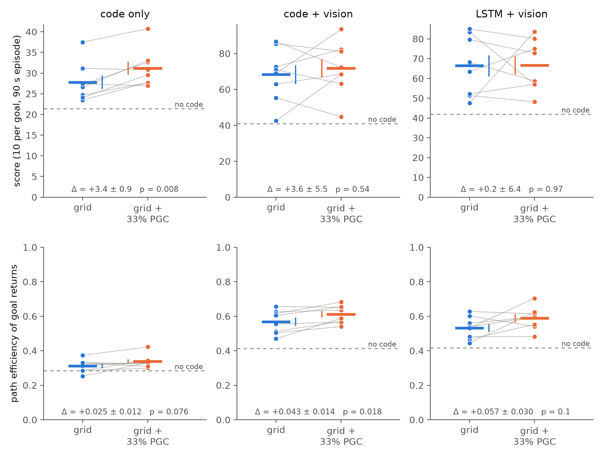
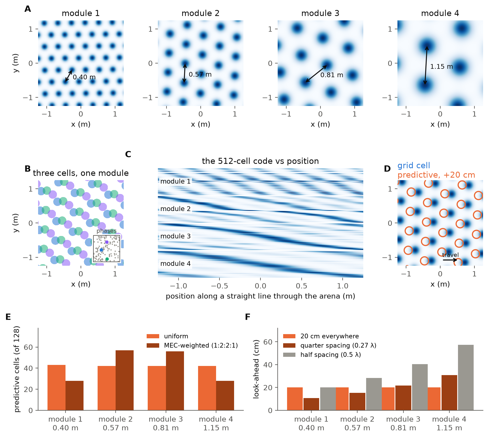
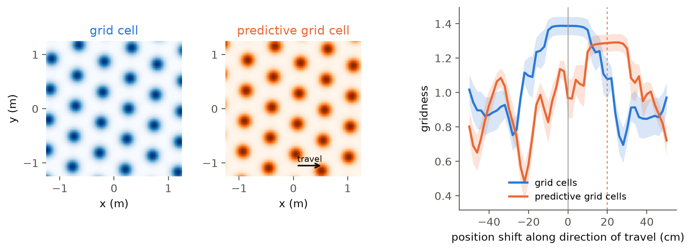
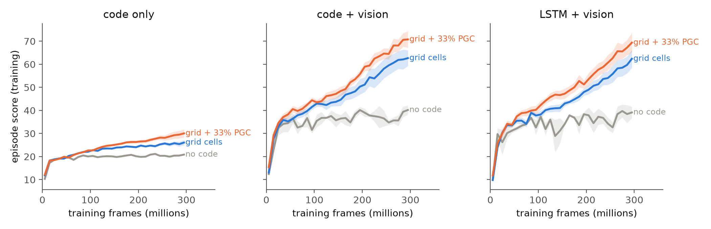
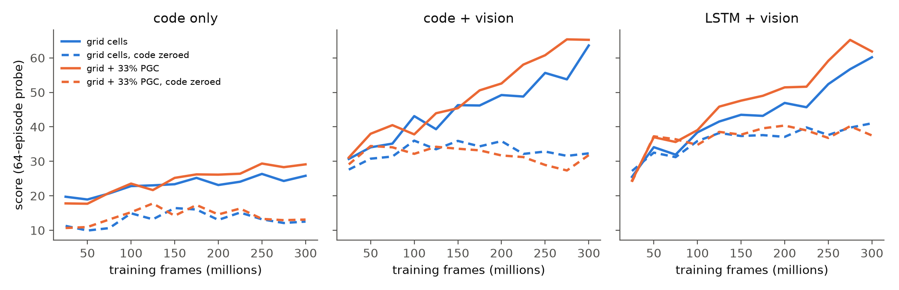
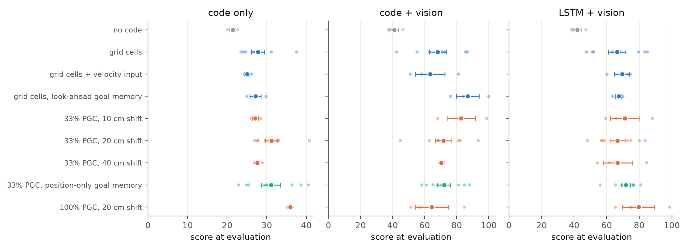
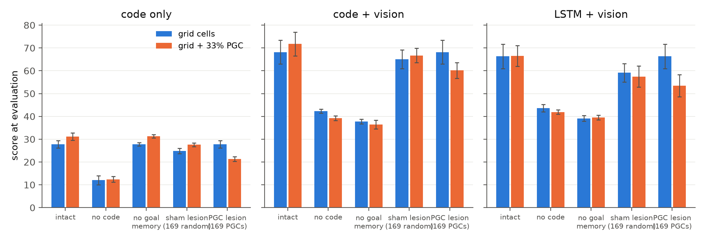
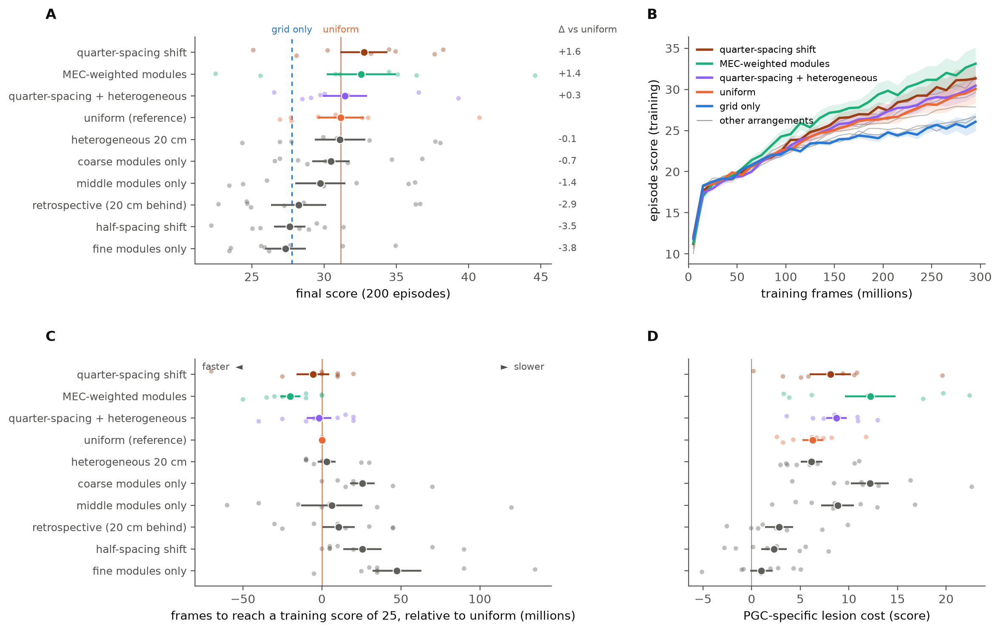
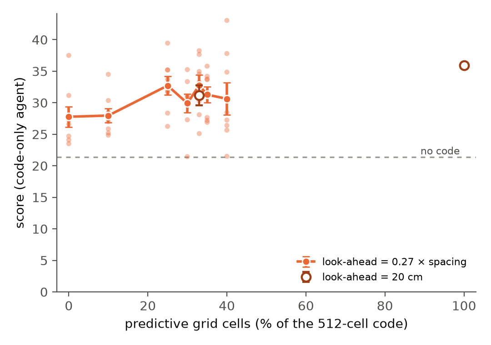
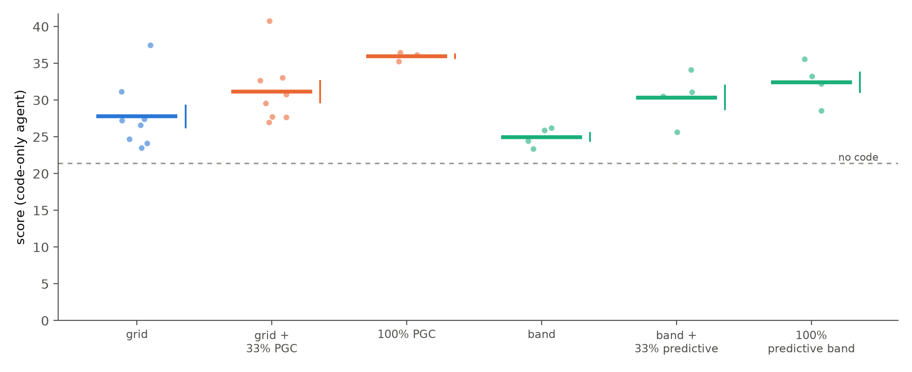

# Predictive grid cells help an agent navigate

**First experiment of the project _Behavioral optimization reveals principles of neural coding_.**

Grid cells give the brain a periodic code for position. A subset of them, the **predictive grid cells** (PGCs) recently described in the medial entorhinal cortex, fire not for where the animal is but for where it is *about to be*. Is a code that contains predictive cells a better code to navigate with?

We answer this the way Banino et al. (*Nature* 2018) built their grid-cell agent: a deep reinforcement-learning agent receives a spatial population code alongside its vision and learns to find a hidden goal. Here the code is *perfect*. It consists of 512 analytic cells whose activity is read directly off the agent's true state at every step. In one condition all 512 are ideal grid cells. In the other, the same cells, with the same phases and orientations, have a third of their number turned into PGCs that read their lattice 20 cm ahead of the agent along its direction of travel. Task, agent, training and cells are otherwise identical, so any difference in behaviour is due to the predictive shift alone.

**What we found** (8 paired training seeds per condition, 250 runs of 300 M frames):

- **Predictive cells make the code better.** When the code is the agent's only source of position, swapping a third of the grid cells for PGCs raises the score by 12 % (27.8 → 31.2, p = 0.008). A code of 100 % PGCs raises it by 39 % (p = 0.008).
- **Agents with vision read the predictive cells specifically.** Silencing the 169 PGCs at test time costs 4 to 6.5 points more than silencing 169 random cells, in all three agent architectures (p ≤ 0.034), and the agents return to the goal on straighter paths (path efficiency +8 %, p = 0.018).
- **What matters is looking forward.** Predictive cells shifted a quarter of their own grid period ahead beat the grid code by 5 points (p = 0.025); the same cells shifted backward or by half a period score at grid-only level, and 10 % predictive cells is too few (p = 0.009 against 33 %).
- **It is prediction, not hexagons.** Predictive band cells help a band-cell code just as much: +5.4 points at 33 % (p = 0.041) and +7.4 at 100 % (p = 0.009), in every seed.



*Figure 1. Each dot is one training seed; a grey line joins the grid-only and grid + PGC runs that share the same cells. Thick bars are means, thin bars SEM. Dashed line: an agent with no spatial code. Top: score (10 points per goal reached in a 90 s episode). Bottom: path efficiency of the agent's return trips to the goal.*

---

## 1. Background

**Grid cells and the Banino agent.** Grid cells in the medial entorhinal cortex (MEC) fire on a hexagonal lattice of locations and are organised in modules that share one lattice spacing. Banino et al. (2018) trained a recurrent network to path-integrate; its bottleneck layer developed grid-like units, and the activity of that layer was fed to a deep RL agent together with a *goal grid code*, the same layer's activity the last time the goal was reached. The agent navigated to hidden goals better than agents without the grid code and took shortcuts, which made the case that a grid-like code is a useful input for vector-based navigation.

**Predictive grid cells.** Ouchi & Fujisawa (2024) found grid cells whose hexagonal firing is best aligned not with the animal's current position but with where it will be a few centimetres further along its path. The shift is a roughly constant fraction of each cell's grid spacing, predictive cells are mixed in with ordinary grid cells in every module, and the shifts vary from cell to cell. Path-integration networks trained in our earlier work develop the same cells (median forward shift 16–21 cm), and ablating them disrupts the network's toroidal dynamics. Whether such cells are *useful* for behaviour was open.

**The approach: perfect cells.** Instead of learning the code, we define a perfect grid cell and a perfect predictive grid cell analytically, read the whole population's activity off the agent's true state at every step, and hand it to the Banino-style agent. This removes every question about how well a code was learned and isolates one variable, the format of the code, so the agent's behaviour becomes a direct readout of what that format is worth.

## 2. Setup

### The task

The agent lives in a 2.5 m square room, Banino's goal task reimplemented as a vectorised GPU environment (`code/env.py`). Each 90 s episode has one hidden goal at a random location. Reaching it earns +10 and teleports the agent to a random pose while the goal stays where it was, so a good agent finds the goal once and then returns to it as often as it can. There are six actions (turn left/right, move forward/backward, strafe left/right), chosen 15 times a second, with smoothed velocities and motor noise. Vision is a first-person 84 × 84 image of the room: four distinctly coloured walls that never change (the distal cues that make heading readable), plus dark stripes and one white landmark per wall whose positions are re-drawn every episode.

### The population code



*Figure 0. **(A)** One cell from each of the four modules; the 128 cells of a module share one spacing (arrow) and one orientation. **(B)** Cells within a module differ only in phase (inset: the 128 phases of module 2, spread uniformly over one unit cell). **(C)** All 512 cells as the agent walks a straight line: each module repeats with its own period, and the four periods read together make position unambiguous across the arena. **(D)** A predictive grid cell is the same lattice read 20 cm ahead along the direction of travel. **(E, F)** The follow-up experiment varies how the 169 predictive cells are allotted to modules and how far ahead they look.*

The code (`code/codes.py`) has 512 cells in four modules of 128, with lattice spacings 0.40, 0.57, 0.81 and 1.15 m (a ratio of 1.42 between neighbouring modules, as between grid modules in rodent MEC), a random orientation per module and a random phase per cell. A grid cell's rate is the classic three-cosine hexagonal pattern, sharpened and scaled to [0, 1]:

```
grid cell i :   r_i(x) = ( (Σ_k cos(k_k · (x − φ_i)) + 1.5) / 4.5 )²      k = 0, 1, 2: wave vectors 60° apart
```

A **predictive grid cell** is the same cell evaluated 20 cm ahead of the agent along its direction of travel:

```
PGC j :         r_j(x + d · u)        d = 0.20 m,  u = unit direction of travel
```

This is the operational definition used for the recorded cells: a PGC's gridness peaks when its activity is aligned with the position *d* ahead on the trajectory. The 20 cm value is the median shift of the predictive units in our path-integration networks. Figure 5 checks the construction with the recordings' own gridness-versus-shift scorer, run on the agent's actual trajectories: grid cells peak at 0 cm, PGCs at 19.5 ± 1.2 cm.



*Figure 5. Left: an example grid cell and a PGC from the same module; the PGC's lattice is displaced along the direction of travel. Right: gridness of the two cell types on the agent's own trajectories as a function of how far their activity is shifted along the path (mean ± SEM over 24 cells each), scored with the predictive-grid-cell pipeline.*

### How the code reaches the agent

The agent (`code/nets.py`) is Banino's. A four-layer convolutional network embeds the image into 256 units. The embedding is concatenated with the current population code **g<sub>t</sub>**, the **goal code g\*** (the population's activity at the moment the goal was last reached, held until the next hit, zeros until the goal is first found in an episode), the previous action and the previous reward, and fed to a 256-unit policy LSTM. A six-way softmax actor and a linear critic read out the LSTM state.

```
 true state at step t: position x_t, direction of travel u_t      first-person view, 84 x 84 RGB
             |                                                                |
             v                                                                v
   population code g_t  (512 rates in [0, 1])                    4 conv layers + linear  ->  256
      grid cell i :  r_i(x_t)                                                 |
      PGC       j :  r_j(x_t + 0.20 m * u_t)                                  |
             |                                                                |
             +--> goal code g*: g frozen at the last goal hit                 |
             |                  (zero until the goal is found)                |
             v                        v                                       v
   [ vision 256 | g_t 512 | g* 512 | previous action (one-hot, 6) | previous reward (1) ]
                                          |
                                          v
                          policy LSTM, 256 units   (or a 2-layer MLP: no memory)
                                          |
                                actor (6 actions) + critic
```

In Banino et al. the two code vectors came from the hidden layer of a separately trained path-integration network. Here they come from the analytic population instead; the downstream agent, its inputs and the goal-code mechanism are unchanged. Nothing about the code is learned: at every step the environment reports the agent's true position and direction of travel, the 512 rates are computed from them, and the agent never sees the coordinates themselves.

### Adding predictive cells

The **grid + 33 % PGC** code takes the grid-cell population of a seed and turns 169 of its 512 cells (a third, 42 or 43 per module, chosen at random within each module) into PGCs by giving them the 20 cm forward shift. Nothing else changes: same spacings, same orientations, same phases. The grid-only and the PGC run of a seed therefore differ *only* in the shift of those 169 cells, and every comparison is made within a seed. Because g\* is the population's activity at the goal hit, the PGC units of the goal code encode the goal displaced along the arrival direction, exactly as a real predictive population would. A **100 % PGC** code shifts all 512 cells.

### Agents and conditions

Three **arms** differ in what the agent has besides the code:

| arm | policy | vision | the code is… |
|---|---|---|---|
| code only | feed-forward (2-layer MLP) | heading only (a synthetic image that reveals the facing direction, not position) | the agent's only source of position |
| code + vision | feed-forward | first-person | one of two position sources, with no memory to integrate either |
| LSTM + vision | LSTM | first-person | the paper's setting |

**Conditions** (one population per seed; conditions of a seed share its cells):

| condition | seeds | population |
|---|---|---|
| grid cells | 8 | 512 grid cells |
| **grid + 33 % PGC** | 8 | 343 grid cells + 169 PGCs, 20 cm shift |
| 33 % PGC, position-only goal memory | 8 | as above; the goal snapshot uses zero shift |
| 100 % PGC | 3 | all 512 cells shifted |
| no code | 3 | code zeroed |
| grid + velocity input | 3 | grid cells plus the agent's velocity as an extra input |
| grid, look-ahead goal memory | 3 | grid cells whose goal snapshot is taken 20 cm past the goal |
| 33 % PGC, 10 cm / 40 cm shift | 3 + 3 | shift series |

The follow-up (Sections 3.4 to 3.6) adds nine arrangements of the 169 predictive cells, five PGC percentages and a band-cell code, all in the code-only arm (8 seeds each, 4 for the bands).

### Training and evaluation

A2C with the paper's hyperparameters (`code/train.py`: 32 parallel environments, 100-step rollouts, discount 0.99, entropy cost 8 × 10⁻⁵, gradient clip 40, rewards clipped to ±1 for learning, RMSProp), 300 M environment frames per run. Each trained agent is evaluated (`code/evaluate.py`) on 200 episodes whose goal, spawn and cue layouts are identical across runs, and then re-evaluated with parts of its code altered at test time: the whole code zeroed, the goal memory zeroed, 169 random cells silenced (a count-matched sham), the 169 PGCs silenced, and an untrained network for the chance level (≈ 1 point).

The primary endpoint was fixed in advance: the within-seed paired difference (grid + PGC) − (grid) in the final score. p-values are from the paired t-test over seeds; bootstrap intervals and the Wilcoxon test are reported alongside in [`results/RESULTS.md`](results/RESULTS.md) and agree. Lesion costs are tested against zero with a one-sample t-test over seeds. In total 250 runs were trained, most of them on fleets of cloud GPUs (the 126-run main matrix took about 7 hours on 42 GPUs).

## 3. Results

### 3.1 The agents use the code, and with vision they home



*Figure 2. Training score (mean ± SEM over seeds). Agents with a code pull away from the no-code agent, mostly after 100 M frames, when they start returning to the remembered goal.*



*Figure 6. Score of intermediate checkpoints with the code intact (solid) or zeroed at test time (dashed). From 100 M frames on, every arm depends on its code.*

Every trained agent relies on its code: zeroing it at test time costs the grid-cell agents 16 points in the code-only arm, 26 with vision and 23 in the LSTM arm (p ≤ 0.006 in each), and agents with a code beat agents without one by 28 points (code + vision, p = 0.005) and 35 points (LSTM + vision, p = 0.012). The two vision arms also learn to **home**: zeroing the goal memory costs them 30 and 27 points (p < 0.001), so after the first discovery they navigate back to the goal rather than search for it again. In the code-only arm the goal memory is not used (cost 0.0 ± 1.1) and the agents score by searching the arena efficiently.

| grid-cell agents, 8 seeds | code only | code + vision | LSTM + vision |
|---|---|---|---|
| score | 27.8 | 68.2 | 66.4 |
| no-code agent | 21.4 | 41.0 | 41.9 |
| cost of zeroing the code at test time | 15.8 ± 2.8, p < 0.001 | 25.9 ± 5.2, p = 0.002 | 22.7 ± 5.7, p = 0.006 |
| cost of zeroing the goal memory | 0.0 ± 1.1 | 30.4 ± 5.0, p < 0.001 | 27.2 ± 5.0, p < 0.001 |

### 3.2 Predictive cells raise the score when the code carries position

In the code-only arm, where the code is the agent's only way of knowing where it is, the grid + 33 % PGC code beats the pure grid code of the same seed, and the fully predictive code beats it by three times as much (Fig. 1, left; Fig. 4, left).

| code-only arm | score | paired Δ vs grid | 95 % CI | p (paired t) |
|---|---|---|---|---|
| grid cells (8 seeds) | 27.8 ± 1.6 | | | |
| **grid + 33 % PGC** (8 seeds) | 31.2 ± 1.6 | **+3.4 ± 0.9** | [1.6, 5.0] | **0.008** (Wilcoxon 0.039) |
| **100 % PGC** (3 seeds) | 36.0 ± 0.4 | **+10.8 ± 1.0** | [8.9, 11.8] | **0.008** |

The gain shows up in how quickly the agent re-finds the goal: the PGC agents score 2.46 goals per 1000 steps after the first discovery against 2.12 for the grid agents (+0.34 ± 0.12, p = 0.025).



*Figure 4. Every condition of the main experiment in the three arms (mean ± SEM, faint dots = seeds). In the code-only arm the three highest-scoring conditions are the three predictive codes with a 20 cm look-ahead.*

### 3.3 Agents with vision read the predictive cells specifically and return on straighter paths

With vision the agents have two sources of position, and the predictive cells make their mark on *how* the agents navigate. Silencing the 169 predictive cells at test time costs the trained agents far more than silencing 169 random cells of the same code, in all three arms (Fig. 3): the policies have learned to exploit the predictive cells in particular.



*Figure 3. Test-time lesions on the same trained agents. Silencing the 169 PGCs (rightmost bars) costs the PGC agent more than silencing 169 random cells (count-matched sham) in every arm.*

| grid + 33 % PGC agents, 8 seeds | code only | code + vision | LSTM + vision |
|---|---|---|---|
| score after silencing 169 random cells | 27.6 | 66.7 | 57.5 |
| score after silencing the 169 PGCs | 21.3 | 60.1 | 53.5 |
| **PGC-specific lesion cost** | **6.3 ± 1.1, p < 0.001** | **6.5 ± 1.6, p = 0.005** | **4.0 ± 1.5, p = 0.034** |

And the agents' return trips to the goal are straighter. Path efficiency (straight-line distance to the goal divided by the distance actually walked on the way back) rises from 0.57 to 0.61 in the code + vision arm, a within-seed gain of +0.043 ± 0.014 (95 % CI [0.02, 0.07], p = 0.018, Wilcoxon p = 0.016; Fig. 1, bottom centre).

### 3.4 What matters is the forward shift, not where the cells sit

Nine other arrangements of the 169 predictive cells were run in the code-only arm (8 seeds each, paired with the uniform and the grid-only runs of the same seed): three module layouts (all predictive cells in the finest, the coarsest or the middle modules), an MEC-like allotment (1:2:2:1 across modules), look-aheads proportional to each module's spacing (a quarter of the spacing, the value measured in the recordings, or a half, the predicted worst case), cell-to-cell spread of the look-ahead, the quarter-spacing rule with spread (the closest match to the recorded population), and a retrospective control (20 cm *behind* the agent).



*Figure 7. **(A)** Final score per arrangement (dots = seeds, circle = mean ± SEM; reference lines = grid-only and uniform means; right column = paired difference from uniform). **(B)** Training score. **(C)** Frames to reach a training score of 25, relative to uniform (negative = faster). **(D)** PGC-specific lesion cost: extra loss from silencing the 169 predictive cells versus 169 random cells.*

| arrangement (code-only arm, 8 seeds) | look-ahead | final score | paired Δ vs grid-only | PGC-specific lesion cost |
|---|---|---|---|---|
| quarter-spacing shift | 0.27 × spacing: 11 / 15 / 22 / 31 cm | 32.8 | **+5.0 ± 1.8, p = 0.025** | 8.1 ± 2.1, p = 0.006 |
| MEC-weighted modules (28 / 57 / 56 / 28 cells) | 20 cm | 32.6 | +4.8 ± 2.3, p = 0.07 | 12.2 ± 2.6, p = 0.002 |
| quarter-spacing + heterogeneous (σ = 0.4) | 0.27 × spacing, spread per cell | 31.4 | **+3.7 ± 0.6, p < 0.001** | 8.7 ± 1.0, p < 0.001 |
| uniform (main experiment) | 20 cm | 31.2 | **+3.4 ± 0.9, p = 0.008** | 6.3 ± 1.1, p < 0.001 |
| heterogeneous 20 cm (σ = 0.5) | 20 cm, spread per cell | 31.1 | **+3.3 ± 1.1, p = 0.022** | 6.2 ± 1.1, p < 0.001 |
| coarse modules only (0 / 0 / 41 / 128) | 20 cm | 30.5 | +2.7 ± 1.2, p = 0.06 | 12.2 ± 1.9, p < 0.001 |
| middle modules only (0 / 128 / 41 / 0) | 20 cm | 29.7 | +2.0 ± 1.6, p = 0.26 | 8.8 ± 1.7, p = 0.001 |
| retrospective | −20 cm (behind the agent) | 28.2 | +0.5 ± 1.2 | 2.8 ± 1.4, ns |
| half-spacing shift | 0.5 × spacing: 20 / 28 / 40 / 57 cm | 27.6 | −0.1 ± 1.9 | 2.3 ± 1.3, ns |
| fine modules only (128 / 41 / 0 / 0) | 20 cm | 27.3 | −0.4 ± 0.9 | 1.0 ± 1.2, ns |

- **Four forward-looking arrangements beat the grid code significantly, and they span very different allotments**: cells spread evenly across modules at a fixed 20 cm, the same at a quarter of each module's own spacing, and either rule with cell-to-cell spread of the look-ahead. Where the predictive cells sit across modules is not what drives the gain; the quarter-spacing rule, the shift the recordings report, gives the highest score of all codes tested at 33 %.
- **The shift is what drives it.** Shifting backward (retrospective), shifting by half a period, or packing all predictive cells into the finest module, where 20 cm *is* half of the 40 cm period, brings the score back to grid-only level, and in those codes the agents stop relying on their predictive cells (lesion cost 1–3 points, none significant, against 6–12 for the forward-looking codes). The fine-modules-only code is significantly worse than uniform (−3.8 ± 1.1, p = 0.012), learns slowest (+48 ± 16 M frames to a training score of 25, p = 0.018) and takes the least efficient paths (−0.039 ± 0.007 vs uniform, p = 0.001).
- **Module allotment changes how fast the agent learns.** The MEC-weighted code learns fastest, 20 M fewer frames to criterion than uniform (p = 0.016) with the largest area under the learning curve (+1.75 ± 0.66, p = 0.03), and its agents rely on their predictive cells twice as much as uniform's. Concentrating the predictive cells in the coarse modules slows early learning (+26 ± 8 M frames, p = 0.014) even though the final score is unaffected.

One figure per arrangement, with what each one changes and its numbers, is in [`docs/arrangements.md`](docs/arrangements.md).

### 3.5 How many predictive cells?

The quarter-spacing code, the arrangement with the highest mean, was run with 10, 25, 30, 35 and 40 % predictive cells, 8 seeds each, and compared within seed with its 33 % runs.



*Figure 8. Final score vs. the fraction of predictive cells (dots = seeds, circles = mean ± SEM). The filled series is the quarter-spacing code; the hollow markers are the 20 cm codes of the main experiment (33 % and 100 %). 0 % = grid only.*

| predictive cells (quarter-spacing code, 8 seeds) | final score | paired Δ vs 33 % | PGC-specific lesion cost |
|---|---|---|---|
| 0 % (grid only) | 27.8 | **−5.0 ± 1.8, p = 0.025** | |
| 10 % | 28.0 | **−4.8 ± 1.3, p = 0.009** (7 of 8 seeds below) | 0.8 ± 0.8, ns |
| 25 % | 32.7 | −0.0 ± 1.1 | 7.8 ± 1.4, p < 0.001 |
| 30 % | 29.9 | −2.8 ± 2.0 | 7.6 ± 1.5, p = 0.002 |
| **33 %** | **32.8** | reference | 8.1 ± 2.1, p = 0.006 |
| 35 % | 31.3 | −1.5 ± 1.3 | 10.1 ± 1.9, p = 0.001 |
| 40 % | 30.6 | −2.1 ± 1.9 | 8.8 ± 1.7, p = 0.001 |
| 100 % (20 cm look-ahead, 3 seeds) | 36.0 | | 17.5 ± 4.0, p = 0.047 |

Ten percent predictive cells is too few: the code scores like a grid-only code and the agents do not use the predictive cells they have. From 25 % on the agents rely on them (lesion cost 8–10 points) and the score sits on a plateau around 31–33, with 33 % the best value tested and 25 % tied. The 100 % code of the main experiment is above the whole plateau.

### 3.6 Prediction helps a non-hexagonal code too: band cells

To ask whether the benefit depends on the hexagonal structure, we built a **band-cell** code: each cell is a single cosine along one of its module's three lattice directions (three orientations per module, same spacings and phases), so it is periodic along one axis instead of on a lattice. A predictive band cell is shifted along the direction of travel exactly like a PGC. Code-only arm, 4 paired seeds.



*Figure 9. Band codes next to the grid codes of the main experiment (dots = seeds, bar = mean ± SEM).*

| code (code-only arm, 4 paired seeds) | final score | paired Δ | PGC-specific lesion cost |
|---|---|---|---|
| band | 25.0 | | |
| **band + 33 % predictive** | 30.4 | **vs band +5.4 ± 1.6, p = 0.041**, 4 of 4 seeds | 7.1 ± 2.3 |
| **100 % predictive band** | 32.4 | **vs band +7.4 ± 1.2, p = 0.009**, 4 of 4 seeds | 21.9 ± 1.6, p < 0.001 |
| grid (same seeds) | 26.6 | band vs grid −1.7 ± 1.3, ns | |
| grid + 33 % PGC (same seeds) | 29.7 | band + 33 % predictive vs this: +0.6 ± 2.0, ns | |

A band code carries position about as well as a grid code for this agent, and predictive band cells help it as much as PGCs help the grid code: +5 points at 33 % and +7 at 100 %, in every seed, with the trained agents relying on the predictive cells specifically. The benefit of prediction is not tied to the hexagonal lattice. It comes from reading a periodic spatial code forward along the path.

## 4. Trends and controls

Effects that point the same way as the results above but do not reach significance at the sample sizes run, and the controls that bound what the predictive cells add.

**Trends**

| comparison | effect | p |
|---|---|---|
| score, code + vision: grid + 33 % PGC vs grid (8 seeds) | +3.6 ± 5.5 | 0.53 |
| score, LSTM + vision: grid + 33 % PGC vs grid (8 seeds) | +0.2 ± 6.4 | 0.98 |
| path efficiency, LSTM + vision | +0.057 ± 0.030 | 0.10 |
| path efficiency, code only | +0.025 ± 0.012 | 0.08 |
| learning speed, code + vision: frames to 80 % of final score | 35 M fewer | 0.09 |
| learning speed, code + vision: area under the learning curve to 100 M frames | +2.3 ± 1.0 | 0.052 |
| MEC-weighted modules vs grid-only | +4.8 ± 2.3 | 0.07 |
| coarse modules only vs grid-only | +2.7 ± 1.2 | 0.06 |
| quarter-spacing shift vs uniform | +1.6 ± 1.8 | 0.40 |
| MEC-weighted modules vs uniform | +1.4 ± 2.4 | 0.57 |
| half-spacing shift vs uniform | −3.5 ± 1.9 | 0.11 |
| retrospective vs uniform | −2.9 ± 1.7 | 0.13 |
| 100 % predictive band vs 100 % PGC (3 seeds) | −4.6 ± 1.1 | 0.054 |
| 33 % PGC with a 10 cm / 40 cm shift vs grid, code only (3 seeds each) | +2.0 ± 1.6 / +2.5 ± 1.6 | 0.34 / 0.27 |

In the two vision arms the score varies by about 15 points from seed to seed, several times the spread in the code-only arm, so the score comparisons there are not decisive at 8 seeds while the within-agent measures (lesion cost, path efficiency) are. The learning curves of the code + vision arm (Fig. 2, centre) show the PGC agents ahead throughout training.

**Controls**

- **Velocity information.** Giving the grid-cell agent its velocity and direction of motion as four extra inputs did not reproduce the gain in any arm (code only 25.0 vs 27.8 for grid alone; code + vision 63.4 vs 68.2; LSTM + vision 69.5 vs 66.4; none significant). The predictive cells are not just a velocity signal.
- **Heading information.** The retrospective code, the same 169 cells shifted 20 cm *behind* the agent, carries exactly the heading information of the predictive code but scores at grid-only level (+0.5 ± 1.2) and is ignored by the agents (lesion cost 2.8 ± 1.4, ns). The benefit comes from looking forward.
- **Goal-memory geometry.** A PGC code whose goal snapshot is taken with zero shift (position-only goal memory) scores the same as the standard PGC code in the code-only arm (31.1 vs 31.2, p = 0.97), so the gain does not come from the shifted goal snapshot. A grid-cell agent given a look-ahead goal snapshot gains 18 ± 10 points in the code + vision arm (3 seeds, p = 0.21) and nothing in the other arms.
- **Shift size.** 10 cm and 40 cm shifts (3 seeds each) gain +2.0 ± 1.6 and +2.5 ± 1.6 over their grid-only partners in the code-only arm, less than the 20 cm code's +3.4 and not significant.

## 5. Reproduce

```bash
PY=python            # needs torch (CUDA), numpy, scipy, matplotlib
$PY -m pytest -q tests/                                                   # unit + smoke tests
$PY -m code.validate_codes --cond pgc33 --seed 1 --out runs/validation_pgc33_s1
$PY -m code.train --cond pgc33 --policy ff --vision heading_only --seed 1 \
    --frames 300000000 --encoder_norm layernorm --lr 3e-4 --rms_eps 1e-5 --out runs/pgc33_ffb_s1
$PY -m code.evaluate --run runs/pgc33_ffb_s1 --probes intact,no_code,no_goal,untrained
$PY scripts/launch_matrix.py --wave 2            # the whole matrix on one machine (slow)
$PY scripts/gcp_fleet.py plan --wave 2 --vms 32 && $PY scripts/gcp_fleet.py launch --vms 32   # or on GCP
$PY scripts/make_matrix_v2.py arrangements --seeds 8 --out /tmp/waveA.json   # follow-up: arrangements
$PY -m code.analyze --runs_dir runs --out results && $PY scripts/make_figures.py
```

Every run's configuration, final evaluations and checkpoint probes are in `data/evals/`, the binned training curves in `data/learning_curves.csv`, and the aggregate statistics in `data/summary.json`, so the tables and most figures can be regenerated without retraining (`python scripts/make_figures.py --runs_dir data/evals`).

Two settings matter when re-running: RMSProp needs the standard ε = 10⁻⁵ (with the paper's 0.1 the policy does not leave chance under this sparse reward), and the vision embedding needs LayerNorm so the LSTM gates stay unsaturated and the code stays visible to the policy. Both are defaults in the launch scripts; every log line carries saturation diagnostics. Details in [`docs/LOG.md`](docs/LOG.md).

## 6. Layout

```
code/         codes.py (population code) · env.py (arena + vision) · nets.py (agent) · train.py · evaluate.py · analyze.py · validate_codes.py
scripts/      launch_matrix.py (scheduler) · make_matrix_v2.py (follow-up matrices) · gcp_fleet.py (cloud fleet) · make_figures.py · pick_concentration.py · arrangement_report.py · package_data.py · status.py
figures/      fig0–fig9 (png + svg) · arrangements/ (one figure per PGC arrangement)
results/      RESULTS.md (all tables, every paired comparison) · summary.json · best_arrangement.json · best_concentration.json
data/         per-run configs + evaluations (250 runs) · learning_curves.csv · validation_pgc33_s1.json
docs/         arrangements.md (follow-up, one figure per arrangement) · LOG.md (day log, decisions) · pilot_4m_arena.md
tests/
```
