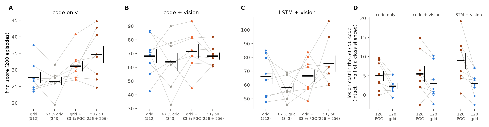
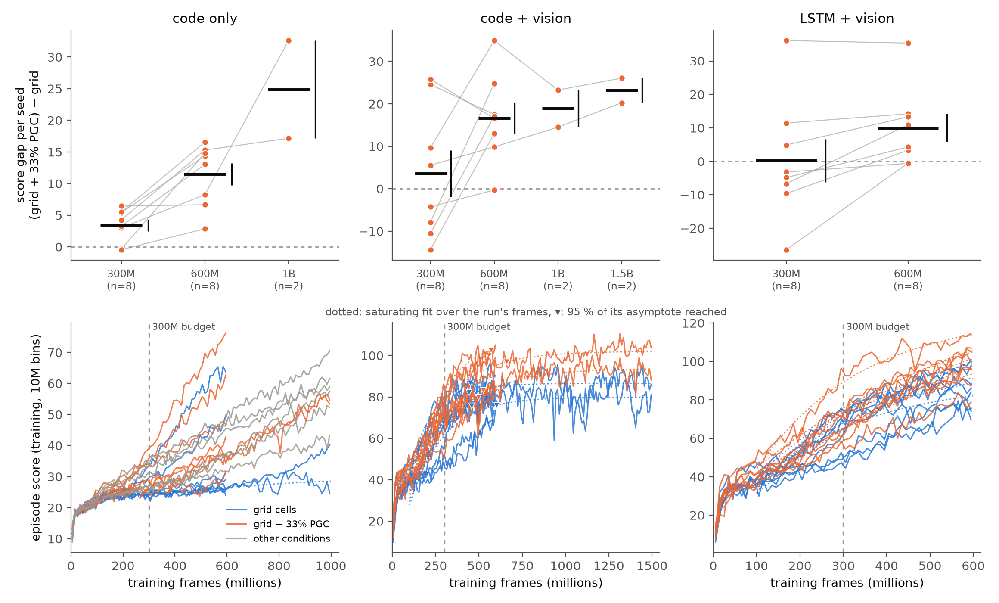

# Predictive grid cells help an agent navigate

**First experiment of the project _Behavioral optimization reveals principles of neural coding_.**

Grid cells give the brain a periodic code for position. A subset of them, the **predictive grid cells** (PGCs) recently described in the medial entorhinal cortex, fire not for where the animal is but for where it is *about to be*. Is a code that contains predictive cells a better code to navigate with?

We answer this the way Banino et al. (*Nature* 2018) built their grid-cell agent: a deep reinforcement-learning agent receives a spatial population code alongside its vision and learns to find a hidden goal. Here the code is *perfect*. It consists of 512 analytic cells whose activity is read directly off the agent's true state at every step. In one condition all 512 are ideal grid cells. In the other, the same cells, with the same phases and orientations, have a third of their number turned into PGCs that read their lattice 20 cm ahead of the agent along its direction of travel. Task, agent, training and cells are otherwise identical, so any difference in behaviour is due to the predictive shift alone.

**What we found** (paired training seeds, 8 for most conditions and 3 or 4 for a few; 322 runs of 300 M frames, 54 of them continued to 600 M frames or longer):

- **Predictive cells make the code better.** When the code is the agent's only source of position, swapping a third of the grid cells for PGCs raises the score by 12 % (27.8 → 31.2, p = 0.008). A code of 100 % PGCs raises it by 39 % (p = 0.008).
- **Agents with vision read the predictive cells specifically.** Silencing the 169 PGCs at test time costs 4 to 6.5 points more than silencing 169 random cells, in all three agent architectures (p ≤ 0.034), and the agents return to the goal on straighter paths (path efficiency +8 %, p = 0.018).
- **What matters is looking forward.** Predictive cells shifted a quarter of their own grid period ahead beat the grid code by 5 points (p = 0.025); the same cells shifted backward or by half a period score at grid-only level, and 10 % predictive cells is too few (p = 0.009 against 33 %).
- **It is prediction, not hexagons.** Predictive band cells help a band-cell code just as much: +5.4 points at 33 % (p = 0.041) and +7.4 at 100 % (p = 0.009), in every seed.
- **The advantage grows with training.** At twice the budget, 600 M frames, the predictive cells raise the score by 33 % in the code-only arm (12 % at 300 M; the gap widened in all 8 seeds, p = 0.002) and by 21 % and 12 % in the two arms with vision (p = 0.003 and 0.047), where they gave no significant gain at 300 M. With vision both codes are still rising at 600 M, and two code + vision seeds trained on to 1.5 B level off about 15 points apart. Without vision grid + PGC climbs about twice as fast as the grid code at 600 M (p = 0.012), and every predictive code is still rising at 1 B (2 seeds; Section 3.7).

*Figure 1. Each dot is one training seed; a grey line joins the grid-only and grid + PGC runs that share the same cells. Thick bars are means, thin bars SEM. Dashed line: an agent with no spatial code. Top: score (10 points per goal reached in a 90 s episode). Bottom: path efficiency of the agent's return trips to the goal.*

---

## 1. Background

**Grid cells and the Banino agent.** Grid cells in the medial entorhinal cortex (MEC) fire on a hexagonal lattice of locations and are organised in modules that share one lattice spacing. Banino et al. (2018) trained a recurrent network to path-integrate; its bottleneck layer developed grid-like units, and the activity of that layer was fed to a deep RL agent together with a *goal grid code*, the same layer's activity the last time the goal was reached. The agent navigated to hidden goals better than agents without the grid code and took shortcuts, which made the case that a grid-like code is a useful input for vector-based navigation.

**Predictive grid cells.** Ouchi & Fujisawa (2024) found grid cells whose hexagonal firing is best aligned not with the animal's current position but with where it will be a few centimetres further along its path. The shift is a roughly constant fraction of each cell's grid spacing, predictive cells are mixed in with ordinary grid cells in every module, and the shifts vary from cell to cell. Path-integration networks trained in our earlier work develop the same cells (median forward shift 16–21 cm), and ablating them disrupts the network's toroidal dynamics. Whether such cells are *useful* for behaviour was open.

**The approach: perfect cells.** Instead of learning the code, we define a perfect grid cell and a perfect predictive grid cell analytically, read the whole population's activity off the agent's true state at every step, and hand it to the Banino-style agent. This removes every question about how well a code was learned and isolates one variable, the format of the code, so the agent's behaviour becomes a direct readout of what that format is worth.

## 2. Setup

### The task

The agent lives in a 2.5 m square room, Banino's goal task reimplemented as a vectorised GPU environment (`code/env.py`). Each 90 s episode has one hidden goal at a random location. Reaching it earns +10 and teleports the agent to a random pose while the goal stays where it was, so a good agent finds the goal once and then returns to it as often as it can. There are six actions (turn left/right, move forward/backward, strafe left/right), chosen 15 times a second, with smoothed velocities and motor noise. Vision is a first-person 84 × 84 image of the room: four distinctly coloured walls that never change (the distal cues that make heading readable), plus dark stripes and one white landmark per wall whose positions are re-drawn every episode.

### Adding predictive cells

The **grid + 33 % PGC** code takes the grid-cell population of a seed and turns 169 of its 512 cells (a third, 42 or 43 per module, chosen at random within each module) into PGCs by giving them the 20 cm forward shift. Nothing else changes: same spacings, same orientations, same phases. The grid-only and the PGC run of a seed therefore differ *only* in the shift of those 169 cells, and every comparison is made within a seed. Because g\* is the population's activity at the goal hit, the PGC units of the goal code encode the goal displaced along the arrival direction, exactly as a real predictive population would. A **100 % PGC** code shifts all 512 cells.

### Agents and conditions

Three **arms** differ in what the agent has besides the code:

| arm | policy | vision | the code is… |
|---|---|---|---|
| code only | feed-forward (2-layer MLP) | heading only (a synthetic image that reveals the facing direction, not position) | the agent's only source of position |
| code + vision | feed-forward | first-person | one of two position sources, with no memory to integrate either |
| LSTM + vision | LSTM | first-person | the paper's setting |

**Conditions** (one population per seed; conditions of a seed share its cells):

| condition | seeds | population |
|---|---|---|
| grid cells | 8 | 512 grid cells |
| **grid + 33 % PGC** | 8 | 343 grid cells + 169 PGCs, 20 cm shift |
| 33 % PGC, position-only goal memory | 8 | as above; the goal snapshot uses zero shift |
| 100 % PGC | 3 | all 512 cells shifted |
| no code | 3 | code zeroed |
| grid + velocity input | 3 | grid cells plus the agent's velocity as an extra input |
| grid, look-ahead goal memory | 3 | grid cells whose goal snapshot is taken 20 cm past the goal |
| 33 % PGC, 10 cm / 40 cm shift | 3 + 3 | shift series |
| 67 % grid (PGC slots silent) | 8 | the grid + 33 % PGC population of the seed with its 169 predictive slots held at zero |
| 50 % PGC | 8 | 256 grid cells + 256 PGCs, 20 cm shift |

The follow-up adds nine arrangements of the 169 predictive cells and five PGC percentages (Sections 3.4 and 3.5) and a band-cell code (summary above), all in the code-only arm (8 seeds each, 4 for the bands), and two control populations in every arm (Section 3.6); 54 runs were then trained on beyond the 300 M budget (Section 3.7).

### Training and evaluation

A2C with the paper's hyperparameters (`code/train.py`: 32 parallel environments, 100-step rollouts, discount 0.99, entropy cost 8 × 10⁻⁵, gradient clip 40, rewards clipped to ±1 for learning, RMSProp), 300 M environment frames per run. Each trained agent is evaluated (`code/evaluate.py`) on 200 episodes whose goal, spawn and cue layouts are identical across runs, and then re-evaluated with parts of its code altered at test time: the whole code zeroed, the goal memory zeroed, 169 random cells silenced (a count-matched sham), the 169 PGCs silenced, and an untrained network for the chance level (≈ 1 point).

The primary endpoint was fixed in advance: the within-seed paired difference (grid + PGC) − (grid) in the final score. p-values are from the paired t-test over seeds; bootstrap intervals and the Wilcoxon test are reported alongside in [`results/RESULTS.md`](results/RESULTS.md) and agree. Lesion costs are tested against zero with a one-sample t-test over seeds. In total 322 runs were trained at the 300 M budget, most of them on fleets of cloud GPUs (the 126-run main matrix took about 7 hours on 42 GPUs), and 54 of them were trained on to 600 M, 1 B or 1.5 B frames (Section 3.7).

## 3. Results

### 3.1 The agents use the code, and with vision they home

*Figure 2. Training score (mean ± SEM over seeds). Agents with a code pull away from the no-code agent, mostly after 100 M frames, when they start returning to the remembered goal.*

Every trained agent relies on its code: zeroing it at test time costs the grid-cell agents 16 points in the code-only arm, 26 with vision and 23 in the LSTM arm (p ≤ 0.006 in each), and agents with a code beat agents without one by 28 points (code + vision, p = 0.005) and 35 points (LSTM + vision, p = 0.012). The two vision arms also learn to **home**: zeroing the goal memory costs them 30 and 27 points (p < 0.001), so after the first discovery they navigate back to the goal rather than search for it again. In the code-only arm the goal memory is not used (cost 0.0 ± 1.1) and the agents score by searching the arena efficiently.

| grid-cell agents, 8 seeds | code only | code + vision | LSTM + vision |
|---|---|---|---|
| score | 27.8 | 68.2 | 66.4 |
| no-code agent | 21.4 | 41.0 | 41.9 |
| cost of zeroing the code at test time | 15.8 ± 2.8, p < 0.001 | 25.9 ± 5.2, p = 0.002 | 22.7 ± 5.7, p = 0.006 |
| cost of zeroing the goal memory | 0.0 ± 1.1 | 30.4 ± 5.0, p < 0.001 | 27.2 ± 5.0, p < 0.001 |

### 3.2 Predictive cells raise the score when the code carries position

In the code-only arm, where the code is the agent's only way of knowing where it is, the grid + 33 % PGC code beats the pure grid code of the same seed, and the fully predictive code beats it by three times as much (Fig. 1, left; Fig. 4, left).

| code-only arm | score | paired Δ vs grid | 95 % CI | p (paired t) |
|---|---|---|---|---|
| grid cells (8 seeds) | 27.8 ± 1.6 | | | |
| **grid + 33 % PGC** (8 seeds) | 31.2 ± 1.6 | **+3.4 ± 0.9** | [1.6, 5.0] | **0.008** (Wilcoxon 0.039) |
| **100 % PGC** (3 seeds) | 36.0 ± 0.4 | **+10.8 ± 1.0** | [8.9, 11.8] | **0.008** |

The gain shows up in how quickly the agent re-finds the goal: the PGC agents score 2.46 goals per 1000 steps after the first discovery against 2.12 for the grid agents (+0.34 ± 0.12, p = 0.025).

### 3.3 Agents with vision read the predictive cells specifically and return on straighter paths

With vision the agents have two sources of position, and the predictive cells make their mark on *how* the agents navigate. Silencing the 169 predictive cells at test time costs the trained agents far more than silencing 169 random cells of the same code, in all three arms (Fig. 3): the policies have learned to exploit the predictive cells in particular.

*Figure 3. Test-time lesions on the same trained agents. Silencing the 169 PGCs (rightmost bars) costs the PGC agent more than silencing 169 random cells (count-matched sham) in every arm.*

| grid + 33 % PGC agents, 8 seeds | code only | code + vision | LSTM + vision |
|---|---|---|---|
| score after silencing 169 random cells | 27.6 | 66.7 | 57.5 |
| score after silencing the 169 PGCs | 21.3 | 60.1 | 53.5 |
| **PGC-specific lesion cost** | **6.3 ± 1.1, p < 0.001** | **6.5 ± 1.6, p = 0.005** | **4.0 ± 1.5, p = 0.034** |

And the agents' return trips to the goal are straighter. Path efficiency (straight-line distance to the goal divided by the distance actually walked on the way back) rises from 0.57 to 0.61 in the code + vision arm, a within-seed gain of +0.043 ± 0.014 (95 % CI [0.02, 0.07], p = 0.018, Wilcoxon p = 0.016; Fig. 1, bottom centre).

### 3.4 What matters is the forward shift, not where the cells sit

Nine other arrangements of the 169 predictive cells were run in the code-only arm (8 seeds each, paired with the uniform and the grid-only runs of the same seed): three module layouts (all predictive cells in the finest, the coarsest or the middle modules), an MEC-like allotment (1:2:2:1 across modules), look-aheads proportional to each module's spacing (a quarter of the spacing, the value measured in the recordings, or a half, the predicted worst case), cell-to-cell spread of the look-ahead, the quarter-spacing rule with spread (the closest match to the recorded population), and a retrospective control (20 cm *behind* the agent).

*Figure 7. **(A)** Final score per arrangement (dots = seeds, circle = mean ± SEM; reference lines = grid-only and uniform means; right column = paired difference from uniform). **(B)** Training score. **(C)** Frames to reach a training score of 25, relative to uniform (negative = faster). **(D)** PGC-specific lesion cost: extra loss from silencing the 169 predictive cells versus 169 random cells.*

| arrangement (code-only arm, 8 seeds) | look-ahead | final score | paired Δ vs grid-only | PGC-specific lesion cost |
|---|---|---|---|---|
| quarter-spacing shift | 0.27 × spacing: 11 / 15 / 22 / 31 cm | 32.8 | **+5.0 ± 1.8, p = 0.025** | 8.1 ± 2.1, p = 0.006 |
| MEC-weighted modules (28 / 57 / 56 / 28 cells) | 20 cm | 32.6 | +4.8 ± 2.3, p = 0.07 | 12.2 ± 2.6, p = 0.002 |
| quarter-spacing + heterogeneous (σ = 0.4) | 0.27 × spacing, spread per cell | 31.4 | **+3.7 ± 0.6, p < 0.001** | 8.7 ± 1.0, p < 0.001 |
| uniform (main experiment) | 20 cm | 31.2 | **+3.4 ± 0.9, p = 0.008** | 6.3 ± 1.1, p < 0.001 |
| heterogeneous 20 cm (σ = 0.5) | 20 cm, spread per cell | 31.1 | **+3.3 ± 1.1, p = 0.022** | 6.2 ± 1.1, p < 0.001 |
| coarse modules only (0 / 0 / 41 / 128) | 20 cm | 30.5 | +2.7 ± 1.2, p = 0.06 | 12.2 ± 1.9, p < 0.001 |
| middle modules only (0 / 128 / 41 / 0) | 20 cm | 29.7 | +2.0 ± 1.6, p = 0.26 | 8.8 ± 1.7, p = 0.001 |
| retrospective | −20 cm (behind the agent) | 28.2 | +0.5 ± 1.2 | 2.8 ± 1.4, ns |
| half-spacing shift | 0.5 × spacing: 20 / 28 / 40 / 57 cm | 27.6 | −0.1 ± 1.9 | 2.3 ± 1.3, ns |
| fine modules only (128 / 41 / 0 / 0) | 20 cm | 27.3 | −0.4 ± 0.9 | 1.0 ± 1.2, ns |

- **Four forward-looking arrangements beat the grid code significantly, and they span very different allotments**: cells spread evenly across modules at a fixed 20 cm, the same at a quarter of each module's own spacing, and either rule with cell-to-cell spread of the look-ahead. Where the predictive cells sit across modules is not what drives the gain; the quarter-spacing rule, the shift the recordings report, gives the highest score of all codes tested at 33 %.
- **The shift is what drives it.** Shifting backward (retrospective), shifting by half a period, or packing all predictive cells into the finest module, where 20 cm *is* half of the 40 cm period, brings the score back to grid-only level, and in those codes the agents stop relying on their predictive cells (lesion cost 1–3 points, none significant, against 6–12 for the forward-looking codes). The fine-modules-only code is significantly worse than uniform (−3.8 ± 1.1, p = 0.012), learns slowest (+48 ± 16 M frames to a training score of 25, p = 0.018) and takes the least efficient paths (−0.039 ± 0.007 vs uniform, p = 0.001).
- **Module allotment changes how fast the agent learns.** The MEC-weighted code learns fastest, 20 M fewer frames to criterion than uniform (p = 0.016) with the largest area under the learning curve (+1.75 ± 0.66, p = 0.03), and its agents rely on their predictive cells twice as much as uniform's. Concentrating the predictive cells in the coarse modules slows early learning (+26 ± 8 M frames, p = 0.014) even though the final score is unaffected.

One figure per arrangement, with what each one changes and its numbers, is in [`docs/arrangements.md`](docs/arrangements.md).

### 3.5 How many predictive cells?

The quarter-spacing code, the arrangement with the highest mean, was run with 10, 25, 30, 35 and 40 % predictive cells, 8 seeds each, and compared within seed with its 33 % runs.

*Figure 8. Final score vs. the fraction of predictive cells (dots = seeds, circles = mean ± SEM). The filled series is the quarter-spacing code; the hollow markers are the 20 cm codes of the main experiment (33 % and 100 %). 0 % = grid only.*

| predictive cells (quarter-spacing code, 8 seeds) | final score | paired Δ vs 33 % | PGC-specific lesion cost |
|---|---|---|---|
| 0 % (grid only) | 27.8 | **−5.0 ± 1.8, p = 0.025** | |
| 10 % | 28.0 | **−4.8 ± 1.3, p = 0.009** (7 of 8 seeds below) | 0.8 ± 0.8, ns |
| 25 % | 32.7 | −0.0 ± 1.1 | 7.8 ± 1.4, p < 0.001 |
| 30 % | 29.9 | −2.8 ± 2.0 | 7.6 ± 1.5, p = 0.002 |
| **33 %** | **32.8** | reference | 8.1 ± 2.1, p = 0.006 |
| 35 % | 31.3 | −1.5 ± 1.3 | 10.1 ± 1.9, p = 0.001 |
| 40 % | 30.6 | −2.1 ± 1.9 | 8.8 ± 1.7, p = 0.001 |
| 100 % (20 cm look-ahead, 3 seeds) | 36.0 | | 17.5 ± 4.0, p = 0.047 |

Ten percent predictive cells is too few: the code scores like a grid-only code and the agents do not use the predictive cells they have. From 25 % on the agents rely on them (lesion cost 8–10 points) and the score sits on a plateau around 31–33, with 33 % the best value tested and 25 % tied. The 100 % code of the main experiment is above the whole plateau.

### 3.6 More cells, or predictive cells? Two controls

Two further populations were run in all three arms, 8 seeds each, paired with the main runs of the same seed: a **67 % grid code**, the grid + 33 % PGC population of that seed with its 169 predictive slots held at zero (343 active grid cells), and a **50 / 50 code** of 256 grid cells and 256 predictive cells, in which silencing half of either class removes the same number of cells. The 50 / 50 code was also run in the quarter-spacing, MEC-weighted and retrospective arrangements of Section 3.4 (code-only arm). For the lesions, three random halves of each class were silenced at test time and the costs averaged.

*Figure 12. **(A–C)** Final score per seed (lines join the runs of one seed; bars = mean ± SEM) for the grid code, the 67 % grid code, grid + 33 % PGC and the 50 / 50 code, one panel per arm. **(D)** Class-matched lesion in the 50 / 50 code: the cost of silencing 128 predictive cells against 128 grid cells, paired within seed.*

| code (8 seeds) | code only | code + vision | LSTM + vision |
|---|---|---|---|
| grid, 512 cells | 27.8 | 68.2 | 66.4 |
| 67 % grid, 343 cells | 26.6 (−1.2 ± 1.5 vs grid) | 64.0 (−4.2 ± 7.7) | 58.3 (−8.1 ± 5.9) |
| grid + 33 % PGC | 31.2 (**+4.6 ± 1.7 vs 67 % grid, p = 0.028**) | 71.8 (+7.8 ± 5.2, p = 0.18) | 66.6 (+8.3 ± 5.2, p = 0.16) |
| 50 / 50 | 34.7 (**+6.9 ± 2.3 vs grid, p = 0.021**) | 68.2 (+0.0 ± 3.4) | 75.5 (+9.2 ± 6.5, p = 0.20) |

- **The gain is not a cell-count effect.** Taking a third of the grid cells away costs little (code only: −1.2 ± 1.5), and putting predictive cells into those slots gains 4.6 ± 1.7 (p = 0.028), more than the gain over the full grid code. Against the 67 % grid code the predictive cells also give straighter returns (path efficiency +0.034 ± 0.010, p = 0.014) and more goal visits after discovery (+0.41 ± 0.15 per 1000 steps, p = 0.025). The vision arms show the same ordering, 67 % grid < grid < grid + 33 % PGC, with a seed-to-seed spread four times larger, and none of their differences is significant.
- **A predictive cell costs more than a grid cell at equal class size.** In the 50 / 50 code, silencing 128 predictive cells costs more than silencing 128 grid cells in every arm: 5.0 vs 2.3 (code only, Δ +2.7 ± 1.0, p = 0.037), 5.5 vs 3.0 (code + vision, +2.5 ± 1.2, p = 0.08) and 8.9 vs 3.0 (LSTM + vision, +5.9 ± 1.7, p = 0.010). The per-cell lesion costs of the 33 % code (0.058 vs 0.036 points per cell in the code-only arm, [`results/relative_benefit.md`](results/relative_benefit.md)) are therefore not an artefact of the unequal class sizes.
- **Half predictive cells.** In the code-only arm the 50 / 50 code scores 34.7, above the 33 % plateau of Section 3.5 (+3.5 ± 2.2 vs grid + 33 % PGC, p = 0.15), with the highest post-discovery goal rate of the 8-seed codes (+0.86 ± 0.27 per 1000 steps vs grid, p = 0.014). Its quarter-spacing and MEC-weighted versions score the same (34.9 and 34.7; +0.2 ± 1.3 and +0.0 ± 1.6 vs uniform), and its retrospective version falls to 25.4 (−9.2 ± 2.4 vs uniform, p = 0.006), below the grid code, with agents that barely use the shifted cells (lesion cost 4.8 against 16.9 for the forward shift). With vision, the 50 / 50 code gains nothing over grid in the feed-forward arm (+0.0 ± 3.4) and +9.2 ± 6.5 in the LSTM arm (p = 0.20).

### 3.7 Longer training widens the gap

Everything above is measured at the 300 M-frame budget of the main experiment. To see whether that budget sets the size of the effect, 54 runs were trained on from their final weights: the grid and grid + 33 % PGC runs of all 8 seeds in every arm to 600 M frames, and the runs of seeds 1 and 2 further, to 1 B in the code-only arm (with the quarter-spacing, MEC-weighted and retrospective codes alongside) and to 1.5 B in the code + vision arm. The optimiser state of a finished run is not kept, so an extension starts a fresh RMSProp with 200 warm-up updates at zero learning rate. The checkpoints at 600 M, 1 B and the end of training were evaluated on the same 200 episodes as the 300 M runs, so every score below is paired within seed with the ones above. Bootstrap intervals, Wilcoxon tests, per-seed values and the plateau fits are in [`results_ext/EXTENSION.md`](results_ext/EXTENSION.md).

*Figure 11. One column per arm. **Top:** the paired score gap (grid + 33 % PGC) − grid per seed at each training budget (lines join the seeds, bars = mean ± SEM). **Bottom:** training return of every extended run (10 M-frame bins) with the 300 M budget marked; grey curves are the quarter-spacing, MEC-weighted and retrospective codes. Dotted lines are saturating fits a − b·exp(−frames/τ), drawn only for runs whose curve has started to saturate, and a triangle marks where a fit reaches 95 % of its asymptote within the run's own frames.*

| arm | 300 M (8 seeds) | 600 M (8 seeds) | 1 B (2 seeds) | 1.5 B (2 seeds) |
|---|---|---|---|---|
| code only | 27.8 vs 31.2: **+3.4 ± 0.9, p = 0.008** (6 of 8) | 34.6 vs 46.1: **+11.5 ± 1.7, p < 0.001** (8 of 8) | 33.3 vs 58.2: +24.9 ± 7.7 | |
| code + vision | 68.2 vs 71.8: +3.6 ± 5.5, p = 0.54 (4 of 8) | 78.7 vs 95.3: **+16.7 ± 3.7, p = 0.003** (7 of 8) | 76.9 vs 95.8: +18.9 ± 4.4 | 74.6 vs 97.7: +23.2 ± 2.9 |
| LSTM + vision | 66.4 vs 66.6: +0.2 ± 6.4, p = 0.97 (3 of 8) | 86.1 vs 96.1: **+10.0 ± 4.2, p = 0.047** (6 of 8) | | |

Each cell gives the mean score of the grid code vs the grid + 33 % PGC code, the paired difference ± SEM over seeds with the paired t-test p for the 8-seed budgets, and the number of seeds in which grid + PGC scored higher. Within seed, the gap grows from 300 M to 600 M by +8.1 ± 1.7 in the code-only arm (wider in 8 of 8 seeds, p = 0.002), +13.1 ± 6.0 in the code + vision arm (6 of 8, p = 0.065) and +9.8 ± 3.1 in the LSTM arm (7 of 8, p = 0.016).

- **The advantage grows with training.** Doubling the budget more than triples the gap in the code-only arm (+3.4 → +11.5, wider in all 8 seeds). In the two vision arms, where the gap was not significant at 300 M, it reaches 17 and 10 points at 600 M (p = 0.003 and 0.047); its growth within seed is significant in the LSTM arm and a trend in the code + vision arm. In relative terms the predictive cells raise the score by 12 % at 300 M and 33 % at 600 M in the code-only arm, by 5 % and 21 % in the code + vision arm, and by 0 % and 12 % in the LSTM arm. The secondary endpoints follow. At 600 M the PGC agents return to the goal on straighter paths (path efficiency +0.079 ± 0.019, +0.078 ± 0.021 and +0.048 ± 0.017 in the three arms, p = 0.005, 0.009 and 0.028) and revisit it more often (post-discovery goal rate +1.44 ± 0.20, +1.95 ± 0.43 and +1.13 ± 0.47 goals per 1000 steps, p < 0.001, 0.003 and 0.048). They do not find the goal sooner: neither the first-goal step nor the fraction of episodes with a goal differs significantly in any arm, and in the code-only arm the PGC agents find it in slightly fewer episodes (85 vs 89 %, p = 0.07). The predictive cells pay off in the homing part of the task.
- **With vision both codes are still rising at 600 M; the two seeds trained to 1.5 B level off about 15 points apart.** Over the last 100 M frames before 600 M the grid code gains 5.1 ± 1.7 points per 100 M in the code + vision arm (seeds 3–8) and 5.2 ± 1.4 in the LSTM arm (seeds 1–8), grid + PGC 8.0 ± 1.6 and 9.0 ± 1.6, so the 600 M gaps of both vision arms are snapshots of two climbing curves, not distances between ceilings. The two code + vision seeds trained on to 1.5 B level off, the grid code at about 450–600 M frames and grid + PGC at about 650–800 M (95 % of the fitted asymptote), at 80 and 87 for the grid code and 94 and 102 for grid + PGC: 13.9 and 15.5 points apart within seed. Their evaluated gaps, +18.9 at 1 B and +23.2 at 1.5 B, are larger because single checkpoints scatter around the plateau by up to 17 points. Both agents lean on the code more at 1.5 B than at 300 M: silencing the whole code costs the grid agents 29 and 41 points (22 and 33 at 300 M) and the PGC agents 53 and 76 (26 and 46), though not steadily across the milestones in between.
- **In the code-only arm the predictive codes are still climbing at 1 B.** Every code with predictive cells gains about 3 to 8 points per 100 M at the end of training (two seeds each, trained to 1 B), with no slowdown since 500 M: grid + 33 % PGC reaches 57 and 59 at 1 B, the quarter-spacing code 62 and 57, the MEC-weighted code 67 and 56. The grid code climbs about half as fast (2.9 ± 1.3 against 5.9 ± 1.0 points per 100 M at 600 M, seeds 3–8; slower in all 6, p = 0.012) and unevenly: of its two 1 B seeds one has been flat since 600 M (26.1 → 26.6) and the other rose late (24.1 → 40.0). The predictive codes have not reached their plateau, and whether the grid code has is unclear: half of its eight seeds are flat at the end of training, and one rose again after a long flat stretch. The size of the effect in this arm is therefore still open: +11.5 at 600 M (8 seeds) and +24.9 at 1 B (2 seeds).
- **The retrospective code at 1 B.** Its two seeds trained to 1 B score 63 and 46, far above the grid code (40 and 27); one is above the forward shift (63 vs 57), the other lies between the grid code and the forward shift (46 vs 59). These two seeds are not typical, though: at 300 M they were already 5.1 and 2.6 points above the grid code and level with the forward shift, whereas over all 8 seeds the retrospective code scored at grid level (+0.5 ± 1.2, Section 3.4). The lesions do not separate the two shifts either: silencing the 169 shifted cells costs 8 points less than silencing 169 random cells in one retrospective seed and 11 points more in the other, against 6.0 and 5.0 for the forward shift. Whether a backward shift becomes as useful as a forward one with enough training needs more seeds; the conclusion of Section 3.4 holds at the 300 M budget.
