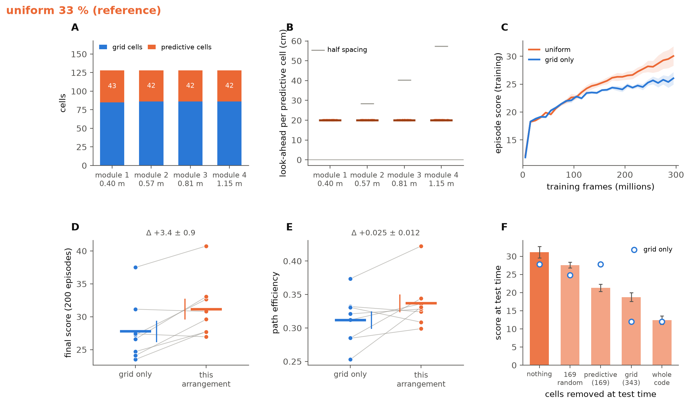
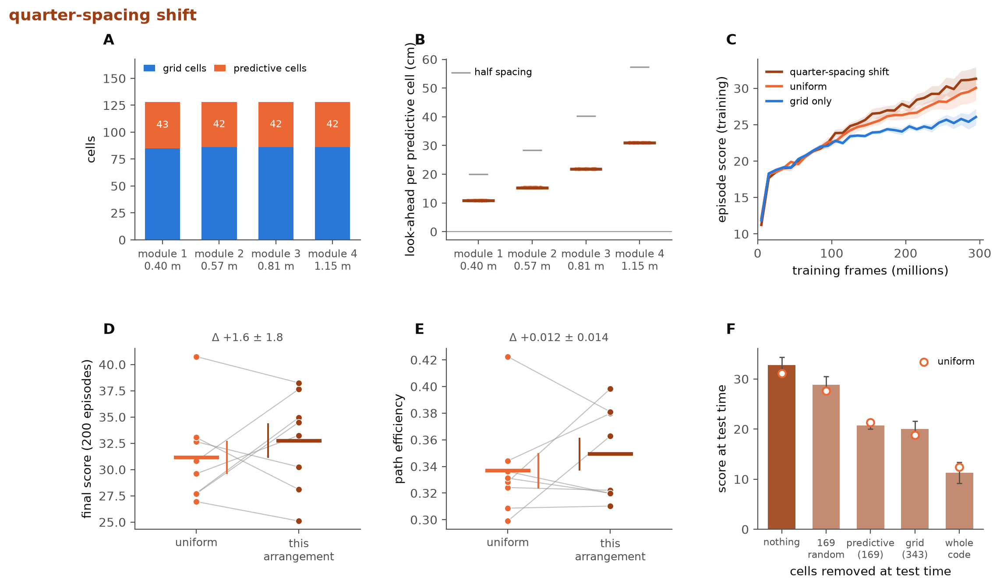
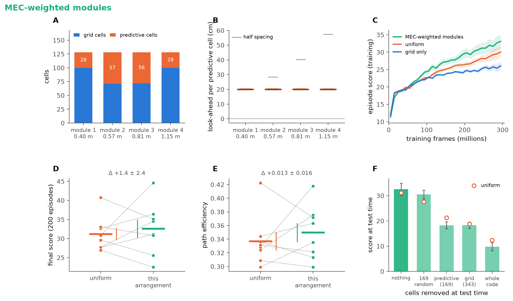
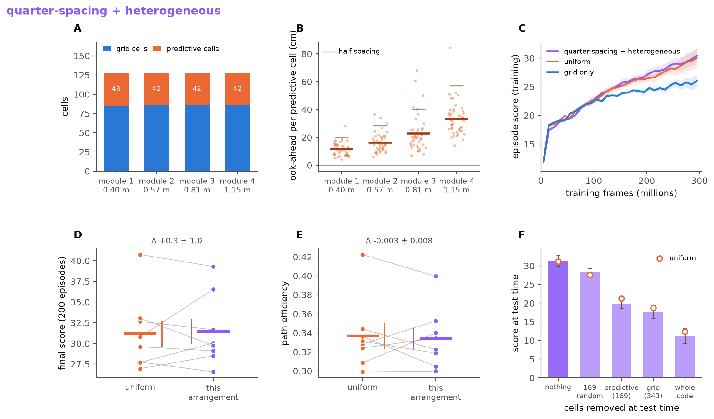
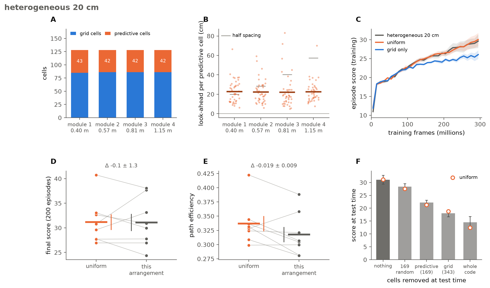
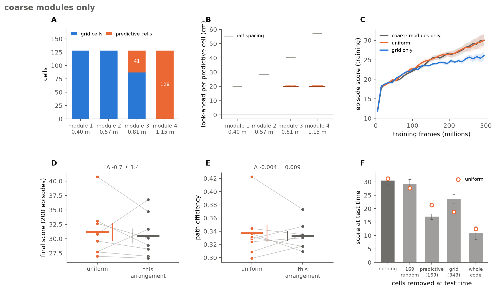
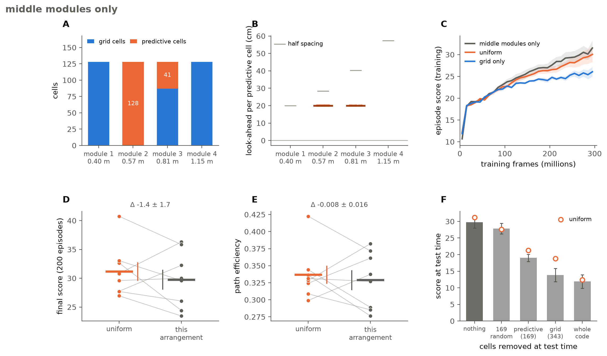
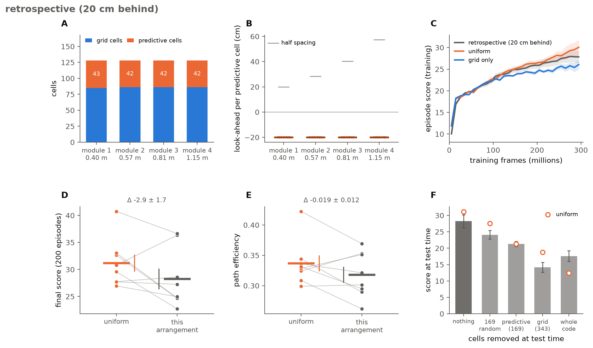
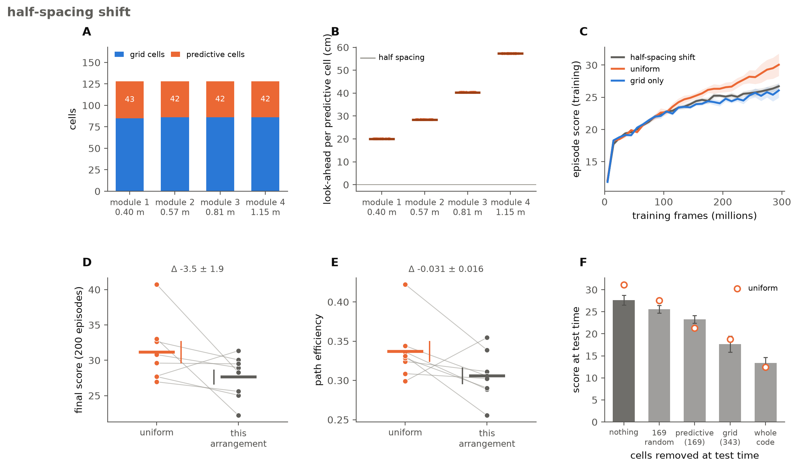
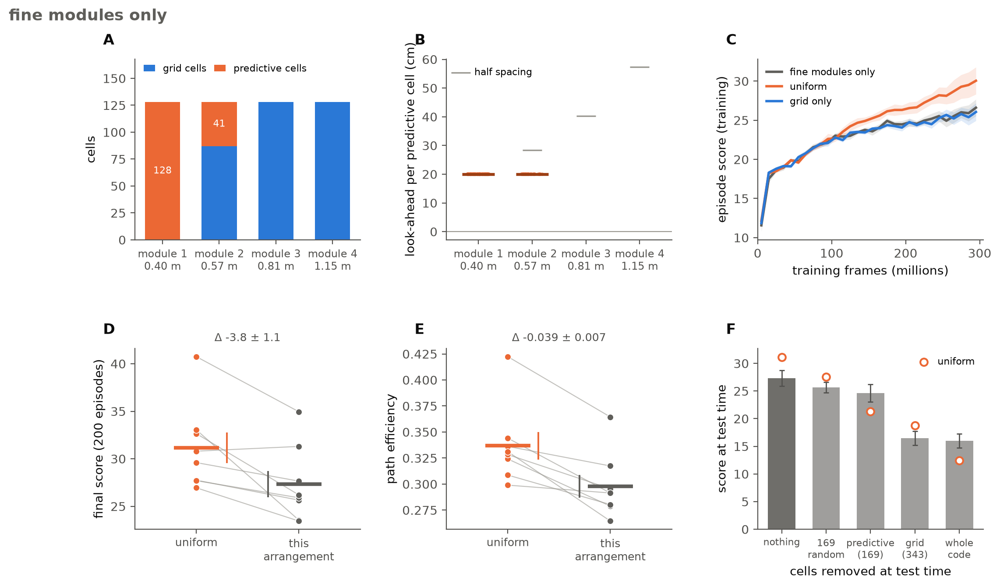

# Arranging the predictive cells

Follow-up to the main experiment, run only in the **code-only arm** (feed-forward policy, heading-only vision), the arm where the population code is the agent's only source of position and where the uniform 33 % predictive-grid-cell (PGC) code beat the pure grid code by +3.4 ± 0.9 points (p = 0.008, 8 paired seeds).

**Question.** The uniform code scatters its 169 PGCs at random over the four modules and gives every one of them the same 20 cm look-ahead. Is there a better way to arrange them?

**Candidates.** Chosen from the literature and from the recorded populations before any run was launched: Ouchi & Fujisawa (2024) report that a predictive grid cell's shift is a roughly constant *fraction* of its own grid spacing (0.27 ± 0.11), that predictive cells are mixed in with ordinary grid cells inside every module, and that the shifts vary cell to cell (coefficient of variation 0.4–0.6); in the MEC data the finest module holds the fewest predictive cells; a half-spacing shift is predicted to be the worst case (the shifted lattice is as far as possible from the cell's own grid phase). To those we added the three module-layout extremes (all PGCs in the finest, coarsest or middle modules) and a retrospective control (the same cells shifted 20 cm *behind* the agent, which carries the same heading information but predicts the past).

**Setup.** Same 512-cell populations as wave 2 (per seed the phases and orientations are identical, so every arrangement is paired with the uniform and the grid-only run of the same seed), 169 PGCs (33 %), 300 M frames, 8 seeds each, final evaluation on 200 identical episodes. 72 new runs, trained on 25 cloud GPUs in ~6 h. Statistics are within-seed paired differences; p-values are from the paired t-test (Wilcoxon gives the same conclusions).


*Figure 7. **(A)** Final score of every arrangement (dots = seeds, circle = mean ± SEM) with the grid-only and uniform means as reference lines, and the paired difference from uniform at right. **(B)** Training score (mean ± SEM over 8 seeds); grey lines are the arrangements not highlighted. **(C)** Training frames needed to reach a training score of 25, relative to the uniform code of the same seed (negative = faster). **(D)** PGC-specific lesion cost: how much more the trained agent loses when its 169 predictive cells are silenced than when 169 random cells are silenced.*

## Summary

| arrangement | what differs from uniform | final score | Δ vs uniform | Δ vs grid-only | frames to score 25, vs uniform | PGC-specific lesion cost |
|---|---|---|---|---|---|---|
| quarter-spacing shift | look-ahead = 0.27 × module spacing (11 / 15 / 22 / 31 cm) | 32.8 | +1.6 ± 1.8, p = 0.40 | +5.0 ± 1.8, p = 0.025 | −6 ± 10 M | 8.1 ± 2.1 |
| MEC-weighted modules | PGCs allotted 1:2:2:1 (28 / 57 / 56 / 28) | 32.6 | +1.4 ± 2.4, p = 0.57 | +4.8 ± 2.3, p = 0.07 | **−20 ± 6 M, p = 0.016** | **12.2 ± 2.6** |
| quarter-spacing + heterogeneous | 0.27 × spacing, lognormal spread per cell (σ 0.4) | 31.4 | +0.3 ± 1.0, p = 0.79 | +3.7 ± 0.6, p < 0.001 | −2 ± 8 M | 8.7 ± 1.0 |
| uniform (reference) | 43 / 42 / 42 / 42, 20 cm everywhere | 31.2 | — | +3.4 ± 0.9, p = 0.008 | — | 6.3 ± 1.1 |
| heterogeneous 20 cm | 20 cm with lognormal spread (σ 0.5) | 31.1 | −0.1 ± 1.3, p = 0.97 | +3.3 ± 1.1, p = 0.022 | +3 ± 6 M | 6.2 ± 1.1 |
| coarse modules only | 0 / 0 / 41 / 128 | 30.5 | −0.7 ± 1.4, p = 0.65 | +2.7 ± 1.2, p = 0.06 | +26 ± 8 M, p = 0.014 | 12.2 ± 1.9 |
| middle modules only | 0 / 128 / 41 / 0 | 29.7 | −1.4 ± 1.7, p = 0.42 | +2.0 ± 1.6, p = 0.26 | +6 ± 19 M | 8.8 ± 1.7 |
| retrospective | shift −20 cm (behind the agent) | 28.2 | −2.9 ± 1.7, p = 0.13 | +0.5 ± 1.2, p = 0.71 | +11 ± 10 M | 2.8 ± 1.4 |
| half-spacing shift | look-ahead = 0.5 × module spacing (20 / 28 / 40 / 57 cm) | 27.6 | −3.5 ± 1.9, p = 0.11 | −0.1 ± 1.9, p = 0.94 | +26 ± 12 M, p = 0.07 | 2.3 ± 1.3 |
| fine modules only | 128 / 41 / 0 / 0 | 27.3 | **−3.8 ± 1.1, p = 0.012** | −0.4 ± 0.9, p = 0.65 | **+48 ± 16 M, p = 0.018** | 1.0 ± 1.2 |

(grid-only agents reach a training score of 25 after 192 M frames on average, the uniform code after 137 M.)

**What this says.**

1. **Where the predictive cells sit across modules barely matters.** Every forward-looking arrangement whose look-ahead stays below half a period lands within ±1.6 points of the uniform code, and none of those differences is significant with 8 seeds.
2. **The shift itself is what matters.** Shifting backwards (retrospective), shifting by half a period (half-spacing), or packing all the predictive cells into the finest module (where 20 cm *is* half of the 40 cm period) all fall back to the grid-only level, and the trained agents stop relying on the predictive cells (lesion cost 1–3 points instead of 6–12).
3. **Secondary effects.** The MEC-weighted code learns fastest (20 M fewer frames to criterion, p = 0.016; above uniform at every checkpoint) but is the most variable across seeds (sd 6.8 vs 4.5; its worst seed is worse than uniform's worst, its best is the best of anything). The biology-matched code (quarter-spacing + heterogeneous) is the most consistent across seeds (sd 4.3) at the same mean as uniform. All three change the agent's reliance on its predictive cells more than they change the score.
4. The quarter-spacing shift had the highest mean and was selected (automatically, highest mean final score) as the arrangement for the concentration series (10 / 25 / 30 / 35 / 40 %). In that series 33 % remained the best percentage (25 % tied, 10 % significantly worse; see the README), so the conditional rerun of all arrangements at another percentage was not triggered.

## The arrangements one by one

Each figure below has the same six panels. **(A)** cells per module: grid cells (blue) and predictive cells (orange) out of 128. **(B)** look-ahead of every predictive cell, by module; the grey tick is half the module's spacing, the aliasing point. **(C)** training score, mean ± SEM over 8 seeds, against the uniform code and the grid-only code. **(D)** final score of each seed, reference → this arrangement, with the paired difference (mean ± SEM) above. **(E)** the same for path efficiency (straight-line distance to the goal over distance walked). **(F)** score after silencing cells at test time: bars = this arrangement, hollow circles = the reference.

### Uniform 33 % (reference)



The code from the main experiment. 169 of the 512 cells are predictive, drawn at random within each module so that every module holds about a third (43 / 42 / 42 / 42), and every predictive cell reads out its lattice 20 cm ahead of the agent along its direction of travel. Against the grid-only code of the same seed it scores +3.4 ± 0.9 (p = 0.008), reaches a training score of 25 about 55 M frames sooner, and silencing its predictive cells costs 6.3 points more than silencing 169 random cells. Here the reference in panels C–F is the grid-only code.

### Quarter-spacing shift



Same even allotment as uniform, but each predictive cell looks ahead by 0.27 of its own module's spacing instead of a fixed distance: 11 cm in the 0.40 m module, 15, 22 and 31 cm in the others. This is the shift Ouchi & Fujisawa measured (0.27 ± 0.11 of the spacing, a constant *phase* offset that survives when the grid rescales). The visible change relative to uniform is in the finest module, where the fixed 20 cm shift was half a period and is now a quarter. Result: the highest mean of all arrangements (32.8), +1.6 ± 1.8 over uniform (4 of 8 seeds, p = 0.40, not significant) and +5.0 ± 1.8 over grid-only (p = 0.025). Learning speed and path efficiency are indistinguishable from uniform; reliance on the predictive cells is a little higher (8.1 vs 6.3).

### MEC-weighted modules



Look-ahead stays 20 cm everywhere, but the 169 predictive cells are allotted to the modules in the ratio 1 : 2 : 2 : 1 (28 / 57 / 56 / 28): fewest in the finest and the coarsest modules, most in the two intermediate ones, as in the MEC recordings where the finest module holds the fewest predictive cells. Result: mean 32.6, +1.4 ± 2.4 over uniform (p = 0.57). It is the fastest learner: it reaches a training score of 25 after 117 M frames against 137 M for uniform (−20 ± 6 M, p = 0.016), its curve sits above uniform at every checkpoint, and the area under the learning curve is +1.75 ± 0.66 (p = 0.03). It is also the least consistent: seed scores range from 22.5 to 44.6 (sd 6.8 vs 4.5 for uniform). Its agents rely on their predictive cells about twice as much as uniform's (lesion cost 12.2 ± 2.6).

### Quarter-spacing + heterogeneous



The quarter-spacing rule with a lognormal spread (σ = 0.4) applied cell by cell, so within the finest module the look-aheads run from about 6 to 20 cm around an 11 cm mean, and proportionally more in the coarser modules. This is the closest match to the recorded population: shift proportional to spacing, mixed within every module, coefficient of variation ≈ 0.4. Result: 31.4, +0.3 ± 1.0 over uniform (p = 0.79), +3.7 ± 0.6 over grid-only (p < 0.001); the tightest spread across seeds of any code (sd 4.3; worst seed 26.6). Learning curve, speed and path efficiency are identical to uniform's; reliance on the predictive cells is slightly higher (8.7 ± 1.0).

### Heterogeneous 20 cm



Uniform's 20 cm look-ahead multiplied by a lognormal factor (σ = 0.5) per cell: the median stays 20 cm, two thirds of the cells fall between 12 and 33 cm, the same in every module. It isolates the effect of cell-to-cell spread on its own. Result: 31.1, −0.1 ± 1.3 vs uniform (p = 0.97). Nothing changes: same score, same learning curve, same reliance (6.2); path efficiency is marginally lower (−0.019 ± 0.009, p = 0.08).

### Coarse modules only



All 169 predictive cells in the two largest-spacing modules (0 / 0 / 41 / 128), 20 cm look-ahead, so the two finest modules are pure grid cells. Result: 30.5, −0.7 ± 1.4 vs uniform (p = 0.65), +2.7 ± 1.2 vs grid-only (p = 0.06). It learns more slowly at first (+26 ± 8 M frames to criterion, p = 0.014) and catches up by the end, and its agents rely heavily on the predictive cells they have (12.2 ± 1.9).

### Middle modules only



All predictive cells in the two intermediate modules (0 / 128 / 41 / 0), 20 cm look-ahead. Result: 29.7, −1.4 ± 1.7 vs uniform (p = 0.42), +2.0 ± 1.6 vs grid-only (p = 0.26): not reliably different from either. Learning speed is the most variable of the set (some seeds much faster, some much slower than their uniform partner). Reliance 8.8 ± 1.7.

### Retrospective (20 cm behind)



The control for *what* the predictive cells add. Same even allotment, but every "predictive" cell reads out its lattice 20 cm *behind* the agent. Such a cell carries exactly as much information about the direction of travel as a predictive cell, but it reports where the agent was rather than where it will be. Result: 28.2, −2.9 ± 1.7 vs uniform (p = 0.13), and no better than grid-only (+0.5 ± 1.2, p = 0.71). The agents barely use these cells (lesion cost 2.8 ± 1.4). The benefit of predictive cells comes from looking forward, not from the heading information they carry.

### Half-spacing shift



Look-ahead = half of each module's spacing: 20 / 28 / 40 / 57 cm. This was predicted to be the worst case before the runs: a half-period shift puts the predictive cell's lattice as far from its own grid phase as a shift can, in every module at once. Result: 27.6, −3.5 ± 1.9 vs uniform (p = 0.11; better than uniform in 1 seed of 8), −0.1 vs grid-only. Learning is slower (+26 ± 12 M frames, p = 0.07) and the predictive cells are nearly ignored (lesion cost 2.3 ± 1.3).

### Fine modules only



All predictive cells in the smallest-spacing modules (128 / 41 / 0 / 0), 20 cm look-ahead. Result: the worst arrangement, 27.3: −3.8 ± 1.1 vs uniform (p = 0.012; better in 1 seed of 8), level with grid-only (−0.4 ± 0.9). It is the slowest learner (+48 ± 16 M frames to criterion, p = 0.018), its paths are least efficient (−0.039 ± 0.007, p = 0.001), and its predictive cells are ignored (lesion cost 1.0 ± 1.2). Note the confound that explains it: 20 cm in the 0.40 m module is exactly half a period, so three quarters of these predictive cells sit at the aliasing point. The fine-only and half-spacing results tell the same story.

## Reproduce

```bash
python scripts/make_matrix_v2.py arrangements --seeds 8 --out /tmp/waveA.json   # fine / coarse / middle / half-spacing / heterogeneous
python scripts/launch_matrix.py --matrix_json /tmp/waveA.json                   # or scripts/gcp_fleet.py plan/launch --matrix_json
# the four literature-matched codes are the same matrix with
#   --pgc_shift_rule spacing --pgc_shift_frac 0.27                 (quarter-spacing)
#   --pgc_shift_rule spacing --pgc_shift_frac 0.27 --pgc_shift_jitter 0.4   (+ heterogeneous)
#   --pgc_layout weights --pgc_module_weights 1,2,2,1              (MEC-weighted)
#   --pgc_shift -0.20                                              (retrospective)
python scripts/make_figures.py --runs_dir runs --out figures                   # Fig. 7 + figures/arrangements/
```
