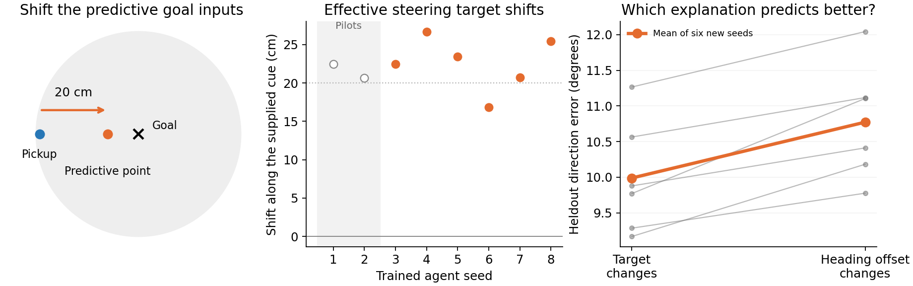

# Predictive goal input moves where the original RL agent aims

**The original PGC-trained agents use the predictive goal-code values to shape where they steer.** After freezing the measurement on pilot agents1–2, all six previously untested agents3–8 showed a positive shift along the predictive displacement. Averaged across four fixed goal/room contexts, the fitted effective target moved **22.6cm** along that direction, with a95% interval of18.9–26.3cm and exact two-sided sign-flip p=.03125. The supplied predictive offset was20cm. This is a consistent directional component, not an exact rigid translation: the transverse component was7.7cm on average and uncertain across agents, CI−3.0 to18.5cm.

We used the original1B-frame reinforcement-learning checkpoints, actual hexagonal spatial-code generator, square-room renderer and six-action actor. At each observer position we swept facing direction while holding the physical position, room, current spatial code and previous action fixed. Only the169 predictive values in the saved goal snapshot changed. The343 ordinary goal values stayed fixed at the pickup point. No policy weights, supervised heading agent or external controller were introduced.

The preferred-motion direction combines all four translation actions with their true physical directions, including strafing and backward movement. We fitted the steering field on half the observer positions and evaluated it on the other half. Two explanations competed: changing the effective target point while retaining one angular offset, or retaining one target point while changing the angular offset. This controls for action-frame and heading-response bias. The target-change explanation gave lower heldout direction error in all six new agents: **9.99° versus10.77°**, an improvement of0.78°[0.43°,1.13°]. The prespecified interpretation gate passed; the improvement is consistent but modest, and the remaining roughly10° prediction error matters when interpreting individual fitted points.

The effect survived uniform position weights (24.6cm along the cue), the older dominant-action readout (22.6cm), and the shorter15-update history (23.1cm). The primary60-update assay and all alternatives are input-clamped measurements, not actual navigation trajectories. Native-versus-ordinary behavior and the goal-state pulse experiments provide separate links to the real actor's navigation.

**Simple interpretation:** the predictive goal snapshot supplies a spatial point shifted inward from where the agent first touched the reward region. The trained network's steering uses that displacement. Combined with the original removal/restoration and goal-geometry experiments, this supports a useful spatial-target cue as a mechanism for the PGC benefit. It does not require a more stable ring attractor. The fitted target is a compact description of policy responses, not a directly observed neuronally encoded goal coordinate.

All32 context/model runs are retained: four contexts for each of eight original PGC agents. Seeds1–2 remain descriptive and were excluded from the six-seed confirmation. There were no optimizer failures or point-bound hits. Source and checkpoint hashes were verified. Synthetic tests checked action-frame offsets, known-target recovery with a common angular bias, and preference for the angular-offset alternative when the simulated field truly only rotates.

The earlier uncorrected ray fit remains archived and is not the primary measurement. It omitted a common angular response offset and used variant-dependent weights, so its apparent absolute target and exact shift direction were less reliable. The revised source includes all translation actions, common weights, a shared-offset target fit, and the heldout competing explanation. See the [frozen protocol](original_rl_goal_policy_map_protocol.md), [source manifest](original_rl_goal_policy_map_sources.json), [full audited summary](../../results/rl_map_mechanism/policy_map_confirmation/summary.json), and [simple results README](../../results/rl_map_mechanism/policy_map_confirmation/README.md).
