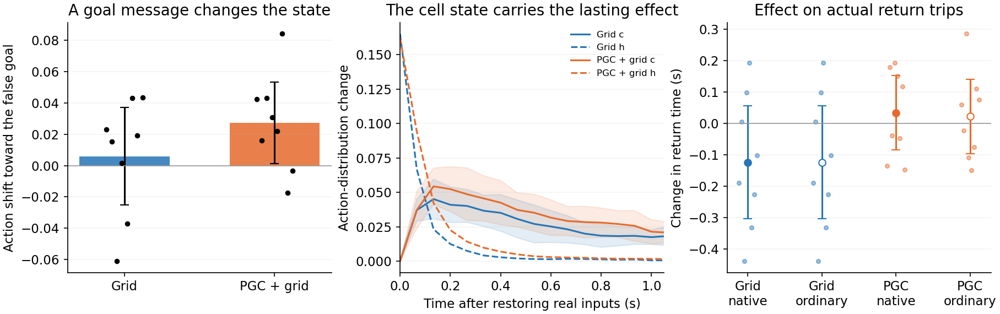

# What changing the original RL network's goal-conditioned state does

We tested all eight original Grid agents and all eight original PGC+grid agents. These are the 1B-frame reward-trained LSTMs, controlling their original square arena with their original visual inputs, hexagonal grid maps, six actions, goal-pickup reward and respawn rules. There were412 eligible Grid return trials and404 PGC+grid return trials across512 attempted episodes per population. Every trained seed is retained.

For each real return state, we replayed the preceding one second of actual experience. We changed only the saved goal snapshot, rotating the actual pickup position and arrival direction together by15° around the current observer. We then inserted the resulting state at the real physical location, restored the actual goal input and continued with the original actor. No decoder supplied a heading or action. Replaying the unchanged input reconstructed the original state exactly in the seed1 pilot and within the fixed tolerance throughout the cohort.

The full counterfactual state changes the agent's action probabilities immediately. Its immediate translational bias toward the fictitious goal is clearer in PGC agents:0.0272 probability units, descriptive95% CI[0.0011,0.0533], versus0.0059[-0.0253,0.0371] in Grid agents. **The paired population difference is uncertain**:0.0213[-0.0201,0.0627], exact exploratory p=.258. Significance in one population and absence in the other is not evidence of a between-population difference. This metric omits turning actions.

To locate the persisting effect, we separately inserted the altered cell state c while retaining native h, or altered h while retaining native c. The c-only intervention leaves the first actor distribution exactly unchanged; the effect appears through the next recurrent update. After one second of identical restored observations, the residual action-distribution difference was:

| Original trained population | Altered c only | Altered h only |
|---|---:|---:|
| Grid |0.01749|0.000647|
| PGC+grid |0.02146|0.001726|

The c-only residual exceeds the h-only residual in **all eight seeds of both populations**. This locates the lasting part of this particular goal-message substitution in c. It is not an equal-amplitude test of the general importance of h and c; their natural changes have different norms and scales. The component hybrids are interventions, not claimed naturally occupied states or ring-manifold tangents.

**Predictive input did not show better repair of this altered state.** Within PGC agents, replacing predictive goal-code values with ordinary grid values changed the one-second c-only residual by−0.00028, CI[−0.00615,0.00560], exact exploratory p=.922. The PGС−Grid difference in c-only residual was also uncertain:0.00396[−0.00605,0.01397]. Both populations carry a continuing goal-conditioned influence on the actor; this assay does not isolate a PGC stabilization advantage.

Actual trajectories changed only modestly after the real goal code returned. Mean first-second path displacement was8.1mm in Grid agents and9.1mm in PGC agents. The full pulse changed capped first-goal time by−0.124s[-0.304,0.056] and+0.034s[−0.084,0.153], respectively; each within-population interval includes zero. The between-population pulse-time contrast is+0.158s[0.014,0.301], unadjusted exploratory p=.039, driven partly by the Grid pulse's tendency to improve rather than impair arrival. This isolated contrast does not support PGC protection and is not presented as a corrected confirmatory discovery. Goal-hit differences were near zero.

The suggested mechanism is **goal-conditioned recurrent processing with a persisting cell-state component**, shared by both populations. Goal-code geometry can change what the actor aims at, while c carries some history of that input after it is restored. These findings support an actual map→RNN-state→policy connection. They do not provide the sought positive evidence for a more stable autonomous ring in the PGC networks. The externally supplied goal snapshot remains present in the task, so goal-dependent activity is not equivalent to internally storing a goal without sensory support.

Validation included unchanged checkpoint hashes; frozen experiment-source hashes; exact c-only first-action equality; and bitwise-identical complete neural/behavioral arrays for all Grid-only native versus ordinary substitutions. The [fixed exploratory protocol](original_rl_goal_state_pulse_protocol.md), [full results](../../results/lstm_goal_message_state_pulse/cohort_summary.json) and [simple README](../../results/lstm_goal_message_state_pulse/README.md) retain every seed, eligibility count and contrast.

An earlier linear-readout pulse is retained as a failed diagnostic: nominal15° in the linear readout produced only1.2° in a separate nonlinear checker and negligible actor/path effects. See [why that edit was not a reliable goal-memory manipulation](../../results/lstm_goal_state_pulse/README.md).
