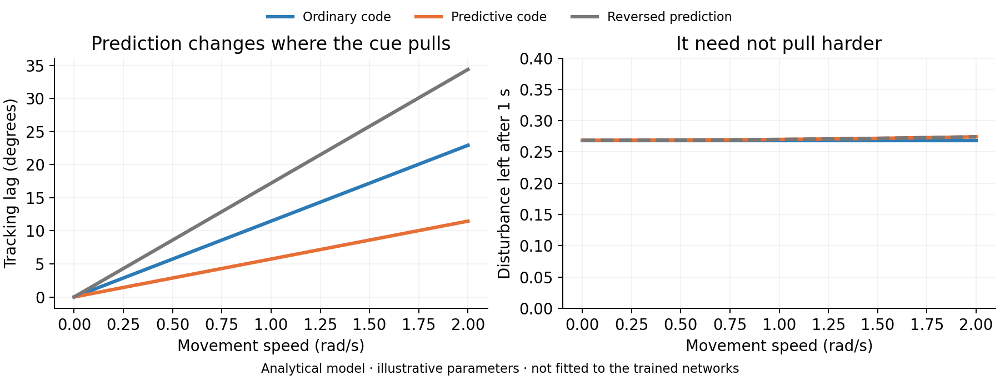
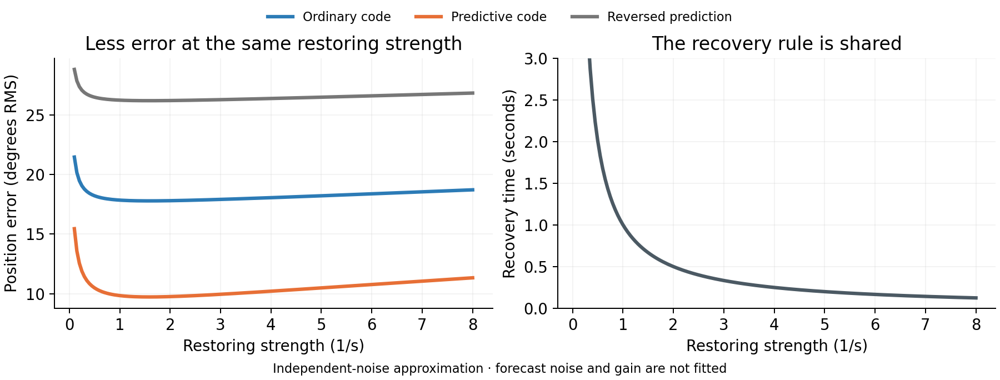
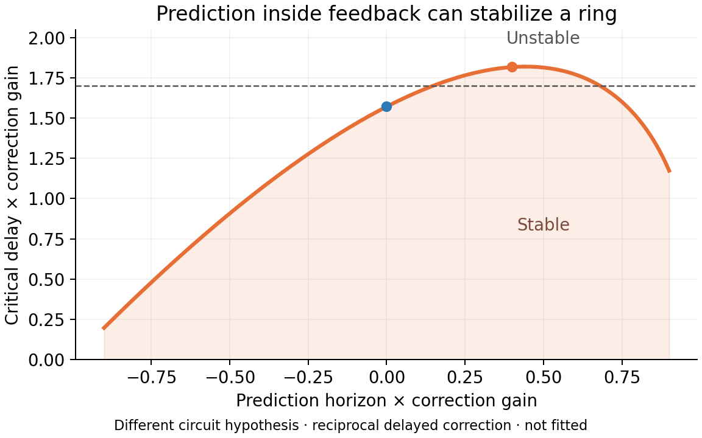

# What prediction changes in a ring model

This is an **analytical model with illustrative parameters**, not a fit to the trained networks. It separates accurate anchoring, stronger contraction, and a genuinely changed attractor-stability boundary. Those are different outcomes.

The model predicts a useful result: **predictive input can pull an agent toward a more accurate position even when ordinary input pulls slightly harder.** Strong recovery from disturbances is useful only if the network recovers toward the right state.



## 1. Mixed spatial cues: where does the network get pulled?

Let the true circular position move at constant speed, `q(t) = v t`. The ordinary cue reports the position from `d` seconds earlier. Predictive channels advance that observation by `H v`, using the same velocity information. A simple phase estimator is

\[
\dot\theta = \hat\omega
 + K_g\sin[q(t-d)-\theta]
 + K_p\sin[q(t-d)+Hv-\theta].
\]

Here `Kg` and `Kp` are **effective learned coupling strengths**, not cell counts. The error is `e = θ − q`. Combining the two cue vectors gives

\[
F=e^{-idv}(K_g+K_p e^{iHv})=R e^{i\alpha},\qquad
\dot e=(\hat\omega-v)+R\sin(\alpha-e).
\]

On the stable locked branch, provided `|ω̂ − v| < R`,

\[
e_* = \alpha + \arcsin[(\hat\omega-v)/R],\qquad
\lambda_e=-\sqrt{R^2-(\hat\omega-v)^2}.
\]

`α` determines the cue's positional bias. `λe` determines how strongly small phase errors are corrected. With accurate velocity integration, these reduce to `e* = α` and `λe = −R`.

Three predictions follow directly:

1. **One coherent cue stream:** advancing its phase changes its bias but leaves its strength and contraction unchanged.
2. **Mixed ordinary/predictive cues:** replacing predictive channels with ordinary ones makes every cue point to the same old location. The total strength becomes `Kg + Kp`, which is at least as large as the mixed-cue strength. Removal can therefore make perturbations contract slightly faster while making tracking less accurate.
3. **Reverse the forecast:** `+H` and `−H` give the same cue strength because `R² = Kg² + Kp² + 2 Kg Kp cos(Hv)`. Their positional biases differ. Opposite effects on tracking with similar contraction would distinguish direction information from a generic increase in gain.

These predictions are relevant to the observed pattern of improved tracking without a stronger measured disturbance contraction. They are not estimates of the trained RNN's parameters.

## 2. The underlying ring and what cue withdrawal does

Use the standard radial normal form in the frame moving with the true phase:

\[
\dot z=(\mu-\beta|z|^2)z+F,\qquad \mu,\beta>0.
\]

With no cue, `F = 0`, the radius is `r0 = √(μ/β)`. The radial exponent is `−2μ`, and the tangent exponent is zero. Every angle is an equilibrium. **This ring is explicitly built into this analytical control model; it is not evidence of learned emergence.**

With a fixed nonzero cue, the stable aligned radius solves `β r³ − μ r = |F|`. Its local exponents are

\[
\lambda_r=\mu-3\beta r^2,\qquad \lambda_\theta=-|F|/r.
\]

The input now selects a phase: it is a driven equilibrium in the moving frame. Rotating the cue changes the selected angle, not these exponents. Combining mixed cues can alter their total strength and therefore the driven exponents. Removing all cues restores the same cue-free ring spectrum in every condition.

This gives a clean boundary: **phase lead alone does not strengthen the intrinsic ring attractor.** A lasting cue-off improvement in a trained RNN must come from changed learned parameters or another internal circuit interaction.

## 3. Why accurate anchoring can still be useful stabilization

In a small-error approximation, noisy path integration and noisy cues give

\[
de=-K(e-b)dt+\sqrt{2D_v}\,dW_v+K\sqrt{2D_c}\,dW_c.
\]

For the explicitly assumed independent noises,

\[
\mathbb E[e^2]=b^2+D_v/K+K D_c.
\]

At the same restoring strength `K`, prediction can reduce the bias `b` while preserving the same recovery time `1/K`. Without anchoring, velocity noise accumulates; with a lagged anchor, the estimate is stable around an old position. Prediction can make anchoring both stabilizing and accurate.



This noise model is illustrative. The actual predictive inputs reuse noisy velocity, so their noise can be correlated with path-integration noise. Fitting the trained model requires measuring those correlations rather than assuming this simple variance formula.

## 4. A circuit where prediction really changes transverse ring stability

This is a **separate proposed circuit**, not the same external-cue model. Consider two internal phases coupled by delayed corrective feedback. Their difference is `e = θa − θb`, their mean is `ψ = (θa + θb)/2`, and the correction uses

\[
\hat e(t)=e(t-d)+H\dot e(t-d),\qquad
\dot\theta_a=-\tfrac K2\sin\hat e,\quad
\dot\theta_b=+\tfrac K2\sin\hat e.
\]

The common phase remains neutral: `ψ̇ = 0`. The synchronized family `θa = θb = ψ` is a ring. Ordinary radial relaxation can stabilize the two amplitudes. Near synchronization, the remaining transverse phase difference satisfies

\[
\dot e(t)=-K[e(t-d)+H\dot e(t-d)],\qquad
s+K(1+Hs)e^{-sd}=0.
\]

For `|K H| < 1`, the first instability boundary is

\[
d_{\rm crit}=\frac{\sqrt{1-(KH)^2}}K
 \left[\frac\pi2+\arcsin(KH)\right].
\]

This follows by setting `s = iω`: the magnitude equation gives `ω = K/√(1−K²H²)`, and the phase equation gives `ωd = π/2 + arctan(Hω)`. At zero delay the finite root is stable, the high-frequency roots are stable for `|KH| < 1`, and the first crossing is toward positive real part. For `|KH| > 1`, high-frequency real parts approach `log|KH|/d > 0`; excessive forecast can therefore destabilize the circuit.

For `K = 1/s` and `d = 1.7 s`:

| Forecast horizon | Critical delay | Root near the first instability |
| --- | ---: | ---: |
| No prediction | 1.571 s | `+0.0331 ± 0.9446i` |
| Predict 0.4 s | 1.817 s | `−0.0396 ± 1.1639i` |
| Reverse by 0.4 s | 1.062 s | `+0.1183 ± 0.8149i` |

Moderate prediction stabilizes the transverse phase error while leaving the common ring phase neutral. The analytical boundary determines stability; the displayed numerical roots independently check the crossing, rather than constituting an exhaustive root search.



To use this as an explanation of the trained RNN, one would need to identify a corresponding delayed corrective interaction and show that perturbing its forecast component changes the transverse mode as predicted. External phase lead alone is not that interaction.

## Reproduce and test

```sh
python scripts/ring_mechanism_theory.py
python -m unittest tests.test_ring_dynamics -v
```

The script writes exact numeric predictions and PNG/PDF/SVG figures. Tests check the normal-form exponents against an independently differentiated vector field, equal stability under pure cue rotation, the mixed-cue accuracy/contraction counterexample, and the delayed-feedback characteristic equation.
