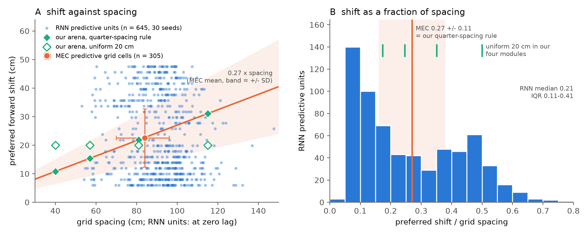

# Predictive shift relative to grid spacing: source check

Checks the statements behind the quarter-spacing arrangement in [arrangements.md](arrangements.md) against the two local sources: the MEC recordings of Ouchi & Fujisawa (2024, *Science* 385, 776–784; main text and figures, the supplement is not available locally) and the 30-seed path-integration RNN cohort (`predictive-grid-cell-analysis`, `canonical_cohort_v1`: 4096-unit RNN, 2.2 m box, 256 units classified per seed). Claims 1–4 below are the statements in arrangements.md attributed to the paper; claims 5–7 are figures stated for the RNN cohort without a written source. Arenas: 2.1 m square (MEC), 2.2 m (RNN), 2.5 m (ours).

*Preferred forward shift against grid spacing. **(A)** RNN predictive units (one dot per unit, spacing at zero lag; 5 units with spacing above 150 cm fall outside the panel), the MEC population (shift mean ± SD; spacing median and IQR read off Fig. 3E) and the two rules used in our arena. **(B)** Shift as a fraction of spacing; the band is the MEC mean ± SD.*

**Methods.** MEC numbers are quoted from the main text; values marked ≈ were read off the box plots of the local PDF, calibrated on the axis ticks (± 1 cm, ± 0.01; whisker ends ± 2 cm). RNN numbers combine the cohort's stored labels and preferred lags (`pgc_rigor/pgc_classification.npz`: time-lag sweep ± 25 steps = ± 49.5 cm at 1.98 cm per step, smallest shift 5 cm, units peaking at the window edge excluded, shuffle-tested, held-out confirmed) with a new per-unit spacing: trajectories regenerated with the classifier's seed (32 batches of 200 × 40 steps; the classifier used 16), spacing = mean radius of the six innermost peaks of the spatial autocorrelogram of the 5-cm-bin rate map at zero lag, accepted when ≥ 4 ring peaks are found and it agrees within 25 % with the radial profile's first maximum. Synthetic 40/57/81/115 cm lattices are recovered within 1 % (peaks) and 2.5 % (radial) ([shift_vs_spacing_code.py](shift_vs_spacing_code.py)). Statistics are pooled over the 30 seeds, with per-seed medians (mean ± SEM over seeds) alongside.

## Ouchi & Fujisawa (2024)

The shift is spatial: rate maps are built after projecting the rat's position "forward or backward a fixed length on the trajectory" (Fig. 1D); the time-shift version gives significantly lower gridness peaks (fig. S8). A predictive grid cell has a gridness maximum "at a future position that is significant compared with shuffled data", no significant gridness at the original position, and theta-trough (≈ 180°) phase locking.

| quantity | value | source |
|---|---|---|
| cells | 305 predictive, 558 phase-precession, 241 phase-locked grid cells, 6 rats (predictive = 27.6 % of the three classes) | text, Fig. 3, table S1 |
| optimal shift, predictive cells | 22.5 ± 10.2 cm (mean ± SD); median ≈ 22, box ≈ 16–29, whiskers ≈ 1–47 cm | text, Fig. 3F |
| shift / own spacing | 0.27 ± 0.11 (mean ± SD); median ≈ 0.27, box ≈ 0.20–0.34, whiskers ≈ 0–0.5 | text, Fig. 3G |
| grid spacing, predictive cells | median ≈ 84 cm, box ≈ 69–96, whiskers ≈ 50–136 cm | Fig. 3E |
| grid spacing, phase-precession / phase-locked | median ≈ 77 / ≈ 98 cm, whiskers ≈ 48–143 cm | Fig. 3E |
| shift of the other classes | 4.5 ± 8.8 cm (phase-precession), 0.8 ± 9.0 cm (phase-locked) | text, Fig. 3F |
| grid rescaling, goal-directed → random foraging (53 predictive cells) | spacing ≈ 92 → ≈ 74 cm (P < 0.01), shift ≈ 19 → ≈ 14 cm (P < 0.01), shift / spacing ≈ 0.26 → ≈ 0.24 (n.s.); the spacing shrinks in all three classes, the shift only in predictive cells | Fig. 4G–I |
| direction of travel | optimal shift "constant regardless of the direction of travel" | text, fig. S5 |
| retrospective cells | no such class: the definition requires the maximum at a *future* position, so predictive cells have positive shifts by construction; the other two classes straddle zero (phase-locked box ≈ −3 to 5 cm), so negative optimal shifts are common there, not outliers | text, Fig. 3F–G |
| modules | "module" does not occur in the main text: no per-module counts, nothing on mixing or on the finest module | — |

CV of the shift: 10.2 / 22.5 = 0.45 in cm, 0.11 / 0.27 = 0.41 relative. CVs of independent factors add in quadrature, so with the ≈ 0.2 spacing CV of Fig. 3E a shift proportional to spacing predicts CV(cm) ≈ √(0.41² + 0.2²) ≈ 0.46 > CV(relative), whereas a spacing-independent shift predicts CV(relative) ≈ √(0.45² + 0.2²) ≈ 0.49 > CV(cm). The observed pair fits the first, so the summary numbers are consistent with proportionality across cells (the paper never plots shift against spacing cell by cell); the within-cell rescaling test (Fig. 4H–I) is its direct evidence for a constant fraction.

## RNN cohort

| quantity | value |
|---|---|
| predictive units | 740 of 7680 (9.6 ± 0.4 % of units, 30.7 ± 1.1 % of the classifier's grid units, mean ± SEM over seeds; per-seed range 6–14 %); 425 retrospective |
| preferred shift | median 17.8 cm (IQR 9.9–35.6), mean 22.9 ± 13.9 cm (CV 0.61); per-seed medians 21.2 ± 1.2 cm (SD 6.8, range 10.9–35.6); modal lags 6–8 cm, 27 % of units at 6–10 cm, 16 % at 40–47.5 cm (units peaking at the ± 49.5 cm edge are dropped); retrospective median −23.7 cm |
| earlier pipeline versions (`predictive_shift_breadth*` summaries of the older checkpoints; threshold classifier, no significance test) | ± 40 cm sweep, 5 seeds: median 15.9, mean 17.0 ± 8.4 cm, per-seed CV 0.45–0.52; spatial-shift mode, ± 20 cm window, 10 seeds: median 15 cm, per-seed CV 0.31–0.40, 90th percentile at the 20 cm edge in every seed |
| grid spacing, zero-lag grid units | median 91.2 cm (IQR 82–99, 5th–95th percentile 67–111, n = 811); per-seed medians 80–102 cm; per-seed median of the stored 11-cm-binned spacing 88 or 99 cm in every seed; the older cohorts' FFT lattice vectors are quantised to multiples of 1/2.2 m (field spacings 2/(√3·\|k\|) = 80–127 cm; 1/\|k\| = 70–110 cm) |
| grid spacing, predictive units (zero lag) | median 92.6 cm (IQR 83–100, range 53–181), 645 of 740 units with a valid ring; one unimodal spacing population (the covariate file's 2–3 "modules" per seed are k-means splits of the binned spacings, not separate populations) |
| shift / spacing per unit | median 0.21 (IQR 0.11–0.41), mean 0.26 ± 0.17 (CV 0.65), n = 645; 29 % within 0.27 ± 0.11, 19 % above 0.45; per-seed medians 0.24 ± 0.015 (range 0.12–0.43); retrospective −0.28 |
| shift against spacing across units | Spearman ρ = −0.10 (p = 0.009); spacing terciles 78 / 93 / 103 cm → shift medians 21.8 / 19.8 / 15.8 cm (ratios 0.31 / 0.21 / 0.16): the shift is roughly constant in cm, not a constant fraction |
| robustness | stored 11-cm spacing: median ratio 0.20 (IQR 0.11–0.40, n = 739); spacing at the preferred lag: 0.15 (IQR 0.10–0.50, n = 536), not used because maps shifted by ≥ 35 cm (≥ 18 of 40 steps dropped) are sparse and report 0.79 × the zero-lag spacing, giving a spurious ρ = −0.45 |

## Verdicts

| claim | verdict |
|---|---|
| 1. shift = 0.27 ± 0.11 of each cell's spacing | **supported** (text, Fig. 3G); constancy of the fraction within a cell under rescaling supported (Fig. 4I); proportionality across cells consistent with the summary CVs but not plotted by the paper |
| 2. CV 0.4–0.6 | **partly**: the paper states no CV; its means and SDs give 0.45 (cm) and 0.41 (relative); the 0.5–0.6 end comes from the RNN (0.45–0.52 older pipeline, 0.61 cohort shift, 0.65 cohort ratio) |
| 3. mixed within every module | **not determinable**: modules are never mentioned; consistent with Fig. 3E, where predictive cells span the same ≈ 50–140 cm spacing range as the other grid cells |
| 4. fewest PGCs in the finest module | **not supported by any local source**: absent from the main text, and Fig. 3E shows no depletion of small spacings among predictive cells (median ≈ 84 cm, between the other two classes); the local draft reanalysis of Gardner et al. (2022) recordings shows one module of one rat, refers the other modules to supplementary figures the local PDF lacks (it holds only Figs. S1–S2 for the same recording) and reports counts per recording, not per module; the RNN cohort has a single spacing population |
| 5. RNN optimal shift ≈ 20 cm | **supported as a median** (per-seed median 21.2 ± 1.2 cm, pooled 17.8 cm) of a broad distribution (IQR 10–36 cm, mode at 6–10 cm, second hump at 33–48 cm next to the window edge) |
| 6. RNN grid spacing 80–100 cm | **supported for the typical unit**: median 91 cm, IQR 82–99 cm, per-seed medians 80–102 cm; single units run from 53 to 181 cm |
| 7. implied RNN ratio 20–25 % | **supported at the level of medians** (21 / 91 = 0.23; per-unit median 0.21, per-seed median 0.24); the per-unit spread is about twice the MEC spread (IQR 0.11–0.41 vs ≈ 0.20–0.34) and the shift does not grow with spacing across units |
| our quarter-spacing arrangement, 11 / 15 / 22 / 31 cm at 40 / 57 / 81 / 115 cm | equals the MEC mean fraction in every module; in the 81 cm module (22 cm) it coincides with both sources (MEC 22.5 cm at ≈ 84 cm, RNN 21 cm at ≈ 91 cm); the uniform 20 cm rule is 0.50 / 0.35 / 0.25 / 0.17 of spacing, inside the MEC ± 1 SD band (0.16–0.38) in the 57, 81 and 115 cm modules and outside it only in the 40 cm module; MEC cells cover ≈ 50–140 cm and RNN units 53–181 cm (90 % within 65–113), so neither source measures cells near our 40 cm spacing |
