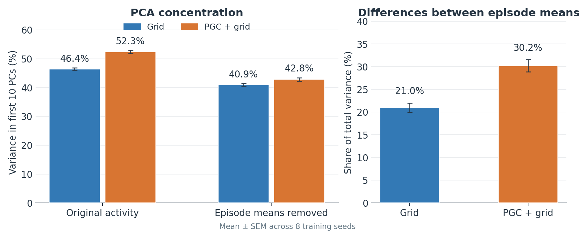
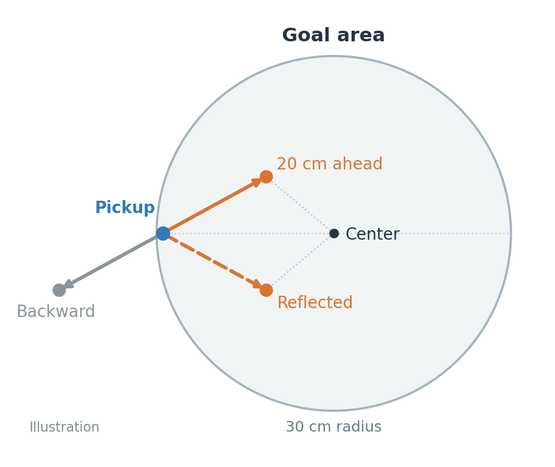
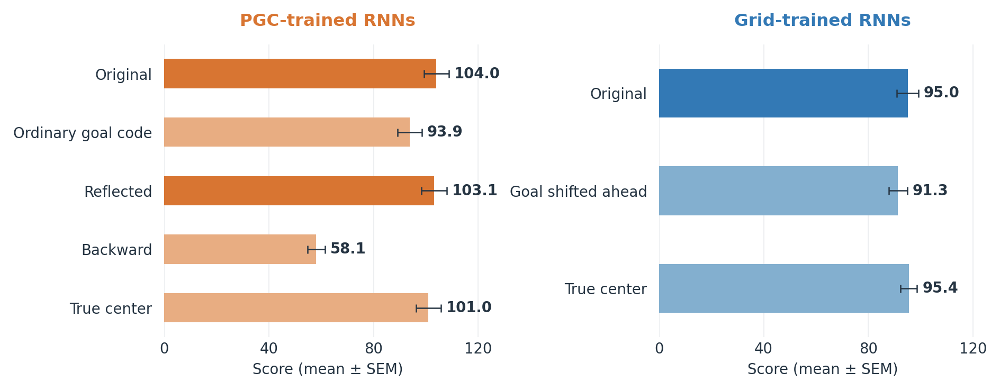
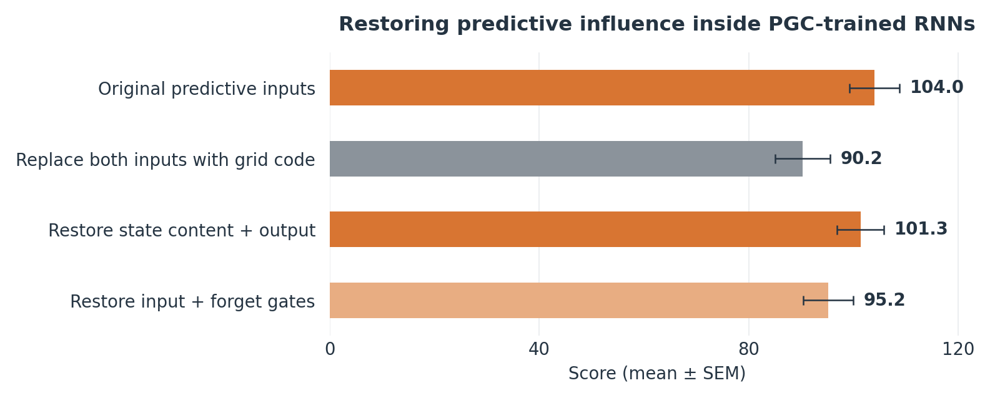

# What predictive inputs change in the RNN

**PGC models have larger activity shifts between episodes, and they use predictive spatial inputs to navigate. Whether those activity shifts cause the performance benefit remains untested.**

Eight paired training seeds; the same RNN architecture, frozen after 1 billion frames. All interventions are evaluation-only: no retraining.

## 1. Episodes move the activity cloud



**Activity-cloud centers differ more between episodes in PGC models.** Removing episode averages reduces the first-ten-PC gap from 5.9 to 1.9 percentage points.

Both populations saw the same physical replay. Episodes change goal, room appearance, and history together: these shifts are not uniquely goal memory. PCA does not establish different state dynamics. [Details](../results/lstm_variance_sources_1B/README.md).

## 2. What the predictive goal message contains



Ordinary cells record the pickup location; predictive cells record a point **20 cm ahead**. The saved message is supplied every step and refreshed at each pickup.

Reflection changes the sideways component while preserving shift length and distance to the center. Reflection and center controls use the hidden true goal coordinates.

## 3. Changing that message changes navigation



**Removing the predictive shift hurts; reversing it hurts much more.** Reflection moves the point about 18 cm but preserves performance within the preselected ±5-point tolerance. It retains the component pointing toward the center.

Moving the grid model's whole goal marker ahead hurts all eight seeds. The exact center gives no clear score gain. Better marker placement alone does not reproduce the benefit in these already-trained models.

Only the **saved goal input** changes here; live encoding and weights stay intact. No cells are silenced. [Results](../results/lstm_goal_geometry_1B/summary.json).

## 4. Predictive input changes what the RNN writes and uses



Here **both current and goal codes** are replaced. Restoring predictive influence on **state content and output** recovers most of the lost score; restoring the other two components recovers less.

Restored components receive predictive information again. This identifies a useful route inside PGC-trained networks, not different gate architecture between populations. [Details](../results/lstm_gate_rescue_1B/README.md).

## What fits these results?

**Working explanation:** the learned use of the pickup and ahead/inward cues guides navigation. Their repeated input may also help establish the episode-dependent background activity.

**Established:** predictive input → internal updates → navigation behavior.

**Still untested:** predictive input → larger episode-average shifts → better navigation.

The continuously supplied goal message could maintain those shifts. Autonomous goal memory, planning, and different attractors remain unproven.

<details>
<summary>Methods, source data, and reproduction</summary>

All data plots show means ± SEM across eight training seeds. Score is 10 points per goal reached in a 90-second episode. Seeds, not individual episodes or activity samples, are the statistical replicates.

Both models use 256-unit LSTMs. Grid-only inputs contain 512 ordinary cells; mixed inputs contain 343 ordinary cells and 169 predictive cells. In the rescue figure, “state content + output” means the candidate cell update and output gate; the other pair is the input and forget gates. The spatial diagram is illustrative.

The PCA analysis uses 3,393 sampled moving states from 16 shared scripted episodes; it is a representation probe, not a performance evaluation. The behavior tests use 128 paired episodes per condition per seed. Goal-only branches have exactly matching first-discovery times, and 3,072 repeated baseline episode records match the earlier input-swap experiment exactly.

The mirror-minus-original 90% paired score interval is [−2.45, +0.73], inside the pre-run ±5-point tolerance. Detailed reports retain paired intervals and both t and exact sign-flip tests, with correction within each analysis. The first-ten-PC gap reduction is descriptive, not a percentage of performance explained; demeaning changes both the fitted axes and the variance denominator.

Numerical sources:

- [Episode variance](../results/lstm_variance_sources_1B/summary.json)
- [Current/goal input substitutions](../results/lstm_code_swap_1B/summary.json)
- [Goal geometry](../results/lstm_goal_geometry_1B/summary.json)
- [Internal rescue](../results/lstm_gate_rescue_1B/summary.json)

Rebuild these four figures from the committed summaries, from the repository root:

```sh
python -m pip install numpy matplotlib
python scripts/plot_lstm_mechanism_summary.py
```

Model configuration JSONs, analysis scripts, figures, numerical summaries, and intervention episode records are included. Checkpoint weights (`*.pt`) and raw NumPy replay/activity archives (`*.npz`) are local artifacts and are not bundled. Re-running model experiments requires the original 1B checkpoints at `models/{gc100,pgc33}/{condition}_lstm_s{seed}_1000M.pt`; their hashes are recorded in the experiment summaries. The corresponding JSON configurations are included. The [shared-replay report](../results/lstm_variable_1B/README.md) and linked intervention reports contain the regeneration commands. Full analysis additionally uses PyTorch, SciPy, and scikit-learn.

</details>

[Main study](../README.md) · [Earlier follow-up experiments](../follow-ups/README.md)
