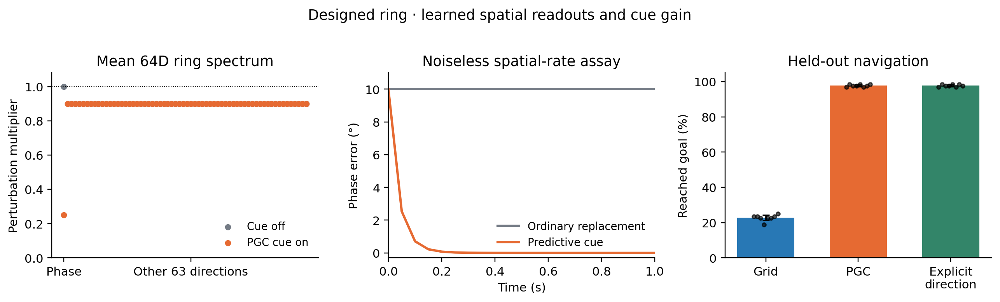
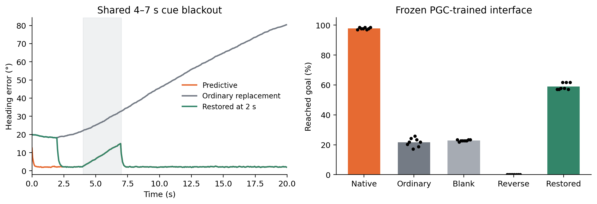

# Predictive spatial cues correct a ring memory

**We built a recurrent agent with a genuine continuous ring memory and trained it to read predictive spatial codes.** The predictive code acts like a compass: it corrects the direction stored on the ring. Removing that cue leaves the memory vulnerable to accumulated error; reversing the cue pulls the memory toward the wrong direction.

The distinction is explicit: **the ring and its correction rule are designed; the spatial readouts and correction strength are trained.** This is a constructive mechanism model, separate from the unconstrained RNN experiments. It does not claim that their recurrent weights learned this exact architecture.

The spectrum panel averages eight seeds: the orange phase multiplier is approximately 0.25, combining individual values near 0.2 and 0.4. The middle panel is a **noise-free recovery assay using actual spatial rates**. The right panel is the separate noisy, closed-loop navigation task; dots are model seeds.

## The simple mechanism

Think of the ring as a clock face. The position of the hand stores the animal's heading. The memory keeps the hand on the circle, but small errors can move it around the circle.

Ordinary grid cells describe the current location. Predictive grid cells describe a point 20 cm ahead in the travel direction. The difference between these spatial phases supplies a direction check. The trained interface uses that check to move the hand back toward the correct heading.

With the cue absent, all headings remain valid memories. With a cue present, the matching heading becomes stable. **The useful stabilization is correction of the stored heading along the ring.** The ring's intrinsic resistance to disturbances away from the circle is unchanged.

## What was trained and what was designed

| Component | How it was obtained |
|---|---|
| Original 512 grid-rate channels, 33% shifted 20 cm | Fixed analytic grid population |
| Linear readouts of the current and shifted spatial phases | Fitted on 4096 independent calibration samples |
| Subtracting phases and converting the difference into direction | Designed operation using known grid geometry |
| 64-dimensional ring memory and contraction toward it | Designed recurrence |
| Strength of the sensory correction | Selected from the same fixed gain grid on independent noisy heading trajectories |
| Navigation controller | Same fixed controller in every condition |

The decoder receives **population activity only** at inference. Position/direction labels are used for calibration and evaluation, not passed to the decoder during navigation. Modules 1–3 are used because their phase shifts avoid the direction alias present in the finest module.

Grid and PGC interfaces have the same phase-readout fitting budget. Grid calibration correctly targets the actual unshifted maps in both cell pools. The explicit-direction control receives the same noisy measured direction that generates PGC input, with the same availability. An ordinary grid population can also convey direction through its history; this deliberately simple instantaneous decoder does not attempt that more general solution.

## What happened in navigation

We froze the protocol after a separate pilot and evaluated eight new population/model seeds, each on the same held-out bank of 128 paired navigation episodes. The agent had noisy angular-motion and speed measurements, noisy spatial codes, intermittent cues, recurrent disturbances, and a common three-second cue blackout. The primary test used positions shifted 10 m beyond calibration and a 20° initial heading error.

| Interface during evaluation | Reached the goal |
|---|---:|
| Grid | 22.75% |
| PGC | **97.75%** |
| Grid plus explicit measured direction | **97.75%** |
| Frozen PGC interface, ordinary code substituted | 21.68% |
| Frozen PGC interface, spatial cue removed | 22.85% |
| Frozen PGC interface, predictive shift reversed | 0% |
| Ordinary substitution, then predictive code restored at 2 s | 58.98% |

The four prespecified success contrasts—PGC versus Grid, native versus ordinary substitution, restoration versus ordinary substitution, and native versus reversal—favor the predicted mechanism in **all eight seeds**. Each exact two-sided paired sign-flip test has p = 0.0078125; Holm adjustment across the four comparisons gives p = 0.03125. The PGC–Grid difference is 75.0 percentage points, with a descriptive 95% paired interval of 73.5–76.5 points. These seed-level tests assume symmetric null contrasts; episodes and repeated measurements are not counted as independent model replicates.

The nominal-initialization secondary test also favors PGC input: 97.66% versus 28.52% for Grid. Thus the result is not restricted to the imposed initial heading error. The explicit-direction result identifies the useful information: **a direction cue**, rather than a special benefit of the grid-shaped encoding itself.

Restoring the code quickly corrects heading. It only partially rescues goal arrival because the position estimate has already accumulated errors during the first two seconds. The controller integrates its own estimated movement; it never reads the simulator's true current position or heading.

## The ring and its spectra

The full neural state has 64 coordinates. Two span the circle; deviations in its radius and in the other 62 directions contract by a factor of 0.9 per step. Every point on the circle is a fixed point when motion and sensory input are absent.

The blank-input Jacobian therefore has **one eigenvalue at 1**, corresponding to heading memory, and **63 eigenvalues at 0.9**, corresponding to return toward the circle. With an aligned predictive cue, the heading eigenvalue becomes `1 − dt × gain × cue magnitude`. The trained gains were 12 or 16 per second, giving phase multipliers near **0.4 or 0.2** for a unit cue. The other 63 eigenvalues remain 0.9.

The spectral audit uses a **separate float64 probe whose embedding basis is re-orthonormalized by QR**. Its full 64 × 64 numerical Jacobians agree with the analytic prediction within 2.2 × 10⁻¹⁵, including an aligned cue decoded from actual spatial rates. That precision applies to the double-precision probe, not the operational float32 agent. The operational model is checked separately: its noise-free circle drifts by less than 8 × 10⁻⁷ in full-state distance over ten seconds. The [derivation and precision discussion](../docs/research/predictive_ring_derivation.md) give the exact map, aligned eigenvectors, rank-one feedback change, and the distinction between these two checks. This is verification of an explicitly constructed mechanism, not discovery of this spectrum in the unconstrained RNNs.

The complementary intervention uses the actual fitted decoder. After shifting the stored heading by 10°:

- Blank input leaves a 10° error.
- Ordinary replacement also leaves approximately 10°.
- Predictive rates reduce the error to about 0.000035° after five seconds.
- Reversed predictive rates pull the state toward the opposite heading, approximately 180° away.

In the noise-free autonomous check, all 180 sampled ring states remain fixed for ten seconds to within 0.00000078 in full-state distance. Equal angular steps produce equal full-state chord lengths. This rules out the hidden-state jumps that can be obscured by a circular two-dimensional readout.

## Exact update

Write the full state as a two-dimensional phase component plus an orthogonal residual, using a fixed dense orthonormal embedding. First integrate the measured angular increment. Then use the cross product between that predicted heading and the decoded cue to correct phase. Radius obeys `r_next = 1 + 0.9 × (r − 1)` and the orthogonal residual is multiplied by 0.9. The cue vector retains its decoded magnitude, so an almost-zero ordinary-code difference supplies almost no correction; it is not normalized into a spurious unit compass.

At inference, the position input is used only by the observation generator to create rates. The memory sees rates and measured angular motion. The controller sees decoded heading, integrated measured speed, known reset location, and the goal. Evaluation scores do not modify the trajectory.

The phase cancellation, known wave-vector inverse, and sinusoidal correction law are designed alongside the ring. Training learns the linear spatial-phase readouts and one scalar gain. Gains are chosen from the same finite candidate set, so they are selected settings, not claims of a global optimum. The training initialization averages four observations acquired during movement; navigation initializes from four stationary observations. Both are common across conditions, but their timing distributions differ.

## Reproduction and checks

- [Frozen protocol and source hashes](../results/ring_attractor/designed_compass/frozen_protocol.json)
- [Complete aggregate](../results/ring_attractor/designed_compass/aggregate.json)
- [Recurrent model and learned interface](../scripts/designed_predictive_ring.py)
- [Training and navigation](../scripts/train_designed_predictive_ring.py)
- [Aggregation and figures](../scripts/summarize_designed_predictive_ring.py)
- [Exact-map and statistics tests](../tests/test_designed_predictive_ring.py)

All eight seeds are included. Ordinary and restored trajectories are bit-identical before restoration. Models whose trained Grid gain is zero reproduce the blank-cue trajectories exactly, confirming paired initialization, noise, and update timing. Seven tests cover neutral memory, all transverse modes, current-cue timing, cue reversal, radius/residual recovery, near-zero cue behavior, and complete-cohort statistics. Independent code review checked controller isolation and the designed-versus-learned boundary. No new cloud resources were used.
