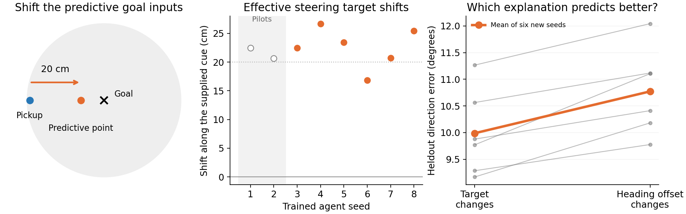
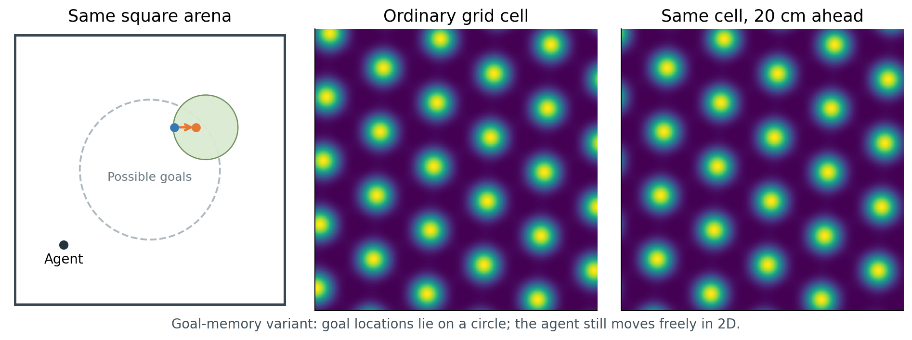
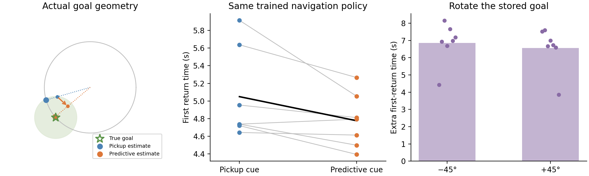

# From predictive maps to goal memory and navigation

**This model uses the project's actual maps, square arena, rewards, and RL-trained policies. The ring stores an estimated goal location.** The earlier compass study remains a separate illustration.

The useful information is simple. Reward arrives near the edge of the goal area. Ordinary goal cells mark that pickup. Predictive cells mark a point 20 cm along the arrival direction, usually farther inside. That gives the agent a more useful place to aim.

**The original RNNs use that displacement.** We kept their weights fixed and changed only the predictive part of the saved goal input. Across all six agents held out from method development, the effective steering target shifted in the supplied direction—about **23 cm** on average.

This measures the original actor's movement preferences at controlled positions and headings. The fitted target is a description of its responses, not a directly decoded neuron. [Test, competing explanation, and controls](../results/rl_map_mechanism/policy_map_confirmation/README.md).

**The new ring remembers a goal in the same room.** Possible goal centers lie on a 65 cm circle. The agent still moves freely in two dimensions, with the original six actions, vision, reward disk, and respawns.

The two rate maps are the same cell from the actual population, with movement to the right. Blue marks a pickup; orange marks its predictive point in the arena illustration.

The model has three steps:

1. Read the actual grid-cell firing rates and recover the ordinary pickup point or predictive ahead point.
2. Project that estimate onto the known circle of possible goals and store its angle in a simple two-dimensional recurrent ring.
3. Convert the remembered location back into the original 512-cell goal code. The **same frozen RL-trained LSTM** chooses every action.

No hidden goal coordinate or external steering command enters the model. The map inverse and ring are explicitly designed; the navigation policy is the project's learned policy.

After a separate pilot, we tested seven previously untested Grid-trained policies. Each comparison uses identical policy weights.

| Stored goal cue | First return, capped at 20 s ↓ | Episode reward ↑ |
|---|---:|---:|
| Ordinary pickup | 5.05 s | 135.98 |
| Predictive ahead point | 4.78 s | 146.74 |
| Predictive memory rotated +45° | 11.34 s | 99.80 |
| Predictive memory rotated −45° | 11.63 s | 95.78 |

**The stored angle matters:** rotating only the ring memory adds roughly **6–7 seconds** to the return. Predictive initialization also raises episode reward in all seven policies. Its first-return advantage is modest and borderline: 0.27 s, with a 95% interval from −0.005 to 0.55 s. [Complete results and uncertainty](../results/original_rl_goal_ring/README.md).

The predictive cue also makes the initial memory more accurate: mean goal-angle error falls from **16.3° to 8.3°**, with lower error in all seven policies' first-pickup samples.

**Why are predictive cells useful here?** They put arrival information directly into the saved goal message. As a control, we recovered arrival direction from ordinary grid observations before the pickup. That history produced essentially the same ahead point and ring input as the predictive cells. The information is available from grid history; PGCs supply it directly. [History control](../results/original_rl_goal_ring/history_control/README.md).

**What this says about the ring:** predictive input improves the goal estimate written into memory. Both conditions have the same designed ring dynamics. This does not show that PGCs strengthen intrinsic ring stability, or that the original LSTM contains this ring. The navigation runs test stored phase; a persistent phase memory would behave the same way in this noiseless setting.

Additional tests, statistics, and the model's limits

The steering-map procedure was developed using seeds 1–2 and frozen before seeds 3–8. Its primary along-cue shift is 22.61 cm, 95% interval [18.91, 26.31], exact two-sided sign-flip p=.03125. A target-change model predicts held-out directions better than a global heading-offset explanation in all six agents: 9.99° versus 10.77° error. Transverse shifts remain uncertain. Physical inputs are clamped in this diagnostic; [earlier actual navigation interventions](navigation-explanation.md) separately test behavior.

The ring study keeps seed 1 as a descriptive pilot. Seven training seeds are the confirmation replicates. The primary first-return comparison uses shared first discoveries by zero-based step 1049, allowing a full 20-second observation window; failed eligible returns contribute 20 s. All episodes remain in reward summaries. The first-return improvement has exact p=.046875 but paired-t p=.05316, so its strength depends on the test. Reward improvement (+10.76, or 7.9%, higher in all seven) is descriptive. The two phase interventions form a separate prespecified family; each has Holm-corrected exact p=.03125. The frozen protocol, pre-outcome timing correction, all seeds, and all outcomes are retained.

The ring has one neutral phase multiplier (1) and one contracting radial multiplier (0.9), verified by numerical Jacobians. Both cue sources have exactly these dynamics. Unit-radius writes and normalized readout mean radial attraction is not functionally exercised in the navigation comparison. The known circle prior and added map decoder are explicit changes. These gains apply to that task variant; they are not a measurement of a hidden ring module in the original network.

In the original LSTM memory pilot, both populations retained about 70% of their initial goal-dependent state separation after one second without the goal cue. Predictive-to-ordinary goal replacement barely changed this. Across all 16 original models, the lasting action effect of a false-goal state substitution lay mainly in cell state c. These suggest recurrent goal information, without demonstrating stronger PGC ring recovery. [State-family test](../results/original_goal_bearing_manifold/pilot/README.md) · [State intervention](../docs/research/original_rl_goal_state_pulse_results.md).

A separate reward-only fine-tuning pilot gave each original seed-1 model five million additional learning frames with a four-update goal flash. Both improved mainly at searching: they scored nearly as well without a goal message, and resetting recurrent state when the flash ended cost only 0.31 points. This pilot did not produce evidence of a learned ring. [All five before/after conditions](../results/ring_rl_goal_memory/README.md).

The compact raw-history control uses 64 actual first pickups. Ordinary grid history reproduces the predictive ahead point within 9.54e−8 m and the regenerated goal code within 1.13e−6 activity units. It demonstrates available information, not that the original Grid LSTM already performs this explicit calculation.

[All analyses, models, and reproduction](../docs/research/rl_map_redo_inventory.md) · [Original navigation study](../README.md)
