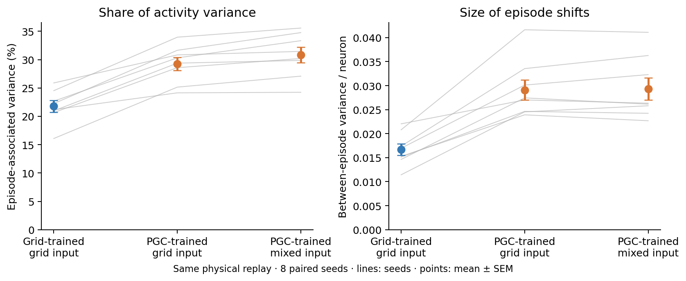
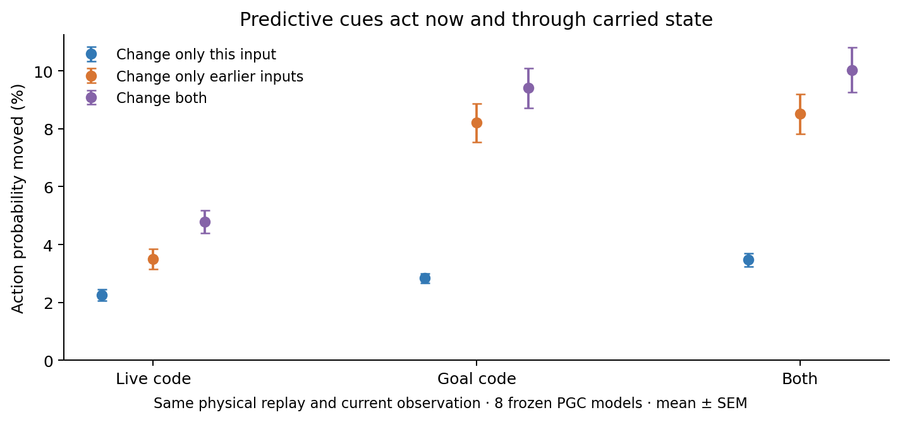
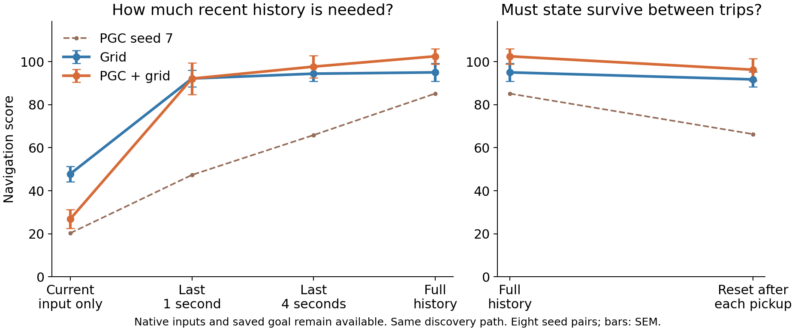

# What changed in the network, and what comes from the inputs?

**Both matter.** Training with PGCs leaves a different learned response, even when predictive input is later removed. Predictive cues also change actions immediately and through the state carried forward by the RNN. These are different findings; neither alone proves better long-term memory.

All new tests use the same eight paired, frozen 1B-frame LSTMs. No model was retrained.

## 1. The learned network difference survives the same grid input

We made both populations watch **the same recorded walk**, with the same images, actions, rewards, and goal pickups. We then gave the PGC-trained networks ordinary grid codes throughout the walk, including the saved goal code.

| Trained network | Spatial input during replay | Episode-associated variance | First 10 PCs |
| --- | --- | ---: | ---: |
| Grid | Ordinary grid | 21.8% | 46.7% |
| PGC + grid | Ordinary grid | 29.3% | 51.7% |
| PGC + grid | Native mixed code | 30.8% | 52.6% |

**The PGC-trained network still produces larger episode-related shifts.** Their mean absolute size also barely changes when prediction is removed. This is a persistent learned response to the same external experience. The visual encoder and LSTM were trained together, so this does not isolate recurrent weights from the other learned components.

These are the same 430 replay moments in all three conditions, with equal episode weights. The subset and weighting explain the small numerical differences from the original full-dataset PCA table. [Matched-input details](../results/lstm_history_input_factorial_1B/shared_replay/README.md).

## 2. Predictive information acts both now and through earlier state

We made two copies of the **same PGC RNN** watch the same walk. One saw predictive codes earlier; the other saw ordinary codes earlier. At the test moment, both received exactly the same predictive input.

Their actions still differed. That remaining difference had to arrive through the state already inside the RNN. Separately, changing only the current input also changed the action.

For the **goal code**, changing only the present input redistributes **2.8%** of action probability. Changing only earlier goal inputs redistributes **8.2%**, even after the current predictive goal input is restored. The past-input effect is larger in all eight seeds.

This separates two routes into the action computation. It does not say that 8.2% of navigation performance comes from memory. The copies follow a forced walk, and these are changes in action probabilities, not navigation scores.

## 3. How much actual history helps navigation?

We kept the native images, spatial codes, saved goal, and previous action/reward. We changed only the internal state carried by the LSTM. Both hidden state and cell state were affected; weights stayed fixed.

All conditions followed the same grid controller until finding the first goal. After discovery, each tested controller chose its own actions. Score differences therefore reflect behavior after discovery; the scores include the shared first-goal reward.

| Internal history available | Grid score | PGC score | PGC advantage |
| --- | ---: | ---: | ---: |
| Full history | 95.0 | 102.5 | +7.5 |
| None: process the current input once | 47.9 | 26.9 | −21.0 |
| Actual last 1 second | 92.2 | 92.1 | 0.0 |
| Actual last 4 seconds | 94.4 | 97.7 | +3.3 |
| Reset after every goal pickup | 91.7 | 96.3 | +4.5 |

**Clearing state every step hurts the PGC models more on average.** Keeping recent inputs restores most of their absolute score, but only part of the mean population advantage. These are exact rolling windows, not occasional resets.

The models differ. **PGC seed 7** loses about 19 points with four seconds of history or pickup resets. It is shown as a dashed line and remains in every mean and statistical test. In the other seven pairs, pickup resets change the population gap by less than 3.3 points in either direction. That is a descriptive observation, not a reason to discard seed 7.

Resetting state is also an unfamiliar operating condition for a trained LSTM. A large reset loss can reflect missing information, disrupted ongoing computation, or both. [History experiment and uncertainty](../results/lstm_history_horizon_1B/README.md).

## 4. Can processing the present replace recent experience?

For a separate control, we cleared both internal states before every decision, then showed the RNN **the same current input 15 or 60 times**. Only then did the agent take one action. The environment stayed still during those internal updates.

There was no sequence of recent observations to remember. The current input still included the externally saved goal and previous action/reward, so this did not remove every form of memory from the agent.

| What the RNN processes before acting | Grid score | PGC score |
| --- | ---: | ---: |
| Current input once, from zero state | 47.9 | 26.9 |
| Same current input 15 times, from zero state | 91.3 | 89.6 |
| Same current input 60 times, from zero state | 91.7 | 90.8 |
| Actual last 60 inputs | 94.4 | 97.7 |
| Full history | 95.0 | 102.5 |

**Repeated processing repairs much of the reset loss without restoring the real recent input sequence.** This shows why reset loss alone cannot measure useful memory. It does not establish that the native policy uses the same computation as this artificial controller, or that repeated updates converge to an attractor.

**It does not demonstrate recovery of the PGC advantage; the observed mean gap is near zero.** Real recent inputs give the PGC models a higher mean score than repetition, but the population-gap comparisons remain uncertain after correction. Some PGC models retain a large advantage with repetition; seed 7 performs much worse. Its full-history score is 85.2, actual-four-second score 65.9, and repeated-current-input score 46.4 after 60 updates.

[See every seed and the uncertainty](../results/lstm_history_settling_1B/settling_vs_history.png) · [Control details](../results/lstm_history_settling_1B/README.md).

## The explanation supported by these tests

The earlier experiments showed that PGCs supply useful goal geometry and live steering information. The new tests show that training changes the learned response to spatial cues, and that predictive information affects actions both immediately and through carried state.

The RNN state participates in ongoing computation as well as carrying past influence. Repeated current-input processing can restore much of a reset network's score, while actual history provides additional help in some models. **We have not established one population-wide improvement in long-term memory that explains the PGC advantage.**

## What this means for the larger PCA shifts

The larger episode shifts are a real learned difference in hidden activity. They persist when the networks receive the same ordinary spatial inputs. Their usefulness for navigation remains unproven: earlier tests did not specifically restore performance by adding back a fixed episode-average offset.

The saved goal is stored **outside** the RNN and supplied every step. Episode-specific activity can therefore be rebuilt from a continuing input; its presence is not proof of a goal remembered internally across the whole episode. [Offset interventions and spectra](offsets-and-spectra.md).

Separately trained feedforward networks also benefit from PGCs. Thus the general PGC benefit does not require a trained recurrent network, although these frozen LSTMs rely on their state. [Feedforward context](../results/lstm_history_context_1B/README.md).

Statistics, controls, and scope

All new behavioral comparisons use eight paired training seeds and 128 episodes per controller per seed. Training seeds, rather than timesteps, are the independent replicates. The two full-history baselines reproduce every episode of the earlier controller-hybrid evaluation exactly. PGC full history here includes grid-controlled exploration; it is not the original native PGC exploration baseline.

The four planned changes in population score gap versus full history are −28.44 points for no carry, −7.51 for one second, −4.20 for four seconds, and −2.97 for pickup resets. The no-carry contrast has paired 95% interval [−46.48, −10.39]; corrected t and exact sign-flip tests disagree (0.0296 versus 0.0625). The other three gap-change intervals include zero; this does not establish equivalence or full preservation of the advantage.

For the matched-code covariance comparison, PGC-trained networks with ordinary codes exceed grid-trained networks by 7.47 percentage points in episode-associated variance, interval [5.53, 9.42]. Both corrected tests pass in the two-comparison exploratory population family. Absolute between-episode variance per unit is 0.01671 for Grid/grid, 0.02910 for PGC/grid, and 0.02936 for PGC/mixed. The fraction change after goal deshifting is mainly a change in the total-variance denominator; the absolute episode offsets barely shrink.

The three past-input-versus-current-input action-sensitivity comparisons pass both corrected tests. These are forced shared-replay interventions. They isolate information arriving through carried state, while holding physical experience fixed, and do not establish that every carried difference helps behavior.

The repeated-input experiment was an exploratory follow-up prompted by seed 1's history-limit results. Four gap comparisons were specified before any repeated-input scores were observed. None passes either four-comparison correction. For 60 repeated inputs versus 60 actual inputs, the gap change is −4.16 points, interval [−8.98, 0.66], Holm t p=0.266 and exact p=0.0938. Repetition therefore demonstrates substantial recovery of absolute scores without establishing retention of the population advantage or equivalence to chronological history. These interventions do not partition the original performance advantage into additive percentages.

Full replay RGB and native h/c/logits reproduce the archival data exactly. Ordinary PGC codes were independently checked against the paired grid populations. Rolling-window states were checked against explicit replay, including episode resets, and the shared-projection gate calculation matched the native cell exactly on recorded inputs from all 16 checkpoints. Model files stayed unchanged.

The repeated-input sequence implementation was checked against native-cell updates on all 16 checkpoints; maximum hidden-state discrepancy was 1.13×10⁻⁶. Every full-history and current-once episode row reproduced the history-limit experiment exactly.

The linked reports contain protocols, per-seed results, complete statistics, and reproduction commands. Raw checkpoints and NumPy archives remain local.

[Navigation explanation](navigation-explanation.md) · [Main study](../README.md)
