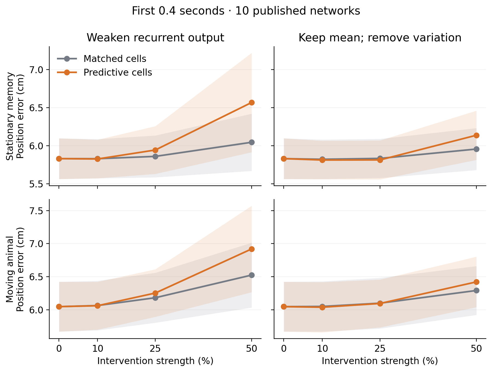
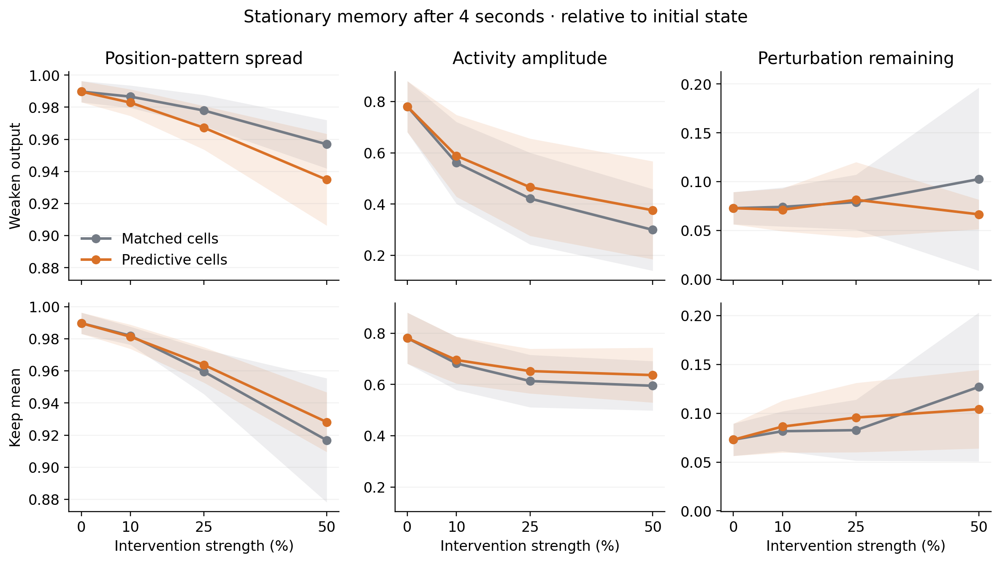

# What internally predictive cells contribute

This study tests **cells inside ten previously trained path-integration RNNs**. It is separate from the new heading experiments, which supply predictive spatial signals as inputs. The original networks, place-cell readout, and published cell classifications are unchanged.

**The primary result is that modestly weakening predictive cells behaves much like weakening matched other cells.** A large, selective dependence on the published predictive-cell class did not appear at the prespecified dose and time window.



Lines show network means; shading is the unadjusted 95% interval across ten networks. The primary comparison is at 25%; 10% and 50% are sensitivity conditions.

| First 0.4 s, 25% intervention | Predictive cells | Matched cells | Difference, 95% paired interval |
|---|---:|---:|---:|
| Stationary: weaken output | 5.945 cm | 5.861 cm | +0.084 cm [−0.217, +0.384] |
| Stationary: keep mean | 5.815 cm | 5.835 cm | −0.020 cm [−0.138, +0.099] |
| Moving: weaken output | 6.252 cm | 6.181 cm | +0.071 cm [−0.112, +0.254] |
| Moving: keep mean | 6.094 cm | 6.099 cm | −0.005 cm [−0.092, +0.083] |

All five primary comparisons, including the movement-versus-memory interaction, have Holm-adjusted **p = 1.0**. The unmodified network errors are 5.832 cm stationary and 6.046 cm moving. This finding concerns these doses, the fixed public classifications, and the selected early endpoint; it does not imply that predictive cells are dispensable at every dose or time.

The sensitivity results are more conditional. At 50%, the early stationary mean-preserving intervention gives 6.139 versus 5.958 cm error, with a larger PGC effect in nine of ten networks. Over four seconds, however, the mean-preserving 25% intervention produces **lower moving error** for PGCs than controls (25.54 versus 27.33 cm; PGC effect smaller in eight of ten networks), while stationary error is higher (14.27 versus 12.63 cm). These are descriptive secondary outcomes. They favor a dose- and task-dependent contribution rather than a uniform PGC-specific stabilization advantage.



At four seconds and 25% output weakening, the relative activity-pattern spread is 0.967 for PGC interventions versus 0.978 for controls. Keeping the mean gives 0.964 versus 0.959. Initially transverse perturbations shrink strongly in both groups. Thus the previously observed large collapse in one older checkpoint is not the characteristic response of this public cohort at these doses. Maintaining average recurrent drive generally preserves activity amplitude better, while useful position information still depends on the changing activity.

The useful mechanistic conclusion is **to distinguish the average recurrent drive, changing position information, and response to a disturbance**. They can change independently. The separately trained heading models supply a different test of whether predictive *inputs* can correct a position or heading memory.

## What we changed

We compare two interventions into the same predictive cells:

1. **Weaken their outgoing recurrent signal.** This removes both their average contribution and some of its variation.
2. **Keep their average contribution, but remove some variation.** This preserves the source cells' independently measured calibration mean while reducing their changing signal. The network's subsequent mean and amplitude can still change.

Both interventions act only where those cells send information to the rest of the RNN. The velocity inputs, initial state, and position readout remain intact. Twenty matched sets of other cells receive identical interventions. Matching uses cell count, average activity, RMS activity, and outgoing recurrent weight norm, measured without evaluation trajectories. These are **matched non-PGC controls**, not a population consisting exclusively of ordinary grid cells.

A 25% dose means **every selected cell** sends `0.75 × its current activity` into recurrence. In the mean-preserving version it sends `0.75 × current activity + 0.25 × its calibration mean`. The cells themselves remain active and continue to contribute normally to the position readout.

Each trained network is tested in two branches from the same valid activity state: the animal either stops, or continues on a fresh trajectory. The first branch tests position memory without movement inputs; the second tests updating the position estimate. Every intervention receives the same physical movement within a branch.

## Fixed protocol

The primary comparison was fixed before any public-cohort network outcome was evaluated: a 25% intervention, mean position error during the first 0.4 seconds, 64 fresh trajectories per network, and all ten model seeds. The four population contrasts (two interventions × two movement contexts) plus the mean-preserving context interaction form one five-test family. Exact two-sided paired sign-flip tests use the ten networks as independent units and Holm correction across the five comparisons. These tests assume symmetric seed-level contrasts under the null; the paired-t confidence intervals are descriptive. The 20 matched sets are averaged within each network.

Ten and fifty percent interventions, 1/2/4-second windows, movement increment gain/alignment, activity amplitude, and activity-pattern spread are retained as sensitivity/descriptive analyses. No model or trajectory is excluded on the basis of performance.

## What the dynamics measurements mean

We also add a small disturbance to each initial activity state and compare its subsequent evolution with an undisturbed trajectory under **the same intervention**. The disturbance initially points away from the two empirical position directions and away from simple activity scaling. Later separation can rotate into a position direction, so the measurement describes the fate of an initially normal disturbance, not an instantaneous normal eigenvalue.

The state-pattern measurement divides each state by its own norm **only for scoring**. This asks whether different starting positions retain different relative activity patterns. No normalization is added to the RNN. Preserving pattern spread is useful only alongside accurate position decoding; eliminating spread while contracting disturbances is a collapse of memory, not useful stabilization.

These networks use bias-free ReLU recurrence. Their zero-input map obeys `F(a h) = a F(h)` for positive `a`. At a nonzero fixed point, the state-scaling direction therefore has eigenvalue one. The analysis concerns **projective position memory**, not a uniquely attracting fixed-radius torus. The stationary branch is a dynamical probe of networks trained on moving trajectories.

## Provenance and reproduction

The public assets come from [Dynamical-Intelligence-Group/predictive-grid-cells](https://github.com/Dynamical-Intelligence-Group/predictive-grid-cells/tree/b503f6d4e73dd0551ead7075561e64f0812be750/RNNs), pinned to commit `b503f6d4e73dd0551ead7075561e64f0812be750`. The exact public model, trajectory generator, and place-cell definitions are imported read-only. The source manifest records Git blob identifiers and SHA256 hashes for every downloaded file; all are verified before use. Checkpoints are loaded with `weights_only=True`.

The public spatial classifications identify 173, 148, 132, 117, 131, 109, 149, 114, 133, and 149 PGCs in seeds 0–9, respectively, out of 4096 recurrent units per network. No new classification threshold is fitted.

The earlier advanced-checkpoint pilot is exploratory and is not one of these ten seeds. It motivated the mean-preserving control and the early primary time window. The public protocol was frozen after that pilot and before any public-cohort outcome. A first launch stopped at ID-array shape validation before generating trajectories: the public IDs are column arrays. Accepting that representation was recorded as a source amendment without changing IDs, interventions, outcomes, or tests.

- [Frozen protocol](../docs/research/public_internal_pgc_protocol.json)
- [Public asset manifest](../docs/research/public_internal_pgc_sources.json)
- [Frozen evaluator manifest](../results/ring_attractor/public_internal_pgc/frozen_manifest.json)
- [Independent timing and geometry audit](../results/ring_attractor/public_internal_pgc/independent_seed00_timing_geometry_audit.json)
- [Evaluator](../scripts/evaluate_public_internal_pgc.py)
- [Aggregation and figures](../scripts/summarize_public_internal_pgc.py)
- [Invariant and counterexample tests](../tests/test_public_internal_pgc.py)

```bash
python scripts/evaluate_public_internal_pgc.py --freeze-only
for seed in {0..9}; do
  python scripts/evaluate_public_internal_pgc.py --seed "$seed"
done
python scripts/summarize_public_internal_pgc.py
python -m pytest -q tests/test_public_internal_pgc.py
```

The evaluator refuses to overwrite completed seeds or silently accept changed frozen sources. Raw arrays and checkpoints remain local/ignored; summaries, provenance, and figures are sufficient to inspect the reported comparisons.

All ten network replays match the original class exactly at the activity level; decoded positions agree within 0.00000015 m. Actual float32 perturbations are orthogonal to the measured position/scale directions to within 0.00000057 cosine. Control-set mean activity differs by at most 1.1%, RMS activity by 1.4%, and outgoing weight norm by 0.7%. Nine invariant/statistics/counterexample tests pass. Evaluation took about 11 minutes locally, with no new cloud resources.
