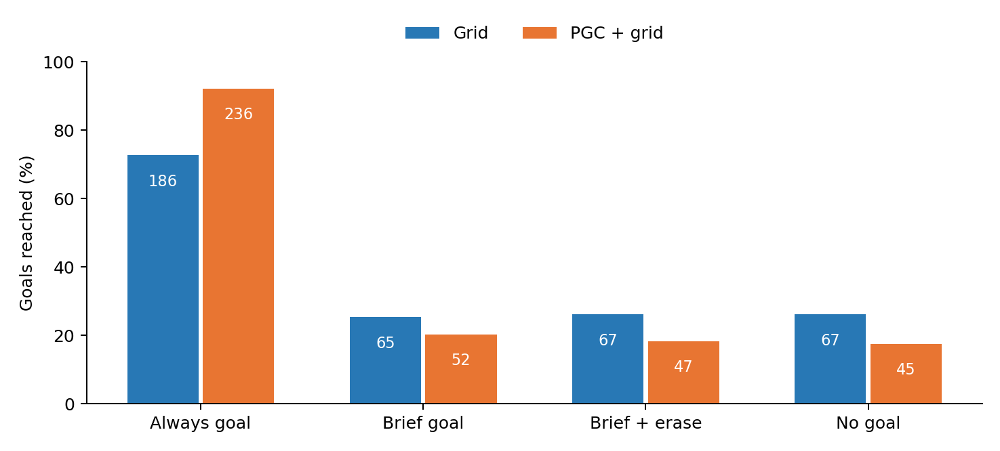
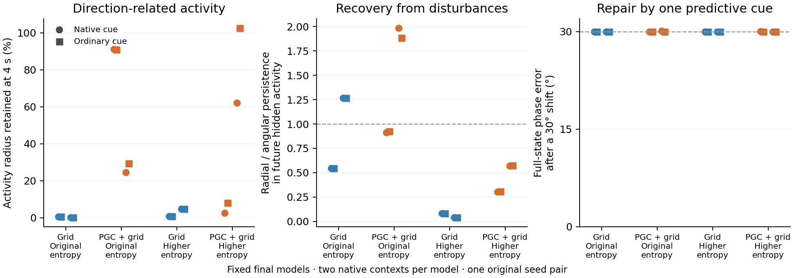
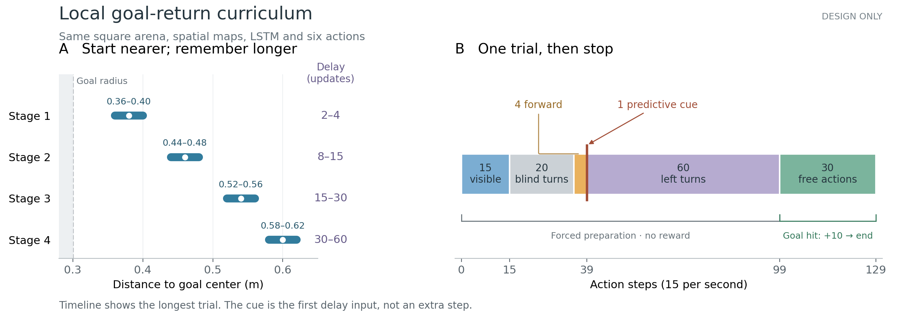
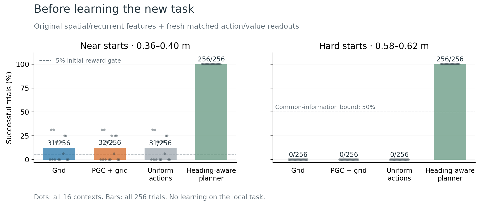
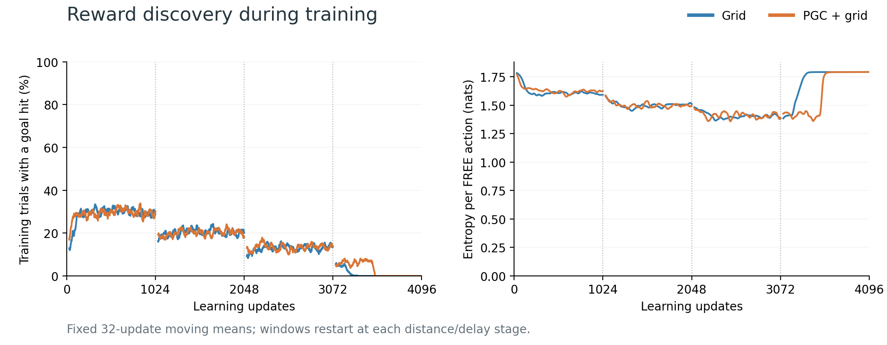
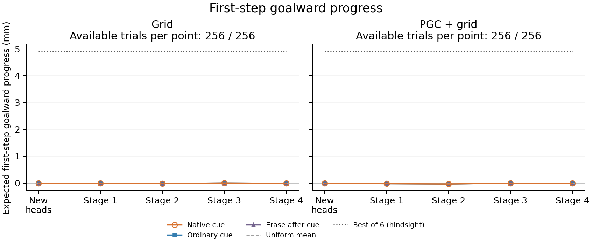
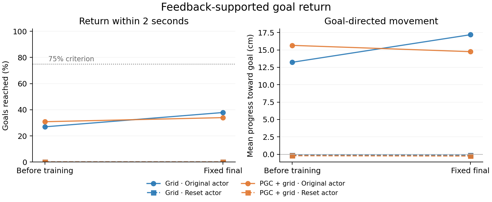

# Does predictive input stabilize a learned ring in the navigation LSTM?

**Latest learning experiment:** four copies of the original navigation agents learned from their own full-vision policies during blind turns, with or without small state disturbances. More than 99% of the imitation improvement came from matching the teacher's average action mixture. Useful direction-dependent movement remained small, and a predictive cue did not repair the choice after memory erasure. All six original/final checkpoints retain heading-related activity differences while the full activity pattern moves away from its starting curve. No case passes every geometry check at 128 headings; a separately specified denser follow-up is running. [Simple explanation and figures](../results/native_turn_distillation/README.md) · [Exact action-mixture breakdown](../results/native_turn_imitation_decomposition/README.md) · [All six geometry results](../results/native_turn_geometry/report_all/README.md).

**Earlier learning experiment:** dense supervision from each original full-vision policy improves blackout navigation while changing only the existing LSTM weights. Grid scores 32.5 → 42.5 and PGC 15.0 → 31.9 in the fixed seed-1 pilot. Identical-input replay reveals a useful recurrent-state contribution after training. The prospective paired-history and own-policy geometry screens produce no ring candidates across all 24 contexts. [Simple explanation](../results/native_policy_distillation/README.md) · [Learning and erasure controls](../results/native_policy_distillation/report/README.md) · [Matched geometry tests](../results/lstm_distillation_memory/README.md).

**The experiments point to persistent direction traces and strong use of incoming goal information. Predictive cues have produced little lasting repair of displaced memories in these tests.** We tested the original agents, including six held-out seed pairs, and fixed reward-only continuations with blackouts, activity noise and increased exploration. None meets the complete ring criteria in the tested conditions.

The fixed 75-million-frame continuations, 40-million-frame blind-reorientation pair, all four matched 90-million-frame exploration endpoints, both local goal-return models, and the four-arm sensory-feedback control are complete. The rapid-return control identifies an action-selection bottleneck. A final original-agent diagnostic below separates continuing goal guidance from remembered goal information. The earlier explicitly constructed goal-memory ring is a [separate result](goal-memory-in-the-navigation-task.md).

A separate **stationary goal-cue proposal has completed its original-policy qualification check**. With the goal code continuously available, the original PGC agent reaches **236/256 goals (92%)**, versus **181/256 (71%)** for Grid. All 512 trials pass the independent neural/input/physics audit. The requirement was at least 192 successes for both, so this proposal stops before its memory baseline, training or cloud launch. This is a navigation comparison in one original seed pair with an external goal message available throughout. [Qualification audit](../results/goal_cue_memory/qualification/audits/pair_review.json) · [Literature and prior-study review](../docs/research/next_native_memory_design_review.md).

The separately registered **original-agent memory diagnostic is also complete**. It uses a second sealed trial bank, both unchanged original actors/CNNs/LSTMs, and all 11 fixed input/state conditions. With the saved goal message supplied at every update, Grid reaches **186/256** goals and PGC **236/256**. After a one-second cue and three-second stationary delay without that message, they reach **65/256 and 52/256**. Erasing h/c after the cue gives **67/256 and 47/256**; never supplying the cue gives **67/256 and 45/256**. Current spatial code, clean vision and native movement remain available. The changed Grid qualification/diagnostic score reflects different banks, with no learning.

Swapping in genuine recurrent states from goals 90° away produces **no average first-second movement advantage toward the donor goal** in either direction or network. Wrong-goal cues reproduce the corresponding state-swap trajectories exactly in all 64 context/model/sign comparisons. All 5,632 trial-condition cases pass the independent audit. The large PGC navigation advantage in this task therefore concentrates in **continuing goal guidance**, while the retained state contributes little after cue withdrawal. This makes repeated use of the supplied goal representation a stronger explanation here than the proposed ring-memory mechanism. No further neural assay or training follows this failed useful-memory screen. [Simple figures, all 11 conditions and methods](../results/goal_cue_memory/original_diagnostic/report/README.md) · [Literature-guided interpretation specified before these outcomes](../docs/research/original_goal_memory_diagnostic_interpretation.md).

## Further searches in the original trained agents

We tested circular variables that the heading and movement assays could have missed: the repeating phases of individual grid modules, both phases together, and local phase changes across all four modules. We also searched directly for unstable equilibria and disturbed the recurrent state during the agents' own repeated turns. A separate published trained RNN provides a positive control: its curved ring passes the original geometric criteria and preferentially corrects disturbances away from the ring.

The new navigation tests identify **fast activity adjustment around slower cell memory**. Fourteen output-curve candidates all come from one Grid model; broader disturbances reveal persistent cell-state errors. The two-phase surface test produces no nomination. Accounting for other grid-module phases explains part of the error, with a substantial persistent component remaining in the complete recurrent state.

The clearest causal result concerns **current predictive input and steering**. Replacing the current 169 predictive values with ordinary-grid values changes 18–19% of sampled actions in the two PGC discovery models. Restoring predictive influence only at the candidate update and output gate reduces those differences to 9.4% and 5.6%. Saved goal codes remain native. Goal progress falls when current prediction is removed, while progress recovery under this gate rescue is mixed.

[Simple figures, exact results and interpretation](../results/ring_nonlinear_design/README.md) · [Native movement interventions](../results/native_movement_pulses/report/README.md) · [Bounded-state robustness](../results/native_movement_bounded_pulses/report/README.md) · [Reproduction guide](../results/nonlinear_ring_release/REPRODUCE.md).

These are additional exploratory tests in two original seed pairs. The many phases, perturbations and time points are repeated measurements within those models, not independent training seeds.

## What we tested

Imagine the network's remembered direction as a point on a circle. A ring mechanism should do two things: **preserve differences around the circle, and correct mistakes away from it**. We measured both in all 512 hidden-plus-cell coordinates. PCA was not used to define the circle.

The predictive spatial displacement follows the last **movement direction**. Body heading is a different variable when the agent walks backward, moves sideways, or turns without translating. We tested heading histories and physically coherent movement histories separately.

For the movement test, the agent approaches one location from many directions using the actual renderer, grid maps and movement equations. We then explicitly stop its movement and give every recurrent state the same input: black vision, ordinary current grid code, the unchanged saved goal and a turn action. This removes the current predictive direction cue. The approach and turn are controlled diagnostic actions, initialized from a native policy history.

## Original agents: information remains, but radial mistakes remain too

Each dot is a trained model, averaging two contexts. Thin lines show those contexts' range.

After developing the method on seeds 1–2, we tested seeds 3–8 without changing the criteria:

- **Direction information persists.** At four seconds, a newly fitted analysis readout recovers direction with 0.75–2.31° error. The readout fixed before darkness has much larger errors: the expression of the trace changes over time.
- **The circle does not correct radial errors selectively.** Radial disturbances survive about as strongly as differences along the circle: the ratio is 0.89–1.11 in raw state units across the 24 held-out contexts. Both raw and hidden/cell-scaled metrics are retained.
- **The result survives an additional control for unrelated activity drift.** Using all hidden units' future activity, rather than large cell-memory amplitudes alone, produces no ring candidates. PGC has stronger preferential radial recovery in only three of the six held-out pairs.

The pattern suggests a slowly changing memory trace with several persistent directions, rather than the tested one-dimensional attracting ring. [Full held-out results](../results/lstm_travel_memory/heldout_original/README.md) · [Control using future activity](../results/lstm_endogenous_ring/observable_history/travel_heldout_original/README.md).

## Can one predictive cue repair an incorrect direction?

We replaced the full recurrent state with the state elicited by movement 30° away. We then restored the 169 current predictive values for one update—1/15 second—or supplied a deliberately rotated predictive cue. Ordinary current code resumed immediately afterward. Every saved-goal value and every other input slot stayed unchanged.

**The brief cue produces a transient response, while the substituted direction largely remains.** Three seconds later, the largest change in the 30° discrepancy is 0.601° across the twelve held-out PGC contexts and both distance metrics. Scaling hidden and cell activity changes the size of the immediate apparent correction, which also moves states off the reference curve. The two panels retain that sensitivity.

Grid-model cue branches are exact identity controls. The same test in the first blackout-trained pair also produces no lasting correction of this state substitution. [All pulse conditions, geometry checks and actor effects](../results/lstm_heading_memory/travel_cue_pulse/heldout_original/README.md).

## Training the same agent to navigate through blackouts

The first continuation changes only visual availability. After goal discovery, one second of vision alternates with blackouts that gradually reach two to four seconds. The square arena, uniformly placed goals, rewards, six actions, 512 spatial cells, CNN, LSTM and learned actor stay the same. Training supplies no angle target or ring loss.

After 25.024 million additional learning frames per model:

| Evaluation score | Grid before | Grid after | PGC + grid before | PGC + grid after |
|---|---:|---:|---:|---:|
| With blackouts | 23.59 | 43.59 | 14.53 | 47.81 |
| With continuous vision | 83.28 | 61.25 | 85.00 | 83.75 |

Both models improve in darkness. The PGC model largely preserves its normal-vision score; Grid loses performance there. These are **one fixed training-seed pair**, evaluated on 64 episodes per condition, so they describe this pilot rather than a population effect.

Neither model acquires a ring candidate in the frozen heading or movement-history assays, including the control using future hidden activity. Resetting state at blackout onset also produces no extra cost compared with the corresponding visible-input reset. Resetting hidden and cell state before **every** black update leaves most of the improvement intact: Grid scores 44.22 versus 43.59 with normal carryover; PGC scores 45.78 versus 47.81. Previous action, previous reward, current code, saved goal and the physical environment remain available. This points toward adaptation using those available inputs and externally carried state. [Every-update reset results](../results/lstm_endogenous_ring/every_blind_update_reset/README.md).

[All fixed learning stages and controls](../results/ring_visual_memory/curriculum_summary.json) · [Training protocol](../docs/research/rl_visual_memory_pilot_protocol.json).

## Longer adaptation and activity noise

Two matched continuations started from those exact final checkpoints and optimizer states:

1. **More adaptation:** another fixed 50.048 million frames with the final blackout schedule.
2. **Resistance to disturbances:** the same training, adding small independent noise to hidden and cell activity during blackouts. The sampled disturbances are replayed exactly during gradient computation.

The noise experiment follows the robustness principle used by [Ságodi and colleagues](https://arxiv.org/html/2408.00109v2), whose trained networks developed slow attracting memory manifolds. It prescribes no circular representation. Both arms received the same reward-only task and the same clean navigation and deterministic geometry tests at their fixed final checkpoints. A separately frozen [matched-noise evaluation](../docs/research/visual_memory_matched_noise_eval_protocol.json) also tested all four final models on one CUDA backend, verifying identical underlying noise draws by hash and reproducing the noise-trained models' existing episode results exactly.

**The longer continuations preserve a changing direction trace.** None of the eight heading contexts or eight travel contexts passes the unchanged full-state criteria. The independent future-hidden-activity test reaches the same conclusion. Radial disturbances persist about as strongly as differences around the curve. [Simple final-model figure and all contexts](../results/lstm_final75_memory/README.md).

Most blackout performance also survives erasing hidden and cell state before **every** black update. The noiseless PGC model scores 46.25 normally and 44.53 with these resets; the noise-trained PGC model scores 49.53 and 47.97. Previous actions, current code, the external saved goal and physical state remain available. Resetting at the corresponding times with vision causes much larger losses. This reinforces the role of available inputs and externally carried state in this particular blackout task. [Final reset comparison](../results/ring_visual_memory/final_memory_reset.png).

At each sampled phase, the two-second state-update product has 6–16 eigenvalues with magnitude at least 0.99. Many are concentrated in cell state with little immediate actor expression. This points to several slow memory directions; the separate radial and observable tests determine whether those directions organize into a useful ring. [Simple spectral figure and analysis](../results/lstm_final75_finite_spectra/README.md).

One correct predictive pulse also leaves the displaced direction largely intact: its largest lasting correction is **0.14° of a 30° substitution** across both PGC continuations, all four contexts and both metrics. [Figure separating the two training arms](../results/lstm_heading_memory/travel_cue_pulse/final75/README.md). The new task below tests a cue at the actual movement endpoint, before the remembered direction is used during the blind turn.

An additional action-context check covers forward, backward and both sideways approaches in the four original pilot models. **None of these 16 cases passes the same ring criteria.** Radial errors again persist about as strongly as angular differences, despite direction remaining readable. This covers translation actions frequently used by the original policies. [Action-context figure and methods](../results/lstm_travel_memory/action_context_original/README.md).

A further literature-guided check varies the **previous-action input during the memory test itself**. A recent fly-navigation study describes behavioral gating of persistent goal activity, so we tested all six action messages in both original pilot seed pairs. The initial state and every other input stay fixed. All 24 model/action cases fail the same full-state criteria; all 48 future-activity comparisons also fail. The original LEFT branches reproduce exactly. These are clamped neural inputs, with location held fixed even for translational action messages. [Simple figure and all outcomes](../results/lstm_previous_action_sweep/README.md).

## Making remembered direction useful during blind movement

The reset result exposed a shortcut: the blackout-trained agents could often keep moving using available spatial inputs, previous actions and physical momentum. The next experiment therefore adds a controlled blind turn, a short actual forward movement and one brief predictive direction cue. It then withdraws the cue, turns the agent further, and gives control back for blind navigation. The same LSTM learns from the original goal reward.

In the design check, two histories end with **identical current inputs and motor state, but opposite body headings**. The same action distribution produces at most 0.077 mm of average goalward progress on the next update; choosing separately for the two remembered headings permits 5.439 mm. These are simulator-based bounds, not trained-agent results. The original agents do not exceed the common-action bound in this check. [Paired-history audit](../results/lstm_blind_turn_necessity/README.md).

The new training pair completed its fixed 40.059-million-frame budget per model, with no ring or angle target. The primary outcome counts goals during freely chosen blind movement, excluding forced-movement rewards. Removing the predictive pulse, rotating it, and resetting the LSTM immediately after it test whether the agent stores and uses the cue. Geometry and state-perturbation tests then identify the computation that carries that memory. [Frozen training method](../docs/research/rl_blind_reorientation_implementation.md) · [Frozen behavior analysis](../results/rl_blind_reorientation/behavior_analysis_protocol.json).

**Grid reaches 0.516 goals per episode during blind free movement, and 0.500 after erasing recurrent state every blind update. PGC reaches none in these windows.** Restoring vision gives 0.750 and 0.625 respectively. This new task exposes a learning bottleneck in the adapted PGC policy: in its prescribed final saved-state diagnostic, all 540 free choices are right turns. Its mean probability of any translational action is only 0.048%. The diagnostic is a fresh short CPU rollout from the saved state, with explicitly specified future random draws; it is not the CUDA worker’s exact future. [All stages and controls](../results/rl_blind_reorientation/README.md) · [Action choices](../results/rl_blind_reorientation_review/entropy_diagnostic/README.md).

*Fixed 40M task continuations; all 64 original evaluation episodes per model.*

The reward audit also explains why weak blind behavior can persist during learning: **98.6% of the final PGC blind-evaluation goals occur while vision is available.** Many free blind windows start near the goal, yet the policy barely translates. This points to reward allocation and action selection as learning bottlenecks, alongside the neural memory question. [All reward phases and fixed training stages](../results/rl_blind_reorientation_review/reward_allocation/README.md).

**There is nevertheless a clear internal difference in these final agents.** Across the two native contexts per model, PGC retains 51–75% of its initial hidden-activity variation across directions after four seconds, versus 0.013–5.4% for Grid. The prescribed radial disturbances fade faster than angular disturbances in future hidden activity: the ratios are 0.38–0.46 for raw state kicks, and 0.44 and 0.61 after scaling hidden and cell coordinates. Removing the predictive pulse leaves these properties nearly unchanged. The activity patterns retain direction information while changing shape over time. A correct pulse scarcely changes the full-state estimate of an imposed 30° displacement. Subsequent sampled movements are identical across correct, removed and rotated cues. This points to a persistent directional trace that has little influence on the chosen blind movements in this task. [Simple neural and causal figure](../results/lstm_reorientation_mechanism/final/README.md).

The final action layer reveals where that influence becomes small. **The PGC direction signal reaches the action scores, but an overwhelming default right-turn preference dominates.** In the two tested contexts, the right-turn score leads the best translation score by 12.55 and 13.79 units; changing direction varies those margins by only 1.83 and 0.18 units RMS. The exact learned action layer therefore assigns almost all probability to turning. This is a concrete bottleneck between retained direction information and movement selection. [Simple action-layer figure and complete decomposition](../results/lstm_reorientation_actor_readout/README.md).

## More exploration changes action selection

The matched experiment kept the same reward, maps, architecture, task, optimizer state and recurrent runtime, and changed only the entropy coefficient from 0.00008 to 0.01. Each population received both settings for another 50.074 million learning frames. All five intermediate checkpoints and the fixed final endpoints are retained. The coefficient follows an A3C/A2C precedent; training supplies no ring target or direction supervision. [Literature rationale](../docs/research/reorientation_exploration_audit.md) · [Frozen continuation](../docs/research/rl_blind_reorientation_entropy_protocol.json).

**More exploration loosens the default action preference, but goalward movement remains weak.** At the final higher-entropy PGC endpoint, the learned action layer assigns 67–84% probability to translation across the two controlled direction families. The original-entropy PGC endpoint assigns 12.8% and 0.0069%. Those native histories differ between models, so this describes the learned model together with its history. Whole-episode evaluation gives only 0.047 blind free goals per episode for higher-entropy PGC, compared with 0.016 at the original coefficient; removing the predictive pulse leaves both rates unchanged. Higher entropy also harms the Grid continuation's performance.

**One PGC context shows a direct route from remembered direction to action.** Replacing its recurrent state with a state elicited 30° away changes 1,042 of 5,760 sampled actions. Erasing state reduces mean goalward progress from +3.38 cm to −0.11 cm. Removing the predictive pulse changes only 27 actions, and restoring it repairs just 0.0095° of the imposed 30° displacement. The directional state influences this model's movement; this particular pulse scarcely corrects it. The other contexts have smaller or negligible direction-edit effects. [All eight contexts, action edits and complete behavior results](../results/lstm_reorientation_entropy_mechanism/report/README.md).

All 32 full-state cue branches and 64 future-hidden-activity comparisons fail at least one ring criterion. Some satisfy individual components: one higher-entropy Grid context has selective radial recovery and little curve departure, but fails circular separation and ordering checks. This is why recovery alone is insufficient.

We also checked the **exact learned action scores**, removing only their common offset, which leaves action probabilities unchanged. This asks whether a ring might be present in the activity that the actor actually reads while unrelated hidden activity obscures it. Across all 16 original agents and the six task-adapted endpoints, none of the 152 prescribed comparisons meets every criterion. These are nested measurements of 22 endpoints, not 152 independent trained models. [Simple action-score figure and all outcomes](../results/lstm_actor_logit_observable/RESULTS.md).

The [completed GitHub release](https://github.com/aaravsinhaofficial/predictive-grid-cells-rl/releases/tag/matched-entropy-continuations-2026-11-06) includes all 28 continuation checkpoints and the exact 40 neural-state archives used by the action-score analysis. Every uploaded asset's SHA-256 digest and size was verified. The reproduction guides link the original-model and parent-checkpoint dependencies.

## Making reward depend on memory

A separate simulator check tested a shorter local goal-return episode, where the reward must come during the blind response. The heading-aware physical planner reaches **128/128 goals**. Under the saved paired inputs and noise, any controller that has forgotten heading is bounded at **50% success**. This follows from the actual movement budget: opposite-heading agents cannot both reach their reflected goal locations with one common action strategy. Uniform random actions reach none in this sample, showing why near-goal training stages may still be useful. These task-design checks preceded the new training. [Simple figure, all cases and the mathematical bound](../results/rl_blind_reorientation_review/local_goal_preflight_v2/README.md).

The curriculum starts near the goal and gradually increases distance and delay, following the start-state principle of [Florensa and colleagues](https://proceedings.mlr.press/v78/florensa17a.html). It retains the original trained spatial and recurrent features while explicitly reinitializing the final action/value readouts. The task rewards an actual blind goal hit and then ends. Its test cases and behavioral thresholds were recorded before policy evaluation: first check that easy trials supply rewards, then require successful hard trials with a substantial memory-erasure cost before running expensive dynamics tests. [Design, literature and frozen gates](../docs/research/local_goal_return_study_review.md).

The next causal test is specified before these training results arrive: replace the agent's memory with the memory from a matched trial facing 30° left or right, while keeping its actual body and surroundings unchanged. Compare correct, ordinary and wrong-direction cues, then measure both memory recovery and navigation. The same task's collector performs every physical step. Native-network checks verify that the intervention changes memory at the intended moment and that erasing it removes the introduced difference. [Prospective design and literature](../docs/research/local_return_mechanism_design.md).

The predictive pulse supplies a fresh direction-dependent pattern. Ordinary inputs can also support direction estimates through visual/action history and two position snapshots. A cue may therefore be redundant when memory is accurate and useful when memory is disturbed. The endpoint intervention replaces only that pulse; earlier visible predictive input and the native saved-goal code remain. [Information available to each network and the repair test](../docs/research/local_return_cue_information.md).

**The initial reward check passes.** With the new readouts, Grid reaches 31/256 nearby goals and PGC reaches 32/256, exceeding the predeclared 13/256 requirement. Both reach zero on the hard trials. The physical planner reaches all 256 in both settings. Every hard antipodal pair passes the saved-tape memory certificate, giving a 50% ceiling for common-information controllers. These are initialization and task checks, before local-task learning. [All baseline conditions and independent audit](../results/local_goal_return_baseline/report/README.md).

The [frozen training study](../docs/research/local_goal_return_training_protocol.json) uses 1,024 batches of 32 complete trials at each of four stages: 131,072 trials per model. It loads the exact initialized weights tested above, retains every stage and supplies only the original goal-hit reward. The fixed final behavioral gate requires at least 65% hard-trial success and a memory-erasure cost of at least 15 percentage points before the more expensive ring tests.

## What happened during local-return training

**Both models completed 131,072 trials and finished with 0/256 successful returns in all 12 test conditions.** Earlier fixed stages reached 3, 8 and 17 successes for Grid and 4, 10 and 15 for PGC. The final stage lost those gains. Every stage and failed endpoint is retained. [All stages, controls and counts](../results/ring_local_goal_return/report/README.md).

The left panel shows training success falling as distance and delay increase. In the final stage, success falls to zero while action entropy approaches `log(6)`, the value for equal probabilities over six actions. Sparse goal rewards and pressure to keep exploring are a plausible learning bottleneck. The source review found no reward-sign, loss-mask or recurrent-replay error; the individual gradient contributions have not been measured. [Learning review](../docs/research/local_return_learning_review.md).

We then asked a simple question: **given the saved position and movement state, did the first action probabilities favor moving toward the goal?** We calculated the next step for all six actions under the same recorded motor noise. The chosen step matched the recorded position for all 38,912 saved trial records. The first-action averages remain close to uniform choices throughout training; the dotted line is a noise-informed physical best-action reference, not information available to the agent.

The full paths tell the same practical story. At stage 3, Grid and PGC traveled **33.92 and 33.09 cm** on average but ended **4.41 and 4.56 cm farther from the goal**. At the final stage they traveled about 19.5 cm and reached no goals. A first-step measure alone can miss a useful turn, so every full-response outcome remains alongside it. These are descriptive results from one original seed pair.

The new recipe therefore has a **steering-acquisition problem before it can provide a useful memory test**. Its frozen behavioral gate fails, so the conditional ring assay is recorded as not run. This failure concerns the new short blind-return task; the original agents' navigation advantage remains documented separately.

The next bounded control uses **fresh vision and fresh spatial codes throughout**, the unchanged native LSTM and goal reward, and all weights trainable. Four arms compare Grid and PGC, each with its original or reset action readout and the same fresh critic. The fixed test asks whether the agent can learn this fast two-second return before feedback is withdrawn. The source, 256-trial evaluation bank and 1,024-update endpoint are now frozen; 39 implementation tests pass. A final score of at least 192/256 with valid inputs and physics qualifies an arm for review of a separate memory experiment. No angle target, circular activity target or designed ring is added. [Reviewed specification](../docs/research/local_return_feedback_acquisition_spec_v2.md) · [Frozen protocol](../docs/research/local_return_feedback_training_protocol.json) · [Independent implementation review](../docs/research/local_return_feedback_final_implementation_review.json).

**All four feedback-supported runs are complete.** With the original action readout, Grid improves from 69 to 97 successes out of 256, and PGC from 79 to 87. Both reset-readout arms finish at zero. Each trains on exactly 32,768 trials; every baseline and final evaluation trial passes the input and physics audit. No arm reaches the frozen 192/256 threshold, so the proposed memory continuation stops here. [All results and reproduction](../results/local_return_feedback_acquisition/README.md).

Two simple checks locate a practical bottleneck. Before training, changing only the action layer leaves every matched first-choice recurrent state exactly identical, while return success disappears. The original readout therefore contains useful movement selection. Its dominant right-turn/right-strafe repertoire also has a physical limit: under the recorded starts and noise, any controller restricted to those actions can potentially reach at most 139/256 starts in two seconds. The six-action networks can exceed that limit by using other movements. Their final policies still rely almost entirely on the two dominant actions. [Actor isolation](../results/local_return_feedback_design/portable/cloud_audit/baseline_actor_isolation.json) · [Restricted-action bound](../results/local_return_feedback_design/portable/restricted_action_bound/README.md).

The literature-guided tests therefore favor **persistent, changing direction representations plus task-specific action selection** as the current description of these LSTMs. The strongest causal explanation of the original PGC navigation advantage remains the useful spatial cue reaching the candidate-update and output-gate pathways. The attracting ring and predictive repair hypothesis has received direct tests with negative outcomes. [Final interpretation](../docs/research/local_return_feedback_interpretation.md) · [Original-task mechanism](navigation-explanation.md).

The controlled local-return setup stores an ordinary goal snapshot only 1.45 cm from the center; its predictive slots project 18.55 cm beyond the center. This differs from the natural boundary pickups that supplied the original inward-cue benefit. The maps, code equations and native reward remain unchanged, while this snapshot distribution is explicit when interpreting transfer and recurrent-memory results. [Exact setup geometry](../docs/research/local_return_setup_goal_geometry.md).

The [literature audit](../docs/research/endogenous_ring_literature.md), [research log](../docs/research/endogenous_ring_run_log.md), [fixed-point and numerical-precision audit](../results/lstm_endogenous_ring/fixed_points_and_saturation.md), and [compute ledger](../docs/research/ring_cloud_budget.json) retain the full method and outcome history. All cloud work draws from the original cumulative $500 authorization.
