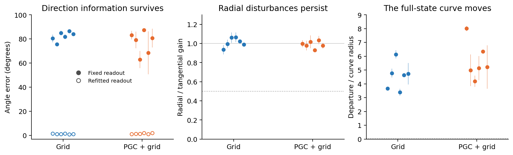
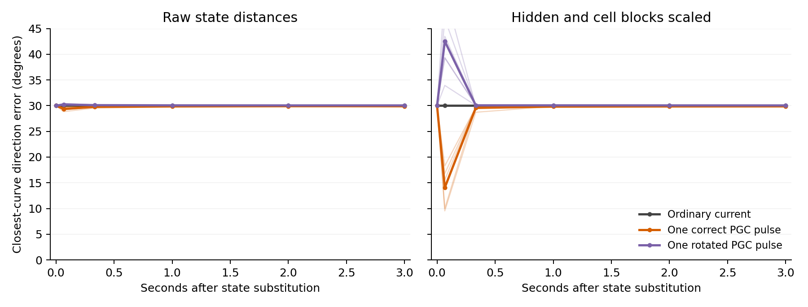
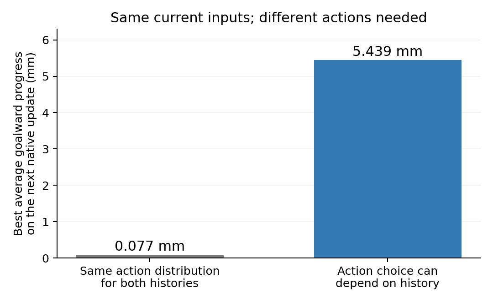
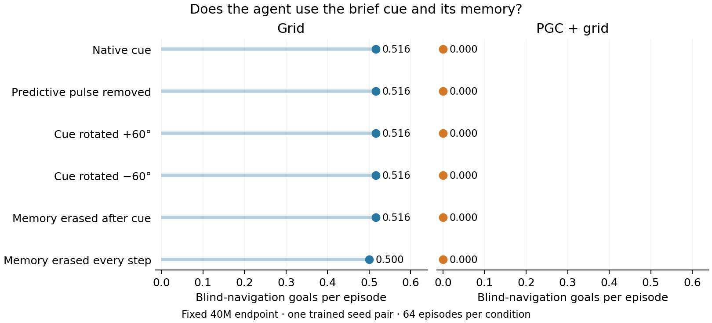
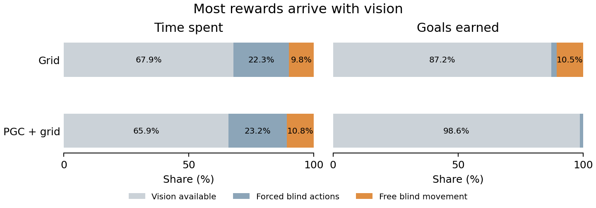

# Does predictive input stabilize a learned ring in the navigation LSTM?

**The experiments currently point to persistent direction traces, with little recovery toward a ring.** We tested the original agents, including six held-out seed pairs, and fixed reward-only continuations with blackouts and activity noise. A new blind-reorientation task now gives remembered direction a more specific role in navigation.

This study is active. The fixed 75-million-frame continuations and 40-million-frame blind-reorientation pair are complete. A matched exploration continuation is now authorized from the exact final checkpoints. The earlier explicitly constructed goal-memory ring is a [separate result](goal-memory-in-the-navigation-task.md).

## What we tested

Imagine the network's remembered direction as a point on a circle. A ring mechanism should do two things: **preserve differences around the circle, and correct mistakes away from it**. We measured both in all 512 hidden-plus-cell coordinates. PCA was not used to define the circle.

The predictive spatial displacement follows the last **movement direction**. Body heading is a different variable when the agent walks backward, moves sideways, or turns without translating. We tested heading histories and physically coherent movement histories separately.

For the movement test, the agent approaches one location from many directions using the actual renderer, grid maps and movement equations. We then explicitly stop its movement and give every recurrent state the same input: black vision, ordinary current grid code, the unchanged saved goal and a turn action. This removes the current predictive direction cue. The approach and turn are controlled diagnostic actions, initialized from a native policy history.

## Original agents: information remains, but radial mistakes remain too

Each dot is a trained model, averaging two contexts. Thin lines show those contexts' range.

After developing the method on seeds 1–2, we tested seeds 3–8 without changing the criteria:

- **Direction information persists.** At four seconds, a newly fitted analysis readout recovers direction with 0.75–2.31° error. The readout fixed before darkness has much larger errors: the expression of the trace changes over time.
- **The circle does not correct radial errors selectively.** Radial disturbances survive about as strongly as differences along the circle: the ratio is 0.89–1.11 in raw state units across the 24 held-out contexts. Both raw and hidden/cell-scaled metrics are retained.
- **The result survives an additional control for unrelated activity drift.** Using all hidden units' future activity, rather than large cell-memory amplitudes alone, produces no ring candidates. PGC has stronger preferential radial recovery in only three of the six held-out pairs.

The pattern suggests a slowly changing memory trace with several persistent directions, rather than the tested one-dimensional attracting ring. [Full held-out results](../results/lstm_travel_memory/heldout_original/README.md) · [Control using future activity](../results/lstm_endogenous_ring/observable_history/travel_heldout_original/README.md).

## Can one predictive cue repair an incorrect direction?

We replaced the full recurrent state with the state elicited by movement 30° away. We then restored the 169 current predictive values for one update—1/15 second—or supplied a deliberately rotated predictive cue. Ordinary current code resumed immediately afterward. Every saved-goal value and every other input slot stayed unchanged.

**The brief cue produces a transient response, while the substituted direction largely remains.** Three seconds later, the largest change in the 30° discrepancy is 0.601° across the twelve held-out PGC contexts and both distance metrics. Scaling hidden and cell activity changes the size of the immediate apparent correction, which also moves states off the reference curve. The two panels retain that sensitivity.

Grid-model cue branches are exact identity controls. The same test in the first blackout-trained pair also produces no lasting correction of this state substitution. [All pulse conditions, geometry checks and actor effects](../results/lstm_heading_memory/travel_cue_pulse/heldout_original/README.md).

## Training the same agent to navigate through blackouts

The first continuation changes only visual availability. After goal discovery, one second of vision alternates with blackouts that gradually reach two to four seconds. The square arena, uniformly placed goals, rewards, six actions, 512 spatial cells, CNN, LSTM and learned actor stay the same. Training supplies no angle target or ring loss.

After 25.024 million additional learning frames per model:

| Evaluation score | Grid before | Grid after | PGC + grid before | PGC + grid after |
|---|---:|---:|---:|---:|
| With blackouts | 23.59 | 43.59 | 14.53 | 47.81 |
| With continuous vision | 83.28 | 61.25 | 85.00 | 83.75 |

Both models improve in darkness. The PGC model largely preserves its normal-vision score; Grid loses performance there. These are **one fixed training-seed pair**, evaluated on 64 episodes per condition, so they describe this pilot rather than a population effect.

Neither model acquires a ring candidate in the frozen heading or movement-history assays, including the control using future hidden activity. Resetting state at blackout onset also produces no extra cost compared with the corresponding visible-input reset. Resetting hidden and cell state before **every** black update leaves most of the improvement intact: Grid scores 44.22 versus 43.59 with normal carryover; PGC scores 45.78 versus 47.81. Previous action, previous reward, current code, saved goal and the physical environment remain available. This points toward adaptation using those available inputs and externally carried state. [Every-update reset results](../results/lstm_endogenous_ring/every_blind_update_reset/README.md).

[All fixed learning stages and controls](../results/ring_visual_memory/curriculum_summary.json) · [Training protocol](../docs/research/rl_visual_memory_pilot_protocol.json).

## Longer adaptation and activity noise

Two matched continuations started from those exact final checkpoints and optimizer states:

1. **More adaptation:** another fixed 50.048 million frames with the final blackout schedule.
2. **Resistance to disturbances:** the same training, adding small independent noise to hidden and cell activity during blackouts. The sampled disturbances are replayed exactly during gradient computation.

The noise experiment follows the robustness principle used by [Ságodi and colleagues](https://arxiv.org/html/2408.00109v2), whose trained networks developed slow attracting memory manifolds. It prescribes no circular representation. Both arms received the same reward-only task and the same clean navigation and deterministic geometry tests at their fixed final checkpoints. A separately frozen [matched-noise evaluation](../docs/research/visual_memory_matched_noise_eval_protocol.json) also tested all four final models on one CUDA backend, verifying identical underlying noise draws by hash and reproducing the noise-trained models' existing episode results exactly.

**The longer continuations preserve a changing direction trace.** None of the eight heading contexts or eight travel contexts passes the unchanged full-state criteria. The independent future-hidden-activity test reaches the same conclusion. Radial disturbances persist about as strongly as differences around the curve. [Simple final-model figure and all contexts](../results/lstm_final75_memory/README.md).

Most blackout performance also survives erasing hidden and cell state before **every** black update. The noiseless PGC model scores 46.25 normally and 44.53 with these resets; the noise-trained PGC model scores 49.53 and 47.97. Previous actions, current code, the external saved goal and physical state remain available. Resetting at the corresponding times with vision causes much larger losses. This reinforces the role of available inputs and externally carried state in this particular blackout task. [Final reset comparison](../results/ring_visual_memory/final_memory_reset.png).

At each sampled phase, the two-second state-update product has 6–16 eigenvalues with magnitude at least 0.99. Many are concentrated in cell state with little immediate actor expression. This points to several slow memory directions; the separate radial and observable tests determine whether those directions organize into a useful ring. [Simple spectral figure and analysis](../results/lstm_final75_finite_spectra/README.md).

One correct predictive pulse also leaves the displaced direction largely intact: its largest lasting correction is **0.14° of a 30° substitution** across both PGC continuations, all four contexts and both metrics. [Figure separating the two training arms](../results/lstm_heading_memory/travel_cue_pulse/final75/README.md). The new task below tests a cue at the actual movement endpoint, before the remembered direction is used during the blind turn.

An additional action-context check covers forward, backward and both sideways approaches in the four original pilot models. **None of these 16 cases passes the same ring criteria.** Radial errors again persist about as strongly as angular differences, despite direction remaining readable. This covers translation actions frequently used by the original policies. [Action-context figure and methods](../results/lstm_travel_memory/action_context_original/README.md).

A further literature-guided check varies the **previous-action input during the memory test itself**. A recent fly-navigation study describes behavioral gating of persistent goal activity, so we tested all six action messages in both original pilot seed pairs. The initial state and every other input stay fixed. All 24 model/action cases fail the same full-state criteria; all 48 future-activity comparisons also fail. The original LEFT branches reproduce exactly. These are clamped neural inputs, with location held fixed even for translational action messages. [Simple figure and all outcomes](../results/lstm_previous_action_sweep/README.md).

## Making remembered direction useful during blind movement

The reset result exposed a shortcut: the blackout-trained agents could often keep moving using available spatial inputs, previous actions and physical momentum. The next experiment therefore adds a controlled blind turn, a short actual forward movement and one brief predictive direction cue. It then withdraws the cue, turns the agent further, and gives control back for blind navigation. The same LSTM learns from the original goal reward.

In the design check, two histories end with **identical current inputs and motor state, but opposite body headings**. The same action distribution produces at most 0.077 mm of average goalward progress on the next update; choosing separately for the two remembered headings permits 5.439 mm. These are simulator-based bounds, not trained-agent results. The original agents do not exceed the common-action bound in this check. [Paired-history audit](../results/lstm_blind_turn_necessity/README.md).

The new training pair completed its fixed 40.059-million-frame budget per model, with no ring or angle target. The primary outcome counts goals during freely chosen blind movement, excluding forced-movement rewards. Removing the predictive pulse, rotating it, and resetting the LSTM immediately after it test whether the agent stores and uses the cue. Geometry and state-perturbation tests then identify the computation that carries that memory. [Frozen training method](../docs/research/rl_blind_reorientation_implementation.md) · [Frozen behavior analysis](../results/rl_blind_reorientation/behavior_analysis_protocol.json).

**Grid reaches 0.516 goals per episode during blind free movement, and 0.500 after erasing recurrent state every blind update. PGC reaches none in these windows.** Restoring vision gives 0.750 and 0.625 respectively. This new task exposes a learning bottleneck in the adapted PGC policy: in its prescribed final saved-state diagnostic, all 540 free choices are right turns. Its mean probability of any translational action is only 0.048%. The diagnostic is a fresh short CPU rollout from the saved state, with explicitly specified future random draws; it is not the CUDA worker’s exact future. [All stages and controls](../results/rl_blind_reorientation/README.md) · [Action choices](../results/rl_blind_reorientation_review/entropy_diagnostic/README.md).

*Fixed 40M task continuations; all 64 original evaluation episodes per model.*

The reward audit also explains why weak blind behavior can persist during learning: **98.6% of the final PGC blind-evaluation goals occur while vision is available.** Many free blind windows start near the goal, yet the policy barely translates. This points to reward allocation and action selection as learning bottlenecks, alongside the neural memory question. [All reward phases and fixed training stages](../results/rl_blind_reorientation_review/reward_allocation/README.md).

**There is nevertheless a clear internal difference in these final agents.** Across the two native contexts per model, PGC retains 51–75% of its initial hidden-activity variation across directions after four seconds, versus 0.013–5.4% for Grid. The prescribed radial disturbances fade faster than angular disturbances in future hidden activity: the ratios are 0.38–0.46 for raw state kicks, and 0.44 and 0.61 after scaling hidden and cell coordinates. Removing the predictive pulse leaves these properties nearly unchanged. The activity patterns retain direction information while changing shape over time. A correct pulse scarcely changes the full-state estimate of an imposed 30° displacement. Subsequent sampled movements are identical across correct, removed and rotated cues. This points to a persistent directional trace that has little influence on the chosen blind movements in this task. [Simple neural and causal figure](../results/lstm_reorientation_mechanism/final/README.md).

The final action layer reveals where that influence becomes small. **The PGC direction signal reaches the action scores, but an overwhelming default right-turn preference dominates.** In the two tested contexts, the right-turn score leads the best translation score by 12.55 and 13.79 units; changing direction varies those margins by only 1.83 and 0.18 units RMS. The exact learned action layer therefore assigns almost all probability to turning. This is a concrete bottleneck between retained direction information and movement selection. [Simple action-layer figure and complete decomposition](../results/lstm_reorientation_actor_readout/README.md).

The next matched experiment keeps the same reward, maps, architecture, task, optimizer state and recurrent runtime, and changes only the entropy coefficient from 0.00008 to 0.01. Each population receives both the original and stronger-exploration setting for the same additional 50.074 million frames. The coefficient follows a concrete A3C/A2C precedent; this experiment tests whether it resolves the observed concentration on one turning action. It introduces no ring target or direction supervision. All five fixed endpoints will be retained, and the original 40M neural tests remain separate. [Literature rationale](../docs/research/reorientation_exploration_audit.md) · [Frozen continuation](../docs/research/rl_blind_reorientation_entropy_protocol.json).

A separate simulator check now tests a shorter local goal-return episode, where the reward must come during the blind response. The heading-aware physical planner reaches **128/128 goals**. Under the saved paired inputs and noise, any controller that has forgotten heading is bounded at **50% success**. This follows from the actual movement budget: opposite-heading agents cannot both reach their reflected goal locations with one common action strategy. Uniform random actions reach none in this sample, showing why near-goal training stages may still be useful. These are task-design results; training on this variant has not started. [Simple figure, all cases and the mathematical bound](../results/rl_blind_reorientation_review/local_goal_preflight_v2/README.md).

The [literature audit](../docs/research/endogenous_ring_literature.md), [research log](../docs/research/endogenous_ring_run_log.md), [fixed-point and numerical-precision audit](../results/lstm_endogenous_ring/fixed_points_and_saturation.md), and [compute ledger](../docs/research/ring_cloud_budget.json) retain the full method and outcome history. All cloud work draws from the original cumulative $500 authorization.
