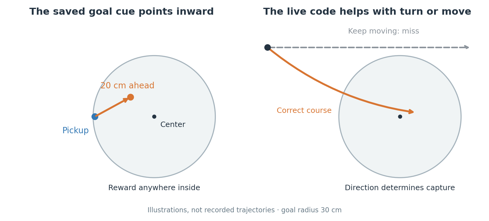
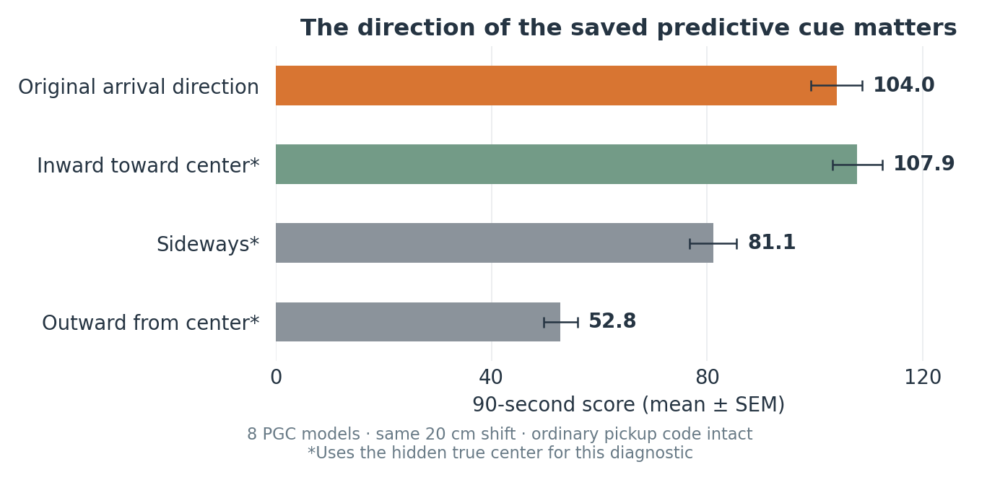
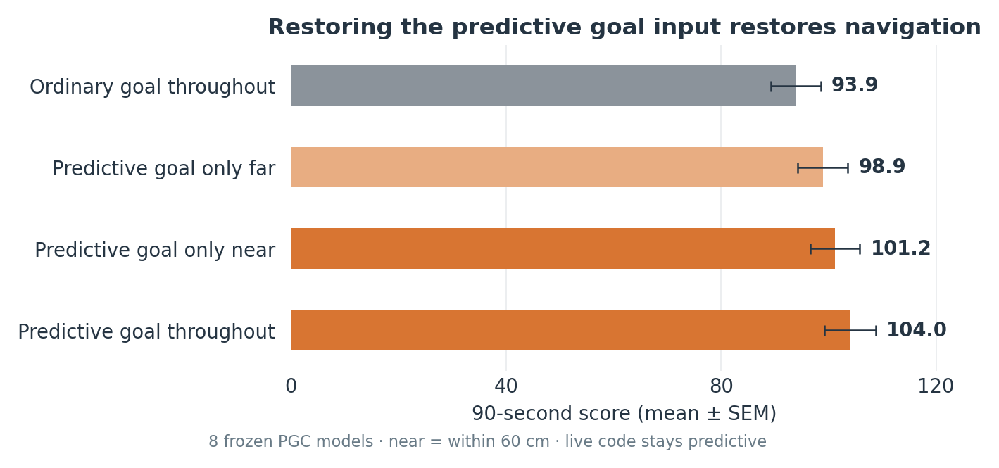

# Why PGC models return to the goal better

**PGCs support better steering during return trips.** The saved code supplies an inward goal cue; the live code helps the RNN decide when to correct its movement. These are results from eight paired, frozen 1B-frame LSTMs.



## 1. The saved code contains a useful goal cue

The goal is a **30 cm radius area**. Reward usually arrives at its edge. Ordinary goal cells save that pickup position. Predictive cells save a point **20 cm along the arrival direction**, usually pointing inward.

At first pickup, the ordinary marker is about **8 mm inside** the reward boundary; the predictive marker is about **12.5 cm inside**, on average. Its squared error about the hidden center is **58% smaller**. The message is then supplied every step. A grid-only RNN could retain arrival information in its history; PGCs provide it externally. [Geometry tests](../results/lstm_goal_cue_mechanism_1B/README.md).



Pointing the predictive cue straight inward improves navigation; directing it sideways or outward hurts. The direction tests keep the **same 20 cm shift and ordinary pickup anchor**, and use the hidden center for diagnosis. All four preselected geometry comparisons pass both corrected tests.

Keeping the original predictive point but moving the ordinary anchor onto it lowers score **104.0 → 96.3**. The learned two-part format matters; this does not establish a literal center-decoding algorithm.

## 2. Restoring the cue restores navigation



Removing predictive goal encoding lowers score **104.0 → 93.9**. Restoring it **only within 60 cm of the goal** raises score to **101.2**; restoring it only farther away gives **98.9**.

Both restorations help. Their difference is uncertain, so this is not a near-only mechanism. We change the goal input, keeping live encoding and weights intact. These gains are not additive percentages of the population advantage. [Causal phase tests](../results/lstm_phase_intervention_1B/README.md).

## 3. The RNN makes a changing turn-or-move decision

Fifteen of sixteen models almost exclusively choose between **one turn and one movement action**. One PGC model also uses a second movement action substantially.

At the same near-goal RNN state, removing live prediction reduces turning when holding the preferred movement would fail to reach the goal within 1.53 seconds: **48.5% → 45.5%**. This diagnostic includes inertia and residual rotation.

The combined turn/go measure improves with prediction in all eight seeds, although corrected tests differ. A separate closed-loop test finds that removing live prediction near the goal hurts more than removing it farther away. This supports anticipatory correction; it does not show internal simulation of a future trajectory. [Turn-or-go computation](../results/lstm_action_computation_1B/on_policy/turn-go.md).

## 4. Better-directed movement produces more returns

Near-goal speed is similar: **0.239 m/s for PGC, 0.242 for grid**. But goalward progress is **0.159 versus 0.132 m/s**. Matching completed trips from the same spawn, PGC models save **0.69 seconds**, including **0.45 seconds after entering the near area**. These duration comparisons condition on both trips finishing.

The net score advantage comes from subsequent returns, not earlier discovery. Failure-retaining first-return tests are less conclusive after correction. [Behavior and failure controls](../results/lstm_navigation_phases_1B/README.md).

## How this fits the earlier RNN results

The gate-rescue tests identified useful predictive influence on **what the RNN writes and exposes to its action selector**. The new tests support an ongoing steering interpretation, without identifying a literal center decoder. [Internal rescue](../results/lstm_gate_rescue_1B/README.md).

A saved goal message can stay fixed while its effect changes with current position, motion, and recurrent state. It therefore need not act like a constant addition to hidden activity. Larger episode-average shifts remain real, but their causal role is unproven: restoring a fixed average did not restore navigation. [Offset and spectrum tests](offsets-and-spectra.md).

<details>
<summary>Scope, additional controls, and reproduction</summary>

All behavioral tests use 128 matched episodes per condition per seed, with identical environment layouts and coupled randomness. Training seeds are the statistical replicates. All original baseline episode records reproduce exactly. Reports retain paired intervals, both paired-t and exhaustive sign-flip tests, and corrections within stated families. Several diagnostic analyses were exploratory; their timing and limits are recorded.

Inward correction gains +3.86 points, interval [1.97, 5.74]; moving the ordinary anchor to the unchanged predictive point loses 7.73, interval [4.38, 11.09]. Each has the same direction in all eight seeds and passes both corrections in the four-comparison geometry family. Inward scores 107.85, sideways 81.10, and outward 52.81. These interventions use privileged geometry and can change the learned input distribution. They demonstrate sensitivity to useful spatial content and the trained input format, not a uniquely identified internal decoder.

The goal-near restoration gain is +7.34 points, 95% paired interval [4.43, 10.26]; the goal-far restoration gain is +5.01, interval [2.17, 7.85]. Both pass both corrections in the four-comparison family. Their difference is +2.33, interval [−0.43, 5.10], which does not establish greater benefit near than far. Removing live prediction near versus far differs by 2.26 points, interval [0.71, 3.80], passing both corrections. Distance masks use the hidden true goal center for diagnosis; trajectories and recurrent histories subsequently diverge.

The matched-state turn/go diagnostic measures a hypothetical 1.53-second continuation, not optimal control or a percentage of score explained. Its balanced-agreement live-code effect is +1.94 percentage points, interval [1.34, 2.54]; Holm t p=0.00087, Holm exact p=0.05469. The original one-step progress metric was inconclusive and remains reported.

Additional [intact-controller switching tests](../results/lstm_policy_hybrid_1B/README.md) hold discovery experience fixed. Using the PGC controller for all returns raises mean score from 95.01 to 102.48, with interval [2.26, 12.68] for the difference; corrected t and exact tests differ (p=0.035 versus 0.070). Each RNN keeps its own state and native inputs. Switching between models within a return performs worse than keeping the PGC controller throughout. Most paired models use different preferred movement axes or turning directions, so switching can introduce costs of its own; that explanation for the switching losses is not proven.

Relaxing the first-return capture criterion from 30 to 45 cm reduces the goal-cue penalty in the mean, but the reduction is uncertain: +0.17 seconds, interval [−0.11, 0.45]. This [radius control](../results/lstm_navigation_phases_1B/radius_sensitivity.md) does not establish that boundary precision alone explains the advantage.

This is an account of how predictive inputs support these trained 1B models. It is not a unique explanation for every training condition, a proof of different attractors, or a demonstration of how optimization selected the weights. Earlier 300M controls can retain benefits without predictive goal snapshots, so goal geometry alone should not be generalized to every architecture or training stage.

Rebuild the two simple figures from committed summaries:

```sh
python scripts/plot_lstm_navigation_explanation.py
```

The linked reports provide full experiment commands. Checkpoints and raw NumPy archives remain local.

</details>

[Main study](../README.md) · [Earlier mechanism guide](README.md)
