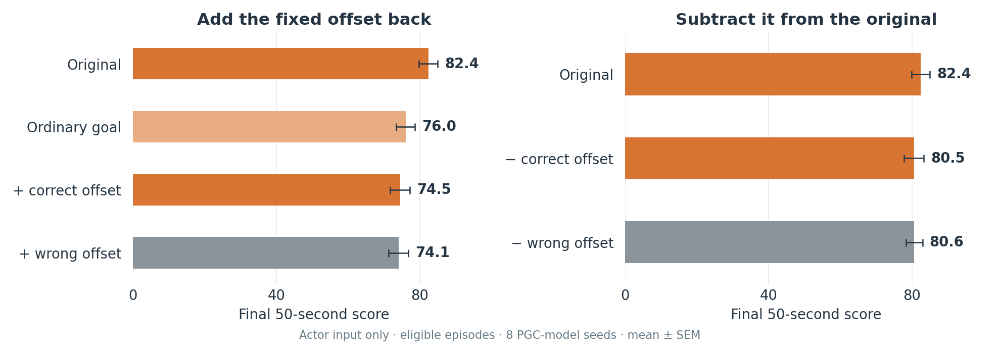
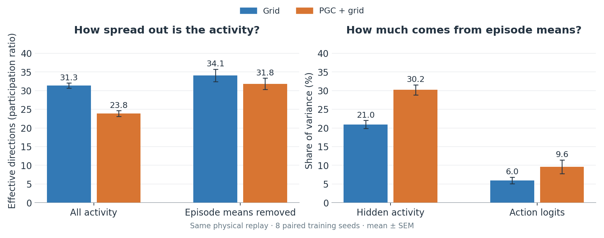

# Do the larger episode shifts explain better navigation?

**We tested a simple version of that idea. The results do not establish it.** Predictive goal input helps navigation, but copying back its fixed episode-specific activity shift did not restore that benefit.

## Add it back; take it away



We ran **eight frozen PGC models**, with 128 matched episodes per seed. Each model first followed the same original behavior. Once it knew the goal, we measured how its activity differed with predictive versus ordinary goal input over a ten-second window.

We froze that average difference, then tested the remaining 50 seconds:

- **Add it back:** give the model ordinary goal input, then add the estimated offset to the activity used to choose actions.
- **Take it away:** keep predictive inputs, then subtract the episode-specific part of that offset.
- **Wrong-episode control:** use another episode's pattern, matching the size of its episode-specific component to the correct one.

**Correct and wrong offsets produced similar scores.** The paired correct-minus-wrong intervals were −2.24 to +3.02 for restoration and −2.41 to +2.17 for subtraction. Neither establishes an episode-specific benefit or harm. These are uncertainty intervals, not equivalence tests.

Weights, the vision system, and live predictive encoding stayed unchanged. In the plotted tests, we changed the **action selector's input**, leaving the recurrent states unpatched. We did not remove whole neurons, all episode information, or the full episode-average activity.

Separate tests also fed the modified hidden activity back into the RNN. Subtraction then hurt more, but the extra harm relative to the wrong-episode control was uncertain. Patches sometimes pushed hidden activity outside its normal range, limiting interpretation. [Restoration details](../results/lstm_episode_offset_rescue_1B/README.md) · [Subtraction details](../results/lstm_episode_offset_rescue_1B/ablation/README.md).

## Why a fixed pattern may be too simple

The early pattern only partly resembled the later pattern. Copying it unchanged predicted the later offset poorly, particularly at the action output. Even the later period's own average captured only **25% of the predictive-goal-induced hidden difference's squared magnitude**; the remaining 75% varied over time. These percentages describe that hidden signal, not navigation performance or total PCA variance.

The tests therefore challenge a reusable fixed-offset explanation. They do **not** rule out useful episode information that changes with position, movement, new goal pickups, or history.

## What the eigenvalues and eigenvectors tell us



An **eigenvector** is an activity pattern across neurons. Its **eigenvalue** says how strongly that pattern varies.

PGC activity is concentrated into fewer strong patterns: about **24 effective directions versus 31**. Removing episode averages brings them closer, with no clear remaining difference in this measure.

But large patterns need not dominate actions. Episode averages account for **30% of PGC hidden variance and only 10% of its action-logit variance**; the grid values are 21% and 6%. Logits are the scores used to choose actions. Small logit changes can still matter, and this does not measure recurrent influence.

The strongest PGC pattern is especially episode-related: episode means account for 67% of its variance, versus 26% for the strongest grid pattern. These particular-direction comparisons are descriptive and vary across seeds. [Full spectra and eigenvector analysis](../results/lstm_eigenspectra_1B/README.md).

We also measured how small state changes affect the next RNN update. Removing the predictive goal shift increased worst-case one-step amplification from **5.3 to 7.4**, at the same starting state, in all eight PGC seeds. This shows an input-dependent change in local dynamics. It does not establish attractors or explain the performance loss. [Local update spectra](../results/lstm_local_dynamics_spectra_1B/README.md).

**Current interpretation:** predictive inputs change useful ongoing RNN computations. The larger episode-average shifts are a real accompanying feature, but their causal contribution to better navigation remains unresolved.

<details>
<summary>Scope and reproduction</summary>

The behavior figure includes only the 691 of 1,024 episodes that had found the goal before calibration began. Selection precedes all interventions; scores cover only the final 50 seconds. Means and SEM weight the eight training seeds equally. Original episode records match the earlier input-swap evaluation exactly. The subtraction study was exploratory, added after the first restoration seed; full reports state the test families and corrections.

The independent replay for the spectra contains 3,393 moving states from 16 common episodes. Eigenvectors are compared within each model using whole-subspace overlaps; separately trained neurons are not assumed to align. The effective-direction count is the participation ratio, not a count of independent state variables. Covariance spectra and local-update spectra answer different questions.

Rebuild these figures from committed numerical summaries:

```sh
python scripts/plot_lstm_offset_summary.py
```

The linked reports include model-run commands, complete controls, uncertainty, and source hashes. Checkpoints and raw NumPy archives remain local.

</details>

[Earlier mechanism guide](README.md) · [Main study](../README.md)
