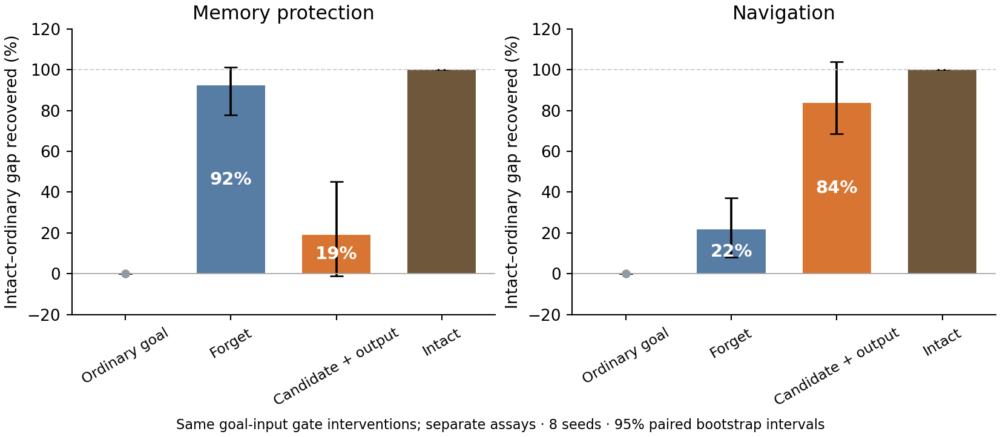

# Predictive input protects memory and improves navigation through different gates

**The predictive goal message does at least two things inside the trained LSTM.** The forget gate protects particular memory-state directions from disturbance. The candidate update and output gate provide the larger measured contribution to navigation.

We separated these functions using the **same four goal-input conditions**. Current predictive input stayed intact, and all weights stayed frozen:

| Goal-input condition | Memory error after 4 seconds ↓ | Navigation reward ↑ |
|---|---:|---:|
| Ordinary goal code | 1.640 | 93.896 |
| Restore prediction to the forget gate | 1.350 | 96.104 |
| Restore prediction to candidate + output | 1.580 | 102.354 |
| Predictive goal code intact | 1.325 | 103.994 |

The memory experiment injected the same small disturbance into a sensitive state direction and followed the actual next inputs. The navigation experiment ran normally, with the original environmental noise and no added state disturbance. It used eight training seeds and 128 episodes per condition per seed.

**The forget gate restores about 92% of the mean memory protection, but 22% of the mean navigation loss. Candidate + output restore about 19% of the memory protection and 84% of the navigation loss.** Each percentage measures recovery of the intact-versus-ordinary-goal gap within its own experiment. The percentages are not additive because the gates interact.

The intervals resample the eight training seeds together across both experiments: 50,000 paired bootstrap samples, with no samples discarded. Ordinary and intact are fixed at 0% and 100% by the definition of recovery. These intervals describe uncertainty in the ratios; the corrected hypothesis tests are below. [Recovery data and intervals](../results/ring_attractor/goal_gate_behavior/recovery_intervals.json)

**How the forget gate protects memory.** Think of cell state `c` as the stored message. The forget gate multiplies that message to decide how much carries forward. A small error in hidden activity can change the forget gate; when the stored value is large, that small gate error can produce a larger memory error.

The relevant term is `c × f(1−f) × W_f × δh`: stored value × gate sensitivity × the incoming hidden-state error. We decomposed the actual cell update and found that this forget-feedback term accounts for most of the change along the tested vulnerable direction. Its signed contribution falls from **6.478 with ordinary goal input to 3.595 with predictive goal input**. The other three terms change much less.

Average forget-gate openness barely changes: **0.335 versus 0.334**. The useful difference is how sensitive the stored-memory feedback is to particular errors. Restoring predictive influence to the forget gate alone recovers **98% of the immediate protection** and **92% after four seconds**. [Gate mechanism and figure](../results/ring_attractor/gate_stability/README.md)

**The network remains responsive overall.** PGC-trained networks respond more strongly to ordinary random state disturbances: mean action probability moved is **0.616% versus 0.262%** in Grid-trained networks. The three population comparisons survive both corrections. Removing predictive input from a PGC-trained network does not increase average noise propagation in the four primary contrasts. The protection appears in selected vulnerable memory directions, alongside an overall more responsive network. [Average-noise experiment](../results/ring_attractor/predictive_stability/README.md)

This also sharpens the ring-attractor question. The original-agent screen points toward direction coding supported by continuing input. The protected modes identified here are cell-state directions; identifying their geometry as a ring remains a separate task. The present result gives a concrete mechanism to investigate: **predictive input controls how strongly errors enter stored state, while other gates use the predictive cue to guide actions.** [Original directional-memory screen](../results/ring_attractor/original_pilot/README.md)

**Navigation tests: four planned comparisons.** Candidate + output restoration beats forget restoration in all eight seeds. The same scope is used throughout: only predictive goal influence changes; current prediction remains intact.

| Score comparison | Difference, with 95% paired interval | Holm t p | Holm exact p |
|---|---:|---:|---:|
| Intact − ordinary | +10.10 [6.75, 13.45] | 0.000754 | 0.03125 |
| Forget restored − ordinary | +2.21 [0.48, 3.93] | 0.01925 | 0.03125 |
| Candidate + output restored − ordinary | +8.46 [5.55, 11.37] | 0.000754 | 0.03125 |
| Candidate + output − forget restoration | +6.25 [2.30, 10.20] | 0.01454 | 0.03125 |

**Targeted stability tests: four separate comparisons.** We chose each initial direction from the leading singular vector under either native or ordinary-goal input, then tested that same direction under both inputs. A positive difference below means ordinary goal input amplified the disturbance more. The four-second difference is concentrated in cell state; action effects at that horizon are very small.

| Fixed initial direction and horizon | Ordinary − predictive amplification, with 95% interval | Holm t p | Holm exact p |
|---|---:|---:|---:|
| Native-sensitive direction, 1 update | +0.978 [0.326, 1.630] | 0.02809 | 0.03125 |
| Native-sensitive direction, 4 seconds | +0.138 [−0.060, 0.336] | 0.14314 | 0.15625 |
| Ordinary-sensitive direction, 1 update | +2.778 [2.066, 3.489] | 0.000145 | 0.03125 |
| Ordinary-sensitive direction, 4 seconds | +0.314 [0.101, 0.527] | 0.02809 | 0.03125 |

The gate attribution was exploratory, with **12 comparisons**. Forget restoration reduces the targeted cell error in all eight seeds at both horizons. Its corrected paired-t p-value is 0.00046 immediately and 0.0978 after four seconds; the corrected exact p-value is 0.09375 at both horizons. These limits accompany the large mean recovery fractions. [All gate-attribution statistics](../results/ring_attractor/gate_stability/summary.json) · [Targeted-stability statistics](../results/ring_attractor/worst_direction/summary.json)

**What the matched experiments suggest:** predictive goal input supports separable functions in the same RNN—protecting selected stored-state directions and improving goal-directed action computation. The navigation rescue identifies a useful action pathway. Connecting the measured memory protection itself to navigation improvement requires a behavioral perturbation test; the two panels use separate assays.

All 4,096 behavioral episodes were completed. Every intact and ordinary-goal episode row exactly matches the earlier evaluation, first-discovery times match across all conditions, all update-identity errors are zero, and checkpoint hashes are unchanged. [Behavioral report](../results/ring_attractor/goal_gate_behavior/README.md) · [Validation](../results/ring_attractor/goal_gate_behavior/validation.json)
