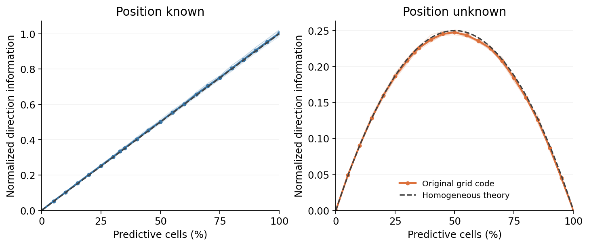
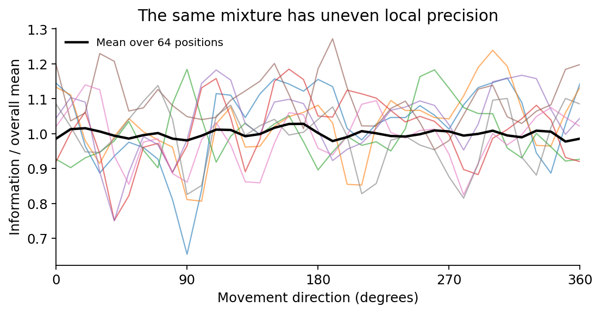

# Why a mixture can reveal movement direction

**Ordinary cells provide the reference point; predictive cells provide the displaced point. Their difference tells you the direction of the displacement.**



The two panels ask different questions about **one instantaneous population sample**:

- **Position known:** more predictive cells provide more local direction information.
- **Position unknown:** a mixture is useful. Ordinary cells alone do not depend on direction. Predictive cells alone specify a displaced location, leaving current location and direction confounded. Combining them separates those two quantities.

We calculated the actual rate derivatives for all eight original population seeds, with 512 cells, 64 positions, 36 movement directions and 22 predictive fractions. The curves closely follow the simple prediction: **direction information scales approximately as `f × (1 − f)` when current position is unknown**, where `f` is the predictive fraction.

At the original fraction of about one-third, the mixed population retains **88.8% of the best sampled mean direction information**, averaged over the eight populations. Seven populations peak at 50% predictive cells; one peaks at 44.9%. These are local coding results under a fixed cell/noise budget, **not an optimal predictive fraction for navigation or a trained RNN**.

Current-position knowledge or useful history can let an all-predictive population recover direction. Ordinary populations can also recover movement direction from changing activity over time. Neither endpoint result says that an entire agent is unable to navigate.

## The simple calculation

Let an ordinary cell encode `g(x)` and a predictive cell encode `g(x + d u(θ))`. Position `x` has two coordinates, direction is `θ`, and `u⊥ = (−sin θ, cos θ)` is the direction change produced by a small rotation. We assume independent additive Gaussian rate noise with variance `σ²`.

Define the spatial precision matrices of the ordinary and predictive subpopulations:

\[
A_0=\frac{1}{\sigma^2}\sum_{i\in GC}\nabla g_i\nabla g_i^T,
\qquad
A_1=\frac{1}{\sigma^2}\sum_{i\in PGC}\nabla g_i\nabla g_i^T.
\]

Each gradient is evaluated at the location that its cell represents. The joint Fisher matrix for position and direction is

\[
I=\begin{bmatrix}
A_0+A_1 & d A_1u_\perp\\
d u_\perp^T A_1 & d^2u_\perp^T A_1u_\perp
\end{bmatrix}.
\]

The bottom-right entry is direction information **if position is known**. When position is unknown, subtract the direction change that could instead be explained by moving the position:

\[
I_{\theta\mid x}
=d^2u_\perp^T\left[A_1-A_1(A_0+A_1)^+A_1\right]u_\perp.
\]

The superscript `+` denotes a pseudoinverse. Equivalently, project the direction-derivative vector away from the two position-derivative vectors and measure its remaining squared length. This is the nuisance-parameter Schur complement, not mutual information in bits.

In a homogeneous local-phase model, splitting the same total precision budget `A` gives `A0=(1−f)A` and `A1=fA`. Therefore

\[
\boxed{I_{\theta\mid x}=f(1-f)d^2u_\perp^TAu_\perp.}
\]

This formula allows anisotropic `A`; it requires the two groups to share its shape in proportion to their sizes. Finite grid populations need not satisfy that approximation at every position and direction. The numerical calculation above uses their actual gradients, without forcing proportionality.

For an all-predictive population, the ambiguity is exact: replacing direction `u` by any `u′` and current position `x` by `x+d(u−u′)` leaves every represented location unchanged. A position prior adds precision to the upper-left block and can break that ambiguity. Our tests verify both the ambiguity and its removal by position knowledge.

## What changes locally



At one-third predictive cells, mean information differs from the homogeneous prediction by −2.3% to +1.1% across populations. Within a population, precision varies across positions and directions: its coefficient of variation is 9.8–13.0%. The positional precision matrix has a median eigenvalue ratio of 1.16, so the actual population is not perfectly isotropic. The second figure uses population seed 1 and the first eight sampled positions, selected without searching for a striking example.

**Local precision does not rule out periodic ambiguity.** In the finest module, grid spacing is 0.4 m and predictive displacement is 0.2 m. Opposite directions along a lattice vector can therefore produce identical rates: their two projected locations differ by one lattice period. We verified this in all eight seeds, with maximum float32 rate differences below `6e−7`, despite positive local direction information. Coarser modules separate those same opposite directions. The [phase-difference decoder](../scripts/decode_predictive_phase_difference.py) avoids the finest module when unwrapping displacement phases.

## Scope and relation to earlier work

This is an input-code analysis, with no fitted RNN or behavior selected. Fisher information is calculated under an explicit, unclipped independent Gaussian rate-noise likelihood. The full agents additionally have shared position/direction measurement noise, clipping and temporal information; their absolute precision is not given by this likelihood. The plots divide both information measures by the same per-population spatial reference precision. Sampling positions from a bounded region selects evaluation points; that region is not supplied as an inference prior.

The broader idea that grid activity can provide a movement-direction signal predates this analysis. [Zutshi, Leutgeb and Leutgeb (2017)](https://pmc.ncbi.nlm.nih.gov/articles/PMC5761317/) proposed reading direction from spatial or theta-compressed grid sequences. [Ouchi and Fujisawa (2024)](https://fujisawalab.riken.jp/publications/Ouchi2024.pdf) described predictive grid fields and current-to-future population sequences. Here we quantify the complementary roles of simultaneous ordinary/predictive rates, the position nuisance, and the finite-population/alias limits. We do not claim that direction decoding from grid activity is a new general concept.

The [full numerical summary](../results/ring_heading/fraction_information/summary.json) records all fractions, population seeds, sampling parameters and source hashes. [Six independent tests](../tests/test_predictive_fraction_information.py) check the homogeneous formula, original Torch derivatives, an independent score-projection calculation, exact confounding, position priors and aliasing.

Reproduce with:

```bash
OPENBLAS_NUM_THREADS=1 OMP_NUM_THREADS=1 python scripts/analyze_predictive_fraction_information.py
python -m unittest discover -s tests -p test_predictive_fraction_information.py -v
```
