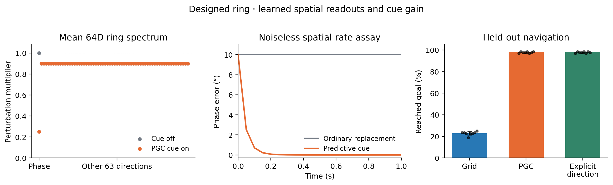
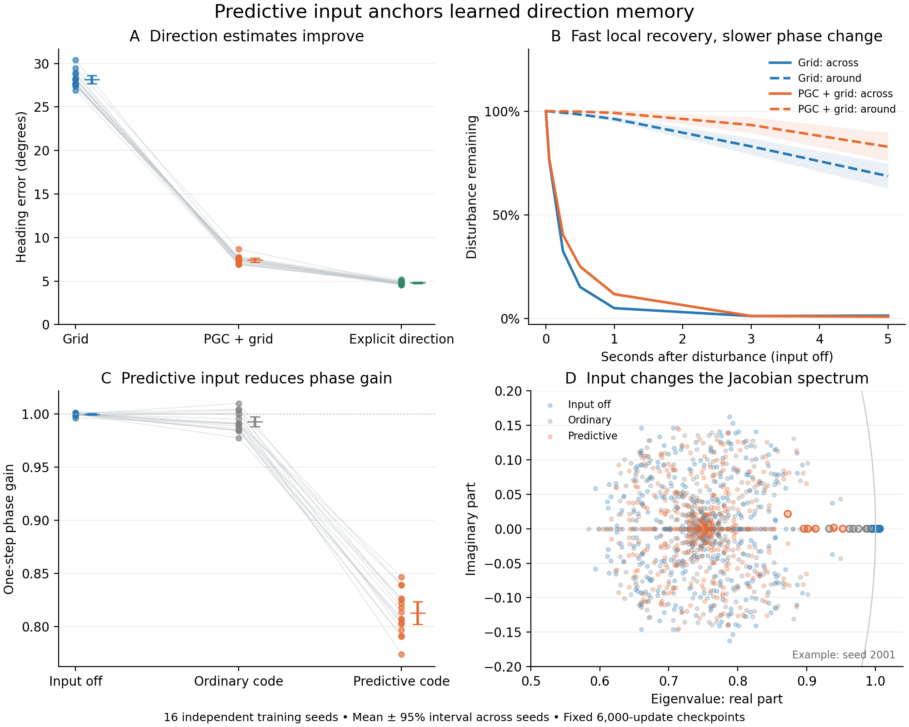
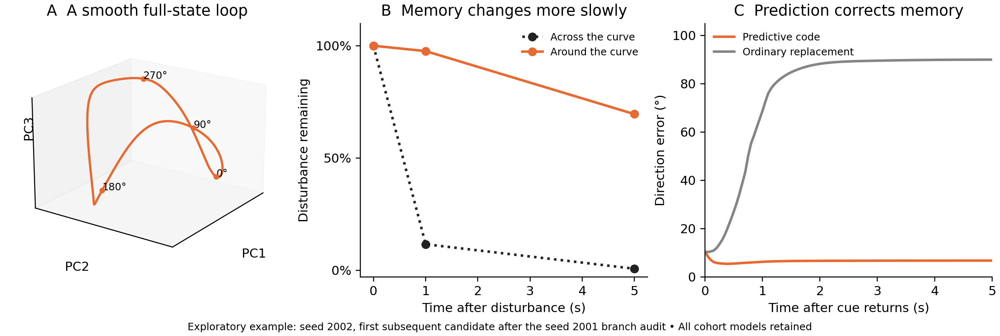
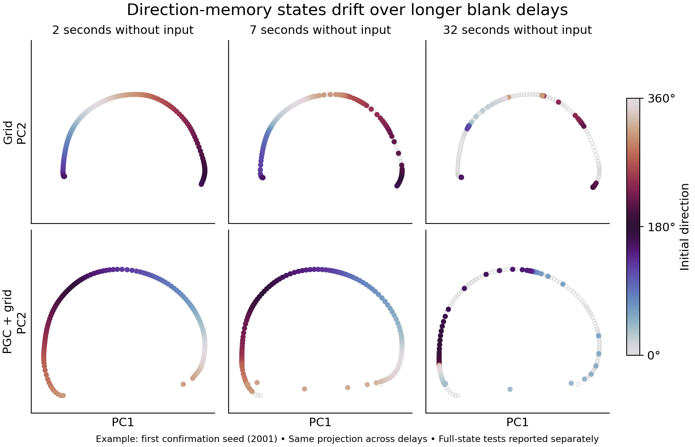
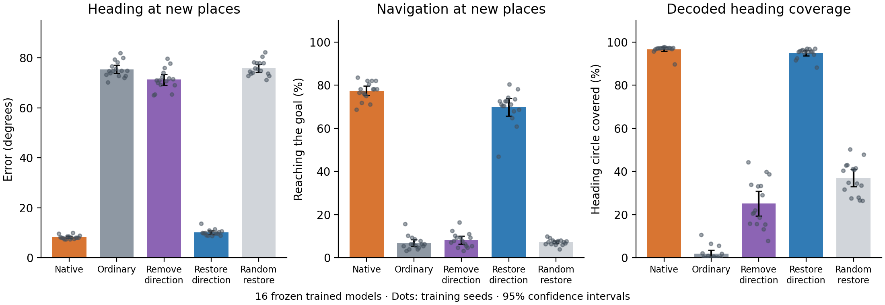
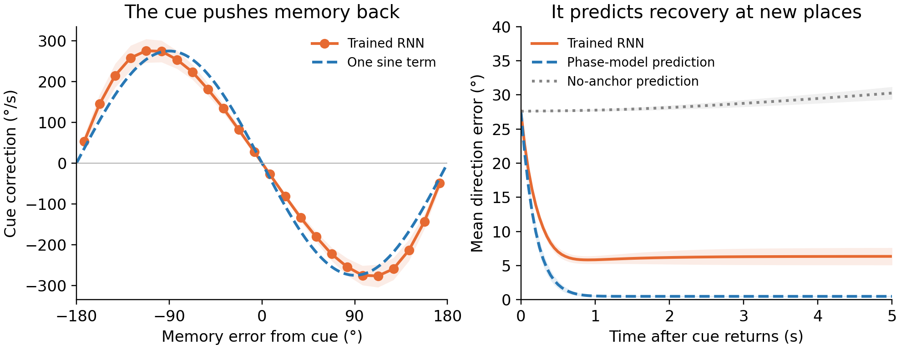
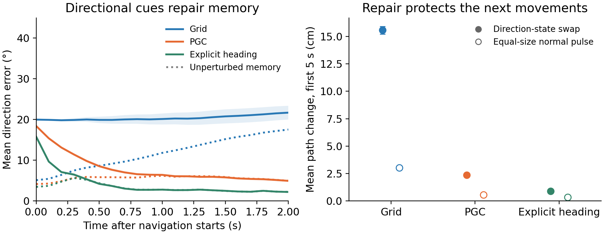
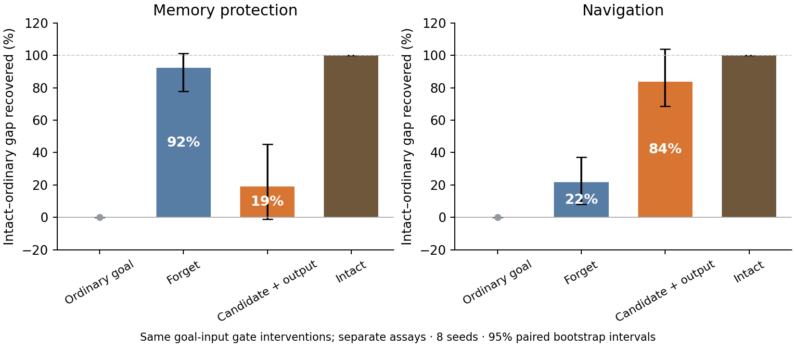

# Predictive spatial codes anchor recurrent direction memory

**Scope: a separate compass-model study.** For the follow-up using the original square-arena RL policies and a goal-location memory, see [From predictive maps to goal memory and navigation](goal-memory-in-the-navigation-task.md). The compass results below are not evidence that the original navigation LSTMs contain a ring.

**Completed computational study.** All planned cohorts are included: 104 unconstrained RNNs across three separate studies, eight trained designed-ring interface sets, eight original navigation LSTM pairs, and ten published path integrators. Pilot results remain separate.

The mechanism is simple: **ordinary grid cells say where the agent is; their relationship to predictive grid cells also says which way it is moving. A trained RNN extracts that direction signal and uses it to correct its internal compass.** Correcting the compass reduces steering error.

We test this in two complementary compass models: an exact ring with a trained sensory interface, and unconstrained RNNs trained to estimate direction. Both drive the same fixed navigation controller. Separate experiments examine the original reinforcement-trained navigation LSTMs and internally predictive neurons in published path integrators. These systems answer different questions and are not pooled.

[Detailed methods](predictive-ring-methods.md) · [Reproduce the study](../docs/research/ring_reproduction.md) · [Mathematical mechanism](../docs/research/predictive_ring_derivation.md) · [Protocols and audits](../docs/research/) · [Related work and biological predictions](../docs/research/ring_prior_work.md)

## 1. What we built

**First, a transparent ring model.** Its 64-dimensional recurrent state contains a continuous circle of valid direction memories. With no cue or angular-motion input, every point on that circle is fixed. Disturbances away from it shrink by a factor of 0.9 per update. We train an interface to read spatial phases from 512 channels generated by the repository's grid-population model, and train the strength with which their relative phase corrects remembered direction. The ring, phase-comparison operation and correction rule are designed; the sensory readout weights and correction strength are learned.

*Left: the full-state spectrum has one neutral memory mode and 63 contracting modes. A predictive cue makes the phase mode contract too, while the other modes stay unchanged. Middle: the fitted decoder corrects a displaced memory using actual predictive rates in a noise-free diagnostic. Right: noisy navigation over eight independent trained interfaces; dots are seeds. [Exact model, all interventions and methods](designed-predictive-ring.md).*

In held-out navigation at new locations with a misleading initial heading cue, this model reaches the goal **97.75%** of the time with PGC input and **22.75%** with Grid input. Replacing the predictive code with ordinary grid values in the frozen PGC model reduces success to **21.68%**. Restoring prediction after two seconds recovers success to **58.98%**. All four prespecified navigation contrasts pass correction across eight seeds. A control with explicit measured direction also reaches **97.75%**, identifying the useful information as direction. With nominal initial heading, the separate descriptive test gives **97.66% for PGC** and **28.52% for Grid**, so the benefit also appears without the misleading initial cue.

The mathematical mechanism is exact in this model: at a cue aligned with the stored direction, the memory-direction eigenvalue changes from `1` to `1 − dt × cue strength × cue magnitude`, while the other 63 eigenvalues remain `0.9`. The trained unit-cue phase multipliers are 0.2 or 0.4. Predictive input therefore corrects errors **along** an otherwise neutral ring. It does not strengthen the already designed contraction **toward** the ring.

**Second, unconstrained trained RNNs.** These test whether a similar useful input pathway appears when recurrent organization is learned rather than prescribed.

We trained an unconstrained 64-unit RNN to keep track of direction while an agent moves, turns, and temporarily loses its spatial observations. Angular-velocity measurements are noisy and biased, so simply integrating them accumulates error. The RNN receives either ordinary grid codes, a mixture of ordinary and predictive grid codes, or ordinary grids plus an explicit direction cue. The last condition receives the **same noisy direction information used to construct the predictive shift**. The shift points 20 cm along measured travel direction; it does not reveal future turns or plans. In this forward-moving task, travel direction and heading coincide.

The recurrent weights have no imposed ring wiring. There is no loss that rewards circular hidden states or stable attractors. Training rewards accurate direction estimates. All conditions have the same parameter count, training trajectories, noise, and fixed training budget. The primary study uses **16 paired seeds and 48 trained networks**, with 2,048 new evaluation trajectories per network. An additional eight-seed, 24-network cohort removes the nonlinear sensory encoder.

After training, we examine the entire recurrent state, disturb its memory, change its inputs, and let its direction estimate control navigation. We keep each trained network's weights fixed during these interventions.

## 2. Predictive input anchors direction memory; full-state geometry is more complicated

Think of the remembered direction as a compass needle. For an ideal ring attractor, moving the state **around** the ring changes the remembered direction; moving it **away from** the ring disrupts the form of the memory. A useful ring should recover from the second disturbance while retaining the first when there is no new information. We test these properties rather than infer them from a circular readout.

We initialize many directions, remove all external input, and perturb the full 64-dimensional state. We measure recovery toward the evolving memory curve and retention of angular displacement. This distinguishes a memory ring from a system that merely collapses every disturbance into the same state. PCA is used only to draw the states; the recovery measurements use all 64 dimensions.

*Dots in panels A and C are trained networks; lines and intervals summarize all 16 seeds. “Across” and “around” refer to the sampled memory curve. The spectral panel shows all 64 eigenvalues at six prespecified phases in seed 2001, using identical states under different inputs; larger open circles mark eigenvalues closest to +1. The phase gain is a coordinate derivative, not an eigenvalue.*

Both populations retain angular memory over short delays and show strong local recovery. Predictive input supplies a reference that corrects drift in the remembered direction. This is the relevant functional stabilization. Long blank delays distinguish it from autonomous persistence: after 32 seconds without input, heading error is **31.62° for Grid** and **44.49° for PGC**. Predictive training does not uniformly improve memory when its directional reference is unavailable.

The full-state audit reveals heterogeneous geometry. Some networks have smooth closed memory loops; others have extremely sharp transitions between distant hidden states, even while decoded angle changes smoothly. Dense sampling resolves these transitions, mostly in directions invisible to the readout. Median eigenvector alignment and sparse circular plots can conceal those exceptions. We therefore test ring-like organization model by model rather than asserting that every network contains a single smooth global ring. Local recovery remains useful evidence, while its precise polyline-based magnitude depends on resolving the sharply transitioning regions.

One learned PGC network, seed 2002, provides a clear example: its full-state curve closes smoothly across 4,096 tested directions, its decoded direction changes monotonically around the loop, and every tested local transverse spectral radius is below one. After one second, mean normal displacement is about 12% of its initial value, while median angular-displacement retention is about 98%. Predictive input then corrects the remembered direction. This is an exploratory example selected after auditing the first seed, not an assertion about every trained model.

*The geometry is displayed in three principal components, but closure, derivatives, spectra and recovery use all 64 dimensions. Seed 2002 is the first subsequent candidate examined after seed 2001 revealed sharp transitions. Both examples and every cohort model remain in the analysis.*

*Prespecified example: first confirmation seed, first position. Color indicates initial direction. The projection is fixed across delays within each model, and gray open circles show its two-second reference states. Points are not connected across unobserved gaps. Dynamical measurements use all 64 dimensions. [Dense and bridge-sensitivity diagnostics](../results/ring_heading/geometry_audit/).*

**An independent geometry replication limits the broader claim.** We trained 32 additional networks and measured how unevenly the full memory state changes as the initial direction rotates. The prespecified peak-to-median sensitivity was lower for PGC in 10 of 16 pairs, but the population difference remained uncertain: mean log10 difference **−0.448**, 95% paired interval **−1.013 to +0.117**, exact **p = 0.110**. All models and the original endpoint were retained. This does not confirm the exploratory suggestion that PGC training generally produces a smoother memory map. The strongest replicated mechanism is the useful correction supplied by predictive input; autonomous geometry varies between networks. [Independent geometry results and figure](../results/ring_heading/geometry_confirmation/README.md).

At the same recurrent state, changing only the input changes the slopes of the nonlinear activation function. Those slopes change how recurrent feedback amplifies a phase disturbance, even though the recurrent weights are unchanged. The full Jacobian, its eigenvalues and eigenvectors, and actual finite-time recovery provide complementary measurements of that mechanism. An eigenvalue near one alone is insufficient: untrained networks can have one without it aligning with a meaningful direction-memory mode.

<!-- BEGIN COMPLETE-COHORT RESULTS -->
All **48 primary networks** completed the fixed training budget and evaluation. Across all 16 paired seeds:

| Network | Heading error | Error at new locations |
| --- | ---: | ---: |
| Grid | 28.14° | 28.13° |
| PGC + grid | **7.42°** | **7.98°** |
| Grid + explicit direction | 4.80° | 4.80° |

PGC input reduces error by **20.73°** relative to Grid (95% paired interval 20.26–21.19°). Replacing predictive values with ordinary grid values in the frozen PGC networks raises error to **73.45°**, a cost of **66.03°** (64.58–67.48°). Each of the four locked primary contrasts has Holm-adjusted p = **0.000122**, with the predicted sign in every seed. The additional accuracy-and-coverage anchoring criterion is met by **15/16** models; the remaining model is retained in every analysis. [Complete statistics and source data](../results/ring_heading/RESULTS.md).
<!-- END COMPLETE-COHORT RESULTS -->

**The sensory interface matters.** The separate 24-network control removes the nonlinear encoder and reduces parameter count, while retaining the same task and training budget. Predictive input still improves tracking: **21.38° for PGC versus 29.08° for Grid**, with **5.28°** for explicit direction. Ordinary replacement raises PGC error to **31.12°**. Tracking, removal and spatial transfer all pass the separate three-test correction across eight seeds (adjusted p = 0.0234). The benefit is smaller than in the larger encoder architecture. [Simple architecture-control figure](../results/ring_heading/raw_sensitivity_evaluation/raw_architecture.png).

Its stationary anchoring test also shows why contraction is not enough: predictive input strongly contracts local phase disturbances, yet its mean stationary heading error is **25.22°** and coverage is **84.3%**. It still improves markedly over ordinary replacement in those same networks. The useful input must be interpreted accurately, not merely drive the state toward something stable. This is an architecture-and-capacity sensitivity, not an isolated test of nonlinearity. [Memory and anchoring diagnostics](../results/ring_heading/raw_memory_evaluation/README.md).

## 3. Removing and restoring the direction signal

We first replace every predictive input with the ordinary grid value that the same cell would have produced at the same position. This preserves the grid maps, cell identities, input size, and trained weights; it removes the forward spatial shift.

We then make a more selective intervention. Using independent calibration data, we find two directions in the learned sensory drive that track cosine and sine of movement direction. Together these form a **direction-carrying plane**; each direction combines inputs to many recurrent units. We remove just that plane's contribution from the native predictive drive, or restore just that contribution to ordinary drive. The intervention uses the observed input patterns and a fixed projector; it receives no true heading or target answer during evaluation.

Three random planes, each matched in input-drive energy, test whether an arbitrary equally large intervention would work. A separate control restores only the fixed calibration mean of the projected drive difference, or removes its varying component while keeping that mean. These controls distinguish directional information from a simple global offset in the network's input.

The direction plane is tested at new physical locations, shifted 10 m beyond the training region, both during matched trajectories and during navigation. This is transfer across position in the same simulated sensor model; it is not a test of arbitrary new environments or sensory modalities.

*All 16 frozen PGC networks, using a new matched test bank distinct from the primary evaluation. The plane is fitted on separate data. Random restoration averages three equally energetic control planes within each model. The right panel measures decoded angular coverage at stationary training-region positions, not full-state ring topology.*

At new locations, native input gives **8.2°** heading error and **77.4%** navigation success. Removing the direction plane gives **71.3°** and **8.2%**. Restoring just that plane to ordinary input recovers **10.0°** and **69.8%**; random restoration gives **75.9°** and **7.2%**. All four heading and four navigation contrasts favor the direction component in every seed, with Holm-adjusted p = **0.000122** in each four-test family.

The fixed-mean control resolves a simpler alternative. Restoring only the average projected drive gives **75.2°** error and **6.6%** success. Removing its changing component while keeping that mean gives **71.0°** and **8.5%**. The useful signal lies in the varying direction-carrying component; this fixed average supplies little benefit. [Mean-control figure and corrected tests](../results/ring_heading/tonic_direction_confirmation/README.md).

## 4. A small equation predicts the correction

For an ideal grid-wave component, current and predictive spatial phases are `k·x` and `k·(x + d u)`. Their difference is `d k·u`: **position cancels, leaving movement direction**. This calculation explains the information available to the learned encoder; the subspace intervention identifies a functional direction pathway, without uniquely identifying literal phase subtraction as its algorithm. We do not assume that every recorded grid cell has a separately observable sinusoidal phase.

In a stationary-cue assay with no angular-motion or speed input, the recurrent phase dynamics are summarized by

`rate of change in remembered direction = intrinsic drift + κ × sin(cue direction − remembered direction)`.

We fit intrinsic drift from separate blank-input data and one cue-strength coefficient, κ, from calibration states. We then predict recovery at held-out positions and new starting-state/cue combinations. Reversing the predictive displacement changes the predicted stable direction without refitting κ. This is a prediction of the network's time evolution, beyond fitting a static activity plot.

*The reduced equation is fitted separately from the displayed test trajectories. Predictive and reversed cues are tested with the same fitted cue strength. The ordinary-replacement condition can leave the memory manifold; a phase-only equation is not expected to describe collapse of the full state.*

Across all 16 models, the fitted cue strength averages **4.80 per second**. The model explains **78.6%** of held-out phase-field variance. Its recovery-trajectory prediction error is **6.89°**, compared with **66.89°** when the anchoring term is omitted. These are errors in predicting the RNN's dynamics, distinct from its navigation or heading-estimation accuracy.

The reference must carry information that the network does not already have. A predictive shift generated from the network's own mistaken direction estimate can reinforce the mistake. That control separates correction by an independent measurement from a self-consistent but inaccurate internal signal.

## 5. Does correcting memory help the agent?

Every trained estimator controls the same navigation rule. The controller knows its starting coordinate and goal, then estimates its position from measured speed and the RNN's direction estimate. It never receives current true position or heading. Its own actions determine its subsequent trajectory.

In addition to removing sensory information, we directly substitute a memory state elicited by an initialization cue shifted by 20°. We measure the actual decoded displacement, which need not equal exactly 20°. We compare this with an equally large disturbance away from the sampled memory curve. This tests whether changing the direction-associated recurrent state affects steering and whether predictive input corrects the resulting error. Near a sharp hidden transition, the substitution can also change components invisible to the direction readout; it is not guaranteed to isolate phase alone in every network.

*All conditions use the same pulse protocol and controller. Heading recovery and trajectory deviation are separate from eventual arrival. Passing through the goal, remaining there, and stopping there are scored separately.*

The state replacement changes the agent's path, relative to its own no-replacement trajectory, by an average of **15.58 cm for Grid** and **2.36 cm for PGC** during the first five seconds. The extra heading error caused by the replacement is **4.18° larger for Grid** after two seconds (95% paired interval 3.55–4.81°). The difference in eventual arrival penalties is less consistent: its paired interval includes zero. The clearest behavioral effect is therefore rapid correction of early steering error.

The selective sensory intervention and the direct memory perturbation answer different causal questions. The first locates useful information in the learned input pathway. The second tests the behavioral consequences of displacing the recurrent memory itself.

## 6. What this explains in the original navigation agents

The original eight pairs of 1B-frame LSTMs show stronger episode-related organization of activity: the first ten PCs capture 46.4% of variance for Grid and 52.3% for PGC+grid. Subtracting each episode's average reduces those values to 40.9% and 42.8%. This describes how activity is distributed across contexts. It does not identify a memory ring, and our autonomous probes did not find the new compass model's ring in those LSTMs.

The original agents nevertheless show a related, specific dynamical effect. Predictive goal input reduces amplification along vulnerable cell-memory directions. Restoring its influence on the **forget gate** recovers about 92% of the measured four-second memory protection. This finer gate partition is exploratory: its exact test has Holm-adjusted p = 0.094 across 12 comparisons. Restoring predictive influence on the **candidate update and output gate** recovers about 84% of lost navigation score, supported by the separate corrected behavioral comparison. These percentages come from different assays; they are not additive pieces of a single effect.

*Predictive current-position input stays intact. Only predictive goal-code features are replaced and selectively restored to specified gate inputs. Eight training seeds; the memory assay uses 32 replay states per model, and the behavioral assay uses 128 matched episodes per condition and model. [Full results and exact intervention](predictive-memory-gates.md).*

This separates memory protection from the pathway carrying the larger measured navigation benefit. It also explains why “PGC networks are globally more stable” is too broad: average sensitivity, vulnerable memory directions, and useful behavioral computation are different properties.

## 7. Internal predictive neurons and the broader mechanism

An additional test uses ten published 4,096-unit path-integrating RNNs with predictive-cell identities fixed by their published classifications. We attenuate the recurrent outputs of predictive units and compare them with matched non-PGC controls. We separately replace the removed output with its independently calibrated mean. This asks whether a lesion removes changing information or mainly changes the network's operating point. These internally generated predictive neurons are different from the analytic spatial inputs supplied to the new compass model.

<!-- BEGIN INTERNAL-PGC RESULTS -->
The ten-network replication is complete. At the prespecified 25% attenuation and first 0.4-second endpoint, predictive-cell interventions differ from matched controls by less than 0.1 cm on average in all four conditions; every paired interval includes zero. All five corrected primary tests have p = 1.0. The selective deficit seen in the earlier single-checkpoint pilot therefore does not replicate under these published classifications and source-only interventions. Later and stronger interventions show mixed effects. [Full results, doses, controls and figures](internal-pgc-recurrent-outputs.md).
<!-- END INTERNAL-PGC RESULTS -->

A complementary [sensorimotor ring model](sensorimotor-ring.md) demonstrates another route: forecasting can compensate delays in the agent–environment feedback loop. Its neural ring is designed in advance; its stabilization concerns the joint physical and neural loop. The learned-compass experiment instead identifies an input-driven correction mechanism in an unconstrained trained recurrent network.

The combined account is that predictive codes can improve behavior in more than one way: by providing a directional reference, shaping recurrent sensitivity, and compensating delayed control. The strongest new causal claim here is the first: **a learned direction-carrying input pathway anchors a recurrent compass and improves navigation.** Its biological prediction is that selectively disrupting the predictive-versus-current spatial relationship should displace or destabilize the downstream direction estimate, even when overall activity is preserved.

## Reproduction and scope

The [methods appendix](predictive-ring-methods.md) specifies source hashes, simulator timing, independent data splits, every intervention, statistical units, and reproduction commands. Primary endpoints were frozen locally before the confirmation cohort; secondary protocols record when they were fixed. Analyses use trained seeds as replicates and retain all planned seeds. Multiple-comparison correction is applied within the declared families, rather than treating every simulated time step as an independent observation.

The new results are computational. The direction reference is deliberately available to the analytic PGC generator; the model explains how it can be used, not how biological PGCs generate it. The explicit-direction control shows the value of the information independently of its grid representation. Prior work already establishes learned compass rings and sensory anchoring; the contribution is the tested chain from predictive spatial code, through a learned sensory subspace and recurrent phase dynamics, to navigation. [Literature context](../docs/research/ring_prior_work.md).
