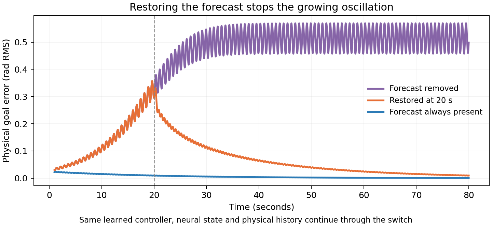
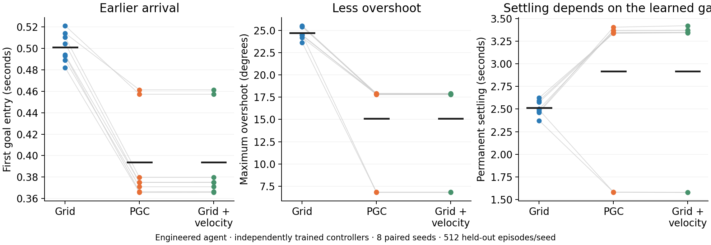
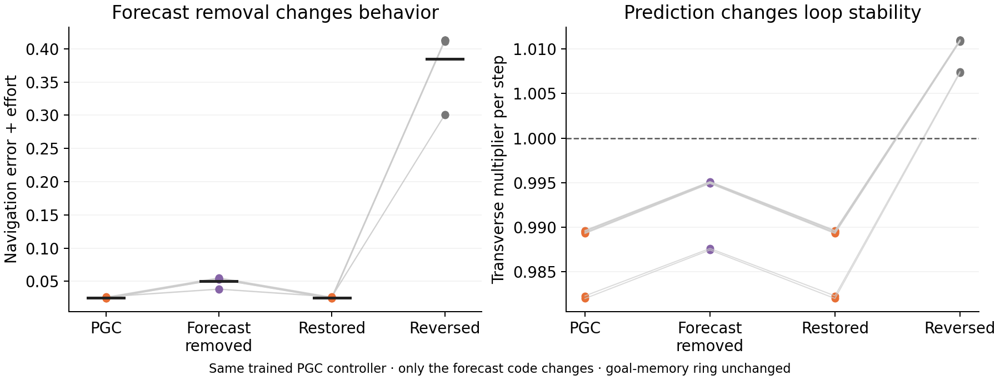
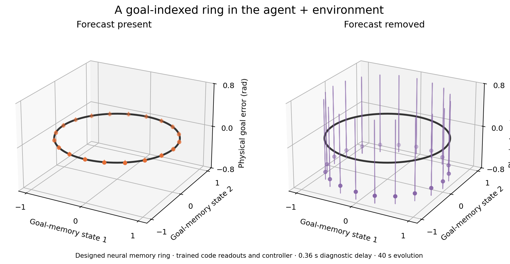
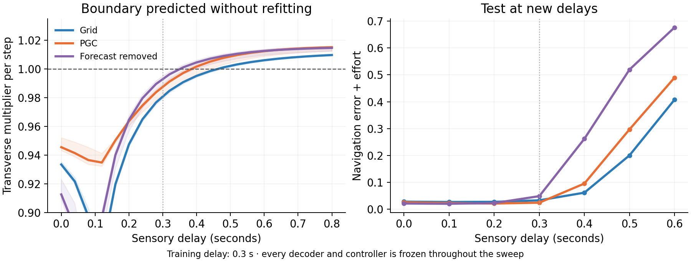
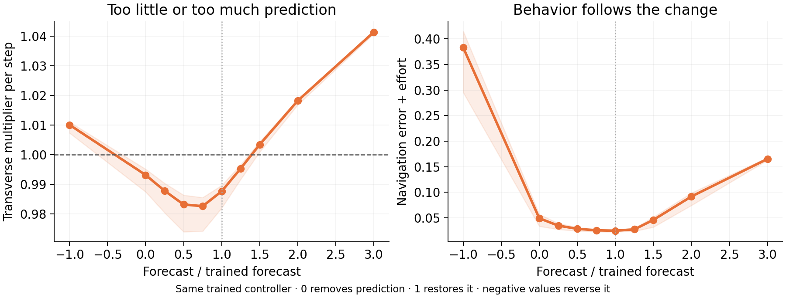

# How predictive grid codes stabilize a trained navigation loop

**Predictive codes let a trained controller correct movement more quickly without making delayed feedback oscillate.** Across eight new seed pairs, this engineered model reduced held-out navigation loss by **26.4%** and reduced overshoot.

This model has a deliberately designed neural goal-memory ring. We learned the spatial-code readout and the controller. Prediction stabilizes the **combined agent–environment system around the ring of possible goals**. The intrinsic neural memory ring stays identical in every condition.

## The simplest explanation

An ordinary code says where the agent was when its delayed measurement was taken. A predictive code also says where that movement is taking it. The controller can therefore begin correcting before the old position signal catches up.

This matters when corrections are strong. Strong corrections can make an agent overshoot repeatedly if the measurements are late. The predictive component acts like an additional velocity-sensitive correction.



In this diagnostic, the same trained controller first receives ordinary code. Its oscillation grows. At 20 seconds, we restore the predictive code **without resetting its neural state or physical history**. The oscillation then shrinks. The feedback delay, chosen from the analytical stability boundary, is 0.36 seconds; training used 0.30 seconds. The first registered seed is shown.

## What was designed and what was learned?

| Designed | Learned from data/task performance |
| --- | --- |
| A circular navigation environment | Weights decoding spatial-cell activity |
| Periodic spatial cells and their predictive displacement | Controller correction strength |
| A neural ring that remembers the goal | How much of the predictive cue to use |
| The form of the feedback controller | Selection by noisy navigation loss |

There are 64 periodic spatial cells, in four frequency modules. In the mixed population, 21 encode `g(x + τv)` and 43 encode `g(x)`, using noisy measurements from the same acquisition time. All observations arrive with the same delay. This is a one-dimensional periodic-code model, distinct from the original two-dimensional hexagonal-code LSTMs.

The decoder learns a quadratic readout from labeled localization examples. The controller then learns its parameters by minimizing navigation error plus a small movement-effort cost. Each condition gets **108 candidate-controller evaluations on the same 64 training episodes**. The grid-only controller can choose a lower gain: it gets 108 distinct gain values rather than being forced to use the PGC controller's settings.

The predictive controller receives its forecast through cell activity. It receives no direct velocity input or derivative of internal neural error. A separate **grid + explicit velocity** controller supplies the information-matched comparison.

## What happened in new held-out episodes?

We froze the protocol after exploratory seed 2100, then ran seeds 2101–2108 with **512 held-out episodes per condition and seed**.

| Measure | Grid | PGC | Grid + velocity |
| --- | ---: | ---: | ---: |
| Navigation error + effort | 0.03477 | **0.02561** | 0.02561 |
| First goal entry | 0.501 s | **0.394 s** | 0.394 s |
| Maximum overshoot | 24.70° | **15.09°** | 15.09° |
| Permanent settling within the 8 s test | 2.51 s | 2.92 s | 2.92 s |
| Late position error | 1.24° RMS | 1.26° RMS | 1.26° RMS |



The navigation-loss reduction was **26.36%**, with a paired 95% interval of **25.89–26.82%**. It appeared in all eight pairs. The three planned loss contrasts—PGC versus grid, forecast removal, and forecast reversal—each had **Holm-corrected exact p = 0.0234**.

The matched velocity control reproduced the PGC result. Its loss difference from PGC fell inside the predefined ±0.001 equivalence margin; the paired 90% interval was approximately **0.00000003 to 0.00000132**. This identifies the useful motion/forecast signal rather than a unique advantage of the cell format itself.

The chosen gains reveal a tradeoff. Six PGC runs selected a fast controller with later final settling; two selected a smoother controller with earlier final settling. The overall settling difference and late-RMS difference were uncertain across seeds. Prediction improved the specified navigation objective, not every possible measure of stability.

## Removal, restoration, and reversal

Keeping each trained PGC controller fixed:

| Input supplied during evaluation | Navigation loss | Maximum overshoot |
| --- | ---: | ---: |
| Native predictive code | **0.02561** | **15.09°** |
| Predictive channels converted to ordinary cells | 0.05018 | 41.14° |
| Predictive code restored | **0.02561** | **15.09°** |
| Predictive displacement reversed | 0.38447 | 77.89° |

Full-trial restoration reproduced the native results exactly. The separate online intervention above shows recovery after a period of growing error, with the existing state preserved.



The velocity-dependent correction explains the sign of these effects. Removing it weakens damping of the delayed loop. Reversing it makes that correction point the wrong way.

## Where is the ring, and what is being stabilized?

The neural memory stores a goal angle. Every goal angle is possible, so the collection of goal-memory states is a ring. At successful navigation, the physical agent occupies the corresponding goal. This creates a ring of equilibria in the **joint neural and physical state space**.



The first two axes are the designed neural goal-memory state. The third is physical error relative to that goal. In the analytical-boundary diagnostic, prediction lets errors return toward the joint ring; removing prediction makes the transverse physical mode grow. The neural ring is stable in both panels.

This is a constructive demonstration of a specific mechanism: **predictive grid input can stabilize a navigation loop attached to a ring memory.** Learned emergence or stronger intrinsic stability of a ring inside an unconstrained RNN is a separate question addressed by the other experiments.

## The eigenvalue prediction

Let `e` be physical goal error, `d` the number of delayed steps, and `Δt` the simulation timestep. Linearizing the learned decoder and controller gives

\[
e_{t+1}=e_t-\Delta t\,k_x e_{t-d}
             -k_v(e_{t-d}-e_{t-d-1}).
\]

The last term comes from the difference between the predictive and ordinary spatial-code phases. Its coefficients are measured from the learned readouts; they are not fitted to the stability results.

The transverse eigenvalues satisfy

\[
\lambda^{d+2}-\lambda^{d+1}
 +(\Delta t\,k_x+k_v)\lambda-k_v=0.
\]

If their magnitudes are below one, disturbances shrink. Above one, they grow. The full numerical Jacobian of neural memory plus physical delay history matched these predicted eigenvalues to **3.2 × 10⁻¹⁰**. The neural memory retains its tangent eigenvalue **1** and radial eigenvalue **0.96** in every condition.



All controllers and decoders remain frozen during the delay sweep. At the same PGC-trained gain, prediction extends the stable-delay range relative to forecast removal. The separately trained grid controller uses a lower gain and can remain stable at longer delays; prediction enables faster useful feedback rather than making every controller maximally conservative.



Too little prediction loses the correction; too much can destabilize the delayed loop. This non-monotonic boundary is a mechanistic prediction, not a claim that more prediction is always better.

## Reproduce

The [frozen protocol](../docs/research/sensorimotor_ring_protocol.json), [full summary](../results/ring_attractor/sensorimotor_confirmatory/summary.json), per-seed results, fitted decoder weights, and held-out trajectories are retained.

```sh
OPENBLAS_NUM_THREADS=1 python scripts/train_sensorimotor_ring.py \
  --seeds 2101 2102 2103 2104 2105 2106 2107 2108 \
  --out results/ring_attractor/sensorimotor_confirmatory
python scripts/summarize_sensorimotor_ring.py
python scripts/plot_sensorimotor_ring_attractor.py
python -m unittest tests.test_sensorimotor_ring -v
```

Training refuses to overwrite an existing run. Choose a fresh output directory for a new reproduction. Eight independent tests check actual-code equivalence, absence of a direct derivative input, neural-ring dynamics, full-state spectra, physical timestep alignment, future-data exclusion, exact restoration, matched optimization budgets, and saved-model loading without refitting. The compiled encoder/readout agrees with explicit cell-code decoding to **1.1 × 10⁻¹⁴**.
