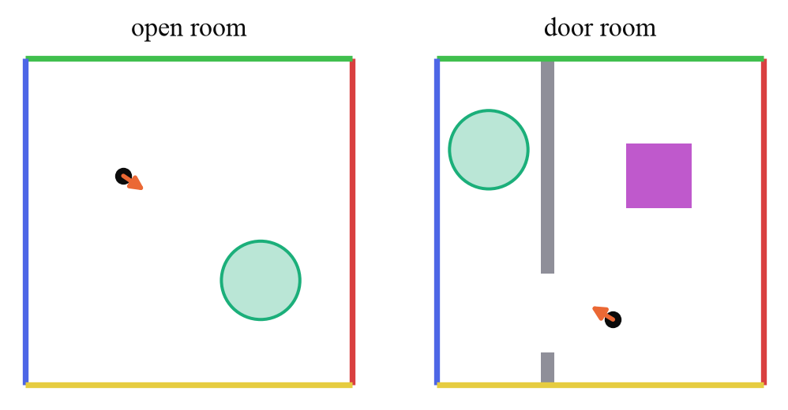
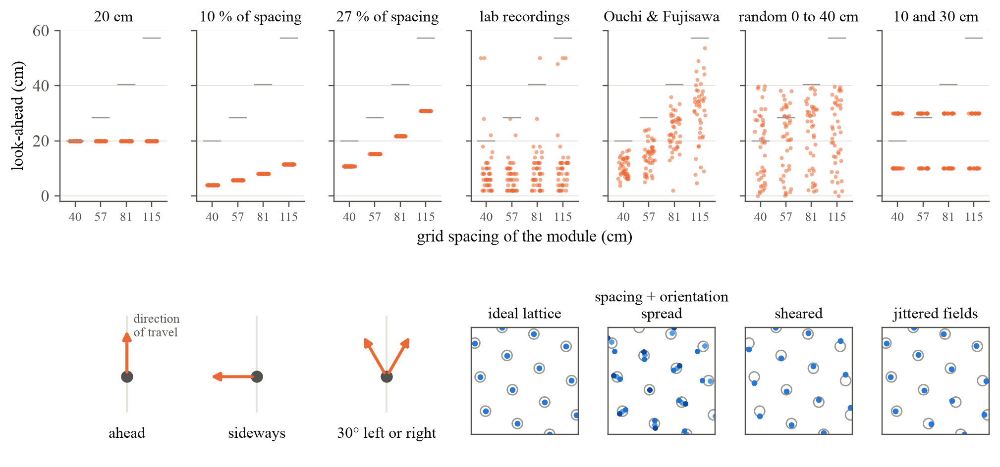
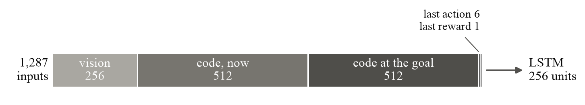
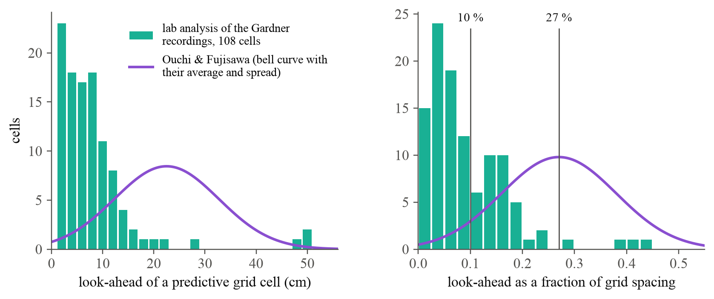

# Which changes to the grid code matter?

**The big question.** At the meeting on 22 November we listed seven follow-ups. Six of them change something about the spatial code the agent receives. One is a check of what the network is fed. Does any change make the code better to navigate with?

EDIT_SHORT_ANSWERS

## How do the tests work?

**The agent.** Most tests use the simplest agent of the [main study](../../README.md). It has no memory. The picture it sees tells it only which way it faces. So the code is its only source of position. With this agent, eight training runs per code are enough to see a difference of a few points between two codes. The LSTM agents of the room-change study are three to five times noisier. They appear only in section 2 and in the last section.

**The rooms.** The original open room, and a room with a wall, a door and an obstacle. The agent cannot see the walls, the door or the obstacle. It has to learn where they are from the code. We added this room because a shorter look-ahead might help near a door or an obstacle.

*Figure 1. The two rooms from above. Green circle: the hidden goal. Black dot and arrow: the agent and a point 20 cm ahead of it. Grey: the wall. The gap in it is the door. Purple: the obstacle. Coloured edges: the four outer walls. Every time the agent reaches the goal it is dropped at a new place.*

**The codes.** Every code has 512 grid cells. Unless stated they sit in four modules with grid spacings of 40, 57, 81 and 115 cm. In the codes with predictive cells, the same 169 cells (one third) are predictive. A predictive cell fires for the place a fixed distance ahead of the agent. We call that distance its look-ahead. The meeting notes call it the shift. One thing changes at a time.

*Figure 2. Top: the look-ahead of every predictive cell in seven codes. One orange dot is one cell. Each column of dots is one module. Short grey line: half the module's grid spacing. In the earlier study a look-ahead of that length gave no benefit. Bottom left: the direction of the look-ahead (orange arrow) against the direction of travel (grey line). Bottom right: firing fields of an example cell when the grid pattern is changed. Grey circles: the ideal fields. Blue dots: the fields in the changed code. In the spread panel the three shades of blue are three cells of one module, lined up on the centre field.*

**The score.** 10 points for every time the goal is reached in a 90 s episode. We compare the score at the end of training. It is the average over the last 25 million of 300 or 600 million frames. There are eight agents per code. Agent 1 of every code starts from the same cells, agent 2 likewise, and so on. So codes are compared agent by agent. The comparisons were fixed before the runs started ([plan](PLAN.md)).

**What these tests can see.** A difference of about 5 points after 600 million frames and about 3.6 points after 300 million. 5 points is half a goal per episode. For scale, the 20 cm code scores about {{sg(c('open', 600, 'u20 - gc100')['diff'], 0)}} points more than the grid-only code after 600 million frames.

## 1. Does a 10 % shift do better than 20 cm?

**What we did.** Each module got one look-ahead, 10 % of its grid spacing. That gives 4.0, 5.7, 8.1 and 11.5 cm. We compared this with the code used so far, which looks 20 cm ahead in every module. Figure 2 shows both.

EDIT_1

*Figure 3. Open room, after 600 million frames. Blue: no predictive cells. Orange: predictive cells. Top: the score. Dots: the 8 single agents. Short thick line: their average. Thin vertical line: how uncertain that average is. The two thin lines across the panel are the averages of the grid-only code (blue) and the 20 cm code (orange). Bottom: each agent's score minus the score of the agent that started from the same cells with the 20 cm code. Short thick line: the average difference. Black line: the range that average could plausibly lie in. The other codes are explained in sections 3 and 6.*

*Figure 4. The same in the door room. Colours and marks as in Figure 3.*

## 2. What enters the policy LSTM?

This is the LSTM agent of the room-change study. Its LSTM has 256 units and gets 1,287 numbers per step. They are joined end to end and go straight in. No layer in between shrinks or mixes them.

*Figure 5. The 1,287 inputs of the LSTM, drawn to scale. The two thin lines at the right end are the last action and the last reward.*

- **Vision, 256.** A convolutional network reduces the 84 × 84 image to 256 numbers. This is the only input that is reduced.
- **Code now, 512, and code at the goal, 512.** Every cell enters as its own number. Together they are 80 % of the inputs.
- **Last action, 6, and last reward, 1.**

The whole LSTM agent has 3.0 million weights. 1.3 million of them sit on these inputs.

## 3. What do recorded MEC shifts look like, and does a code built from them do better?

**What we looked at.** Two sets of recorded predictive grid cells.

- **Ouchi & Fujisawa (2024), 305 cells.** On average the cells look 22.5 cm ahead. That is 27 % of the cell's own grid spacing. Half of the cells lie between 21 % and 34 %. Cells with a larger spacing look further ahead.
- **The lab's own analysis of the Gardner recordings, 108 cells, not published.** Half of the cells look less than 6 cm ahead. The average is 8 cm. That is about a tenth of the grid spacing on average, close to the 10 % of follow-up 1. It is less than the 10 to 20 cm recalled at the meeting. Unlike in Ouchi & Fujisawa, the look-ahead does not grow with spacing.

*Figure 6. Look-ahead of recorded predictive grid cells, in centimetres (left) and as a fraction of grid spacing (right). Green bars: the lab's analysis of the Gardner recordings. Violet line: Ouchi & Fujisawa. It is not their data. It is a bell curve with their average and spread, scaled to the size of the green bars. Vertical lines: the 10 % of follow-up 1 and the 27 % average of Ouchi & Fujisawa.*

**What we built.** One code from each. In the Ouchi & Fujisawa code every predictive cell gets its own look-ahead, as a fraction of its grid spacing. The fractions follow a bell curve with their average and spread. In the lab code every predictive cell gets one of the 108 recorded look-aheads in centimetres. The scores of both codes are in Figures 3 and 4.

EDIT_3

## 4. Does spread in spacing and orientation within a module matter?

**What we did.** We started from the grid-only code, which has no predictive cells. Every cell got its own spacing and orientation, drawn from a bell curve around its module's values. The width of the curve is the one Redman et al. (2025) used to model a recorded module. It is 5 cm at 85 cm spacing (6 %) and 1° of orientation. We also tried three times that width. And we tried a code with a single module. That is the case in which the paper finds that spread helps most. Figure 2 shows example fields.

EDIT_4

*Figure 7. Open room, after 300 million frames. Read it like Figure 3. Blue: no predictive cells. Orange: predictive cells. The bottom panel shows the difference to the grid-only code. "Sheared" and "jittered fields" are the two changes of section 5. "Ouchi & Fujisawa + all three" is the Ouchi & Fujisawa code with spread, shear and moved fields together.*

## 5. Does deforming the grid matter?

**What we did.** Two changes to the grid-only code. In the first the whole pattern is slanted along one wall (a shear), by the amount found in rats (Stensola et al. 2015). The hexagons become slightly stretched. In the second every firing field is moved a little in a random direction, by about 6 % of the grid spacing. That size is our own choice. None of the papers we read gives one. Figure 2 shows both changes. The scores are in Figure 7.

EDIT_5

## 6. Which predictive shifts do best?

**What we did.** We kept the average look-ahead near 20 cm and changed how it is spread over the cells.

- **Proportional or random.** 27 % of spacing in every module, against a random look-ahead between 0 and 40 cm for every cell.
- **Few or many.** One distance (20 cm), two distances (10 and 30 cm), or many (the random code and the two recorded codes of section 3).
- **Sideways.** One code looks 20 cm to the left of the direction of travel. Another looks 20 cm ahead, turned 30° to the left for half of the predictive cells and 30° to the right for the rest. Recorded grid cells sweep ahead to the left and right in a similar way, by 20° to 30° (theta sweeps, Vollan et al. 2025).

The scores are in Figure 3 (27 %, random, sideways) and Figure 8 (10 and 30 cm, 30° left or right).

EDIT_6

*Figure 8. Open room, after 300 million frames. Read it like Figure 3. Blue: no predictive cells. Orange: predictive cells. "All cells 20 cm" is a code in which all 512 cells look 20 cm ahead.*

## 7. Do fixed codes point to a property worth training?

**Fixed codes.** A fixed code does not change during training. Sections 1 and 3 to 6 compare fixed codes.

EDIT_7A

**A trainable code.** We tried the simplest version. Each module has one look-ahead, so there are four numbers. They are not fixed. Training adjusts them along with the agent. They start at 0 cm or at 20 cm.

EDIT_7B

*Figure 9. The four look-aheads during training. One column per module. Top row: open room. Bottom row: door room. One line per agent. Blue: start at 0 cm, which is the grid-only code. Orange: start at 20 cm. Grey: control runs that learn from a scrambled signal. They show how far chance alone moves a look-ahead. Dotted line: 10 % of the module's spacing. Dashed line: 27 %.*

## Do the 10 % shift and the recorded shifts help the LSTM agents in the changed rooms?

This repeats follow-ups 1 and 3 in the agent of the room-change study. LSTM agents with first-person vision were trained from the start in the mix of 21 changed rooms.

EDIT_LSTM

*Figure 10. LSTM agents trained from the start in the mix of 21 changed rooms of the room-change study. Blue: grid-only. Orange: 20 cm. Green: 10 % of spacing. Violet: Ouchi & Fujisawa. Left: score during training. Line: average of the 8 agents. Shaded band: how uncertain that average is. Right: score at the end. Dots: single agents. Short line: their average.*

[Details and all statistics](DETAILS.md) · [All tables](RESULTS.md) · [Plan](PLAN.md)
