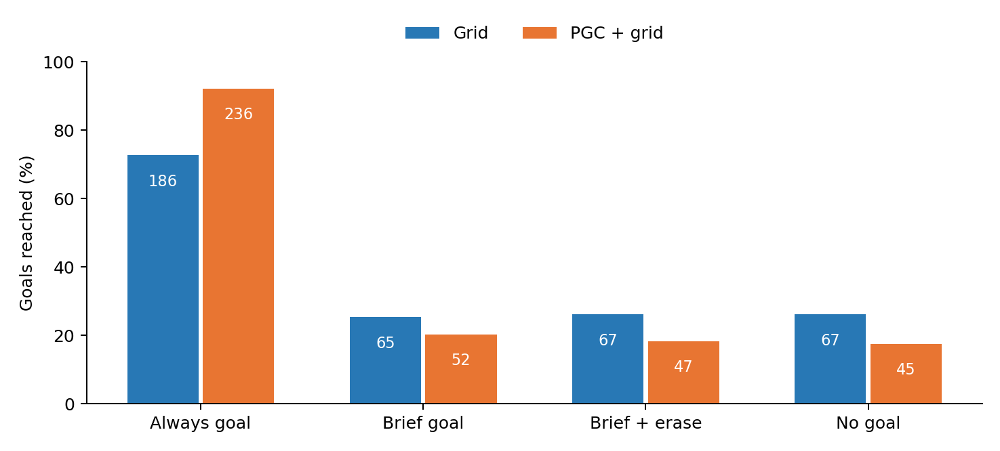
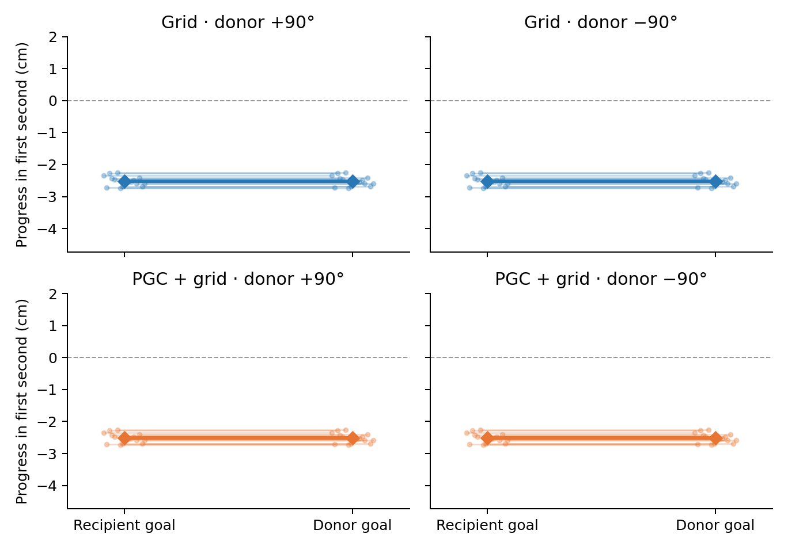

# Goal memory in the unchanged original networks

**For this fixed pair, successful navigation depended strongly on a continuing goal message.** After a brief cue and delay, performance was similar to the no-cue and erased-state controls: the differences were at most 7 and 5 goals out of 256, respectively. Neither sign of the 90° donor-state swap produced an average first-second steering advantage toward the donor goal (0.00 cm in both networks). Keeping the goal message available after erasure gave 184/256 Grid and 235/256 PGC+grid successes, consistent with rebuilding useful state from the continuing cue. This pattern points to ongoing goal guidance as the useful mechanism in this task.

With the goal code continuously available, Grid reached 186/256 goals and PGC+grid reached 236/256. After only a brief cue, Grid reached 65/256 and PGC+grid reached 52/256. Erasing the recurrent state after that cue gave 67/256 and 47/256, respectively. Numbers on bars are goals reached out of 256. [All counts linked to raw data](all_conditions.csv) include every prescribed trial.

We showed the native goal code for 15 stationary RNN updates, removed it for 45 more updates, then allowed 90 native actions (six seconds). The goal remained unmarked in the image. The networks retained their actor, CNN and LSTM trained for the original 1 billion frames; both used the same archived fresh critic. **No learning occurred.**

**Current-location code and clean native vision remain available throughout.** The ordinary-goal condition changes only the initial goal cue. Brief conditions remove all 512 goal-input slots after the cue. Postcue erasure clears both recurrent states immediately after the cue. In the always-goal erasure control, continued goal input can rebuild the state.

Immediately before the first navigation input, we replaced the recipient's complete h/c state with a genuine state from the same context and a goal 90° away. We kept the recipient's physical goal and movement-noise tape; native vision and current-location code continued updating from its own path. Thin lines show all 16 context means; diamonds show their overall mean. Progress uses exactly the first 15 navigation updates (one second); an earlier terminal position is held. Positive progress means movement toward that goal. [Both signs and all context values](donor_contexts.csv) are retained; full-path donor entry is censored by the first actual recipient hit and is reported separately in [summary.json](summary.json).

| Condition | Grid | PGC+grid |
|---|---:|---:|
| Brief native goal | 65/256 | 52/256 |
| Always goal | 186/256 | 236/256 |
| Brief ordinary goal | 65/256 | 50/256 |
| No goal | 67/256 | 45/256 |
| Brief goal + postcue erase | 67/256 | 47/256 |
| State donor +90° | 68/256 | 50/256 |
| State donor −90° | 65/256 | 49/256 |
| Always goal + postcue erase | 184/256 | 235/256 |
| Goal cue from +90° | 68/256 | 50/256 |
| Goal cue from −90° | 65/256 | 49/256 |
| Self-state swap | 65/256 | 52/256 |

This was separately registered **after** the original qualification result (181 Grid / 236 PGC+grid) was known and **before** any memory-bank outcome. The qualification and diagnostic used **two different presealed trial banks**; the Grid continuous-goal score changing from 181 to 186 therefore reflects different trials, not learning. All 11 conditions and all 256 cases per condition were fixed. This is one trained seed pair, with no population-level significance claim. Both descriptive memory screens failed. The earlier paired training requirement remains failed; no further training or neural assay follows these results under the prescribed decision.

Both independent audits passed. All 5,632 trial-condition cases were valid. They verified original-policy composition, unchanged weights, global random state and model mode across evaluation, saved physical/input traces, the full stationary neural prefix and first navigation transition, genuine donor provenance and the self-swap control. [Grid audit](../audits/gc100.json) · [PGC audit](../audits/pgc33.json) · [Exploratory protocol](../../../../docs/research/goal_cue_memory_original_diagnostic_protocol.json).

All outputs and exact source/audit hashes are in [the report record](summary.json). Cloud compute cost was $0.
