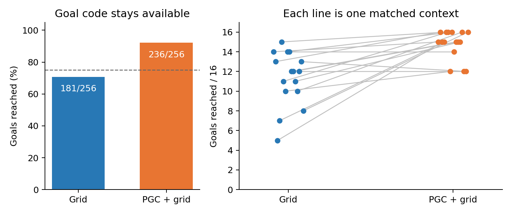

# Original networks: goal code remains available

**PGC+grid reached 236/256 goals (92.2%); Grid reached 181/256 (70.7%).** The difference is 55 goals, or 21.5 percentage points, in this one original training-seed pair. No new training was done.

We first obtained each goal code by an actual native goal pickup. Then we cleared setup history, put both agents at the same central position, and gave them a stationary wait followed by six seconds to return to the unmarked goal. **The goal code stayed on throughout this qualification.** The native six actions and movement noise were retained; image noise was set to zero.

Across the 256 matched trial pairs, both succeeded on 170; only PGC+grid succeeded on 66; only Grid succeeded on 11; neither succeeded on 9. PGC+grid scored higher in 13/16 contexts, tied in 2, and scored lower in 1. [All context counts](paired_contexts.csv) are retained. These contexts are not independent training seeds.

This suggests that the original PGC+grid controller uses the supplied goal information more successfully in this controlled return task. Memory after removing that information is a separate question.

**The planned paired training prerequisite failed:** both original models had to reach at least 192/256 goals (75%, dashed line). Grid reached 181. This proposal therefore stopped before its memory-bank baseline or training. No cloud worker was created or reserved; cloud cost was **$0**.

Both independent audits passed all 512 trials. They checked native movement and saved inputs, verified unchanged original actor/CNN/LSTM weights and the shared fresh critic, and reproduced the complete stationary neural sequence and first movement update exactly. [Paired audit](../audits/pair_review.json) · [Exact protocol](../../../../docs/research/goal_cue_memory_training_protocol.json) · [Execution and storage record](../../../goal_cue_memory_design/qualification_execution.json).

The two local CPU evaluations took 36.4 and 34.8 seconds inside the evaluators. Their complete outputs occupy 329.1 MB, including lossless raw tensors. [Machine-readable report and source hashes](summary.json).

The [proposed brief-goal task drawing](../../../goal_cue_memory_design/task_design.png) illustrates the memory proposal; this qualification instead kept the goal code available.
