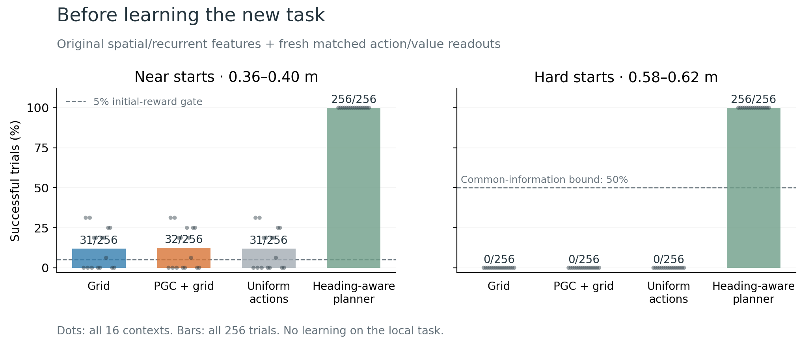

# Reward discovery before local-task training

**Both initialized populations pass the frozen 5% near-start reward-discovery gate.**

These are the original 1B spatial/visual/recurrent features with explicitly reinitialized action and value readouts. Neither model has learned on this local task. The two populations receive identical new head weights, physical trials and random tapes. The figure asks whether sparse rewards are available at initialization; it is not a trained PGC-versus-Grid performance comparison.

| Controller | Near starts | Hard starts |
|---|---:|---:|
| Grid | 31/256 (12.1%) | 0/256 (0.0%) |
| PGC + grid | 32/256 (12.5%) | 0/256 (0.0%) |
| Uniform actions | 31/256 (12.1%) | 0/256 (0.0%) |
| Heading-aware planner | 256/256 (100.0%) | 256/256 (100.0%) |

The initialized Grid and PGC heads have measured mean initial free-action entropies of 1.79175 and 1.79175 nats on valid near-start trials (uniform six-action entropy: 1.79176). Invalid trials still count as failures in the success denominator. The original CNN/LSTM tensors are preserved exactly; the saved initialized policies and source hashes are independently audited.

The uniform controller draws a fresh action from all six options at each update. The analysis-only planner uses the true physical pose to choose the action with best expected immediate progress; it does not see future motor noise. Both controls run the same native physics and stop at the first goal hit. Their physical outcomes were checked identical across the two population inputs before displaying one shared control series.

| Population | Near gate | Recorded forced hits: near / hard | Invalid contexts: near / hard | Certified hard pairs | Hard common-information bound |
|---|---|---:|---:|---:|---:|
| Grid | Pass | 0 / 0 | 0 / 0 | 128/128 | 50.0% |
| PGC + grid | Pass | 0 / 0 | 0 / 0 | 128/128 | 50.0% |

The near gate was frozen at at least 13 successes out of 256 for **each** population, zero forced rewards and passing physical checks. The hard bound applies to equally weighted opposite-heading pairs with common inputs/state and the saved coupled body-frame tapes. Certified pairs contribute a maximum success rate of 50%; uncertified pairs remain in the denominator with bound 100%. It is conditional on these tapes and observation rules, and does not bound an agent retaining heading information. The easier near bank is not assigned the hard-bank 50% claim.

All 16 contexts and all 256 trials per controller/bank are retained, including failures. Context dots describe within-bank variation; headings share a physical context and random tape. These are one original model-seed pair, not 256 independent trained agents, and no p-values are reported. Every one of the 12 frozen vision/cue/state variants remains available in the source summaries and this report’s numerical summary; the figure displays the primary blind/native condition.

[Complete report data and input hashes](summary.json) · [Independent raw-artifact audit](../../local_goal_return_design/completed_baseline_audit.json) · [Frozen bank/gates](../../local_goal_return_design/behavior_protocol.json) · [Task design](../../local_goal_return_design/design/README.md) · [Plot source](../../../scripts/plot_local_goal_return_baseline.py)

Rebuild with `python scripts/plot_local_goal_return_baseline.py`. It refuses partial data or an incomplete independent audit and performs no policy/environment execution.
