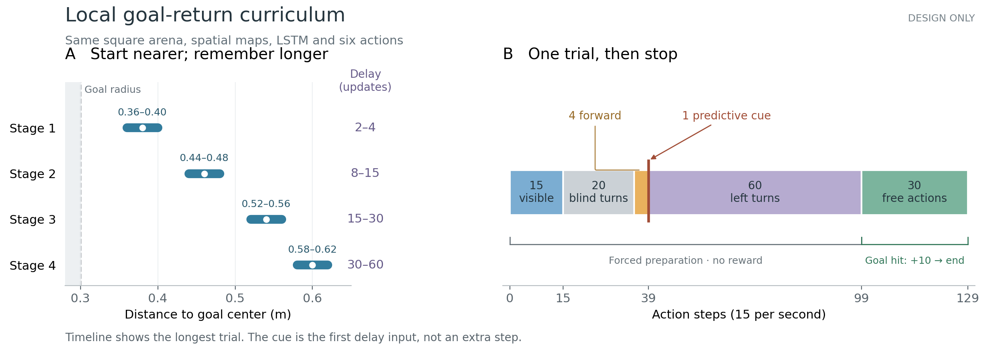

# The proposed local goal-return task

**Design only; this figure contains no learning or neural results.** The agent starts progressively farther from the goal while the blind delay grows. Distances refer to the goal center; the unchanged goal radius is 0.30 m. The square arena, maps, LSTM and six actions remain the repository's native ones. The action/value heads are explicitly reinitialized before this new study.

The longest trial has 15 visible forced updates, at most 20 labelled blind-turn updates, four forward-probe updates, at most 60 LEFT-delay updates and 30 free actor updates: **129 total**, inside the 160-update credit window. The single native predictive cue is the **first delay input**, immediately after the actual forward probe; it adds no update. Blind turns vary from 10–20 updates total, and each stage's delay is uniform over the range shown. In Grid models the corresponding pulse is ordinary grid code.

Preparation is forced and supplies no task reward. During the final free interval, only an actual native goal hit earns +10; that hit or the 30-action timeout ends the trial. The separate setup pickup creates the saved goal code outside the scored trial. The actor receives no supervised heading or ring target.

[PDF](../trial_design.pdf) · [Frozen behavioral protocol](../behavior_protocol.json) · [Figure timing/provenance](../trial_design_metadata.json) · [Scientific design review](../../../docs/research/local_goal_return_study_review.md) · [Plot source](../../../scripts/plot_local_goal_return_design.py)

Rebuild this display with `python scripts/plot_local_goal_return_design.py`. The script verifies the frozen protocol hash and leaves the archived bank README and all bank bytes unchanged.
