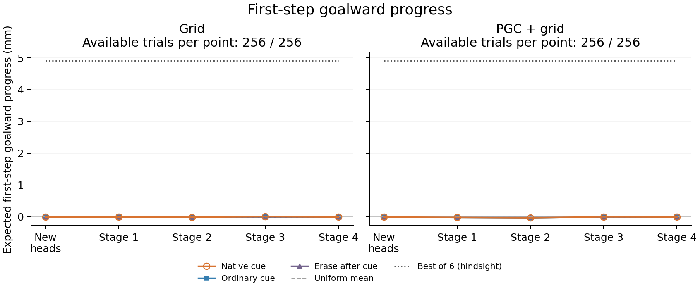

# Movement without reliable goalward steering

**The agents moved, but their average movement did not bring them closer to the goal in this new blind-return task.**

The saved first-action probabilities produce almost zero average goalward progress at every fixed stage. The dotted line shows the best of six possible immediate steps under the recorded noise; it is a hindsight physical reference.

| Fixed endpoint | Grid: path / goalward progress | PGC + grid: path / goalward progress |
|---|---:|---:|
| Stage 3 | 33.92 cm / −4.41 cm | 33.09 cm / −4.56 cm |
| Final | 19.50 cm / −0.77 cm | 19.60 cm / −0.66 cm |

Both final models reach **0/256 goals** in every test condition. A useful turn can have little immediate progress, so the analysis keeps full-response outcomes beside the first-step measure. A near-zero average does not imply that every individual choice lacks directional information.

All **38,912** saved trial records were independently checked against the raw observations, actions and physical trajectories. The independent calculation reproduced all six counterfactual endpoints per trial, every pooled/context mean, and every denominator. No new policy or environment was run. This is one original seed pair, with repeated trials.

[All stages and navigation controls](../ring_local_goal_return/report/README.md) · [Independent audit](../local_return_action_use_review/completed_output_audit.json) · [Download every trial and six-action table](https://github.com/aaravsinhaofficial/predictive-grid-cells-rl/releases/download/local-goal-return-pilot-2026-11-06/local-return-action-use-v1.tar.gz)

To regenerate from the three study input/output assets and source commit `4f73dd99f1ce94773a7495c2da93aef01672913c`, run `python scripts/analyze_local_return_action_use.py --out /path/to/a/new/empty/folder`. The downloadable derived archive also contains the complete generated README and all JSON/CSV tables.
