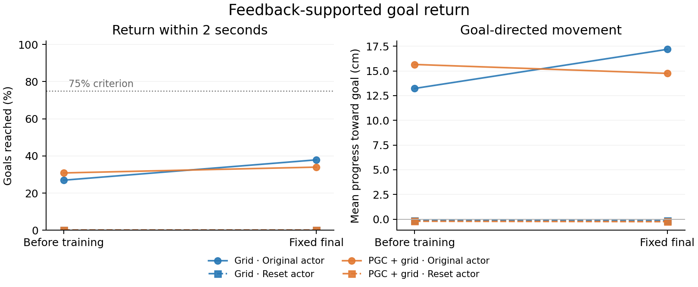
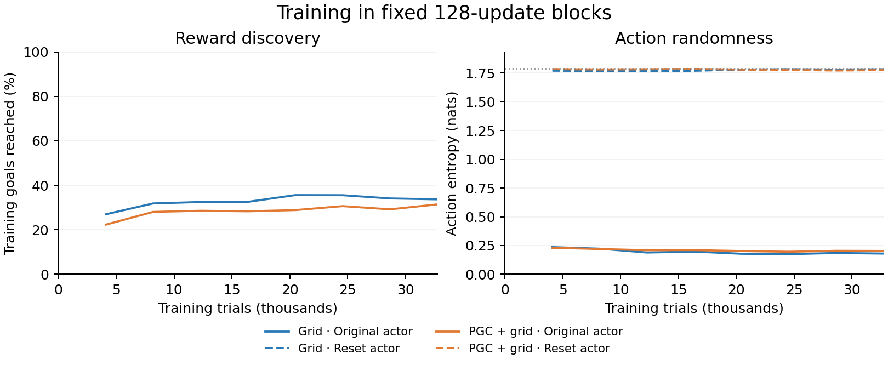

# Can the native agent learn the return movement?

The previous blind-return recipe struggled to learn goalward movement. This control supplies **fresh vision and spatial codes throughout**, then trains the unchanged native CNN/LSTM using the real goal reward.

**All four arms are complete: the original-readout models improve modestly; both reset-readout models finish at zero.** Each received exactly 1,024 updates, or 32,768 training trials. All network weights could learn. Every baseline and final trial passed the physical and input checks. These are four continuations from one original Grid/PGC seed pair.

| Initial action readout | Grid before → final | PGC + grid before → final |
|---|---:|---:|
| Original trained readout | 69 → 97 / 256 | 79 → 87 / 256 |
| Reset readout | 0 → 0 / 256 | 0 → 0 / 256 |

None reaches the frozen **192/256** fast-steering criterion. The proposed continuation that withdraws feedback therefore stops here. The criterion concerns this exact two-second return task.

The first cloud attempt stopped during input validation, before a model or learning update ran. It exposed a cross-platform rounding mismatch in an unnecessary bank-regeneration check. A separate reviewed loader used the identical saved test inputs directly for all four completed runs. The original source and failed-start evidence remain preserved. [Failure evidence and repair](../local_return_feedback_design/PORTABILITY.md) · [Reproduce the results](../local_return_feedback_design/PORTABLE_REPRODUCE.md).

Before training, resetting changes only the action layer within each population. **The RNN state at the first choice is exactly identical in all 256 matched trials**, while action scores differ. The baseline success drop therefore comes from changing how existing activity selects movements. Later actions can change subsequent observations and states. During training all weights changed, so the final comparison concerns the complete learned policies. [Baseline audits](../local_return_feedback_design/portable/cloud_audit/all_baselines_independent_review.json) · [Saved-state isolation check](../local_return_feedback_design/portable/cloud_audit/baseline_actor_isolation.json).

The original-readout policies retain a strong preference for **right turns and right strafes**. The reset policies remain close to equal probabilities over six actions and discover almost no rewards. A separate calculation using the saved pretraining starts finds that any strategy restricted to those two dominant actions can potentially reach at most **139/256 starts (54.3%)** within two seconds. All 16 contexts remain included. That bound concerns the restricted repertoire; the actual networks can select six actions. [Bound and independent checks](../local_return_feedback_design/portable/restricted_action_bound/README.md).

The physical references are complete:

| Controller | Goals reached |
|---|---:|
| Random actions | 0/256 |
| Planner using true position and heading | 256/256 |

All 512 trials passed the independent audit. This establishes physical reachability on the sealed bank; the planner has privileged information and supplies no training targets. [Reference results](references/summary.json) · [Independent audit](../local_return_feedback_design/reference_audit.json).

**The clearest discovery is a bottleneck between neural information and movement:** existing readouts provide useful steering, but their limited action strategy transfers poorly to a rapid return from every heading. Resetting the readout removes that competence, and this training budget does not recover it. The original PGC navigation benefit remains best explained by the goal-cue geometry and gated input-processing interventions in the main task. [Interpretation and literature](../../docs/research/local_return_feedback_interpretation.md) · [All endpoint data](portable/report/README.md).

[Frozen method](../../docs/research/local_return_feedback_training_protocol.json) · [Simple specification](../../docs/research/local_return_feedback_acquisition_spec_v2.md) · [Implementation review](../../docs/research/local_return_feedback_final_implementation_review.json) · [Larger mechanistic study](../../mechanisms/learned-ring-in-navigation.md).
