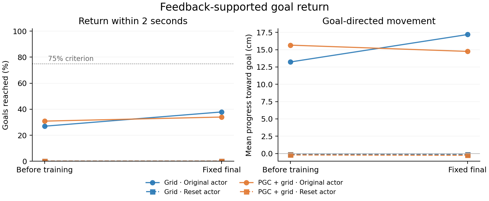
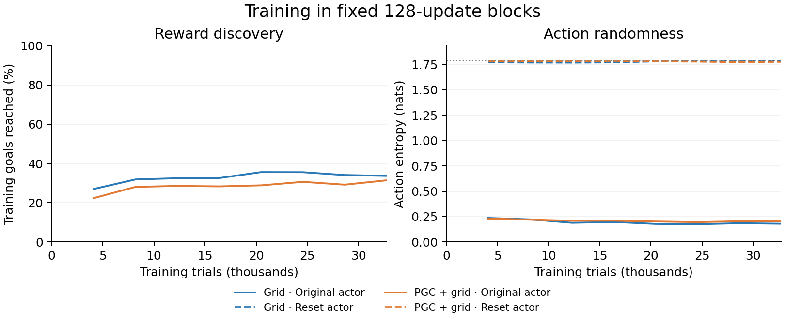

# Feedback-supported goal return

All four fixed runs are audited.

The agents receive fresh images and spatial codes throughout. Each arm is assigned 32,768 training trials and a fixed 256-trial test. All network weights can learn.

| Population | Actor at start | Status | Before | Fixed final | Final goal progress |
|---|---|---|---:|---:|---:|
| Grid | Original actor | complete | 69/256 | 97/256 | 17.19 cm |
| Grid | Reset actor | complete | 0/256 | 0/256 | -0.15 cm |
| PGC + grid | Original actor | complete | 79/256 | 87/256 | 14.75 cm |
| PGC + grid | Reset actor | complete | 0/256 | 0/256 | -0.25 cm |

Physical controls: uniform actions reached 0/256 goals; the planner reached 256/256. The planner uses privileged physical state. These are once-only controls, not learned policies.

The preset criterion is at least 192/256 returns (75%) at the fixed final endpoint, with a complete passing artifact audit. No intermediate checkpoint is selected.

Training curves use consecutive 128-update blocks. Entropy is weighted by the number of free decisions; a hollow point marks an unfinished block. Unknown results are never scored as zero. Invalid trials count as failures and contribute zero to the declared all-trial progress/path means.

This is one original seed pair and a test of learning to steer toward a nearby goal with normal feedback. A qualifying final provides a starting point for the separate memory and ring-perturbation experiments. All four arms and all available endpoint measurements are in [the full table](all_arms.csv) and [the provenance summary](summary.json).
