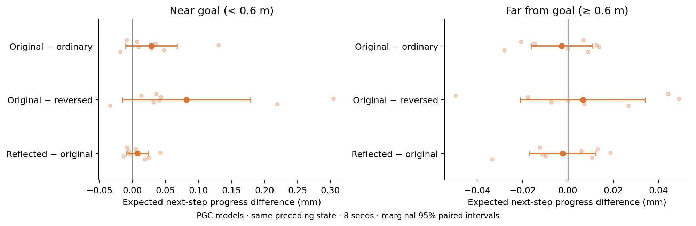

# Immediate goalward action effects on shared scripted experience

**This measures whether changing population-code inputs immediately shifts actions toward the true goal. It is not a navigation-score test.**



Each comparison holds the previous hidden/cell state, visual embedding, previous action, and reward fixed. Goal variants change only the saved goal code; the 343 ordinary goal slots remain intact. We compare the native predictive code, ordinary code, reflected predictive shift, reversed predictive shift, and oracle-centered predictive slots. Grid-model controls use the native pickup, an ahead point, or true center.

For each of six actions, we calculate one noiseless environment step, including current linear/rotational velocity, inertia, updated heading, and wall clipping. We measure distance reduction to the **goal disk**, then average it using the RNN’s action probabilities. No decoder is fitted. An independent environment-step check verifies this calculation.

| Comparison | All states: change (mm) | Near states: change (mm) | Near 95% interval | Near Holm t / exact p |
|---|---:|---:|---|---|
| Original − ordinary | +0.0021 | +0.0289 | [-0.0101, +0.0678] | 0.3692 / 0.2578 |
| Original − reversed | +0.0172 | +0.0819 | [-0.0152, +0.1789] | 0.3452 / 0.125 |
| Reflected − original | -0.0011 | +0.0075 | [-0.0086, +0.0236] | 0.6108 / 0.6562 |

Intervals can include both helpful and harmful effects. The seed, not the individual state, is the replicate. Four comparisons (including the native population contrast) are corrected within each metric/subset; no global correction across metrics/subsets. This is exploratory.

**Interpretation limits:** a useful turn may have little immediate distance benefit. Holding the preceding state intact also retains information from earlier predictive inputs. The result therefore cannot determine whether sustained predictive input helps over many decisions, nor exclude useful delayed steering.

All sixteen networks see the same scripted physical replay, but their actions do not control it. Their recurrent states reflect this unusual action history. Selection takes every eighth known-goal moving sample within each of sixteen episodes, for 430 states per model. Exact full-image replay reconstruction was verified.

The summary also reports expected target translation toward the center, separate, simpler action-intent metrics that likewise undervalue turns.

Reproduction requires the original shared replay/activity archives and 1B checkpoints. Raw arrays and weights remain local.

```sh
OPENBLAS_NUM_THREADS=1 OMP_NUM_THREADS=1 python scripts/lstm_action_computation.py
```

[Numerical results](summary.json) · [Protocol](protocol.json) · [Native-policy probe](on_policy/README.md)
