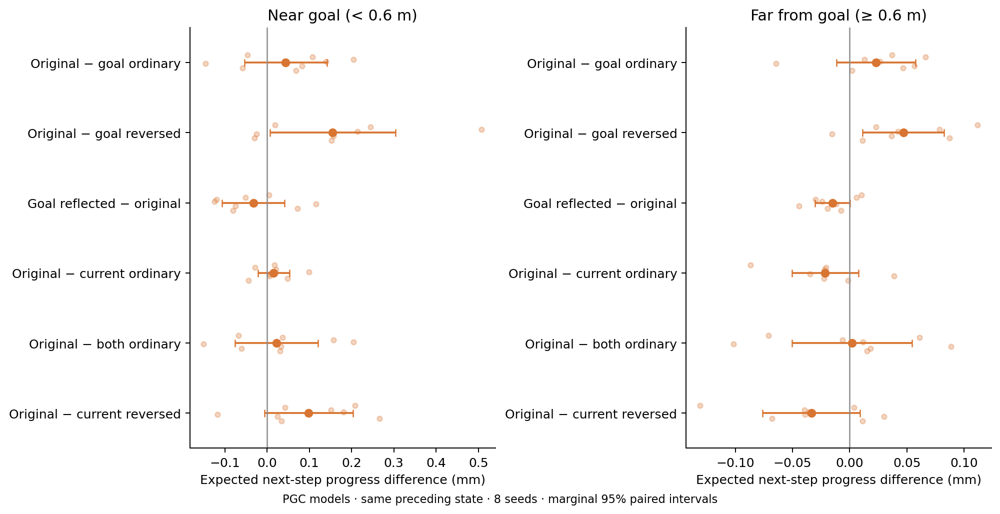

# Immediate goalward action effects on native policy experience

**This measures whether changing population-code inputs immediately shifts actions toward the true goal. It is not a navigation-score test.**

The [turn-or-go analysis](turn-go.md) tests whether the live predictive input changes steering appropriately when continued movement would hit or miss the nearby goal.



Each comparison holds the previous hidden/cell state, visual embedding, previous action, and reward fixed. Goal variants change only the saved goal code; the 343 ordinary goal slots remain intact. We compare the native predictive code, ordinary code, reflected predictive shift, reversed predictive shift, and oracle-centered predictive slots. Grid-model controls use the native pickup, an ahead point, or true center.

For each of six actions, we calculate one noiseless environment step, including current linear/rotational velocity, inertia, updated heading, and wall clipping. We measure distance reduction to the **goal disk**, then average it using the RNN’s action probabilities. No decoder is fitted. An independent environment-step check verifies this calculation.

| Comparison | All states: change (mm) | Near states: change (mm) | Near 95% interval | Near Holm t / exact p |
|---|---:|---:|---|---|
| Original − goal ordinary | +0.0257 | +0.0441 | [-0.0537, +0.1419] | 1 / 1 |
| Original − goal reversed | +0.0782 | +0.1549 | [+0.0064, +0.3033] | 0.3015 / 0.3828 |
| Goal reflected − original | -0.0236 | -0.0323 | [-0.1062, +0.0416] | 1 / 1 |
| Original − current ordinary | -0.0118 | +0.0155 | [-0.0215, +0.0526] | 1 / 1 |
| Original − both ordinary | +0.0032 | +0.0226 | [-0.0756, +0.1208] | 1 / 1 |
| Original − current reversed | +0.0067 | +0.0985 | [-0.0060, +0.2029] | 0.3661 / 0.4219 |

Current-only variants remove or reverse the shift of the 169 live predictive cells while retaining the original goal input. The both-ordinary variant removes both shifts. Native current/goal inputs are retained exactly where not intervened on; CPU/MPS reconstruction differences are checked. These additional current-code tests were added after inspecting the first seed’s goal-only results, and before inspecting the other native-policy models.

Intervals can include both helpful and harmful effects. The seed, not the individual state, is the replicate. Seven comparisons (including the native population contrast) are corrected within each metric/subset; no global correction across metrics/subsets. This is exploratory.

**Interpretation limits:** a useful turn may have little immediate distance benefit. Holding the preceding state intact also retains information from earlier predictive inputs. The result therefore cannot determine whether sustained predictive input helps over many decisions, nor exclude useful delayed steering.

These snapshots come from each native model’s own trajectories. Native grid versus PGC comparisons therefore confound visited states with policy differences. Within-model goal interventions use identical states.

The summary also reports expected target translation toward the center and alignment with actual motion direction, separate, simpler action-intent metrics that likewise undervalue turns.

Reproduction requires the native `*_action_states.npz` files from [the navigation-phase rollout](../../lstm_navigation_phases_1B/README.md), plus the original 1B checkpoints. Raw archives and weights remain local.

```sh
OPENBLAS_NUM_THREADS=1 OMP_NUM_THREADS=1 python scripts/lstm_action_computation.py --on-policy
```

[Numerical results](summary.json) · [Protocol](protocol.json) · [Shared replay probe](../README.md)
