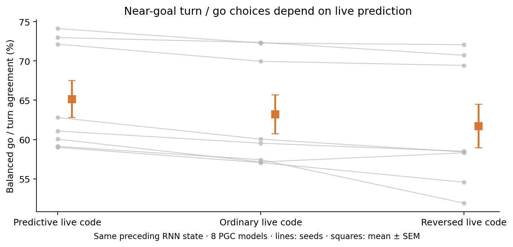

# A simple turn-or-go computation

**Removing live motion prediction makes the RNN more likely to keep going when its preferred movement would miss the nearby goal.** This is a matched-state action effect, not a percentage of navigation performance explained.



## What the policies do

Fifteen of sixteen native models put at least **99.87%** of action probability on one turn direction and one movement direction in these snapshots. The movement can be forward, backward, or sideways; these are alternative body-axis strategies. PGC seed 5 is an exception: its dominant pair has **88.55%** mass, with substantial backward movement in addition to strafing. The [full trajectory analysis](../../lstm_navigation_phases_1B/README.md) independently finds the same exception.

The RNN’s action head is linear. Its go-versus-turn log-odds is exactly:
```text
(go weights − turn weights) · hidden activity + (go bias − turn bias)
```
For the models dominated by this pair, that one changing readout controls almost all choices. This does **not** mean the recurrent state itself is one-dimensional.

## The diagnostic

At saved native-policy states within **0.6 m** of the goal center, we ask: would holding this model’s preferred movement for **23 decisions (1.53 seconds)** reach the goal disk? We simulate the actual inertia, residual rotation, wall collisions, and 0.3 m pickup radius, with noise off. The hypothetical continuation never controls the real policy.

We then measure the current probability of **go when that continuation hits**, and **turn when it misses**. The diagnostic averages these two numbers equally. It is not an optimal-action oracle: a miss could require more than 1.53 seconds, and an actual policy can turn again. It also overlooks the extra movement option of PGC seed 5.

Only the live population code is changed for the main comparison. The previous h/c state, goal snapshot, visual embedding, previous action/reward, and all 343 ordinary live cells stay fixed. No learned decoder is fitted.

| Near-goal action probability | Predictive live code | Ordinary live code | Reversed live code |
|---|---:|---:|---:|
| Go when continuation hits | 81.79% | 80.95% | 77.32% |
| Turn when continuation misses | 48.54% | 45.50% | 46.17% |
| Balanced agreement | 65.17% | 63.23% | 61.74% |

The largest component of the ordinary-code effect is **less turning when continued movement would miss**. This is consistent with anticipatory steering, rather than simply making the next movement faster.

| Same-state comparison | Agreement difference (percentage points) | 95% paired interval | Holm t p | Holm exact p |
|---|---:|---|---:|---:|
| Predictive − ordinary live code | +1.94 | [+1.34, +2.54] | 0.0008717 | 0.05469 |
| Predictive − reversed live code | +3.42 | [+1.89, +4.96] | 0.007035 | 0.05469 |
| Predictive − both codes ordinary | +2.55 | [+1.05, +4.04] | 0.02507 | 0.05469 |
| Predictive − ordinary goal code | +0.91 | [-0.55, +2.38] | 0.3817 | 0.45312 |

The live ordinary-code comparison has the same sign in all eight seeds. The paired-t and exact tests disagree at 0.05 after correction: with eight seeds, the smallest two-sided exact p is 0.0078125, and multiplying it by the seven-comparison family gives 0.0546875. Both results are reported. The diagnostics were exploratory additions after observing the policies’ concentrated action choices.

Excluding the three-action seed 5 leaves a **1.80-point** live-code effect, with an unadjusted paired interval [1.20, 2.41]. This is a structural sensitivity check, not another selected primary test.

The simpler straight-ray diagnostic agrees: removing live prediction reduces near-goal balanced agreement by 1.78 points; its far-state effect is only 0.095 points with an interval spanning zero. This is not itself a test of the near-versus-far interaction. The original one-step distance-progress metric is inconclusive; it gives little credit to useful turns. Both diagnostics and all variants remain in the numerical summary.

**Scope:** this identifies an input-sensitive steering computation inside already trained PGC networks. It does not establish why training selected these strategies, or show that this snapshot metric mediates the score advantage. The separate closed-loop interventions supply the navigation evidence.

The input itself encodes a position 20 cm ahead along motion. This result does not show that the RNN internally simulates a future trajectory.

[All action metrics and controls](README.md) · [Full results](summary.json) · [Protocol](protocol.json)
