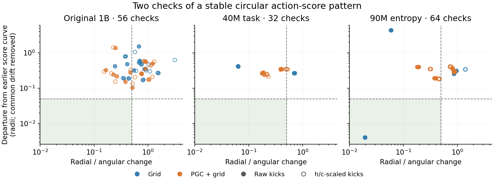

# Dynamics in the learned action scores

**0/152 drift-subtracted and 0/152 original-curve checks meet all frozen criteria.**

We looked directly at the network’s six learned action scores, observed at four future times. This removes hidden activity that never reaches those future scores. No decoder or circular representation was fitted.

**Leftward:** a radial disturbance shrinks faster than an angular disturbance. **Downward:** the later score patterns remain close to their earlier curve after common drift is removed. The shaded region meets these two criteria only; amplitude, curve geometry, phase correspondence and the other recovery guards must also pass. All contexts, cue branches and both perturbation metrics are plotted; exact shams overlap.

| Cohort | Checks | Drift-subtracted passes | Original-curve passes |
|---|---:|---:|---:|
| Original seeds 1–2 | 8 | 0 | 0 |
| Original seeds 3–8 | 48 | 0 | 0 |
| Fixed 40M endpoints | 32 | 0 | 0 |
| Fixed 90M endpoints | 64 | 0 | 0 |

The higher-entropy Grid model’s second context is the point inside the shaded region. Its native raw-kick radial/angular ratio is 0.019 and curve departure is 0.004 radii. It fails the separation of distant curve locations and the phase-coverage/correspondence guards, so those two favorable numbers alone do not identify a ring. Its exact cue shams and both metrics are retained.

These are nested tests of 16 original networks and six continued endpoints from one of those seed pairs, not 152 independent networks. The earlier held-out label describes the original collection cohort; its other analyses were already known before this follow-up.

Selective recovery can occur in a changing directional memory or a contracting plane as well as a ring. These tests ask for a stable circular factor in the exact learned scores under one common input. An evolving representation can retain direction while failing correspondence to the earlier curve. The results should therefore be read with the native navigation and cue/state-intervention results.

Every saved trajectory replayed exactly before testing. The unchanged amplitude threshold is measured in centered-logit units here. The six action scores have their action-common component removed; subtracting the mean across the direction family is a separate operation.

[Complete numerical results and all gates](summary.json) · [Frozen method and commands](README.md) · [Freeze and independent reviews](review.json) · [Display source](../../scripts/plot_actor_logit_observable.py)
