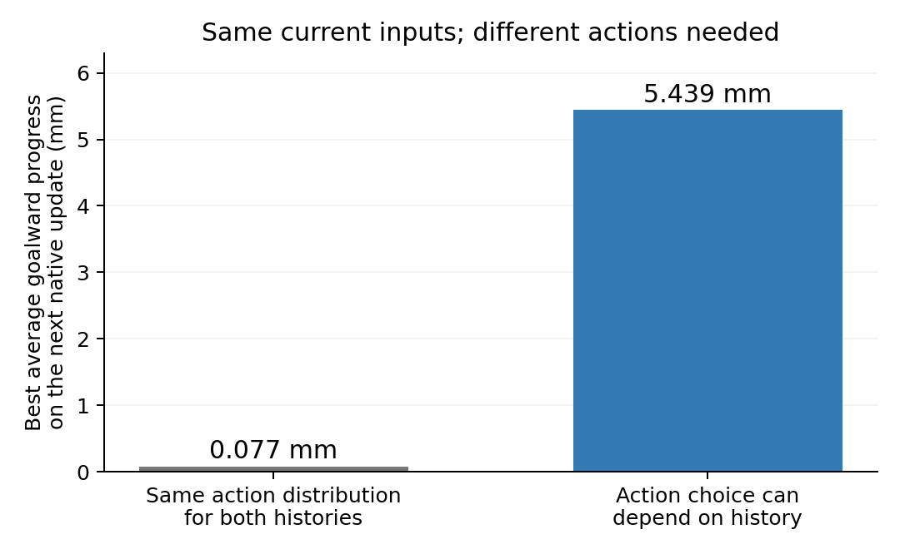

# The proposed blind-turn test requires remembered information

**All eight paired-history audits pass:** four original pilot models, each with a turn-only history and a complete forward-probe/cue history. This is a design diagnostic; no training or cloud experiment was launched.

The two histories end with headings about 178.39° apart. Their final 1,287 input values, last three complete input vectors, position, saved goal, previous action/reward, and motor velocities match byte-for-byte. Different earlier turn actions are visible only through recurrent history. In the probe variant, actual four-update forward trajectories finish at the same endpoint before the native-code glimpse.

The best action distribution shared by both histories gives 0.077 mm average goalward progress over the next native update. Choosing separately for each remembered heading gives 5.439 mm. These are analysis-only ceilings calculated by evaluating all six actions through the original simulator; the policy receives no oracle action or angle label.

The preferred translations are backward in one history and forward in the other. Any randomized memoryless policy is a mixture of common actions and obeys the same ceiling. A future trained agent must exceed this bound using intact history and show a corresponding reset-sensitive navigation benefit before proceeding to ring interpretation.

## Original-model transfer responses

The original checkpoints were not trained for this task. None exceeds the common-action ceiling here. The table reports their expected first-update progress, calculated from their own six-action probabilities. This prevents the information audit from being mistaken for successful learned memory.

| Model | History | Intact state (mm) | Reset at final decision (mm) |
|---|---|---:|---:|
| Grid seed 1 | turn only | -0.000002 | -0.000011 |
| Grid seed 1 | probe glimpse | 0.000009 | -0.000011 |
| Grid seed 2 | turn only | 0.006850 | 0.006922 |
| Grid seed 2 | probe glimpse | 0.006515 | 0.006922 |
| PGC + grid seed 1 | turn only | -0.000001 | -0.000005 |
| PGC + grid seed 1 | probe glimpse | 0.000003 | -0.000005 |
| PGC + grid seed 2 | turn only | -0.000092 | -0.000198 |
| PGC + grid seed 2 | probe glimpse | -0.000288 | -0.000198 |

## Controls retained

- Deterministic native square-arena physics, actual renderer, original CNN/LSTM/maps and unchanged goal snapshot. The controlled visible history is fifteen observations containing fourteen native left-turn updates.
- Explicit motor braking before forced segments. Both terminal motor states are identical, including the remaining common angular velocity; equality does not rely on a turn instantly braking.
- Only 169 current slots differ in the PGC native-versus-ordinary glimpse. Grid glimpse replacement changes zero slots. All saved-goal and other input values remain identical.
- Erasing state after the glimpse, or before an ordinary glimpse, produces exactly identical final action distributions across the paired histories. The native cue is withdrawn before the identical final suffix.
- Endpoint rounding correction is bounded below 1e−5 m; the largest measured correction is 5.82e-08 m.
- Entire observation/action traces, both cue histories, recurrent endpoints, hashes and actor responses are retained in each model folder. These four models provide repeated implementation checks, not eight independent training replications.

[Frozen diagnostic protocol](protocol.json) · [All numerical results](summary.json) · [Proposed training timeline and shortcut controls](../../docs/research/rl_blind_reorientation_proposal.md)

Reproduce locally with `OPENBLAS_NUM_THREADS=2 /opt/anaconda3/bin/python scripts/lstm_blind_turn_necessity.py`. The three unit tests cover the action-mixture bound, byte equality and native motor-state matching; the run itself asserts every full input/goal/position/motor identity.
