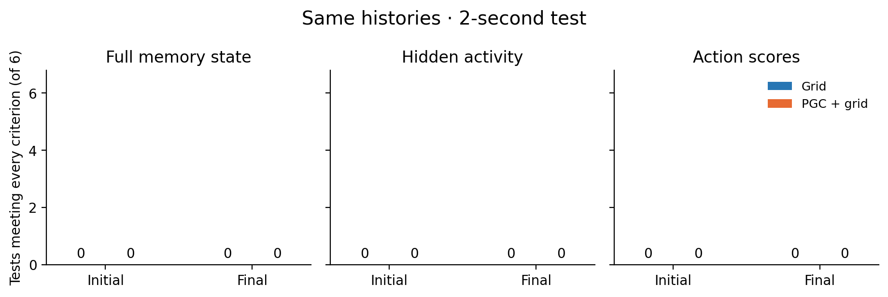
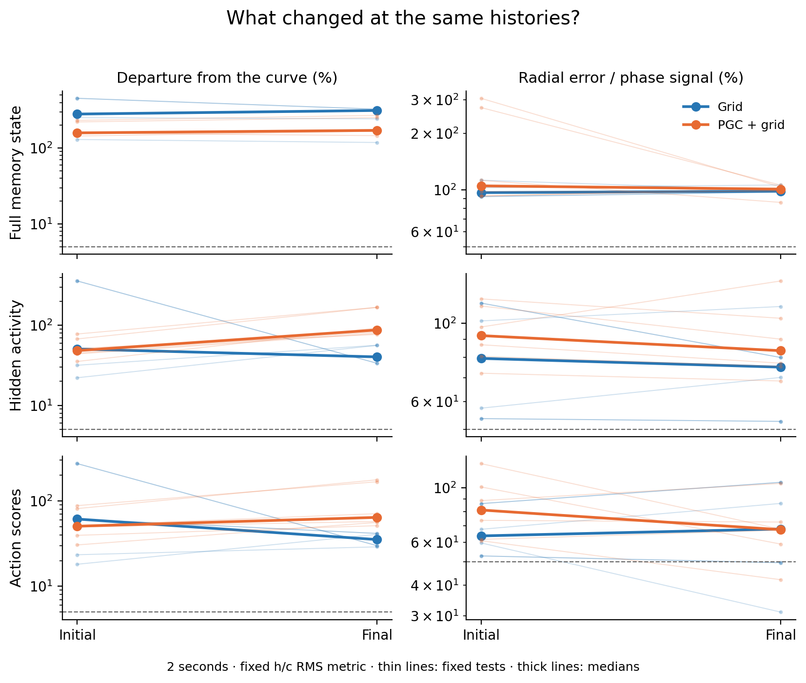

# Direction memory after distillation

The matched two-second screen found **0/36** jointly qualifying final tests, compared with **0/36** initially. The tested direction families did not acquire the combination of persistent geometry and selective radial recovery required by this screen.

We tested both original agents and both fixed final distillation agents. We replayed the same recorded history through each network, letting each build its own memory state. We then gave them identical heading or movement experiences and identical future inputs. This isolates the weight change at those histories.

Both populations use seed 1. Each final model received 1,036,800 extra physics frames of policy distillation, with only the four LSTM tensors allowed to change. During the memory test, images are black. Heading tests compare native and ordinary current codes. Travel-direction tests replace the predictive current entries with ordinary values, giving every remembered direction the same future input. The native saved goal code remains available.

A ring candidate must keep different directions distinguishable, stay close to the same closed family, and correct the tested radial error faster than it loses the direction signal. We examined the complete hidden-and-cell state, all hidden outputs, and all learned action scores. No fitted plane or angle decoder defines these tests.

| Population | What we observe | Initial | Final |
| --- | --- | ---: | ---: |
| Grid | Full memory state | 0/6 | 0/6 |
| Grid | Hidden activity | 0/6 | 0/6 |
| Grid | Action scores | 0/6 | 0/6 |
| PGC + grid | Full memory state | 0/6 | 0/6 |
| PGC + grid | Hidden activity | 0/6 | 0/6 |
| PGC + grid | Action scores | 0/6 | 0/6 |

Each denominator is six fixed context/input tests. A count requires every criterion in both raw and h/c RMS coordinates; hidden-output and action-score counts use the prespecified common-mean correction. All noncentered results remain in the data. The duplicated native/ordinary Grid inputs are identity controls, not independent replications.

The left panels show how far the family moves away from its earlier shape. The right panels compare the remaining radial error with the surviving phase signal. Lower values are favorable, but neither measurement alone is sufficient: all geometry, visibility and recovery checks must pass. Dashed lines mark the existing thresholds.

**What changed:** output responses contracted more strongly after training. The tested action-score error became smaller, and the direction-dependent pattern also shrank.

| Population | Radial action-score error left, initial → final | Direction-pattern size left, initial → final |
| --- | ---: | ---: |
| Grid | 50% → 35% | 89% → 76% |
| PGC + grid | 49% → 19% | 77% → 63% |

These are descriptive medians of six fixed tests in the h/c RMS metric, measured over one second of evolution; the complete primary observation window ends two seconds after blackout onset. Every matched test still failed the curve-stability criterion. In the complete hidden-and-cell state, radial error and phase signal decayed at roughly the same rate. This suggests stronger contraction of short-term output activity, with direction patterns that continue to deform, rather than selective correction toward a stable direction ring.

The final agents’ own-policy contexts produce **0/36** jointly qualifying primary tests. The separate four-second matched-context extrapolation produces **0/72** qualifying tests across both endpoints. These counts combine the three observation maps; they do not count independent trained agents.

All 24 context evaluations are retained: eight initial contexts, eight final own-policy contexts and eight final tests matched to the initial contexts. The two-second window matches the largest training blackout. Four seconds is an extrapolation.

These screens test one specific inward/outward radial perturbation. A qualifying observable is a candidate for broader normal-direction and predictive-cue repair tests. The actor-probability amplitudes and every failed gate are saved in aggregate.json, so a small score-space pattern is not silently treated as a useful navigation mechanism.
