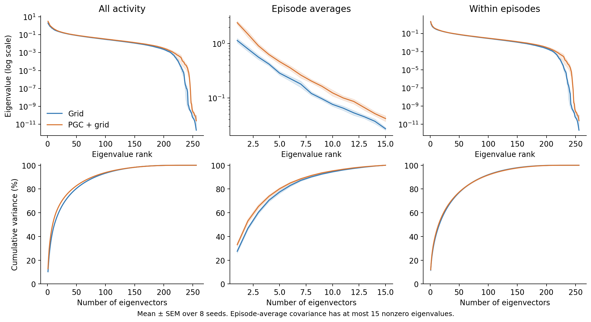
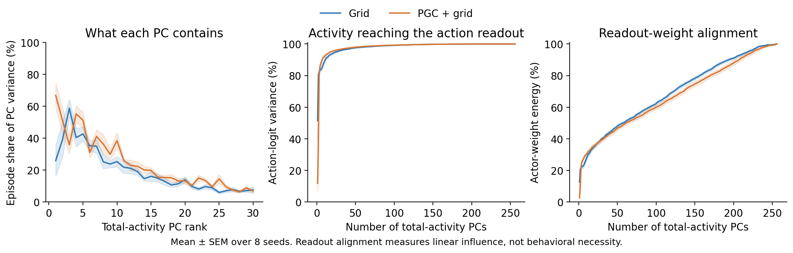
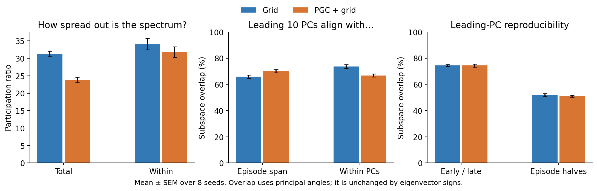

# What the eigenvalues and eigenvectors show

**PGC activity is more concentrated into a few strong directions. Much of the difference comes from episode-associated activity. The biggest PGC direction is more episode-related and less directly aligned with action variation.**

An **eigenvalue** measures how much activity varies along one direction. Its **eigenvector** describes that pattern across the 256 RNN units. These are activity-covariance eigenvalues, not eigenvalues of the recurrent dynamics.

## How concentrated is the activity?



The *participation ratio* summarizes the number of comparably strong activity directions; lower means more concentrated variance. It is **31.3 for grid and 23.8 for PGC**. After removing each episode's average, it is **34.1 versus 31.8**, with no clear difference. The episode-average covariance has at most 15 nonzero eigenvalues because there are only 16 episodes.

| Spectrum measure | Grid | PGC + grid |
|---|---:|---:|
| Participation ratio: all activity | 31.33 | 23.84 |
| Participation ratio: within episodes | 34.10 | 31.83 |
| Entropy effective rank: all activity | 66.20 | 55.50 |
| Entropy effective rank: within episodes | 75.39 | 72.86 |
| PCs needed for 90% of total variance | 82.0 | 77.5 |

Participation ratio and entropy effective rank are different summaries, not literal counts of independent state variables. Their reduction does not establish a lower-dimensional attractor. The previous small within-episode first-ten-PC difference can coexist with an uncertain participation-ratio difference: the measures weight the spectrum differently.

## Which directions reach the action selector?



**The largest PGC direction is mainly episode-related.** On average, episode means account for **66.8% of PC1 variance in PGC models**, versus **26.0% in grid models**. Yet PC1 carries only **11.8% of action-logit variance in PGC models**, versus **51.6% in grid models**. These PC1 comparisons are descriptive and vary substantially across seeds.

Across the first ten PCs, both populations retain most action-logit variation: **89.1% for grid and 92.2% for PGC**. The group difference is uncertain after correction. Episode averages contribute **6.0% versus 9.6%** of action-logit variance, much less than their **21.0% versus 30.2%** shares of total hidden-activity variance.

This separates **large activity fluctuations** from **fluctuations strongly expressed at the action readout**. It does not show that the remaining episode signals are useless: they may affect recurrence, and small action-logit differences can still affect behavior. Nor does explained logit variance equal the percentage of navigation performance explained.

## Are the eigenvector directions more reproducible?



The leading ten PCs overlap strongly with the span of episode means in both populations: **66.0% for grid and 70.2% for PGC**. The corrected comparison is uncertain.

Their overlap between early and late samples of the same episodes is **74.4% in both groups**. Across separate halves of the episodes, it is **51.9% versus 51.0%**. These descriptive checks do not show more reproducible leading subspaces in PGC models. They measure reproducibility across sampled data, not stability of recurrent states over time.

Eigenvectors can flip sign, and nearby eigenvalues permit rotations of their directions. We therefore compare whole subspaces using principal angles **within each network**. Neuron axes and eigenvectors are not matched across separately trained models. The ten-dimensional cutoff itself can remain sensitive to small spectral gaps.

## Statistical scope and exact calculation

Eight paired training seeds are the replicates. The five primary comparisons below were specified in [protocol.json](protocol.json) before analyzing model results. Other quantities and per-PC curves are descriptive. Intervals are marginal paired t intervals; plot shading is mean ± SEM, not simultaneous uncertainty across all ranks.

| Preselected comparison, PGC minus grid | Difference | 95% interval | Holm t p | Holm exact sign-flip p |
|---|---:|---:|---:|---:|
| Total participation ratio | −7.49 | [−10.22, −4.77] | 0.00166 | 0.0391 |
| Within-episode participation ratio | −2.27 | [−6.96, +2.42] | 0.290 | 0.273 |
| Leading-10 overlap with episode span | +4.16 percentage points | [+0.79, +7.53] | 0.0896 | 0.0703 |
| Leading-10 share of action-logit variance | +3.11 percentage points | [−0.12, +6.34] | 0.114 | 0.141 |
| Episode share of action-logit variance | +3.64 percentage points | [+0.64, +6.64] | 0.0896 | 0.0625 |

The covariance decomposition is sample-weighted: `C_total = C_episode + C_within`. Covariances use divisor n. An eigenvalue's normalized share is `lambda / sum(lambda)`; participation ratio is `sum(lambda)^2 / sum(lambda^2)`.

The frozen actor is linear in hidden activity. Its weight matrix is centered across its six actions to remove a common logit shift, which cannot change softmax probabilities. Calling that centered matrix `A`, the exact contribution of PC j to centered action-logit variance is `lambda_j * ||A u_j||^2`. This sum matches variance calculated independently from the saved logits. The figure also reports unweighted actor-weight alignment; high activity variance and large readout weights are different quantities.

The early/late split divides selected steps within each episode. The episode-split analysis averages 12 fixed, balanced divisions of the 16 episodes, fitting each half independently. The same splits are used for all models. The recorded physical replay is shared; the policies did not control its actions. Goal, room, and history remain confounded across episodes.

## Reproduce

```sh
OPENBLAS_NUM_THREADS=1 OMP_NUM_THREADS=1 MKL_NUM_THREADS=1 python scripts/lstm_eigenspectra.py
```

The script reads the existing `results/lstm_variable_1B/replay.npz`, sixteen saved activity arrays, and the frozen checkpoint actor weights. It does not train a policy or run new navigation episodes. All source hashes are checked before and after analysis. Full spectra, principal angles, and validation errors are in [summary.json](summary.json). Eigenvector matrices are saved locally in `eigenvectors.npz`; raw arrays and checkpoints are not bundled with Git.

[Previous episode-variance analysis](../lstm_variance_sources_1B/README.md) · [Simple mechanism guide](../../mechanisms/README.md)
