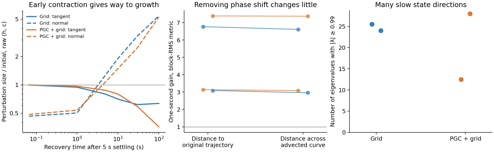

# Corrected goal-curve recovery in the original LSTMs

We tested all four cached native contexts in each of the original Grid and PGC models of seeds1–2. The original weights, renderer-derived visual embedding, spatial maps, and actual histories were preserved.

The new check addresses a specific possible false negative. A disturbance away from a ring can settle onto a different phase. Measuring its distance to the original trajectory then confuses phase displacement with failure to return to the ring. We propagated the exact512-dimensional LSTM differential, separated displacement along the evolving goal-state curve from residual displacement across it, and checked the calculation against finite perturbations. A synthetic sheared ring verifies that this correction detects transverse recovery even when the old pointwise error grows.



**Outcome:** none of the16contexts meets the frozen candidate screen. After5seconds with one common physical input and the goal slots blank, removing induced phase displacement changes the normal-error result only slightly. The primary screen's mean context-median gain changes4.93→4.79 for Grid and5.26→5.23 for PGC in block-RMS coordinates. The frozen combination of family-size and recovery criteria is unmet.

Raw coordinates change the early finite-time magnitude. An all-context follow-up retained both coordinate systems and both raw-isotropic and block-isotropic disturbances. With raw-isotropic disturbances, one-second transverse gains average0.50Grid/0.54PGC, then rise to1.28/1.08 at5seconds and5.40/5.28 at100seconds. Tangent sizes over those same horizons are0.94/0.97,0.80/0.87,and0.63/0.36. Thus the short raw-coordinate contraction does not continue as a protected one-dimensional goal-memory ring in this assay.

The instantaneous full-state spectra contain many slow directions: median24Grid/20.5PGC eigenvalues have modulus≥0.99 across the prespecified contexts/phases. The eigenvector closest to eigenvalue1 is poorly aligned with the goal tangent in many cases. These spectra belong to slow trajectory states, not optimized fixed points; finite-time growth is not equated with an unstable eigenvalue. Some slow c-state directions may be invisible to behavior, so this full-state result does not determine whether a task-relevant angular factor exists inside a larger dynamical system.

**Method details:** each valid goal-code family first experiences15actual recorded physical updates, with only goal slots varying. We then repeat the endpoint physical input while withholding goal input; this is an explicit dynamical intervention, not a closed-loop navigation trajectory. The primary probes begin after0,1,5,and10seconds of common-input settling. All96sampled goal phases, all16contexts, and all matched native/ordinary/withheld restoration conditions are retained. The main candidate screen requires≥20%initial family radius after5seconds, then tangent gain≥0.5, transverse gain<0.5,and their ratio>2over the next1second. These are screening criteria, not a definition that every ring must meet them. Slow rings can contain stable fixed points and saddles rather than a continuum of exact fixed points.

The block-RMS metric divides each h/c block by its initial family-wide RMS; raw coordinates are reported separately. A phase coordinate that remains1under propagation with the reference family is tautological; the report instead keeps physical tangent size, family radius and actual state motion visible. No circular readout or imposed ring enters the dynamics.

All source/checkpoint hashes pass, all finite-amplitude checks pass, and three focused mathematical tests pass. The follow-up did not change the frozen first-screen source or its thresholds. [Numerical summary](summary.json) · [Frozen primary protocol](corrected_recovery/protocol.json) · [Descriptive metric audit](metric_audit/protocol.json). The subsequent [fixed-point and saturation audit](fixed_points_and_saturation.md) checks whether full-state drift could hide a useful stable factor.

Reproduce:

```bash
python scripts/lstm_endogenous_curve_recovery.py
python scripts/lstm_endogenous_metric_audit.py
python scripts/lstm_endogenous_recovery_report.py
python -m pytest -q tests/test_lstm_endogenous_curve_recovery.py
```
