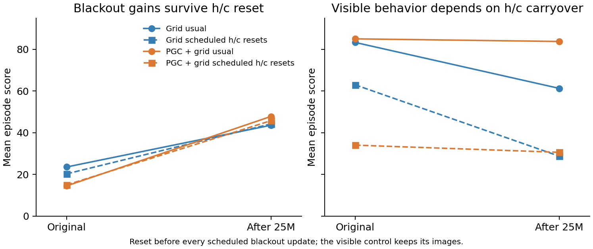

# Does blackout behavior require recurrent carryover on every step?

We reset both LSTM variables, `h` and `c`, **before every scheduled blind update**. The earlier control reset them only once, when the blackout began. The ordinary evaluation function was unchanged; a small clock adapter returned the next scheduled-blind mask instead of only the onset signal. Its tests verify exact clock timing, identical clock RNG/state, and no extra resets before goal discovery.

**Most of the learned blackout improvement survives removing h/c carryover on every blind update.** The continued Grid model scores 43.59 normally and 44.22 with this intervention; continued PGC scores 47.81 and 45.78. Each result uses 64 episodes from the same fixed seed-1 models. The unchanged branches reproduce every corresponding episode row in the parent CUDA evaluation exactly.

Previous action/reward, current spatial codes, the external saved-goal code and the environment's physical state remain available. They still carry information about history. The result suggests the blackout improvement is largely supported by computation from those available inputs and externally carried state, rather than requiring maintained h/c across blind updates.

Applying the same reset schedule while keeping images visible has much larger effects. This shows dependence on recurrent state under the intervention; it also changes the state distribution seen by the network, so it does not uniquely identify stored information. The original and continued outcomes, including onset-only controls, are retained below.

| Model | Vision | Usual h/c | Reset at onset | Reset every scheduled update |
|---|---|---:|---:|---:|
| Grid original | blind | 23.59 | 20.62 | 20.31 |
| Grid original | seen | 83.28 | 83.75 | 62.97 |
| Grid +25M | blind | 43.59 | 43.59 | 44.22 |
| Grid +25M | seen | 61.25 | 58.28 | 28.75 |
| PGC + grid original | blind | 14.53 | 15.47 | 15.00 |
| PGC + grid original | seen | 85.00 | 83.28 | 34.06 |
| PGC + grid +25M | blind | 47.81 | 45.94 | 45.78 |
| PGC + grid +25M | seen | 83.75 | 75.62 | 30.62 |

The every-update branches contain about 32,000–40,000 resets each. These are descriptive results from one trained seed pair, with no population-level significance claim. [Summary and artifact identities](summary.json) · [Frozen intervention protocol](protocol.json). The discarded local MPS attempt completed no model outcome; authoritative results are the same-CUDA cloud diagnostics.
