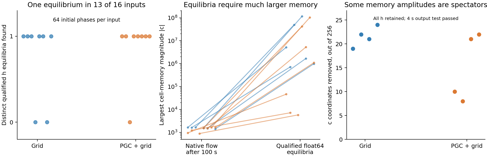

# Fixed points, hidden activity, and saturated memory

We tested a concrete alternative: perhaps the full LSTM memory keeps drifting while the useful neuronal activity forms a stable ring. We retained every hidden activity coordinate, `h`, and examined the internal cell-memory coordinates, `c`, separately.



The equilibrium results use float64 analysis. At these extreme memory amplitudes, the original float32 recurrence exhibits cell-value quantization; the separate precision audit below reports that effect.

**The final equilibrium solver found one distinct qualified activity equilibrium in each of 13 of the 16 fixed-input cases.** Across 1,024 initial states, 641 converged to those equilibria. There were no qualified fixed points in the other three cases; one of those had slow residuals. Every qualified representative was locally stable. This landscape suggests convergence toward individual activity patterns under the tested constant inputs. The retained native-trajectory and recovery tests remain essential for finding a finite-time ring between equilibria.

The original full-state optimizer had found zero fixed points. Its failure was largely a numerical conditioning problem: the equilibrium memory values are much larger than the native values, and the residual changes very slowly with those memory coordinates. We corrected that directly using the exact LSTM equilibrium equation, `c = i*g/(1-f)`, and then solving the remaining activity equation. No angle label, circular loss, learned decoder, or new recurrent weight entered this calculation. All failed earlier searches remain available.

Even the smallest qualified equilibrium's largest memory amplitude was about **5,800**, while the most distant case required about **116 million**. The actual full LSTM, started from the native goal-conditioned states and held under the same input for 100 seconds, reached maximum memory amplitudes of about **900–1,700**. Its activity moved closer to the equilibria, while the memory coordinates remained far away. These remote equilibrium states describe asymptotic dynamics; the relevant navigation mechanism must operate along the native trajectories.

**Some memory amplitudes really can be omitted without changing the output.** In eight separate native-history tests, we found 8–24 such `c` coordinates. The rule used only persistent saturation across eight preset discovery phases. We then removed those amplitudes, retained every `h` and every other `c`, and tested the resulting dynamics on 56 held-out phases. Across six different 4 second input futures—including recorded native input, predictive-cue removal, ordinary-code substitution, and a switch to another recorded context—the maximum hidden-activity error was **1.13×10⁻⁷**, and the maximum action-probability error was **2.68×10⁻⁹**. This validates a finite-domain spectator factor. It does not turn that factor into a ring.

Simply assuming that all initially saturated coordinates were irrelevant failed in all 16 initial tests: some later became unsaturated and affected the output. A stronger forced-clamp manipulation also showed why instantaneous saturation is insufficient. The validated reduction instead replaces only persistently saturated `tanh(c)` values by their fixed sign. This distinction was checked with explicit mathematical tests. The reduced-state fixed-point searches still did not converge before the analytic conditioning fix.

The full-state spectra of the qualified equilibria have **13–41 near-unit eigenvalues**, largely associated with memory coordinates. Their existence is therefore not, by itself, evidence of a one-dimensional angular attractor. The preceding recovery audit also found that raw-coordinate short-term contraction gives way to longer transient growth, and the goal families contract. Together these results point to slow, partly saturated memory dynamics plus input-dependent activity patterns in the tested original agents. A causal ring explanation needs an actual activity family with preferential radial recovery and preserved useful phase; these assays keep those requirements visible instead of inferring a ring from a circular input or a near-unit eigenvalue.

Numerical checks: no fitted forget sigmoid rounded exactly to 1 in the **float64 analysis**. We computed `1-f` as `sigmoid(-forget_logit)` to avoid cancellation, recorded both stable and ordinary float64 recurrence residuals, and evaluated the full-state Jacobian with a stable forget-gate derivative. The largest ordinary float64 recurrence RMS among the qualified solutions was 3.48×10⁻⁹.

We also evaluated every qualified solution in the **original float32 LSTM**. Here 474 cell-gate instances rounded the forget gate to 1. Each corresponding nonzero write was lost because the cell amplitude was so large that float32 could not resolve it; the largest spacing between representable cell values was 8. Elsewhere, a cell changed by as much as 1 in one update. The full-state float32 residual RMS reached 0.0442, while the activity residual RMS remained below 2.63×10⁻⁷. Thus the enormous finite mathematical equilibria also encounter numerical quantization in the native implementation. This reinforces the need to study mechanisms at the actual task-scale states. [Native float32 audit](native_float32_precision_audit.json).

Source and checkpoint hashes pass. These are descriptive results from two original seed pairs, not a population significance claim.

[Machine-readable summary](fixed_points_and_saturation_summary.json) · [Full-state protocol](fixed_points/protocol.json) · [Saturation intervention protocol](saturation_audit/protocol.json) · [Held-out quotient protocol](quotient_points/protocol.json) · [Final exact-equilibrium protocol](equilibrium_elimination/protocol.json) · [Recovery and spectra audit](README.md).

Reproduce:

```bash
python scripts/lstm_endogenous_fixed_points.py
python scripts/lstm_endogenous_saturation_audit.py
python scripts/lstm_endogenous_quotient_points.py
python scripts/lstm_endogenous_equilibrium_elimination.py
python scripts/lstm_endogenous_precision_audit.py
python scripts/lstm_endogenous_equilibrium_report.py
python -m pytest -q tests/test_lstm_endogenous_*.py
```
