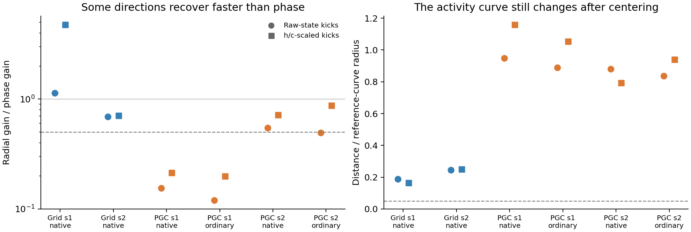

# Does an observable ring survive after common drift is removed?

We made the test sensitive to an angular subcomputation inside a larger drifting LSTM. For every state, the measurement includes **all 256 hidden outputs now and at three later times**. This fixed 1,024-dimensional observable history exposes internal memory when it affects future activity. It uses no fitted decoder or chosen two-dimensional plane.

We compared the activity curves both before and after subtracting their common phase-family mean. The mean subtraction removes shared background motion; differences among phases remain. The same actual full-state radial and tangent kicks were used in both comparisons, with a guard against perturbations that are invisible in the measured activity. Everything ends within four seconds: a one-second reference, two-second evolution, and one final second of observation.



**All six original native/released cases fail the frozen conditional-ring-factor screen in both perturbation constructions.** There is nevertheless a specific dynamical difference: PGC seed1 has substantially faster observable radial recovery than phase recovery, with a raw-state ratio of 0.154. That ratio remains 0.120 after replacing current predictive inputs with ordinary inputs. The corresponding Grid ratios are 1.140 and 0.689; PGC seed2 is 0.549 under native input. These are two seed pairs, so the individual outcomes remain visible rather than being presented as a population significance claim.

The PGC seed1 activity curve also changes by about 0.95 of its reference radius after common drift is removed, and loses phase coverage/order. Its faster radial recovery therefore suggests anisotropic short-term dynamics. It does not supply a stable angular curve, and the ordinary-input comparison does not attribute the recovery to an active predictive cue. Some observable curves also have large sampled edges; those resolution failures are retained explicitly.

We also applied the identical frozen control to **last-travel-direction families**, which vary the direction actually represented by PGC input. Only their ordinary-current released states were used, so every phase received the same input. All four original models failed the conditional-factor screen. Their raw radial/phase ratios were Grid 0.922/0.541 and PGC 0.331/0.616; after mean removal, curve-change errors were 1.766/0.416 and 0.663/0.987 radii, respectively. This preserves the PGC seed1 recovery finding while keeping it distinct from stable ring geometry. [All travel-direction results](travel_original/summary.json).

The code passes three controls: a known ring combined with shared observable drift passes the centered test; a shrinking plane sampled around a circle fails; and an output-silent circle fails the nontrivial-perturbation guard. The primary full-state tests are unchanged. This is an explicitly secondary, conditional ring-factor analysis.

[Frozen protocol](protocol.json) · [All original outcomes](original_summary.json). A serialization-only fix was needed before any result could be written; the earlier source and protocol are retained beside the current protocol, and the numerical calculation and thresholds were unchanged.

The same frozen implementation accepts the final continued models and their native/ordinary saved curves:

```bash
python scripts/lstm_endogenous_observable_flow.py --originals
python scripts/lstm_endogenous_observable_report.py
python scripts/lstm_endogenous_observable_flow.py --checkpoint FINAL.pt --archive context0_states.npz --label continued/MODEL
python -m pytest -q tests/test_lstm_endogenous_observable_flow.py
```

## Fixed 25.024M continued pair

All 24 metric-specific tests are retained; 0 pass the conditional-factor screen. These are the same fixed final Grid/PGC models used by the primary analysis, with fresh native contexts and no checkpoint selection.

| Family | Model | Context | Current input | Radial / phase gain | Centered curve-change error |
|---|---|---|---|---:|---:|
| heading | Grid | context0 | native_current | 0.704 | 0.542 |
| heading | Grid | context0 | ordinary_current | 0.704 | 0.542 |
| heading | Grid | context1 | native_current | 0.922 | 0.406 |
| heading | Grid | context1 | ordinary_current | 0.922 | 0.406 |
| heading | PGC + grid | context0 | native_current | 1.025 | 0.591 |
| heading | PGC + grid | context0 | ordinary_current | 1.011 | 0.625 |
| heading | PGC + grid | context1 | native_current | 0.787 | 0.592 |
| heading | PGC + grid | context1 | ordinary_current | 0.875 | 0.634 |
| travel | Grid | context0 | ordinary_current_released | 0.931 | 0.394 |
| travel | Grid | context1 | ordinary_current_released | 0.762 | 0.591 |
| travel | PGC + grid | context0 | ordinary_current_released | 1.253 | 0.342 |
| travel | PGC + grid | context1 | ordinary_current_released | 0.666 | 0.416 |

The table uses raw-state kicks; both constructions and every failed gate are in the [continued summary](continued_summary.json). Curve-change error is measured in reference-curve radii. All observations finish within four seconds.
