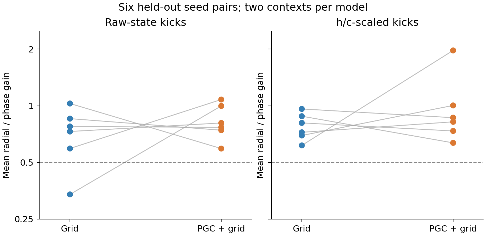

# Held-out observable travel-direction audit

The calculation and criteria were frozen on seeds 1–2, then applied unchanged to seeds 3–8. Every one of the 24 native travel contexts is retained. Only the common ordinary-current release is used, so persistent phase-specific predictive inputs cannot create an apparent autonomous ring.

**0 of 48 metric-specific results pass the conditional-factor screen.** The PGC radial/phase ratio is lower in 3/6 seed pairs for raw-state kicks and 3/6 for h/c-scaled kicks. Each seed value is the mean of its two context medians; these comparisons describe held-out variation rather than a population significance claim.

| Seed | Grid ratio | PGC ratio | PGC minus Grid |
|---|---:|---:|---:|
| 3 | 0.593 | 1.080 | +0.486 |
| 4 | 0.854 | 0.742 | -0.113 |
| 5 | 0.730 | 0.810 | +0.080 |
| 6 | 0.776 | 0.768 | -0.008 |
| 7 | 0.338 | 0.998 | +0.660 |
| 8 | 1.028 | 0.593 | -0.436 |

Lower radial/phase gain means stronger recovery of radial disturbances relative to preservation of phase. It remains a partial property: stable geometry, phase coverage and useful output must also be present. The complete failed-gate lists and both metrics are retained in the [all-context summary](summary.json); [seed summary](seed_summary.json); [frozen adapter protocol](protocol.json).
