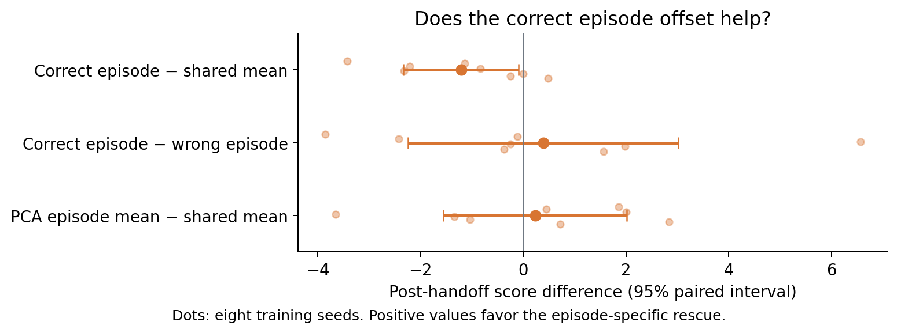
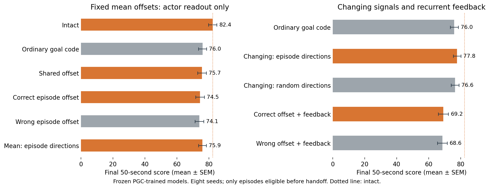

# Do episode-specific activity offsets help navigation?

**Adding back the fixed episode offset did not demonstrate a navigation benefit.** The correct offset was not reliably better than a shared offset or a same-sized wrong-episode offset.



The primary outcome is **score during the final 50 seconds**, among episodes eligible before the intervention. These numbers should not be compared directly with the earlier 90-second scores near 104. The intact condition scores **82.39** here, and ordinary goal-code substitution scores **76.03**.

Restoring the correct fixed offset scores **74.47**, and restoring a same-sized wrong offset scores **74.08**. Neither recovers the lost score in its mean outcome; their difference remains uncertain.

## The simple test

Every branch first follows the same intact policy for 600 steps. During steps 450–599, after the goal is already known, two shadow RNN states receive the same experience: one gets the predictive goal code and the other gets ordinary goal code. Their average hidden-state difference estimates an offset for that episode. The estimate is frozen before any later action or reward is observed.

After step 600, the main fixed-offset interventions feed the actor ordinary-goal hidden activity plus:

- **Shared mean:** the average offset across eligible episodes.
- **Correct episode mean:** that episode's own offset.
- **Wrong episode mean:** another eligible episode's deviation from the shared mean, rescaled to match the correct deviation's size.
- **PCA episode mean:** the shared mean plus the correct episode deviation projected onto ten episode-mean directions learned from an independent earlier replay.

Live population inputs stay predictive. These fixed-offset arms change only the actor input; their recurrent h/c states continue under ordinary goal input. The correct-versus-shared and correct-versus-wrong controls distinguish episode-specific content from a generic offset or perturbation size.

## Primary comparisons

| Comparison | Score difference | 95% interval | Holm t p | Holm exact p |
|---|---:|---:|---:|---:|
| Correct episode − shared mean | -1.21 | [-2.33, -0.09] | 0.1128 | 0.1406 |
| Correct episode − wrong episode | +0.39 | [-2.24, +3.02] | 1 | 1 |
| PCA episode mean − shared mean | +0.23 | [-1.56, +2.02] | 1 | 1 |

Eight paired training seeds are the replicates. The three primary comparisons form one Holm correction family. Positive differences favor the episode-specific rescue. Individual dots show seed differences; intervals are marginal 95% paired t intervals.

## Dynamic and recurrent controls



The **dynamic PCA rescue** adds the current mixed-versus-grid hidden difference only along the independently learned episode-mean subspace. Its control uses a rank-matched random subspace outside that span, with patch norm matched at each step. These patches vary with time: success would identify useful information in the subspace, not prove that constant episode offsets are sufficient.

The **feedback** arms additionally feed the corrected h back into the next ordinary-goal recurrent update; c is unchanged. They test a different mechanism from actor-only restoration.

| Comparison | Score difference | 95% interval | Holm t p | Holm exact p |
|---|---:|---:|---:|---:|
| Goal substitution − intact | -6.36 | [-9.16, -3.57] | 0.005151 | 0.03906 |
| Dynamic PCA rescue − substitution | +1.77 | [+0.46, +3.09] | 0.04618 | 0.0625 |
| Dynamic PCA rescue − random control | +1.22 | [-0.11, +2.56] | 0.1345 | 0.1719 |
| Mean feedback − substitution | -6.82 | [-10.04, -3.59] | 0.006258 | 0.0625 |
| Correct feedback − wrong feedback | +0.65 | [-2.14, +3.43] | 0.5998 | 0.5703 |

These five comparisons form a separate exploratory Holm family. All ten variants and full-episode scores remain in [summary.json](summary.json).

Restoring the changing signal gives a small mean improvement, but its advantage over the same-sized random control remains uncertain. Feeding fixed offsets back into recurrence scores **69.21** with the correct offset and **68.56** with the wrong one. Both means are below the ordinary-goal baseline; the correct-versus-wrong comparison does not establish an episode-specific effect.

## Interpretation limits and checks

The test isolates information produced by changing the goal encoding within the same frozen PGC model. It does not equate every episode offset with a pure goal coordinate: goal effects can interact with visual context and history. It also does not establish why PGC training outperformed grid-only training.

During the matched calibration prefix, episode averages account for **49.30%** of hidden variance with predictive goal input and **48.60%** with ordinary goal input. Both retain large episode-associated variation. These are descriptive batch averages from the **same PGC-trained RNN with unchanged predictive live input**; they are not the earlier 30.2% versus 21.0% comparison of separately trained populations on a different replay.

A successful constant-offset rescue would show sufficiency under this intervention. A failed rescue would not rule out changing goal signals, recurrent interactions, or context features inadequately estimated by the short prefix. Dynamic rescue and feedback must be interpreted separately from the fixed-offset primary comparisons.

The [subtraction test](ablation/README.md) also found an uncertain correct-versus-wrong effect: -0.12 points, 95% interval [-2.41, +2.17]. Its [past-to-future check](ablation/README.md#did-the-prefix-estimate-match-the-later-offset) found that the frozen prefix offset predicted the later mean poorly: R² = -0.162 in hidden activity and -0.946 in action logits. That limits what the failed fixed-offset rescue can establish: a short past average is an imperfect substitute for the changing predictive signal.


All branches have identical first-goal and prefix-score records. Intact records reproduce the earlier evaluation exactly. Wrong-offset controls require a genuine derangement within each eligible batch and matched norms. Calibration and independent-basis provenance are retained in the per-seed files; all offsets use only prefix information.

Activation patches are not clipped. The summary retains how often patched h leaves its natural [−1, +1] range, the maximum magnitude, and random-control rescaling. Feedback effects therefore include a deliberately altered recurrent state and should not be interpreted as ordinary operation of an unmodified LSTM.

```sh
OPENBLAS_NUM_THREADS=1 OMP_NUM_THREADS=1 python scripts/lstm_episode_offset_rescue.py --device mps --episodes 128 --n-envs 64
python scripts/summarize_lstm_episode_offset_rescue.py
```

The first command runs all eight seeds using the original local checkpoints; the second summarizes completed runs. Existing completed seed files are reused. See [protocol.json](protocol.json), [full statistics](summary.json), the [subtraction and future-offset checks](ablation/README.md), and the [eigenvector analysis](../lstm_eigenspectra_1B/README.md).
