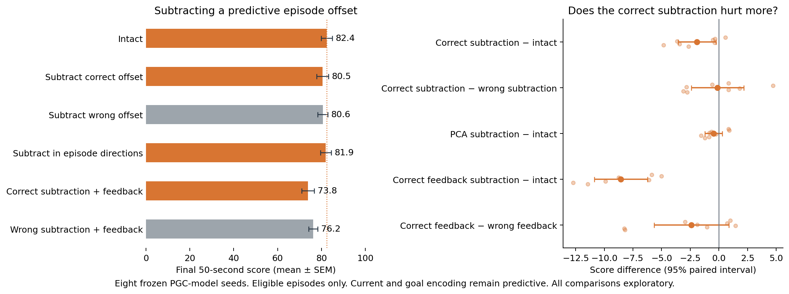

# Subtracting the predictive episode offset

**In the actor-only test, subtracting the correct offset was not reliably more harmful than subtracting a same-sized wrong offset.** This does not demonstrate an episode-specific contribution to navigation; uncertainty is not proof that all episode-related activity is irrelevant.

Actor-only scores are **80.49** after correct subtraction and **80.61** after wrong subtraction, versus **82.39** intact. Feeding correct subtraction back through the RNN lowers score to **73.84**; wrong-offset feedback scores **76.23**. **Correct-offset feedback hurts relative to intact**, including after both statistical corrections, but its extra harm compared with the wrong-offset control remains uncertain.



The plotted outcome is score during the final **50 seconds**, among episodes eligible before the intervention. It is not the earlier 90-second full-episode score. This is an exploratory necessity-oriented complement to the [rescue experiment](../README.md), added after inspecting the first rescue seed and before full rescue results.

## What was subtracted

All branches follow the same intact policy for the first 600 steps. For episodes already knowing the goal at step 450, mixed-goal and ordinary-goal shadow states experience the same prefix. Their average hidden difference over steps 450–599 gives a predictive contribution for that episode.

We subtract its **episode-specific deviation from the batch's shared mean**. We do not subtract the whole episode-average activity pattern. The patch is frozen before any post-handoff activity or reward is observed.

- **Correct offset:** subtract that episode's centered predictive contribution from the original mixed hidden state at the actor readout.
- **Wrong offset:** subtract another eligible episode's centered contribution, rescaled to exactly the same norm.
- **PCA offset:** subtract the correct contribution only along the ten episode-mean directions learned from an independent earlier replay.
- **Feedback:** additionally pass the subtracted mixed h into the next recurrent step. Cell state c and the ordinary-goal shadow are untouched.

Current and saved goal inputs remain predictive. The non-feedback branches change only the actor's input. The feedback branches also alter the evolving recurrence and must be interpreted separately.

## Exploratory comparisons

| Exploratory comparison | Score difference | 95% interval | Holm t p | Holm exact p |
|---|---:|---:|---:|---:|
| Correct subtraction − intact | -1.90 | [-3.55, -0.25] | 0.1181 | 0.1562 |
| Correct subtraction − wrong subtraction | -0.12 | [-2.41, +2.17] | 0.9028 | 0.8906 |
| PCA subtraction − intact | -0.45 | [-1.20, +0.31] | 0.4123 | 0.4219 |
| Correct feedback subtraction − intact | -8.55 | [-10.86, -6.24] | 0.0002561 | 0.03906 |
| Correct feedback − wrong feedback | -2.39 | [-5.66, +0.87] | 0.3806 | 0.4219 |

The five comparisons form one Holm family, corrected separately for paired t and exhaustive sign-flip tests. Eight training seeds are the statistical replicates. Negative correct-minus-wrong differences mean the correct subtraction is more harmful. If both offsets hurt similarly, that does not demonstrate episode-specific information use.

## Patch size and hidden-state range

| Intervention | Mean patch L2 | Hidden units outside [−1,1] | Samples with any outside unit | Largest observed abs(h) |
|---|---:|---:|---:|---:|
| Intact | 0.000 | 0.000% | 0.00% | 1.000 |
| Subtract correct offset | 1.547 | 3.343% | 99.95% | 3.031 |
| Subtract wrong offset | 1.547 | 3.538% | 99.99% | 4.831 |
| Subtract in episode directions | 0.660 | 2.580% | 99.79% | 2.259 |
| Correct subtraction + feedback | 1.547 | 3.512% | 99.97% | 3.031 |
| Wrong subtraction + feedback | 1.547 | 3.603% | 99.98% | 4.950 |

Fractions and patch norms are means of eight seed means; the final column is the largest value across seeds. Natural LSTM hidden outputs lie in [−1,1]. Patches are not clipped. Exceeding that range, especially with recurrent feedback, is an intervention side effect and limits mechanistic interpretation. Raw per-seed diagnostics are retained in [summary.json](summary.json).

This tests an estimated predictive contribution in frozen PGC-trained networks. It does not establish that every episode offset is goal memory, that all episode information is necessary, or why PGC training outperformed grid-only training. A finite prefix estimate can also miss changing signals and later context interactions.

## Did the prefix estimate match the later offset?

| Past offset predicting future offset | Cosine similarity | Prediction R² |
|---|---:|---:|
| Centered hidden activity | 0.545 | -0.162 |
| Centered action logits | 0.395 | -0.946 |

After the episode ended, we compared the frozen prefix estimate with the intact branch's actual mean mixed-minus-grid difference during steps 600–1349. Past and future offsets were separately centered across the same eligible episodes. This diagnostic never influenced actions, offsets, or eligibility.

R² is `1 − squared error / future offset energy`, with no fitting or rescaling; it can be negative. Each seed averages its two batch metrics using eligible counts, then the eight seeds receive equal weight. These are **averaged batch R² values, not pooled R²**. Poor agreement, especially in action-logit space, limits what failed constant-offset rescues or ablations can establish. Full energy fractions and raw batch diagnostics are retained in the summary.

The future mean within each episode accounts for **25.0808%** of the **hidden mixed-minus-grid signal energy** (`future_mean_energy_fraction = 0.2508075194`). After removing the shared mean across episodes, the episode-specific means account for **24.2210%** (`future_episode_mean_energy_fraction = 0.2422103853`). The denominator is the mean squared size of the changing hidden-state difference over steps 600–1349 along the intact trajectory. These are **not percentages of total PCA variance or navigation performance**; they are descriptive averages of batch energy fractions.

## Checks and reproduction

Eligibility, first-goal times, and prefix scores match exactly across variants. Ineligible episodes are unchanged. Intact episode records are compared with both the original code-swap evaluation and the main rescue run. Wrong controls require a derangement and matched norms. Calibration uses only the past prefix.

```sh
OPENBLAS_NUM_THREADS=1 OMP_NUM_THREADS=1 python scripts/lstm_episode_offset_rescue.py --device mps --episodes 128 --n-envs 64 \
  --variants intact remove_episode_mean remove_wrong_episode_mean remove_between_episode_mean \
  remove_episode_mean_feedback remove_wrong_episode_mean_feedback \
  --out results/lstm_episode_offset_rescue_1B/ablation
python scripts/summarize_lstm_episode_offset_ablation.py
```

The first command runs the six ablation conditions for all eight seeds using the original local checkpoints; the second summarizes completed runs. Existing completed seed files are reused. The matching main rescue files are also required to check the intact baseline. [Protocol](protocol.json) · [Numerical results](summary.json) · [Main rescue test](../README.md)
