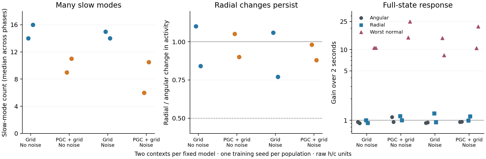

# Memory traces and spectra after 75M additional frames

**Direction-related activity persists, while radial changes recover about as slowly as angular changes. The full state contains several slow cell-memory modes.**

Each dot summarizes one fixed travel context; spectral counts and gains are medians across 16 phases. Both original seed-1 agents received 75.072M additional frames; the noise arms added recurrent noise during the final 50.048M. These are descriptive comparisons of four models, not estimates across independent training seeds.

**Left:** at each sampled phase, the 2-second state-update product has 6–16 eigenvalues with magnitude at least 0.99. Across the sampled phases, 72.8% of slow eigenvectors have exactly zero hidden-state component in float64; they are locally actor-silent cell-state modes. Slow memory therefore occupies multiple state directions.

**Middle:** radial and angular kicks were measured through all 256 hidden outputs over the frozen observation window. A ratio near 1 means radial changes persist about as much as angular changes. Every travel-context median lies above the prespecified 0.5 selective-recovery threshold (dashed line). Across heading/travel branches and both coordinate metrics, all 48 observable-factor screens retain their negative result. The activity families also deform and lose phase order.

**Right:** the linearized ordinary-input map from 2s to 4s retains angular and radial disturbances near unit size; its worst transverse direction grows 8.3–25.0× (context medians). **This maximum includes spectator cell-state dimensions. It is a full-state sensitivity, not a measure of behavioral instability.** The observable recovery test in the middle addresses activity that can influence the actor.

| Model | Median slow-mode counts | Observable radial/angular | Median worst normal gain |
|---|---:|---:|---:|
| Grid / No noise | 14/16 | 1.10/0.84 | 10.6/10.6 |
| PGC + grid / No noise | 9/11 | 1.05/0.90 | 14.8/25.0 |
| Grid / Noise | 15/14 | 1.06/0.77 | 14.6/8.3 |
| PGC + grid / Noise | 6/10.5 | 0.98/0.88 | 10.5/21.3 |

Each table entry lists context 0 / context 1. Spectral medians use the 16 phases within each context: a value such as 10.5 is the median of integer mode counts, not a fractional mode.

The spectra use all 512 state coordinates at 16 uniformly preselected phases in every one of the eight travel contexts. They describe a fixed-input finite-time propagator, not a Floquet or period-return map. Raw and h/c-RMS coordinates, all eigenvalues/singular values, eigenvector alignment, the top 16 full eigenvectors and products are retained. No new ring gate or favorable-context selection was added.

Numerical replay agrees with the saved trajectories to 5.69×10⁻¹⁴ and with the native LSTMCell exactly. The angular finite-difference propagation error has context medians below 0.019, with an outlying maximum 0.575 in block-scaled coordinates; all phases remain included. High tangent alignment is also a smooth-flow consistency check.

[Spectral summary](summary.json) · [Observable summary](../lstm_endogenous_ring/observable_history/final75/summary.json) · [Primary tests](../lstm_final75_memory/README.md) · [Frozen spectral protocol](protocol.json) · [Numerical validation](numerical_validation.json) · [Artifact verification](artifact_verification.json)

Reproduce the figure with `python scripts/plot_lstm_final75_secondary.py`. The frozen calculations are in `scripts/lstm_final75_finite_spectra.py` and `scripts/lstm_endogenous_continued_observable_v2.py`; their exact source and checkpoint hashes accompany the results.
