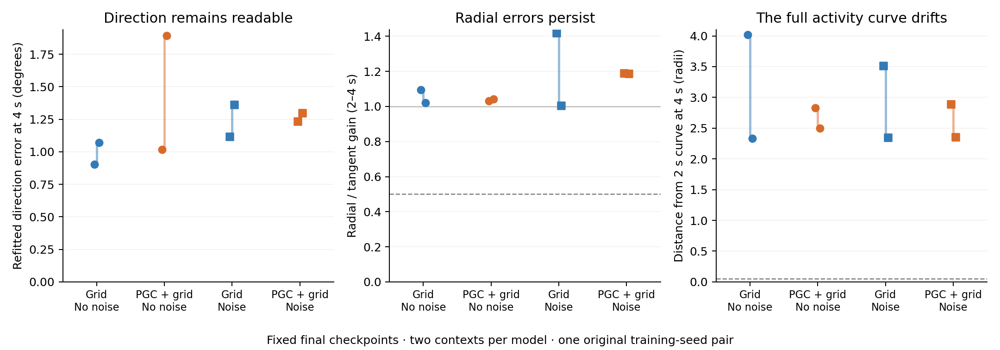

# Fixed 75M continuations: primary memory results

**None of the eight heading contexts or eight travel contexts passes the unchanged full-state ring criteria.** All fixed final models are retained: the seed-1 Grid/PGC pair continued with or without activity noise. No intermediate checkpoint was selected.

Direction can still be recovered with an analysis readout fitted at each time. Radial disturbances persist about as strongly as angular differences, while the full-state family moves away from its earlier curve. The added training, including the chosen activity-noise condition, preserves a changing direction trace in these tests.

| Training | Population | Context | Refitted error at 4 s | Radial/tangent gain | Curve drift (radii) |
|---|---|---:|---:|---:|---:|
| Noiseless | Grid | 0 | 0.90° | 1.095 | 4.02 |
| Noiseless | Grid | 1 | 1.07° | 1.020 | 2.33 |
| Noiseless | PGC + grid | 0 | 1.02° | 1.031 | 2.83 |
| Noiseless | PGC + grid | 1 | 1.89° | 1.042 | 2.50 |
| Activity noise | Grid | 0 | 1.12° | 1.418 | 3.51 |
| Activity noise | Grid | 1 | 1.36° | 1.004 | 2.35 |
| Activity noise | PGC + grid | 0 | 1.24° | 1.189 | 2.89 |
| Activity noise | PGC + grid | 1 | 1.30° | 1.186 | 2.35 |

The figure/table use raw full-state distances. The [complete numeric summary](primary_summary.json) retains the separate hidden/cell RMS-scaled results and both heading-input conditions. Lines show the two contexts of one trained model; they are not confidence intervals. The refitted readout measures accessible information and is not a ring criterion.

Heading tests retain native-current and ordinary-current branches. Travel tests remove only the current predictive component after a real forward approach; saved-goal values stay native. Both use fresh histories from the final weights under their trained blackout schedule, and primary recovery ends within four seconds. Independent future-hidden-activity, cue-pulse and finite-time spectral analyses are reported separately.

The separate [single-cue repair test](../lstm_heading_memory/travel_cue_pulse/final75/README.md) also retains all eight travel contexts. Across the four PGC contexts and both distance metrics, a correct predictive pulse changes the late phase error by at most 0.14°; all Grid sham branches are exact identities. The [simple pulse figure](../lstm_heading_memory/travel_cue_pulse/final75/cue_pulse_by_training_arm.png) distinguishes the immediate response from the much smaller persistent change. This measures acute cue repair in the same frozen network, separately from autonomous radial recovery.

The independent [future-hidden-activity analysis](../lstm_endogenous_ring/observable_history/final75/summary.json) finds zero candidates across all 48 branch/metric checks, including the version that subtracts shared background drift. The [full-state finite-time spectra](../lstm_final75_finite_spectra/README.md) show multiple slow cell-state directions and strong temporary amplification outside the angular direction. This full-state amplification includes actor-silent cell modes; it is not a behavioral-instability measure. Together these favor a persistent, changing memory trace over selective restoration toward a circular state. These checks reuse the same four trained models; they are not independent seed replications.

The noiseless worker adds a verified runtime metadata field to checkpoint provenance. The [separate metadata adapter](runtime_adapter_protocol.json) checks its protocol hash/backend/condition before calling the original validator; the frozen numerical wrapper and gates are unchanged. Initial metadata-only attempts ended before context collection. Noise-arm checkpoints use the original wrapper directly.

[Frozen primary protocol](protocol.json) · [Original numerical wrapper](../../scripts/lstm_final75_memory.py) · [Runtime-only adapter](../../scripts/lstm_final75_memory_runtime_adapter.py) · [Reproduce from the published inputs](REPRODUCE.md)

These are one original training-seed pair and two nested contexts per continuation. The new blind-reorientation training task and its prospective assay remain a separate experiment.
