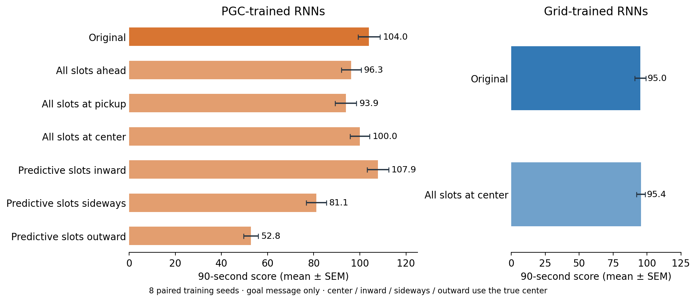
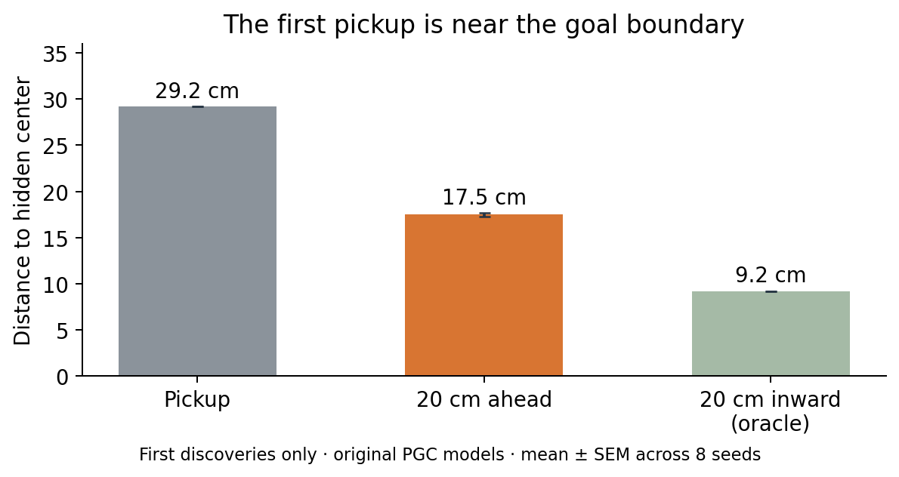

# Which part of the goal message helps?

**Making the predictive goal shift point exactly inward improves all eight PGC models. Moving the ordinary pickup marker to the unchanged predictive point hurts all eight.** The trained RNN and live spatial code remain intact.



The ordinary 343 goal slots normally mark the pickup. The predictive 169 slots mark a point 20 cm ahead along the arrival direction. Both are continuously supplied and refreshed at each pickup. No neuron is silenced and there is no retraining.

| PGC goal message | Score |
|---|---:|
| Original | 103.99 |
| All slots ahead | 96.26 |
| All slots at pickup | 93.90 |
| All slots at center | 100.00 |
| Predictive slots inward | 107.85 |
| Predictive slots sideways | 81.10 |
| Predictive slots outward | 52.81 |

**The spatial direction is useful, and the ordinary pickup anchor also matters.** These results support learned use of both parts of the goal message. They do not identify a literal vector-subtraction algorithm inside the RNN or show that this one factor explains every part of the trained-population advantage.

“All slots ahead” moves only the ordinary anchor slots: the original predictive slots remain exactly unchanged. “All slots at pickup” removes the predictive shift. “All slots at center” supplies one coherent true-center code. The last three conditions keep ordinary slots at the pickup and place predictive slots 20 cm inward, sideways, or outward.

Inward, sideways, outward, and center are **oracle diagnostics** using the otherwise hidden true center. Sideways chooses the perpendicular sign matching the arrival direction. All three direction tests preserve the 20 cm shift length; their distances to the goal center differ. Altered messages may fall outside the learned input distribution.

## Preselected score comparisons

| Comparison | Difference | 95% paired interval | Holm t p | Holm exact p |
|---|---:|---:|---:|---:|
| all ahead minus intact | -7.73 | [-11.09, -4.38] | 0.001895 | 0.03125 |
| radial minus intact | +3.86 | [+1.97, +5.74] | 0.001895 | 0.03125 |
| radial minus tangent | +26.75 | [+21.19, +32.31] | 2.732e-05 | 0.03125 |
| radial minus reverse | +55.04 | [+48.13, +61.95] | 1.179e-06 | 0.03125 |

The four comparisons form one Holm family. Eight training seeds, not individual pickups, are statistical replicates. Other comparisons and behavior measures are exploratory; all values and intervals are in [summary.json](summary.json). No nonsignificant difference is treated as equivalence.

## Information available at the first discovery

Reward occurs on entering a **30 cm goal disk**, not on reaching its center. The saved pickup is therefore usually near its edge. Arrival direction points roughly inward, so the predictive point steps into the target area.



For the original PGC policies, the first pickup is **29.2 cm** from the hidden center. Moving 20 cm along the arrival direction reduces the mean error to **17.5 cm**. The mean arrival cosine toward the center is **0.770**. This uses first discoveries only, before any goal-message intervention has influenced behavior.

Grid-policy first discoveries show the same environmental cue: **29.2 cm → 17.2 cm**. Thus the extra geometry is available in the mixed code; it is not merely a result of PGC policies already making more successful return trips. This alone does not identify the RNN computation.

For PGC first discoveries, the ordinary pickup marker lies only **0.81 cm inside the reward boundary** on average. The predictive marker has a mean inward margin of **12.52 cm**; **93.6%** of those ahead points are inside the disk. Aiming toward an interior point could tolerate larger steering errors, but these geometry measurements alone do not show that the RNN aims at that point.

A simple reference calculation explains the scale: with straight boundary crossings and a uniformly distributed impact parameter, the average center displacement along arrival is `π × radius / 4`, or **23.6 cm** here. The measured projection at first discovery is **22.4 cm** for PGC policies and **22.7 cm** for grid policies. The reference assumes ideal crossing geometry; the measured trajectories need not satisfy those assumptions exactly. A 20 cm shift is consequently on the scale of an inward center estimate, rather than the actual pickup location.

| First-hit center estimate | Grid-policy pickups | PGC-policy pickups |
|---|---:|---:|
| Pickup squared error (m²) | 0.08523 | 0.08526 |
| 20 cm ahead squared error (m²) | 0.03444 | 0.03561 |
| Squared error reduction | 59.6% | 58.2% |
| Best scalar shift along arrival | 22.7 cm | 22.4 cm |

The best scalar shift minimizes squared center error on these observed first pickups; it is a descriptive geometry fit, not a trained policy or an out-of-sample performance result. Each seed is weighted equally. The externally saved PGC goal message retains this arrival-related cue at every later step. An ordinary goal snapshot contains only pickup position; a grid RNN could still retain arrival information in its recurrent history.

The ideal crossing model predicts `radius² + shift² − 2 × shift × (π × radius / 4)` for the ahead-point squared error: **0.03575 m²** at a 20 cm shift and 30 cm radius. This numerical reference is close to the observed errors, but its assumptions are an approximation and it is not a model of the learned policy.

This is one candidate factor for these frozen 1B models. Earlier 300M training controls with predictive live code and ordinary goal snapshots can still learn useful behavior; these goal-message interventions do not explain every predictive-code benefit across training budgets or architectures.

## Checks and reproduction

All 7,168 intervention episode first-goal records match their original branch exactly. All 4,096 repeated original/plain-goal/grid-center episode records match the earlier goal-geometry experiment exactly. Original checkpoint hashes are unchanged. Means of eight seed means are plotted; score is 10 points per pickup in 90 seconds.

```sh
OPENBLAS_NUM_THREADS=1 OMP_NUM_THREADS=1 python scripts/lstm_goal_cue_mechanism.py
python scripts/lstm_goal_cue_mechanism.py --summarize
```

Reproduction requires the local frozen checkpoints. Raw pickup arrays remain local; JSON summaries and per-episode behavior records are included. [Protocol](protocol.json) · [Previous goal geometry](../lstm_goal_geometry_1B/summary.json)
