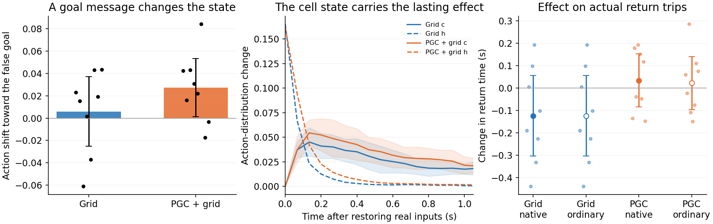

# Goal-conditioned state in the original RL networks

These are the original square-arena reward-trained LSTMs: eight Grid models and eight PGC+grid models. The actor and every policy weight stayed unchanged. No heading-supervised substitute agent was used.

We replayed one second of each agent’s actual recent experience while changing only its saved goal snapshot to point 15° to one side. We then inserted the resulting state at the real physical location, restored the real goal message and let the original actor continue.

| Measure, averaged across eight trained seeds | Grid | PGC + grid |
|---|---:|---:|
| Initial movement-probability shift toward fictitious goal | 0.005895 | 0.0272 |
| Action effect after1s: c-only | 0.01749 | 0.02146 |
| Action effect after1s: h-only | 0.0006472 | 0.001726 |
| First-second mean path change, mm | 8.086 | 9.078 |
| Return-time change, seconds | -0.1237 | 0.03408 |

The altered goal message changes the original actor. The signed first-action result above checks whether its translational component moves toward the fictitious goal; it does not include turning actions. For this particular goal-conditioned state substitution, the persisting action effect resides chiefly in c. The immediate h contribution fades quickly. Both trained populations show this organization.

A lasting influence is not a ring attractor. The native versus ordinary-goal comparisons in the full summary test whether PGC input improves recovery; the existence of a persisting c effect by itself does not answer that question. The table reports actual path and return-time effects. Neither the total state norm nor the hybrid-component comparison is an equal-amplitude general comparison of h and c importance.

Dots represent trained seeds; intervals are descriptive95% intervals across seeds. The pilot preceded the fixed exploratory replication. Exact sign-flip statistics and every seed/trial count are in [cohort_summary.json](cohort_summary.json). No model was excluded. The external goal snapshot remains supplied throughout the task, so this is goal-conditioned recurrent processing, not a demonstration that the goal must be stored without a cue.

Validation: the unchanged recent input history reconstructs the original state; c-only edits leave the first action distribution unchanged; native/ordinary substitutions in Grid-only models give bitwise-identical complete neural and behavioral arrays. Frozen checkpoint/source hashes are verified for every model.
