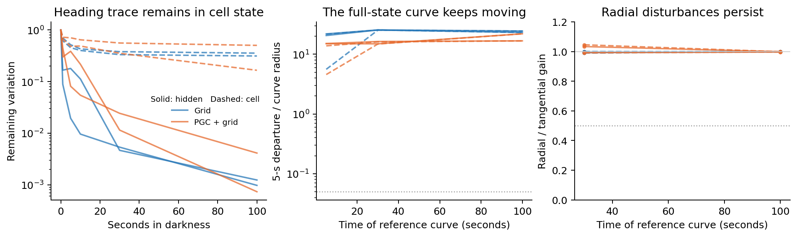

# What the original LSTMs retain in darkness

**A long-lived heading trace survives mainly in the LSTM's cell state. Radial disturbances persist about as strongly as tangential disturbances. This behaves like broader slow memory, with little expression in the navigation actor during darkness.**



Each line is one original trained model. Blue: Grid. Orange: PGC + grid. Left: hidden state is solid, cell state dashed. Middle and right: raw state coordinates are solid, separately RMS-scaled hidden/cell coordinates dashed. Dotted lines mark the frozen candidate thresholds.

We used the two original seeds from each population and preselected context 0. The actual renderer and original CNN established 768 different headings during two seconds of turning. After vision became black, every heading family member received identical inputs: the same actual grid code, saved goal code, turn action and reward. Position and last movement direction stayed fixed. We followed all 512 hidden-plus-cell coordinates for 100 seconds.

The analysis followed [Ságodi et al.'s slow-manifold approach](https://arxiv.org/html/2408.00109v2): inspect extended recurrent flow, reconstruct a possible closed memory set and test its dynamics. Their trained LSTM examples contain slow rings with stable points and saddles. Here, full-state nearest-segment distances replace their task-output-based angular reconstruction. No two-dimensional decoder defines our candidate geometry.

**The curve keeps moving.** At 5, 30 and 100 seconds, we measured the dense observed heading curve, checked its closure and possible folding, and sampled it uniformly along its length. We then ran those states forward and measured distance to the fixed earlier curve. At the primary 30-second reference, five more seconds moved the states **15–26 curve radii away**, in both coordinate metrics. None of the four models passed the frozen full-state invariance screen.

**Random disturbances were too easy a test.** A two-dimensional slow plane can preserve a circle-shaped trace while most randomly chosen directions quickly decay. We therefore pushed states inward and outward from the curve, using a radius vector projected perpendicular to the tangent. A ring should correct that radial mistake faster than it loses angular memory. At 30 seconds, the five-second radial/tangential gain ratios were **0.99–1.03** in raw coordinates, and **0.99–1.05** after RMS scaling. Radial mistakes survived almost as strongly as angular differences. This identifies the missing selective attraction.

**The remaining signal is mostly cell memory.** After 100 seconds, cell-state variation across starting headings retained **17–50%** of its initial radius. Hidden-state variation retained only **0.07–0.41%**. More than **99.9999%** of the surviving raw state variance was in the cell coordinates. The actor's probability variation across headings was only **2e-9 to 1.1e-6 RMS** under this common dark-turn input. This describes expression in this condition; the retained cell information may be expressed differently after inputs change.

A [mean-only diagnostic](mean_shift_diagnostic.json) separated the common background from the heading-specific pattern. Shared movement of the mean state accounted for at least **99.98%** of the matched-state displacement energy between five and thirty seconds. Removing that common translation still left changes in the heading curve's shape: the 90th-percentile residual was **0.60–0.88 curve radii**. Between thirty and one hundred seconds it was **0.20–0.59 radii**. The trace is therefore both carried by a drifting background and gradually deformed.

These are tests of the original agents, which were trained with continuous vision. The new agents trained with blackouts require their own primary test inside their trained four-second gap duration. The long tests here characterize the original recurrent mechanism; they are not a performance criterion for a four-second memory task.

The [protocol](protocol.json) was frozen before extended data collection. The [summary](summary.json) preserves all four outcomes. Model folders contain full-state trajectories and metrics. Five implementation controls pass: exact full-state projection, a rotating attracting ring, a shrinking linear plane, a folded line and a collapsed point. The shrinking-plane control specifically checks that radial/tangential recovery is not mistaken for ring attraction.

Reproduce from the repository root:

```bash
OPENBLAS_NUM_THREADS=2 /opt/anaconda3/bin/python -m pytest tests/test_lstm_heading_curve_flow.py -q
OPENBLAS_NUM_THREADS=2 /opt/anaconda3/bin/python scripts/lstm_heading_curve_flow.py
OPENBLAS_NUM_THREADS=2 /opt/anaconda3/bin/python scripts/plot_lstm_heading_curve_flow.py
```

There is one preselected context per model and two trained seeds per population. These are mechanistic pilot cases, not an estimate of a population-level performance advantage.
