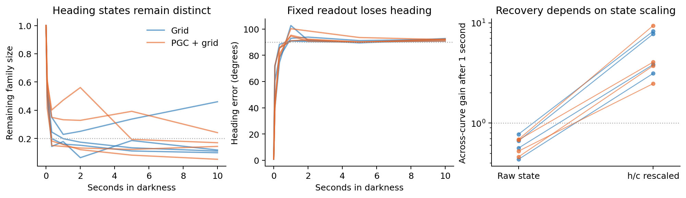

# Heading memory inside the original navigation LSTMs

**Both populations retain heading information, but none of these eight cases passes the frozen screen for an attracting heading-memory ring.**



We tested two original 1-billion-frame models per population, in two actual task contexts each. Every context used its real goal snapshot, room appearance, position and starting recurrent state. We varied only initial body heading, then gave all versions the same turn command. They saw the room for 30 updates (2 seconds), followed by darkness for up to 10 seconds.

The agent turned in place: its position, saved last movement direction and spatial code stayed **exactly constant**. Thus changing body heading was distinct from the direction encoded by the PGC input. Darkness was a black image passed through the original trained visual encoder. All maps, recurrent weights and actor weights were unchanged.

| After 5 seconds of darkness | Grid | PGC + grid |
| --- | ---: | ---: |
| Remaining size of the heading-state family | 19.2% | 19.8% |
| Heading error using the readout fixed before darkness | 90.1° | 90.9° |
| Starting-angle error after fitting a new readout at that time | 1.25° | 1.07° |

Values are descriptive averages across four contexts per population. Contexts are nested within two model seeds and are not independent trained-model replicates. The physical contexts also differ between models; these means are not a matched estimate of a population effect.

**The memory is still present, but a fixed interpretation of the activity no longer works.** Re-fitting the analysis readout reveals information that survived in the altered activity pattern. That readout never controls the agent or supplies its inputs.

For the dynamical test, we made tiny disturbances along and across the full 512-dimensional hidden-plus-cell-state heading curve. We followed the changing curve and separated phase shifts from distance away from it. The result depends strongly on the distance metric. After five seconds of darkness, a one-second disturbance across the curve retained **44–78%** of its size in raw state coordinates, while an along-curve disturbance retained **95–99%**. This suggests some separation between faster transverse changes and slower angular-memory changes. When hidden and cell states were separately scaled by their typical activity, across-curve disturbances instead grew **2.5–9.4 times**. These are different disturbance ensembles as well as different distance metrics. The attraction interpretation therefore needs both results, alongside the preserved information and failed fixed readout.

Changing the initial tangent's angular sampling changed the primary transverse gains by at most 1.2%. All eight cases fail the combined frozen candidate screen. The [raw-coordinate sensitivity](raw_metric_sensitivity.json) is explicitly post-screen and leaves the original thresholds and outcomes intact. A separate [fixed-weight baseline correction](fixed_weights_time_centered_sensitivity.json) reduces starting-angle error to 11–36°, compared with 0.5–1.8° when the readout is fully refitted. Thus the readout change involves more than a common activity offset.

This result motivates the visual-blackout training experiment: teach the same navigation actor to use memory during brief gaps, then repeat this assay before testing predictive-input removal and restoration. Here the predictive code was deliberately held constant so it could not reveal changing heading.

The [frozen protocol](protocol.json) records candidate thresholds and source/checkpoint/context hashes. [Summary](summary.json) retains all eight outcomes. Each model folder contains detailed metrics and full-state snapshots. Initial curve tangents use actual rendered neighbors with a doubled-resolution check; subsequent recurrent derivatives are exact and agree with independent finite differences to relative error below 2.7e-8. Four implementation tests passed, covering native stationary-turn physics, motion-corrected decoding, angular wraparound and a false-positive control where re-fitting decodes a collapsing circle.

Reproduce from the repository root:

```bash
/opt/anaconda3/bin/python -m pytest tests/test_lstm_heading_memory_probe.py -q
/opt/anaconda3/bin/python scripts/lstm_heading_memory_probe.py
/opt/anaconda3/bin/python scripts/plot_lstm_heading_memory.py
```

For continued models, supply `--model-manifest` with entries containing `condition`, `seed`, `checkpoint` and `config`, and use a separate `--out` directory. The native archives supply the shared initial context, so results for continued agents should explicitly describe whether they inherit the original starting recurrent state or regenerate histories under their own weights.
