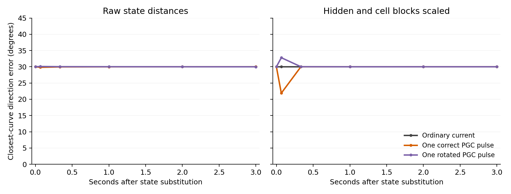

# A brief predictive cue after a direction-memory disturbance

Each thin line is a trained PGC model, averaging its contexts when there are two; thick lines average models. Both signs of the 30° state substitution and the ±60° wrong-cue rotations are retained. The two panels show different state-distance metrics. Grid-model cue branches are an exact identity control. Sampled angles and contexts are not independent trained-model repetitions.

We first let the original renderer, spatial maps and LSTM process actual forward travel from different directions to the same location. After an explicit stop, the network receives ordinary current grid code and black RGB. At 1 second we replace its full recurrent state with the naturally elicited state for a direction 30° away. A predictive cue is restored for exactly one update (1/15 second), or rotated deliberately; then ordinary code resumes. The saved goal and all other input slots stay unchanged.

The angle is measured by the nearest point on the full 512-coordinate reference curve, not by a PCA projection. Correct-pulse trajectories supply the reference for both correct and wrong cues. All results also include off-curve distance, reference geometry, phase coverage, matched-branch errors and original actor probabilities. A curve angle is only interpretable together with those checks.

Across 1 PGC models and 2 contexts, the largest absolute change in the 30° discrepancy three seconds after a correct pulse is **0.030°**, considering both distance metrics. The substituted direction largely remains. Any larger immediate shift in the block-scaled metric should be read alongside the off-curve distances: a brief input response can move the state toward the reference without durably repairing its memory. The largest mean action-probability change caused by the phase substitution across the ordinary/correct-pulse branches is 0.012727.

The separate radial-recovery and observable-history assays characterize the geometry of the trace. Persistent cue influence alone could also occur in a non-attracting memory system.

[Protocol](../protocol.json) · [All pilot contrasts](summary.json). Individual `result.json` files retain every branch, both distance metrics and input/checkpoint hashes. `pulse_states.npz` retains full trajectories locally. Reproduce with `scripts/lstm_travel_cue_pulse.py` and regenerate this figure with `scripts/plot_lstm_travel_cue_pulse.py`.
