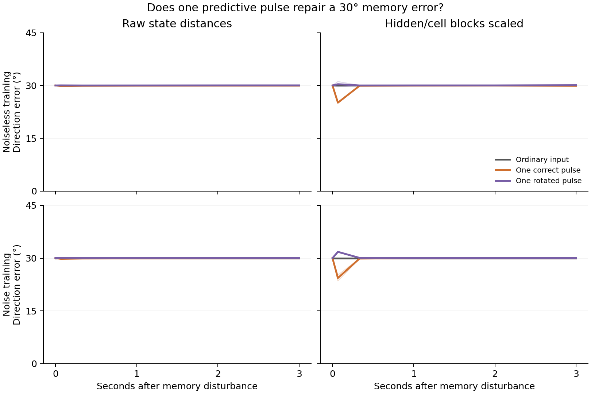

# A brief cue after longer training

**The substituted direction largely remains in both training arms.** Three seconds after the correct pulse, its largest effect on the 30° discrepancy is 0.137°, across both PGC models, all four contexts and both distance metrics.

We displaced the complete LSTM state to the state elicited by movement 30° away, then supplied one correct predictive pulse, an ordinary-grid pulse, or a deliberately rotated predictive pulse. The cue lasts one update. The saved goal and every other input stay fixed. The plot averages the two signs of the state displacement and, for the wrong cue, both rotation signs.

Rows keep noiseless and noise-trained models separate. Each thick line averages two contexts of one model; thin lines show those contexts. Both arms descend from the same original seed-1 checkpoint. Grid cue branches are exact identity controls. All eight prespecified model/context cases ran successfully.

The angle uses the nearest point on the full512-state curve. Every result also retains distance off that curve, phase coverage, matched-branch state errors and actor effects. The companion geometry/recovery assays determine whether the family behaves as an attracting ring; the short pulse response is a separate measurement.

These late pulses refer to the stored actual travel direction after movement has stopped. The new blind-reorientation task separately tests a pulse at the actual movement endpoint, before the remembered direction is used for a blind turn.

[Frozen cohort](cohort_protocol.json) · [All numerical summaries](summary.json) · [Original pulse method](../protocol.json). Individual result files retain every condition, both metrics and exact checkpoint/input hashes. Recreate this figure with `python scripts/plot_final75_travel_pulse.py`.
